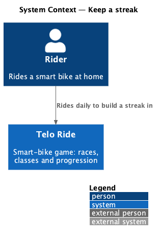
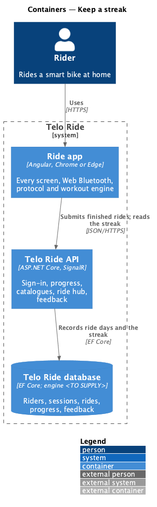
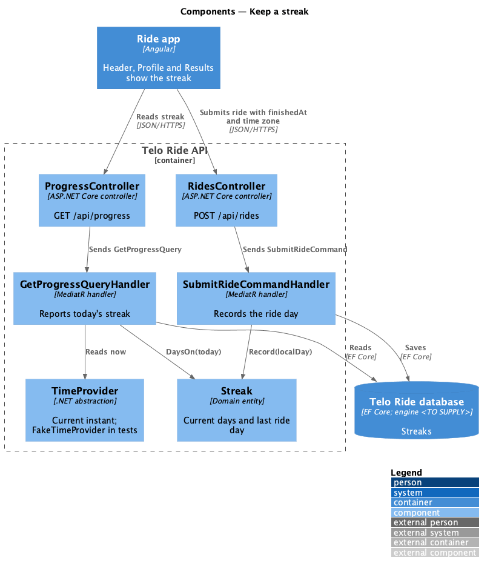
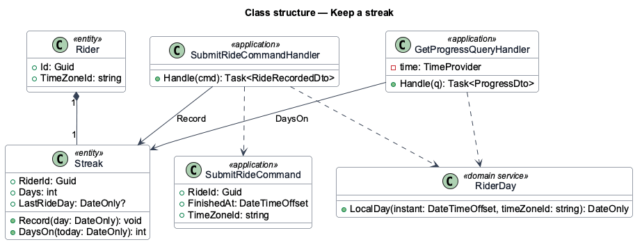
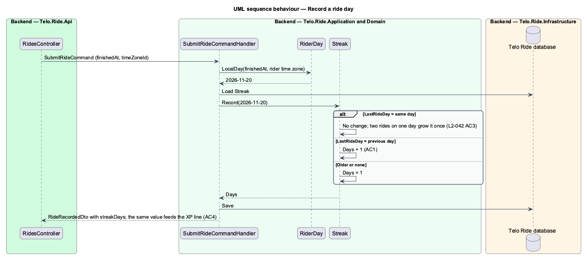
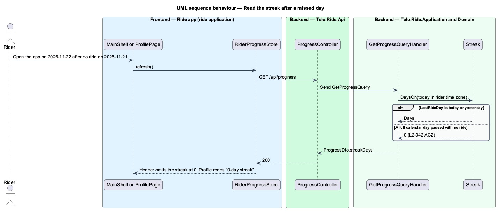

# Keep a streak

## Overview

A streak rewards riding on consecutive days. It shows in the app header, on Profile and as an XP
line on Results, and it earns "{n}-day streak" +n × 10 XP on every finished ride (L2-037 AC4).

- **streak** — count of consecutive calendar days, ending today or yesterday, on each of which the
  rider finished at least one ride
- **calendar day** — date in the rider's time zone, from midnight to midnight
- **ride day** — calendar day on which a ride finished

The backend keeps the streak (L2-044), so every device and every screen shows one value
(L2-042 AC4). A second ride on the same day does not grow it. A full calendar day with no
finished ride resets it to 0.

## Description

- **`Streak`** — value in `Telo.Ride.Domain` that each `Rider` owns (stored in the rider's row),
  holding `Days` and `LastRideDay`. `Record(day)` leaves the streak unchanged for a second ride
  on `LastRideDay` or for a ride on an earlier day (a ride submitted late never breaks a streak),
  adds 1 when `day` is the day after `LastRideDay`, and otherwise sets it to 1. `DaysOn(today)`
  returns `Days` when `LastRideDay` is today or yesterday, and 0 otherwise.
- **`RiderDay`** — domain service. `LocalDay(instant, timeZoneId)` converts an instant to the
  rider's calendar day.
- **`Rider.TimeZoneId`** — IANA time zone of the rider. The Ride app sends its
  `Intl.DateTimeFormat().resolvedOptions().timeZone` with each submitted ride as `timeZoneId`.
  Each ride's day is taken in the zone it was submitted with, and the rider's zone becomes the
  latest ride's, which decides "today" when the streak is read; until the first ride it is UTC.
  A rider who flies east or west may so gain or lose a day once; the requirement does not say
  otherwise.
- **`SubmitRideCommandHandler`** — converts `finishedAt` with `RiderDay`, calls
  `Streak.Record`, and passes the resulting `Days` to `XpCalculator`, so the XP line uses the
  streak after the ride (see `earn-xp-and-rider-levels`). A DNF or discarded ride does not record
  a ride day, because the requirement counts finished rides.
- **`GetProgressQueryHandler`** — reads the current instant from `TimeProvider`, converts it with
  `RiderDay`, and returns `Streak.DaysOn(today)` as `ProgressDto.streakDays`. Tests advance a
  `FakeTimeProvider` across midnight; none sleeps.
- **Where it shows** — the header's streak (`home/show-the-app-header`, absent at 0) and
  Profile's meta line, "760 XP to level 8 · 4-day streak" (rides and kilometres join it with
  slice 13.3), both from `ProgressDto.streakDays`, and the "{n}-day streak" XP line of the ride's
  answer, which Results shows with journey 11 (L2-042 AC4).

## Requirements

| L2 ID | Refines (L1) | Requirement |
|-------|--------------|-------------|
| `L2-042` | `L1-008` | Each calendar day in the rider's time zone with at least one finished ride shall extend the streak by one. |
| `L2-042` (AC2) | `L1-008` | After a calendar day with no finished ride, the streak shall be 0 when the next day starts. |
| `L2-042` (AC3) | `L1-008` | Two rides on one day shall grow the streak once. |
| `L2-042` (AC4) | `L1-008` | The streak shall be the same in the header, on Profile and in the XP line. |

## Diagrams

### System context

The rider rides on consecutive days in Telo Ride to build the streak. No external system takes
part.

### Containers

The Ride app submits each finished ride with its finish instant and time zone; the Telo Ride API
records the ride day and keeps the streak in the database.

### Components

`SubmitRideCommandHandler` records the ride day on `Streak`. `GetProgressQueryHandler` reads the
streak for today using `TimeProvider`.

### Class structure

Each `Rider` owns one `Streak`. Both handlers convert instants to calendar days through
`RiderDay`.

### Behaviour — record a ride day

The handler converts the finish to the rider's calendar day and records it. A second ride that day
leaves the streak unchanged (L2-042 AC3); the next day adds one (AC1).

### Behaviour — read the streak after a missed day

When a full calendar day passes with no ride, the query returns 0 (L2-042 AC2). The header then
omits the streak and Profile reads "0-day streak".

