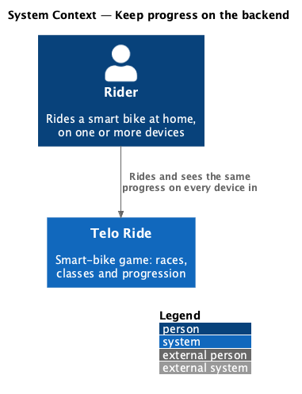
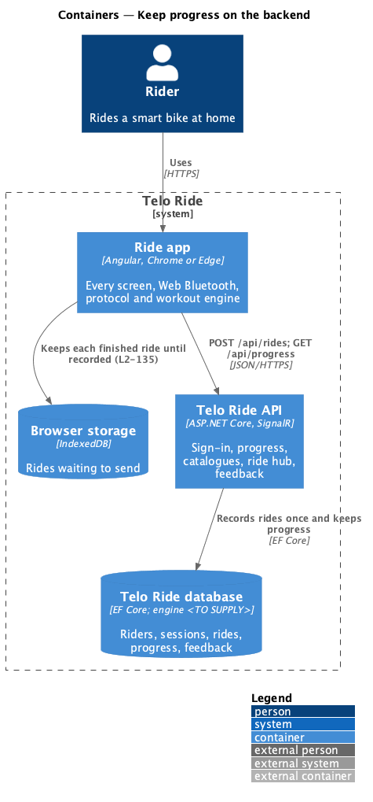
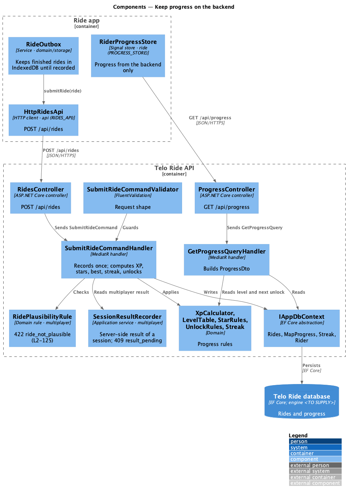
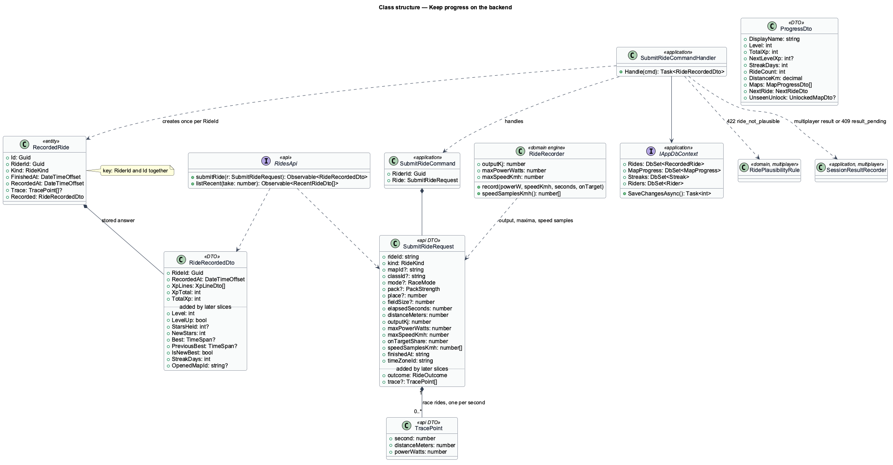
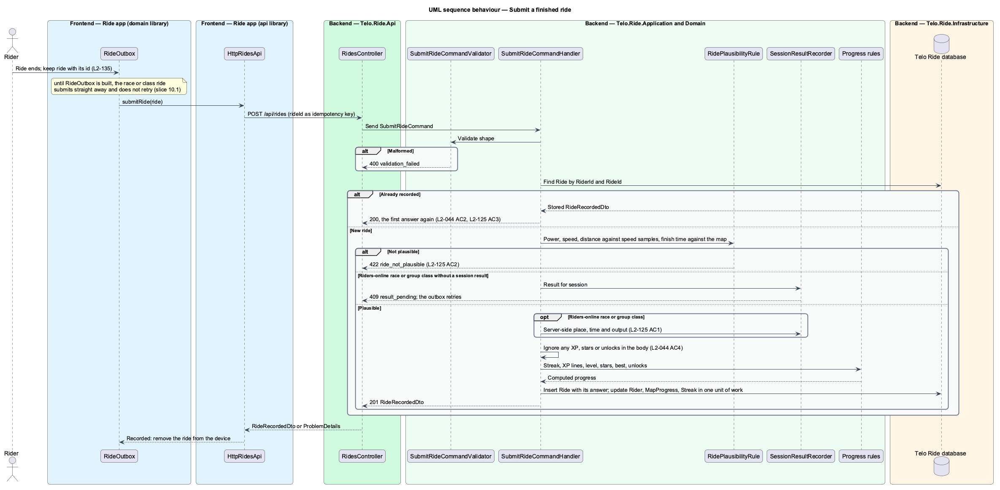
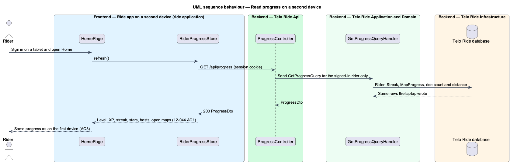

# Keep progress on the backend

## Overview

Telo Ride's progression is XP, rider levels, stars, best times, a streak and map unlocks. The
backend computes and keeps all of it, so a rider sees the same progress on every device they sign
in on, and no browser can award itself progress (L1-008).

- **progress** — rider's total XP, level, streak, stars and best time per map, open maps, ride
  count and distance
- **finished ride** — race, class or custom workout that ended, kept in the rider's history
- **ride id** — identifier the Ride app assigns to a ride when it starts; it is the idempotency
  key of the submission
- **idempotency key** — value that makes a repeated request take effect once

The Ride app submits each finished ride once it ends, or later when the network returns
(`performance/ride-without-a-network`, L2-135). The backend records the ride once, computes every
progress value from the ride itself, and returns them. Any XP, stars or unlocks a client sends are
ignored. Every screen that shows progress reads it from the backend.

## Description

The slice runs from the outbox in the Ride app to the database.

- **`RideOutbox`** — service in the Ride app's `domain/storage`, owned by
  `performance/ride-without-a-network`. It keeps each finished ride in IndexedDB with its ride id
  and submits it through `RIDES_API`; it removes the ride once the backend has recorded it.
  Until it is built, the race and the class ride submit a finished ride straight through
  `RIDES_API` as it ends, and a submission that fails is not retried (slice 10.1).
- **`RidesApi`** / **`HttpRidesApi`** — contract, `RIDES_API` token and HTTP client in `api`.
  `submitRide(request)` posts a `SubmitRideRequest`; `listRecent(take)` serves Profile.
- **`SubmitRideRequest`** — ride facts only: ride id, kind (`race` or `class`), the map with
  its race mode (`solo` or `bots`), pack strength, place and field size, or the class; elapsed
  seconds, distance in metres, output in kJ, maximum power and speed, the share of running
  seconds on target (0 to 1, slice 10.2), the speed of each second
  ridden in km/h (at most 14,400, four hours), the finish instant and the IANA time zone. The
  app's `RideRecorder` (`domain/engine`) gives the ride its id when it starts and keeps the
  output, the maxima and the speed samples in a buffer sized for four hours; the distance is what
  the samples add up to. A race's speed is its virtual speed, a class's the bike's speed (L2-022). The
  slices that use them add the outcome of a ride that did not finish and
  the race's per-second trace (`TracePoint`: second, distance, power) recorded by
  `RaceRideRecorder` (`race/race-the-ghost-and-bots`). It carries no XP, stars or unlocks; a body
  that sends them is read without them.
- **`RidesController`** — controller in `Telo.Ride.Api` for `POST /api/rides`. It requires a
  session (fallback policy) and sends one `SubmitRideCommand` for the signed-in rider.
- **`SubmitRideCommandValidator`** — FluentValidation validator. It checks the request's shape
  and refuses a malformed request with 400 `validation_failed`: a ride id; a kind; for a race a
  map in the catalogue, a mode, a pack for a bots race, and a place within the field; for a class
  a class in the catalogue; 1 to 14,400 elapsed seconds; no negative distance, output, power or
  speed; no more speed samples than seconds; a finish instant; and a known time zone.
- **`RidePlausibilityRule`** — domain rule owned by `multiplayer/record-results-nobody-can-change`.
  The handler calls it before recording; an implausible ride is refused with 422 and the code
  `ride_not_plausible` (L2-125 AC2).
- **`SessionResultRecorder`** — service owned by the same feature. For a riders-online race or
  group class, the handler takes the place, time and output from the recorder's server-side
  result instead of the request (L2-125 AC1). A submission that arrives before the session result
  exists is refused with 409 and the code `result_pending`; `RideOutbox` retries it.
- **`SubmitRideCommandHandler`** — MediatR handler. It looks up the ride by rider and ride id;
  a recorded ride returns its stored answer unchanged, with 200. A new ride is checked by
  `RidePlausibilityRule`, recorded and answered with 201. Slice 10.1 records the ride and its
  answer; the later slices of journey 10 add the progress rules. A new ride runs the progress rules in
  order: `Streak.Record`, `XpCalculator`, `LevelTable`, `MapProgress.RecordFinish`, `StarRules`
  and `UnlockRules`. It inserts the `RecordedRide` with its answer and updates `Rider`, `MapProgress`
  and `Streak` in one unit of work.
- **`RecordedRide`** — entity (named so because `Telo.Ride` is the solution's namespace) holding
  the ride's facts, keyed by rider and ride id, the race trace where present, and the `RideRecordedDto` it answered with. `GET /api/maps/{mapId}/best-ride` serves the trace of the rider's best ride on a map as the ghost (`race/race-the-ghost-and-bots`).
- **`RideRecordedDto`** — answer with the ride id and the instant it was recorded, and, as the
  slices that compute them arrive, the XP lines and total, the new total XP and level,
  `LevelUp`, stars held and new stars, best and previous best, the streak and any opened map.
  Results renders it (`results/show-xp-stars-and-personal-best`).
- **`GetProgressQueryHandler`** — builds `ProgressDto` for the signed-in rider only (L2-128).
- **`IAppDbContext`** — application abstraction over EF Core; tests run on EF Core InMemory and
  inject database faults through it.
- **`RiderProgressStore`** — Ride app store (`PROGRESS_STORE`). It refreshes from
  `GET /api/progress` on start, after each recorded ride, and on screens that show progress. It
  holds no progress the backend did not return.

The concurrency rule for two submissions of one ride id arriving at once is the `RecordedRide` key, rider
and ride id together; the second insert fails and the handler returns the stored answer.

## Requirements

| L2 ID | Refines (L1) | Requirement |
|-------|--------------|-------------|
| `L2-044` | `L1-008` | For a signed-in rider, every screen that shows level, XP, streak, stars, bests, open maps or rides shall take the values from the backend. |
| `L2-044` (AC2) | `L1-008` | When the app submits a finished ride, the backend shall record it once (an idempotency key per ride), compute XP, stars, best, streak and unlocks, and return them. |
| `L2-044` (AC3) | `L1-008` | When the rider signs in on a second device, Home there shall show the same progress. |
| `L2-044` (AC4) | `L1-008` | The backend shall ignore XP, stars or unlocks a client sends and compute its own. |

## Diagrams

### System context

The rider rides on one or more devices and sees the same progress on each. No external system
takes part.

### Containers

The Ride app keeps each finished ride in browser storage until the Telo Ride API has recorded it,
and reads progress back from the API, which keeps it in the database.

### Components

`RideOutbox` submits through `HttpRidesApi`. On the backend, the validator guards the command's
shape; `SubmitRideCommandHandler` checks plausibility, takes a multiplayer result from
`SessionResultRecorder`, and applies the progress rules through `IAppDbContext`;
`GetProgressQueryHandler` serves `RiderProgressStore`.

### Class structure

`SubmitRideCommand` wraps the client's `SubmitRideRequest`, which holds facts only. The handler
creates one `RecordedRide` per ride id and stores its `RideRecordedDto` as the answer to repeat. A race ride also stores its per-second `TracePoint` list, which later serves the ghost.

### Behaviour — submit a finished ride

An implausible ride is refused with `ride_not_plausible`; a multiplayer ride submitted before its
session result exists is refused with `result_pending`. A repeated ride id returns the first
answer. A new ride runs the progress rules and is saved in one unit of work, after which the
outbox drops it.

### Behaviour — read progress on a second device

A second device reads the same rows through `GET /api/progress`, so Home shows the same progress
(L2-044 AC3).

## Open questions

- **Rides that do not finish.** A race that ends as a DNF and a class the rider leaves are not
  submitted yet; whether they count as rides, earn XP or keep a streak is `<TO SUPPLY>`.
- **A lost submission.** Until `RideOutbox` (L2-135) keeps finished rides on the device, a ride
  whose submission fails is not recorded.
