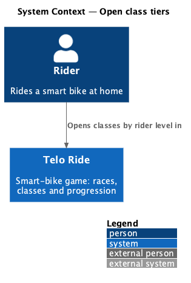
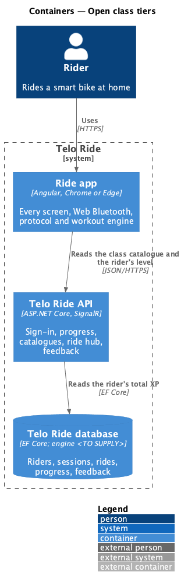
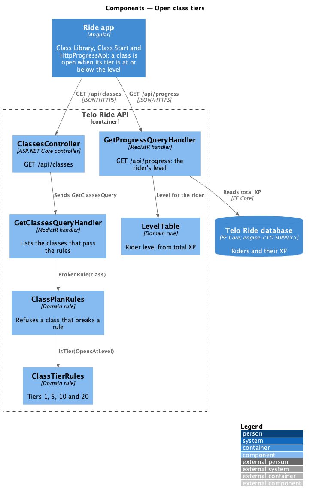
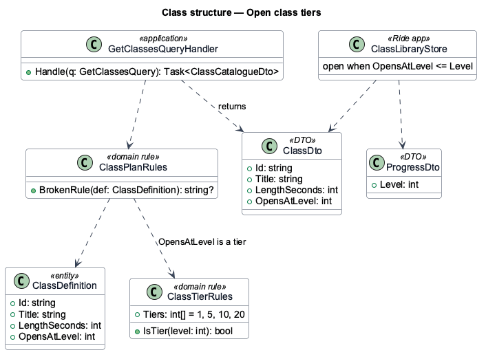
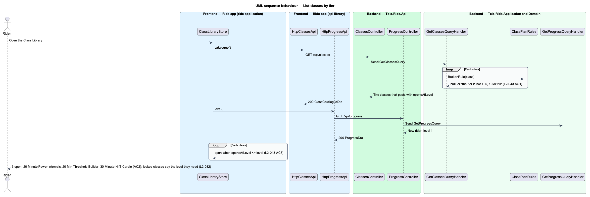

# Open class tiers

## Overview

Telo Ride's Classes door offers video classes, each with a bike plan that follows its video.
Classes open by rider level, so a new rider starts with short, approachable classes and longer
ones open as the rider progresses (L1-008, L1-014).

- **class tier** — rider level at which a class opens: 1, 5, 10 or 20
- **open class** — class whose tier the rider's level has reached
- **locked class** — class whose tier is above the rider's level; it shows the level it needs
  (`classes/browse-the-class-library`, L2-082)

A new account has three classes open: 20 Minute Power Intervals, 20 Min Threshold Builder and
30 Minute HIIT Cardio. The backend decides which classes are open from the rider's level, so the
answer is the same on every device (L2-044). This feature defines the tier rule; listing and
showing the classes belong to the classes subsystem.

## Description

- **`ClassDefinition`** — catalogue entity in `Telo.Ride.Domain` with the class's id, title,
  length and `OpensAtLevel` tier. The catalogue is data served by `GET /api/classes`
  (`classes/browse-the-class-library`, L2-080).
- **`ClassTierRules`** — domain rule. `Tiers` holds the four tiers, 1, 5, 10 and 20, and
  `IsTier(level)` says whether a class's `OpensAtLevel` is one of them.
- **`ClassPlanRules.BrokenRule`** — the rule check `GetClassesQueryHandler` and
  `GetClassQueryHandler` already run on every class. It also refuses an `OpensAtLevel` that is
  not a tier, so such a class is not listed and its address is `404 class_not_found` (L2-043
  AC1, L2-080 AC4).
- **`GetClassesQueryHandler`** — MediatR handler behind `ClassesController`. It returns each
  valid class as a `ClassDto` with its `opensAtLevel`. The catalogue reads the same for every
  rider, so the Ride app can keep it on the device (L2-135).
- **`HttpProgressApi`** — the `PROGRESS_API` client from slice 12.1, now also bound on the Class
  Library and Class Start routes. It reads the rider's level from `GET /api/progress`, where
  `LevelTable` resolves it from the rider's total XP. The answer is the same on every device
  (L2-044).
- **`ClassLibraryStore`** and **`classUnlockedGuard`** — in the Ride app. A class is open when
  `opensAtLevel <= level`. A locked card says the level that opens it, and a locked class's
  Class Start address opens the Class Library instead
  (`classes/browse-the-class-library`, L2-082). After a level-up, the next visit reads the new
  level and the tier's classes are open (L2-043 AC3).

The tier check has a test of `ClassTierRules` for each level from 0 to 21, plus an acceptance
test through the API. The open rule has behaviour specs for the new rider (level 1), the mid
rider (level 7) and the veteran (level 18).

## Requirements

| L2 ID | Refines (L1) | Requirement |
|-------|--------------|-------------|
| `L2-043` | `L1-008` | A class's tier in the catalogue shall open it at level 1, 5, 10 or 20. |
| `L2-043` (AC2) | `L1-008` | A new account shall have 20 Minute Power Intervals, 20 Min Threshold Builder and 30 Minute HIIT Cardio open. |
| `L2-043` (AC3) | `L1-008` | When the rider reaches a tier's level, that tier's classes shall be open. |

## Diagrams

### System context

The rider opens classes by levelling up in Telo Ride. No external system takes part.

### Containers

The Ride app reads the class catalogue and the rider's level from the Telo Ride API, and opens
each class whose tier the level has reached.

### Components

`GetClassesQueryHandler` lists each `ClassDefinition` whose tier `ClassTierRules` accepts.
`GetProgressQueryHandler` resolves the rider's level with `LevelTable`.

### Class structure

`ClassDefinition` holds its `OpensAtLevel`. `ClassPlanRules` refuses one that `ClassTierRules`
does not accept, and the handler returns `ClassDto` with `opensAtLevel`. The Ride app compares it
with the level from `ProgressDto`.

### Behaviour — list classes by tier

For a new rider at level 1, the Class Library opens the three level-1 classes (L2-043 AC2) and
locks the rest, each with the level it needs.

