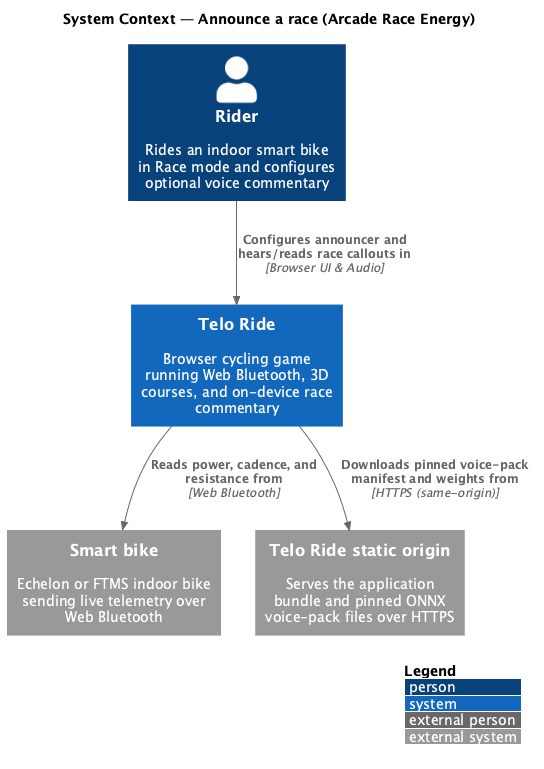
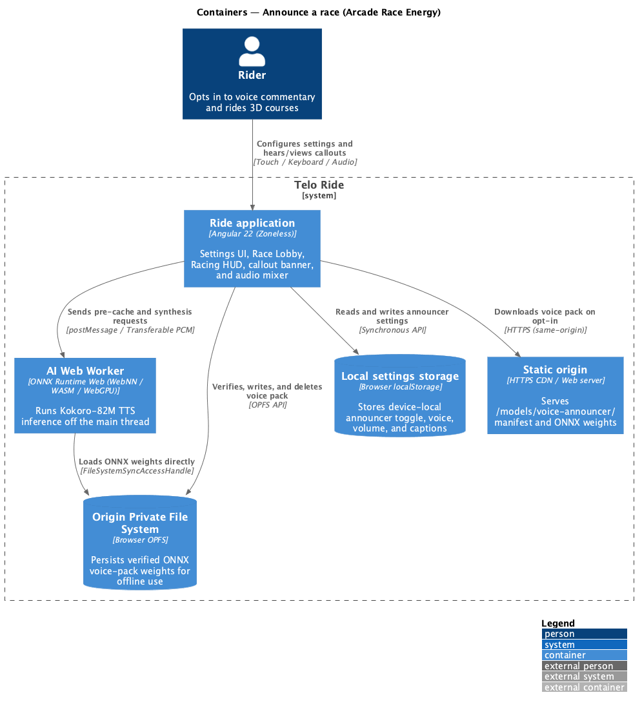
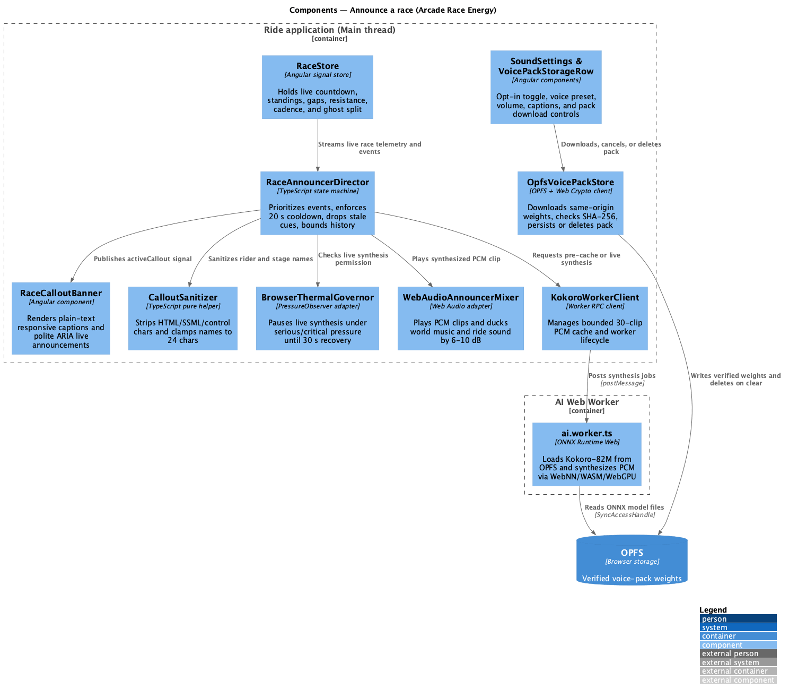
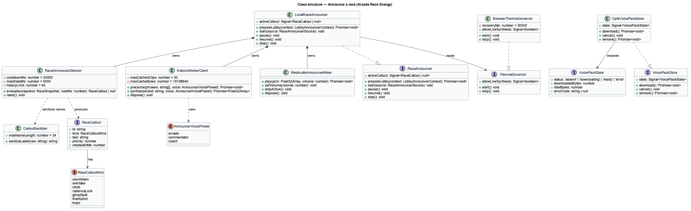
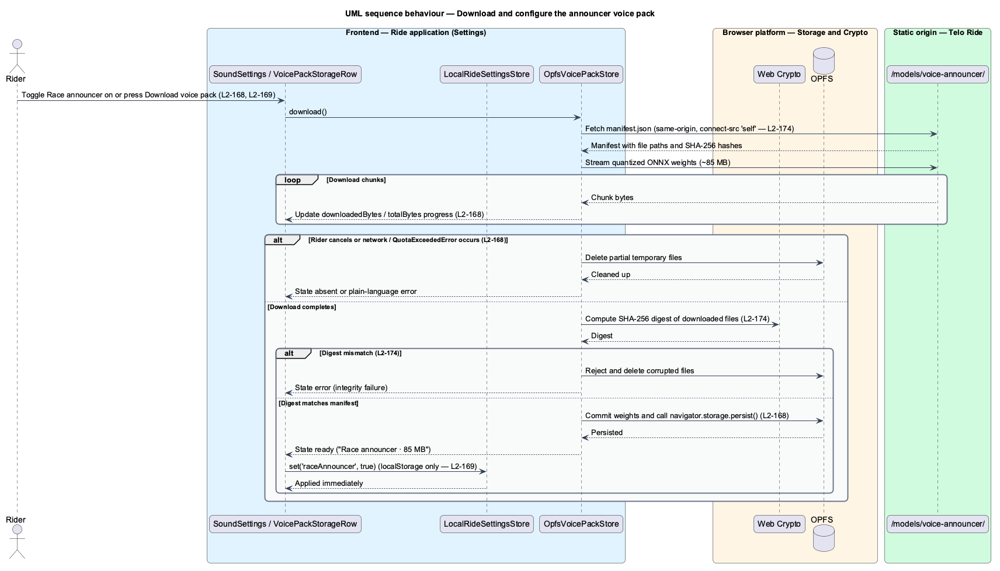
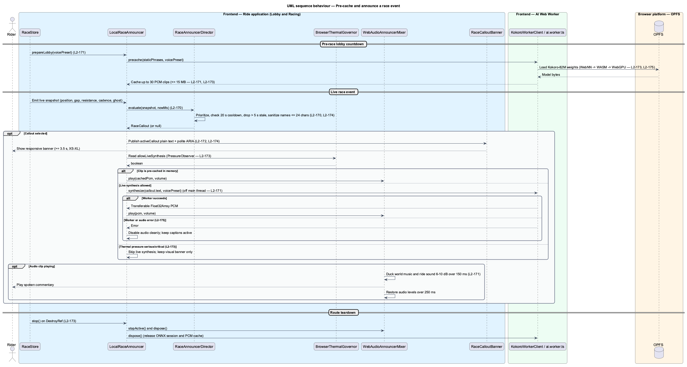

# Announce a race (Arcade Race Energy)

## Overview

Telo Ride turns an indoor smart bike into a kart-racing game in which riders race against their
personal-best ghost, bots, or other riders online across 3D courses. A race announcer adds
play-by-play energy to that experience by calling out start countdowns, overtakes, climbs, stage
cadence locks, ghost splits, and the final sprint using natural spoken audio generated on the
rider's device.

> **race announcer** — optional on-device play-by-play audio and caption system that reacts to live race events

> **voice pack** — quantized ONNX text-to-speech model (~85 MB) hosted on Telo Ride's origin and cached in the browser's Origin Private File System (OPFS)

> **callout** — short spoken and visual announcement describing one race event using live metrics from the race store

> **callout director** — deterministic event scheduler that prioritizes, throttles, and sanitizes race callouts

> **audio ducking** — temporary 6 to 10 dB reduction of world music and ride sound while an announcer clip plays

> **thermal shedding** — automatic pause of live neural speech synthesis when browser compute pressure reaches serious or critical

The feature stays off until the rider opts in and downloads the voice pack in Settings. Once stored
in OPFS, the announcer runs offline, keeps all audio and ride telemetry on the device, protects the
3D world's frame rate and multi-hour tablet memory budget, and provides synchronized visual captions
for riders with sound off or hearing loss.

## Description

The feature is a vertical slice spanning Settings, the Race Lobby, the Racing screen, a new
lazy-loaded `ai` frontend library, a dedicated Web Worker, OPFS storage, and static same-origin
model hosting. The .NET backend does not participate; announcer settings and voice packs remain
strictly on the rider's device.

**Frontend — `api` library**

- **`RideSettings`** (`settings/ride-settings.ts`) gains four local-only fields:
  `raceAnnouncer` (`boolean`, default `false`), `announcerVoice` (`'arcade' | 'commentator' | 'coach'`,
  default `'arcade'`), `announcerVolume` (`number`, `0` to `100` in steps of `5`, default `85`), and
  `announcerCaptions` (`boolean`, default `true`). `LocalRideSettingsStore` validates each field
  independently and falls back to its recommended default when missing, malformed, or out of range
  (`L2-169`).
- **`RACE_ANNOUNCER`** (`ai/race-announcer.ts`) — injection token for `RaceAnnouncer`, exposing
  `prepareLobby(context)`, `start(source)`, `stop()`, `pause()`, `resume()`, and a readonly signal
  `activeCallout: Signal<RaceCallout | null>`. When disabled, the composition root binds a zero-cost
  `NoopRaceAnnouncer` stub so the initial bundle grows by at most 2 KB gzipped (`L2-173`).
- **`VOICE_PACK_STORE`** (`ai/voice-pack-store.ts`) — injection token for `VoicePackStore`,
  exposing `status: Signal<VoicePackState>`, `download()`, `cancel()`, and `remove()`.
- **`THERMAL_GOVERNOR`** (`ai/thermal-governor.ts`) — injection token for `ThermalGovernor`,
  exposing `pressure: Signal<ComputePressureState>` and `allowLiveSynthesis: Signal<boolean>`.
- **`ANNOUNCER`** (`screen/announcer.ts`, existing) — existing polite ARIA live-region service
  called by the callout banner so screen readers hear race callouts without interrupting per-second
  timers (`L2-172`).

**Frontend — `ai` library (new, lazy-loaded via dynamic `import()`)**

- **`OpfsVoicePackStore`** — downloads the pinned manifest and ONNX weights exclusively from
  `/models/voice-announcer/` on Telo Ride's origin, streams progress to `status`, supports abort via
  `AbortController`, verifies each file's SHA-256 digest via Web Crypto before committing to OPFS,
  requests `navigator.storage.persist()` on completion, and deletes partial files on cancel, error,
  or `QuotaExceededError` (`L2-168`, `L2-174`).
- **`RaceAnnouncerDirector`** — pure, deterministic TypeScript state machine consuming live race
  signals (countdown, standings, gaps, stage resistance, target cadence, ghost split, distance to
  finish, pause state). It detects the six race event categories, enforces priority ordering
  (Finish / Final sprint > Start countdown > Overtake / Ghost pass > Climb transition > Cadence
  lock), applies a 20 s cooldown during normal racing, discards queued callouts older than 5 s,
  bounds its event history ring buffer to 64 entries, and reads every numeric metric directly from
  the race store (`L2-170`, `L2-173`).
- **`CalloutSanitizer`** — strips HTML/script tags, control characters, and SSML/phoneme markup
  from untrusted strings (multiplayer display names and stage titles) and clamps interpolated names
  to 24 characters before synthesis or caption display (`L2-174`).
- **`KokoroWorkerClient`** and **`ai.worker.ts`** — manage a dedicated Web Worker running ONNX
  Runtime Web (`onnxruntime-web`) with execution provider priority `webnn` → `wasm` → `webgpu`.
  During the Race Lobby countdown, the worker pre-synthesizes up to 30 high-frequency static clips
  into a bounded PCM cache (at most 15 MB total). Dynamic mid-race callouts synthesize off the main
  thread. On `stop()`, the client releases the ONNX session, clears PCM buffers, cancels timers,
  and terminates or idles the worker (`L2-171`, `L2-173`, `L2-175`).
- **`WebAudioAnnouncerMixer`** — plays PCM buffers through a Web Audio `GainNode` controlled by
  `announcerVolume` (ramped via `setTargetAtTime` within 100 ms), emits a ducking signal that lowers
  `WebAudioRideSound` and `ClassWorldScene` world music by 6 to 10 dB over 150 ms while speech
  plays, restores volume over 250 ms afterward, and allocates zero audio nodes when the announcer is
  off (`L2-169`, `L2-171`).
- **`BrowserThermalGovernor`** — wraps `PressureObserver` (where supported). Entering `serious` or
  `critical` pressure sets `allowLiveSynthesis` to `false`, restricting playback to pre-cached clips
  and visual captions until pressure remains `nominal` or `fair` for 30 continuous seconds
  (`L2-173`).
- **`FakeAiWorker`** (test fixture) — deterministic worker double used in Playwright and Vitest
  returning canned callouts and silent PCM buffers with zero network calls and fake-clock cooldown
  control (`L2-175`).

**Frontend — `components` library**

- **`SoundSettings`** (`wz-sound-settings`, existing) — adds the "Race announcer" switch,
  "Announcer voice" preset selector, "Announcer volume" range slider (0 % to 100 % in steps of 5),
  "Announcer captions" switch, and an inline prompt to download the voice pack when toggled on
  before download (`L2-169`).
- **`VoicePackStorageRow`** (`wz-voice-pack-storage`) — presentation row inside Settings → This
  device displaying pack status ("Not downloaded", live progress with "Cancel", or "Race announcer ·
  85 MB" with "Delete voice pack") and storage/network error messages (`L2-168`).
- **`RaceCalloutBanner`** (`wz-race-callout-banner`) — high-contrast HUD banner rendering
  `activeCallout.text` strictly as plain text for at least 3.5 s (or clip duration), paired with a
  polite `ANNOUNCER.announce` call and a quick-mute button (≥ 48 × 48 px on XS). Responsive rules
  dock it above the bottom HUD panel on XS (< 576 px, 16 px horizontal margins, max two lines),
  center it below the race header at max 480 px on SM–MD (576–991 px), and center it at max 560 px
  clear of the standings board on LG–XL (≥ 992 px). Reduced motion disables slide transitions
  (`L2-172`, `L2-174`).

**Frontend — `ride` application and static origin**

- **Settings route** binds `VOICE_PACK_STORE` (lazy-loaded on demand) and wires `SoundSettings` and
  `VoicePackStorageRow` to `RIDE_SETTINGS`.
- **Race Lobby and Racing routes** dynamically load `@telo/ai` only when `raceAnnouncer` or
  `announcerCaptions` is enabled, call `prepareLobby` during countdown, bind `RaceStore` signals to
  `RACE_ANNOUNCER.start`, pause/resume with solo race pause, and call `stop()` inside `DestroyRef`
  on route exit (`L2-170`, `L2-171`, `L2-173`).
- **Static origin (`/models/voice-announcer/`)** serves the pinned `manifest.json` (with SHA-256
  hashes) and quantized `Kokoro-82M` ONNX weight files under `connect-src 'self'` (`L2-168`,
  `L2-174`).

## Requirements

The feature realizes the following level-2 (L2) requirements. Each L2 requirement refines a
level-1 (L1) requirement, cited by identifier.

| L2 ID | Refines (L1) | Requirement |
|-------|--------------|-------------|
| `L2-168` | `L1-028` | The voice pack (~85 MB ONNX model) shall remain off and undownloaded until opt-in, shall fetch exclusively from `/models/voice-announcer/` on Telo Ride's origin with progress and cancel, shall persist in OPFS for offline use, and shall handle quota errors, eviction, and one-click deletion without disrupting rides. |
| `L2-169` | `L1-028` | Settings → Sound shall offer "Race announcer" (off), "Announcer voice" (three presets, default "Arcade hype"), "Announcer volume" (0 % to 100 % in steps of 5, default 85 %), and "Announcer captions" (independently toggleable), applying changes within 100 ms mid-ride, storing values locally only, validating malformed entries to defaults, and providing 44 × 44 px+ keyboard- and touch-accessible controls. |
| `L2-170` | `L1-028` | A deterministic director shall trigger callouts for start countdown, overtakes, climbs, stage cadence locks, personal-best ghost splits, and final sprint/finish in strict priority order with a 20 s normal-racing cooldown, 5 s stale-callout drop, immediate silence on solo pause, and factual metrics read from the live race store. |
| `L2-171` | `L1-028` | Common static callouts shall pre-synthesize during the Race Lobby into a bounded cache (at most 30 PCM clips), dynamic callouts shall synthesize exclusively inside a dedicated Web Worker, playback shall duck world music and ride sound by 6 to 10 dB over 150 ms and restore over 250 ms, and zero audio resources shall allocate when off. |
| `L2-172` | `L1-028` | Each callout shall display in a WCAG 2.2 AA visual banner for at least 3.5 s (or clip length) with polite ARIA announcements, responsive placement across XS (< 576 px, 48 × 48 px mute target), SM–MD (max 480 px), and LG–XL (max 560 px clear of standings), and instant transitions under reduced motion. |
| `L2-173` | `L1-028` | The `ai` library shall lazy-load (at most 2 KB gzipped initial chunk impact), prefer WebNN or WASM SIMD over WebGPU to preserve the 50 fps budget, shed live synthesis under `PressureObserver` `serious`/`critical` states until 30 s of recovery, bound PCM cache (≤ 30 clips, ≤ 15 MB) and history (≤ 64 entries), and release resources on route teardown within 10 MB of baseline. |
| `L2-174` | `L1-028` | Network fetches shall remain same-origin under `connect-src 'self'` with zero exfiltration of audio, telemetry, or names; interpolated strings shall strip HTML, control characters, and SSML markup and clamp to 24 characters; captions shall render strictly as plain text; and downloaded weights shall pass SHA-256 verification before OPFS commit. |
| `L2-175` | `L1-028` | The announcer shall run identically on stable Chrome and Edge without Chrome Canary or Built-in AI dependencies, degrade cleanly to captions on mid-ride worker or audio errors without affecting BLE or 3D rendering, work with `?simulate`, and test deterministically via `FakeAiWorker` and fake clocks. |

## Diagrams

### System context

The rider configures and listens to the race announcer inside Telo Ride. All speech synthesis and
storage occur on the rider's device, with static voice-pack weights served from Telo Ride's own
origin and zero data sent to external AI services.

### Containers

The Ride single-page application fetches pinned ONNX voice weights from the static origin, stores
them in the browser's Origin Private File System, and delegates neural synthesis to a dedicated
Web Worker so the main thread and Three.js renderer stay responsive.

### Components

Inside the browser application, the Settings and Racing views interact through `api` contracts with
the lazy-loaded `ai` library: `OpfsVoicePackStore` manages verified downloads, `RaceAnnouncerDirector`
schedules sanitized callouts, `KokoroWorkerClient` drives ONNX synthesis off-thread,
`WebAudioAnnouncerMixer` handles ducked playback, and `BrowserThermalGovernor` sheds live inference
under thermal pressure.

### Class structure

The `api` library defines the `RaceAnnouncer`, `VoicePackStore`, and `ThermalGovernor` interfaces
plus `RideSettings` extensions. The lazy-loaded `ai` library implements those contracts through
`LocalRaceAnnouncer`, `RaceAnnouncerDirector`, `CalloutSanitizer`, `KokoroWorkerClient`,
`WebAudioAnnouncerMixer`, `OpfsVoicePackStore`, and `BrowserThermalGovernor`.

### Behaviour — download and configure the voice pack

From Settings, the rider triggers an opt-in download from `/models/voice-announcer/`. The store
streams progress, verifies SHA-256 digests before committing to OPFS, requests persistent storage,
and cleans up partial files on cancel, quota failure, or hash mismatch (`L2-168`, `L2-169`,
`L2-174`).

### Behaviour — pre-cache and announce a race event

During the Race Lobby, the announcer pre-caches common static clips. During Racing, the director
filters and prioritizes live events from `RaceStore`, sanitizes interpolated names, checks the
thermal governor, synthesizes dynamic clips in the Web Worker, ducks ride audio during playback,
shows the responsive caption banner, and releases all resources on route exit (`L2-170` to
`L2-175`).

