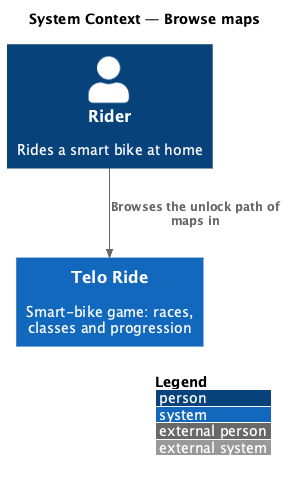
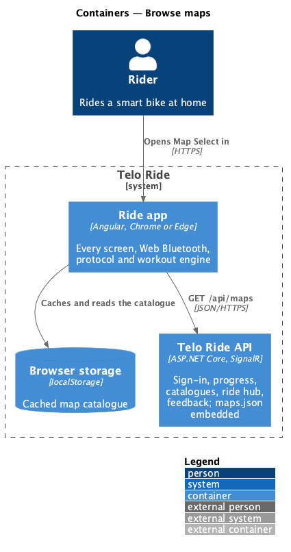
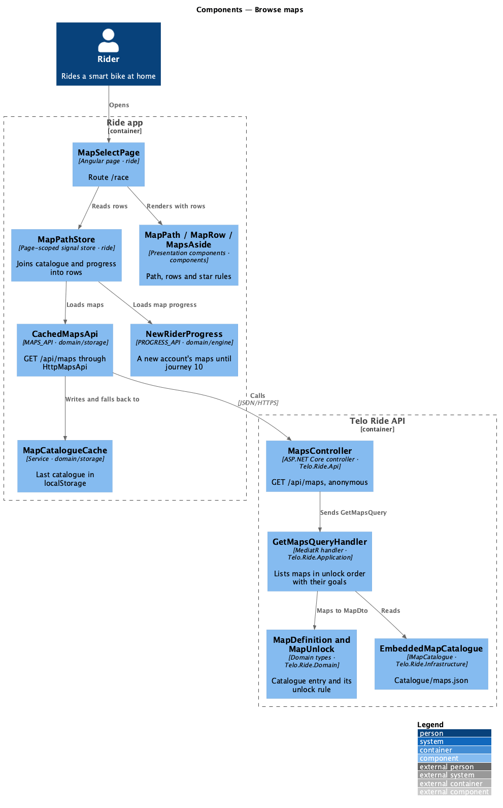
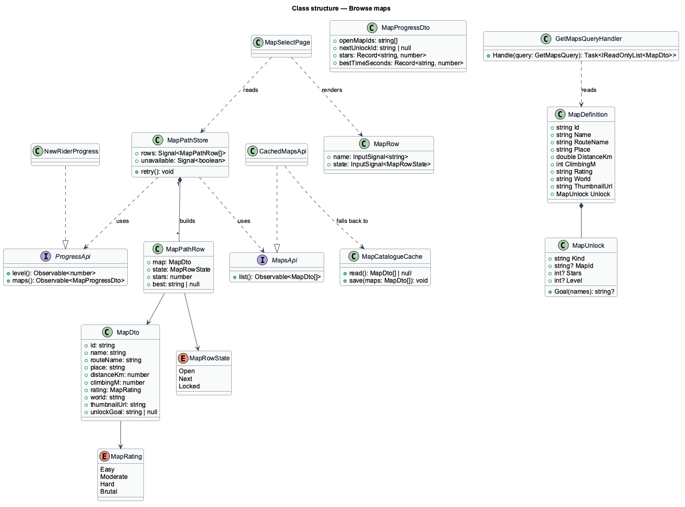
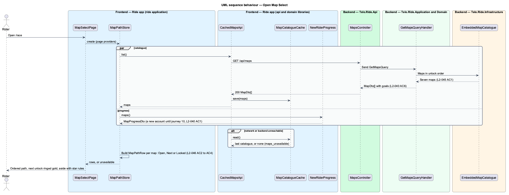

# Browse maps

## Overview

Telo Ride turns a smart bike at home into a game with two doors, Race and Classes. Behind the
Race door sits a catalogue of maps, ridden one after another as the rider improves.

> **map** — named route through a 3D world, with fixed distance, climbing, rating, elevation profile and 30:00 plan of intervals

> **map catalogue** — ordered list of every map, in the order in which maps unlock

> **unlock path** — sequence of maps in catalogue order, each map open, next or locked for one rider

> **next unlock** — first locked map, the one whose goal the rider is working towards

This feature covers two things. The first is the catalogue itself: which maps exist, what each
holds, and how a catalogue change ships without a change to app code. The second is Map Select
(`/race`), the screen that draws the unlock path. Map Select shows every map in order. An open
map links to Race Setup. The next unlock is ringed gold and names its goal. Every other locked
map is greyed with a lock.

The backend owns the catalogue and the rider's progress (L2-044). The Ride app reads both,
caches the catalogue for offline reading (L2-135), and composes the path from them. Stars,
unlock rules and the next unlock are computed by the progression subsystem; this feature only
reads their results.

## Description

The slice runs from the Map Select page to the catalogue endpoint. The catalogue is a file
shipped with the backend, public and cached on the device ([ADR 0029](../../../adr/0029-map-catalogue-shipped-with-the-backend.md)).

**Slices.** Slice 7.1 builds Map Select for the rider's progress as `PROGRESS_API` gives it. Until
the backend keeps progress (journey 10), `NewRiderProgress` answers for a new account: Prairie
Paceline and Old Town Criterium open with no stars and no best, and Cliffside Coast the next
unlock (`L2-040` AC1). Stars, bests and the other riders' paths come with journeys 10 to 12;
`MapRow` already draws them.

**Ride app (`frontend/projects/`)**

- **`MapSelectPage`** (`ride`, selector `wz-map-select-page`) — routed page at `/race`, loaded
  with `loadChildren` under the main shell. It renders the heading, the path and the aside, or,
  with no catalogue to read, the warning and Try again.
- **`MapPathStore`** (`ride`, provided on the page, so it goes when the rider leaves) — signal
  store. It joins the map catalogue with the rider's map progress into one `MapPathRow` per map
  and exposes `rows` and `unavailable`, with `retry()`. Subscriptions end with the page
  (`takeUntilDestroyed`).
- **`MapPath`** (`components`, block `map-path`) — presentation component for the ordered list
  (`<ol>`); the page projects one **`MapPathItem`** (`li[wz-map-path-item]`) per map, which draws
  the path's line and the dot of the map's state, around its `MapRow`.
- **`MapRow`** (`components`, block `map-row`) — one map, its state in the `status` input (named
  apart from `RouterLink`'s `state`) and its name projected as its text. For an open map it
  renders a link (`a[wz-map-row]`, the page adds `routerLink` to `/race/:mapId`) with the thumbnail, name, facts
  line ("18.4 km · 90 m climbing · Easy"), stars and "Best 31:42". For a locked map it renders a
  disabled button (`button[wz-map-row]`) with the goal, and the hidden text ", locked" or ",
  locked, your next unlock". The next unlock carries the `map-row--next` modifier (gold ring);
  other locked rows carry `map-row--locked` (greyed photo and lock). Colour is never the only
  carrier: the lock icon and the hidden text say the state.
- **`Stars`** (`components`, block `stars`) — the three stars, earned in gold, as an image named
  "N of 3 stars".
- **`MapsAside`** (`components`, block `maps-aside`) — "Stars on every map" with the three star
  rules (`star-rules`) and "Racing against people opens at level 3. Until then, the bots are
  good practice."
- **`MapsApi`** (`api`, token `MAPS_API`) — `list(): Observable<MapDto[]>`. **`HttpMapsApi`**
  (`api`) calls `GET /api/maps`; **`CachedMapsApi`** (`domain/storage`), bound to the token,
  keeps the last catalogue in `localStorage` (`MapCatalogueCache`, `telo-ride.map-catalogue`)
  and reads it when the request fails (`L2-135` AC3), or refuses with `maps_unavailable`.
- **`ProgressApi`** (`api`, token `PROGRESS_API`) — `level()` and `maps():
  Observable<MapProgressDto>`: the open map ids, the next unlock's map id, and the stars and
  best time of each map ridden. Owned by the progression subsystem and read here;
  **`NewRiderProgress`** (`domain/engine`) answers for a new account until journey 10.
- **`MapDto`** (`api`) — one catalogue entry: `id`, `name`, `routeName`, `place`,
  `distanceKm`, `climbingM`, `rating` (`Easy`, `Moderate`, `Hard`, `Brutal`), `world`,
  `thumbnailUrl`, `photoUrl` (the 21:9 photo Race Setup shows), `unlockGoal` (`null` for a map
  open from the start) and `unlockMapId` (the map the goal is earned on, `null` for a level goal
  or a map open from the start), and, for the race (ride-a-race), `plan` (its 30:00 segments)
  and `terrain` (its world's grade for each segment kind and rolling grade, from `main`).

**Telo Ride API (`backend/`)**

- **`MapsController`** (`Telo.Ride.Api`, `[AllowAnonymous]`) — `GET /api/maps`. It sends
  `GetMapsQuery` and returns the result; it checks nothing itself.
- **`GetMapsQueryHandler`** (`Telo.Ride.Application`) — reads `IMapCatalogue` in unlock order
  and maps each `MapDefinition` to `MapDto`, with the goal its `MapUnlock` writes.
- **`MapDefinition`** and **`MapUnlock`** (`Telo.Ride.Domain`) — a catalogue entry and its
  unlock rule: open from the start, a top-3 bots finish on a map, stars on a map, or a rider
  level. `MapUnlock.Goal` writes "Finish top 3 vs Bots on {map}", "Earn {n}★ on {map}" or "Reach
  rider level {n}" (`L2-040` AC6).
- **`EmbeddedMapCatalogue`** (`Telo.Ride.Infrastructure`) — reads `Catalogue/maps.json`,
  embedded in the assembly, once. A catalogue change is a data change and needs no change to app
  code (`L2-045` AC3). A map whose world is new also needs that world's assets and its thumbnail,
  bundled in the app (ADR 0021).

The path state of each row comes from `MapProgressDto`: `openMapIds`, `nextUnlockId`, and per
map `stars` and `bestTimeSeconds`. A map is open if its id is open, the next unlock if it is
`nextUnlockId`, and locked otherwise.

## Requirements

The feature realizes the following level-2 (L2) requirements. Each L2 requirement refines a
level-1 (L1) requirement, cited by identifier.

| L2 ID | Refines (L1) | Requirement |
|-------|--------------|-------------|
| `L2-045` | `L1-009` | The map catalogue shall hold, in unlock order: Prairie Paceline (18.4 km, 90 m, Easy, Route 9 Wind Farm · Open farmland at golden hour), Old Town Criterium (14.2 km, 140 m, Easy, Cathedral Circuit · A cobbled European old town on race day), Cliffside Coast (32 km, 410 m, Moderate, Headland Road · A clifftop road above the sea at sunset), Neon Docklands (21.6 km, 120 m, Moderate, Harbour Bridges Loop · A harbour city after dark), Dolomites (38.5 km, 860 m, Hard, Val Gardena Valley Road · An alpine valley under pale limestone peaks), Vice City (24 km, 60 m, Moderate, Ocean Drive to the Causeway · A neon beachfront city at a magenta sunset) and Col du Granit (16.1 km, 1240 m, Brutal, A high mountain pass at first light). Each map shall have an elevation profile, a 30:00 plan of intervals and a 3D world. A catalogue change shall ship with no change to app code. |
| `L2-046` | `L1-009` | Map Select (`/race`) shall read "Maps" and "Each map opens the next. Race well on the ones you have to unlock the rest." above an ordered list of every map. An open map shall link to Race Setup with its thumbnail, name, "18.4 km · 90 m climbing · Easy", stars and "Best 31:42", and no best line when unridden. The next unlock shall be a disabled button ringed gold with the hidden text ", locked, your next unlock", its facts and its goal. Another locked map shall be a disabled button with a greyed photo, a lock, the hidden text ", locked" and its goal. The aside "Stars on every map" shall list the three star rules and "Racing against people opens at level 3. Until then, the bots are good practice." At lg or wider the list shall sit beside a 280 px aside; at sm or wider rows shall have a 176 px thumbnail and a chevron. With no catalogue to read and none kept on the device, it shall read "The maps can’t be loaded. Check your connection and try again." with "Try again". |

## Diagrams

### System context

The rider browses maps in Telo Ride. No external system takes part: the catalogue and progress
both come from Telo Ride's own backend.

### Containers

The Ride app reads the catalogue from the Telo Ride API, which reads the catalogue file shipped
inside it. The app keeps the last catalogue in browser storage for offline reading. Progress
comes from the API's progress endpoint once journey 10 builds it; until then the app answers for
a new account.

### Components

`MapSelectPage` reads through `MapPathStore`, which joins `MAPS_API` and `PROGRESS_API`.
`CachedMapsApi` falls back to `MapCatalogueCache`. On the backend, `MapsController` sends
`GetMapsQuery` to its handler, which reads `IMapCatalogue`.

### Class structure

`MapPathStore` composes `MapDto` and `MapProgressDto` into `MapPathRow` values, each with a
`MapRowState` of open, next or locked. `MapDefinition` and its `MapUnlock` are the backend's
types behind `MapDto`.

### Behaviour — open Map Select

The store reads the catalogue and progress together. The catalogue client caches the
catalogue, and falls back to the cached catalogue when the network fails (L2-135). Each row's
state follows the progress the backend computes (L2-044); with no catalogue at all, the page
says so and offers Try again.

## Open questions

- **Progress before journey 10.** `GET /api/progress` needs sign-in (journey 9) and the progress
  the backend keeps (journey 10). Until then `NewRiderProgress` answers `PROGRESS_API.maps()`
  for a new account, so stars, bests and the mid rider's and veteran's paths (`L2-041` AC2 and
  AC3) are drawn by `MapRow` but not yet reachable in the app.
- **The rest of each map.** The elevation profile, the 30:00 plan and the world description
  (`L2-045` AC2) join the catalogue with the race (slice 7.3), which reads them; Race Setup's photo
  joins it with slice 7.2, and the panorama and real place with the world (journey 8).
