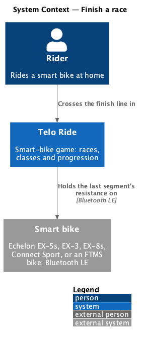
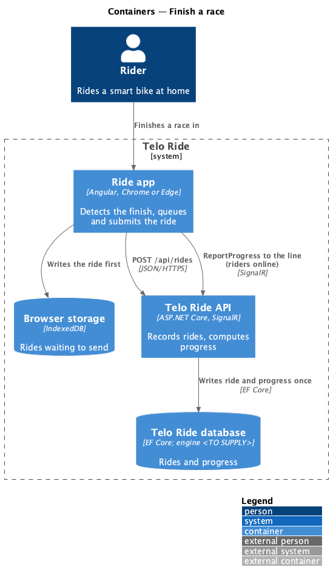
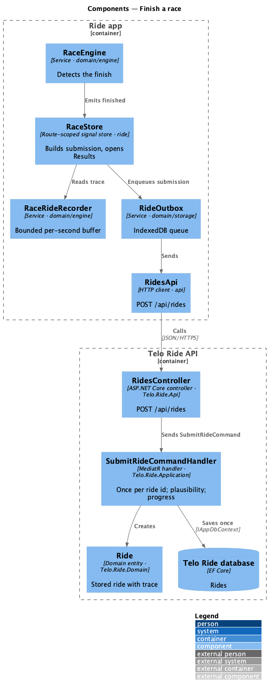
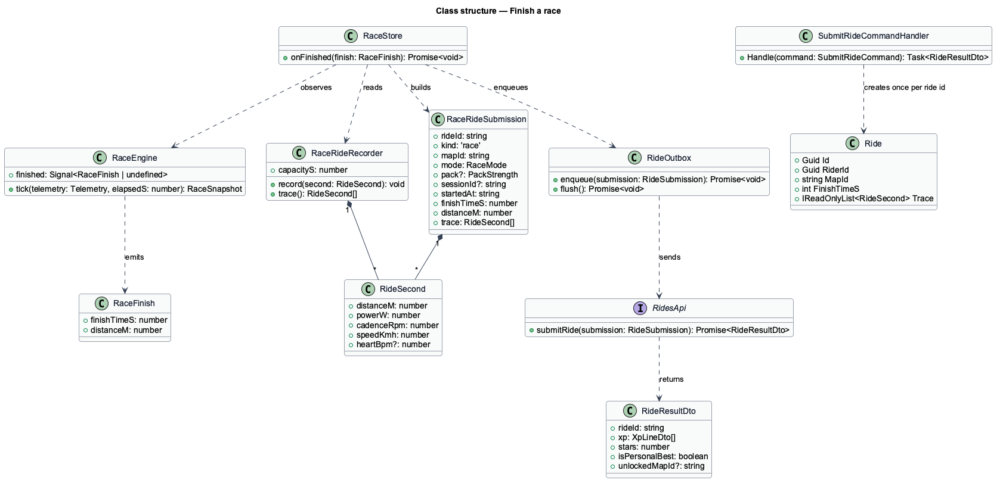
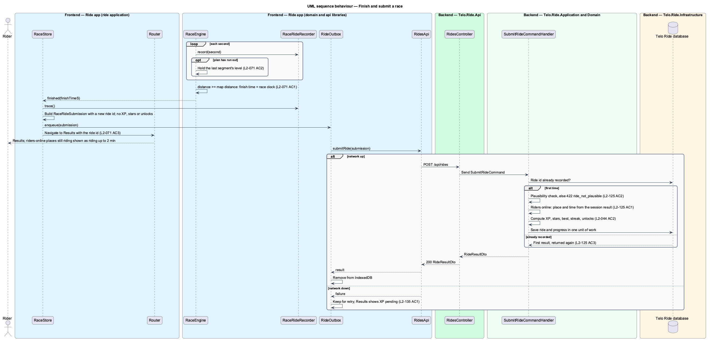

# Finish a race

## Overview

A race ends for the rider when they cover the map's distance. Their finish time is the race
clock at that moment, and the finished race is submitted to the backend as a ride, which earns
XP, stars, a best time and any unlock (L2-044).

> **finish line** — point on the route at the map's full distance

> **finish time** — race clock reading when the rider crosses the finish line

> **ride submission** — record of one finished ride sent to the backend, keyed by a ride id that makes it count once

> **ride outbox** — device-side queue of finished rides waiting to be sent

The map's plan lasts 30:00, but a rider may still be short of the line when it runs out. In that
case the last segment's level holds until the finish. Once the rider has finished, Results opens
with the race's result (results/show-results). In a riders-online race the service decides
places from the progress it received (L2-125), and places still riding are shown as riding
until they finish or 2 minutes pass.

The ride is submitted whether or not the network is up. Without a network the ride waits in the
ride outbox and Results shows its XP as pending (L2-135); this feature hands the ride to the
outbox and the performance subsystem (ride-without-a-network) sends it.

## Description

**Ride app**

- **`RaceEngine`** (`domain/engine`, from ride-a-race) — on the tick where the rider's
  distance reaches the map's distance, it records the finish time from the race clock, marks
  the rider finished, and emits `finished`. Past the plan's end it keeps the last segment's
  level (L2-071 AC2).
- **`RaceStore`** (`ride`) — on `finished`, builds the `RaceRideSubmission`, hands it to
  `RideOutbox`, and navigates to Results with the ride id. It stops the clock, telemetry
  subscriptions and the world as the race route is left.
- **`RaceRideRecorder`** (`domain/engine`) — keeps the per-second distance, power, cadence and
  speed of the race in a fixed-size buffer of one entry per second up to the race's length, so
  memory stays bounded (AGENTS.md, Bound what grows). Its distance column becomes the ghost
  trace of a future solo race (race-the-ghost-and-bots).
- **`RaceRideSubmission`** (`api`) — `rideId` (UUID made on the device), `kind: 'race'`,
  `mapId`, `mode`, `pack`, `sessionId` (riders online), `startedAt`, `finishTimeS`,
  `distanceM`, the per-second trace, average and maximum power, energy and heart rate. It holds
  no XP, stars or unlocks; the backend ignores any it receives (L2-044 AC4).
- **`RideOutbox`** (`domain/storage`) — stores the submission in IndexedDB first, then sends it
  through `RidesApi`; on success it removes it, on failure it keeps it for retry (L2-135).
- **`RidesApi`** (`api`, token `RIDES_API`, implementation `HttpRidesApi`) —
  `submitRide(submission): Promise<RideResultDto>` over `POST /api/rides`.

**Telo Ride API**

- **`RidesController`** (`Telo.Ride.Api`) — `POST /api/rides`; sends `SubmitRideCommand`.
- **`SubmitRideCommandHandler`** (`Telo.Ride.Application`) — records the ride once per ride id
  (L2-125 AC3), refuses an implausible ride with 422 `ride_not_plausible` (L2-125 AC2), and
  computes XP, stars, best, streak and unlocks (progression/keep-progress-on-the-backend). For
  a riders-online race it takes place and time from the session's recorded result, not from
  the submission (L2-125 AC1).
- **`Ride`** (`Telo.Ride.Domain`) — the stored ride, including its per-second distance trace.

**Slice 7.5.** What is built, and how:

- The finish line is the map's distance (`MapDto.distanceKm`). On the tick where the rider's
  distance reaches it, the finish time is that second of the race clock. The clock and the ticker
  stop, the wake lock is released, and `/results` opens with the race's result, `RaceResult`
  (`api`: map, mode, pack, finish time, place and the field's size), in the navigation's state
  for Results (slice 11.1) to read.
- Placing: `FinishLine` (`domain/engine`) holds each opponent at the line from the second it
  first reaches it, and keeps that second, at most one per rider; `rankStandings` orders riders
  at the line by it, the rider ahead of an opponent who finished in the same second. The rider's
  place at the line is their finishing place.
- Past the plan's end nothing more is sent, so the last segment's level holds; the interval panel
  keeps the last segment at 0:00, its bar full, and the clock counts on past the plan's length
  ("30:12 / 30:00").
- The ride's submission (`RaceRideRecorder`, `RaceRideSubmission`, `RideOutbox`, `RidesApi`)
  comes with *record a ride* (slice 10.1), which needs sign-in (journey 9); until then a finished
  race submits nothing. Riders online's places come with journey 15.

## Requirements

The feature realizes the following level-2 (L2) requirements. Each L2 requirement refines a
level-1 (L1) requirement, cited by identifier.

| L2 ID | Refines (L1) | Requirement |
|-------|--------------|-------------|
| `L2-071` | `L1-012` | When the rider covers the map's distance, their finish time shall be the race clock and the ride shall be submitted (L2-044). When the plan runs out before the line, the last segment's level shall hold until the finish. Once the rider has finished, Results shall show the race's result (L2-073); in a riders-online race, places still riding shall be shown as riding until they finish or 2 minutes pass. |

## Diagrams

### System context

The rider finishes a race in Telo Ride on a smart bike. The finished ride is kept by Telo Ride's
backend.

### Containers

The Ride app writes the ride to browser storage, then submits it to the Telo Ride API, which
records it in the Telo Ride database. A riders-online race also reports its finish through the
ride hub.

### Components

`RaceEngine` detects the finish. `RaceStore` builds the submission from `RaceRideRecorder` and
hands it to `RideOutbox`, which sends it through `RidesApi` to `RidesController`.

### Class structure

`RaceStore` turns the engine's finish and the recorder's buffer into a `RaceRideSubmission`.
`RideOutbox` sends it and receives a `RideResultDto`.

### Behaviour — finish and submit

The engine records the finish time; the store queues the ride and opens Results. The outbox
sends it when it can, and the backend records it once and computes progress.

