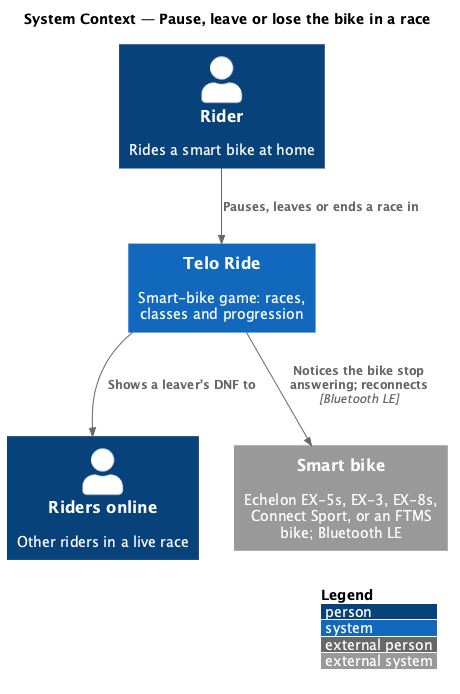
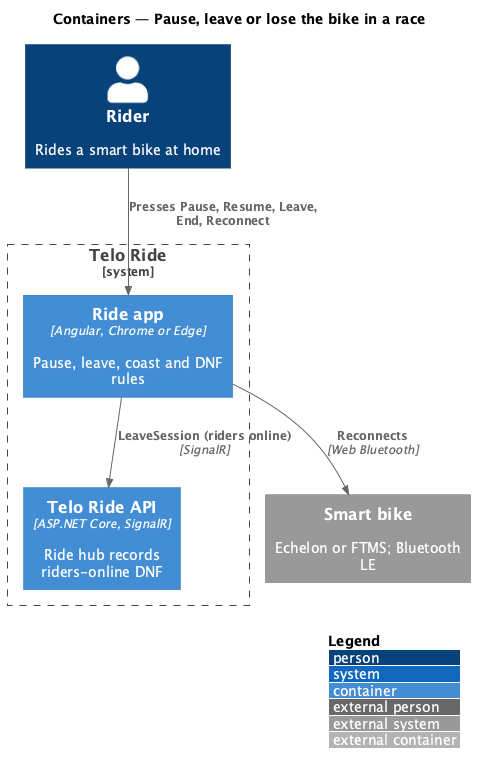
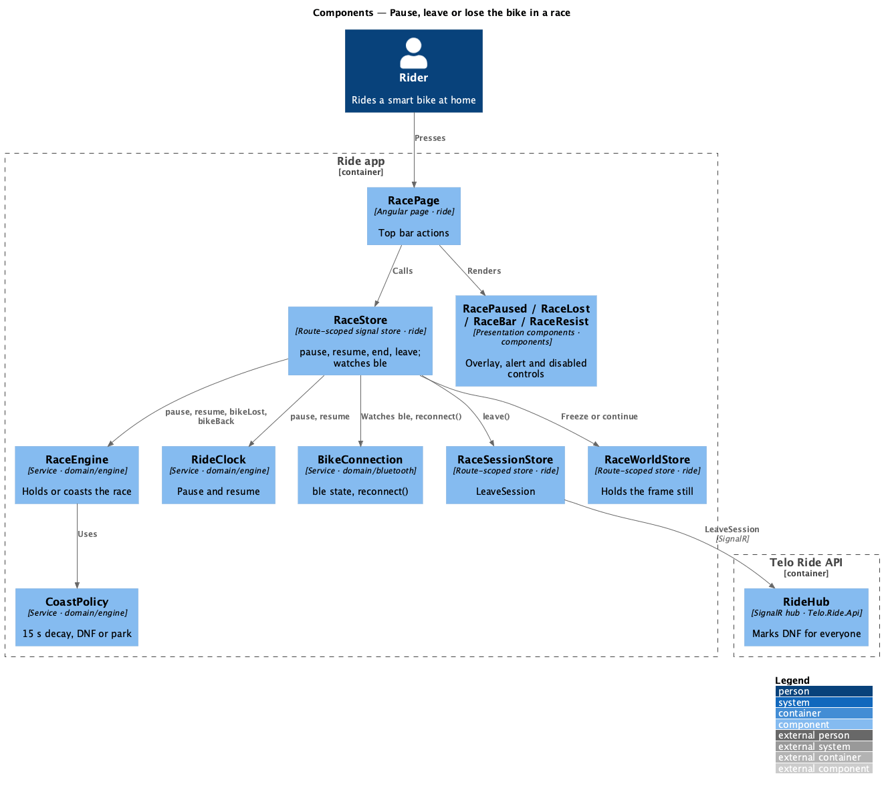
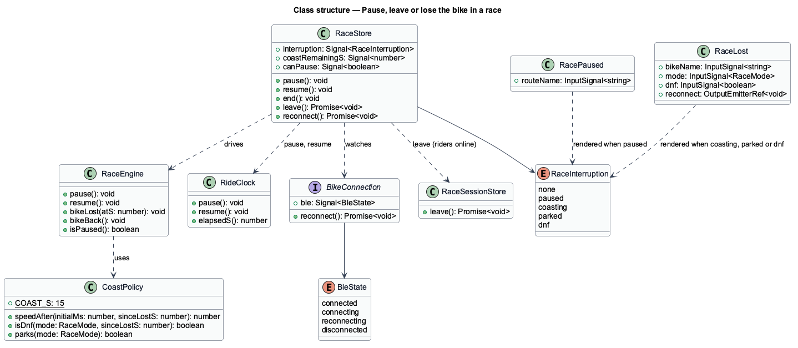
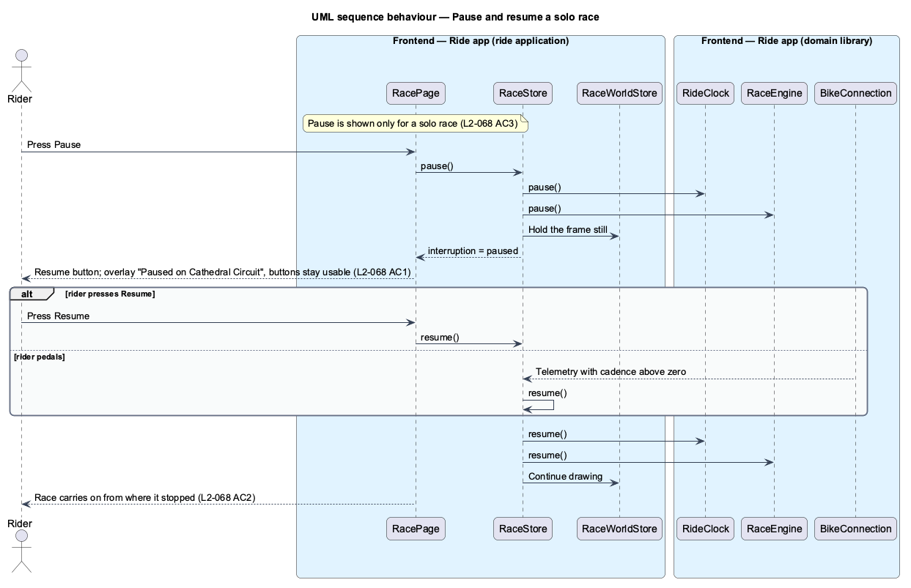
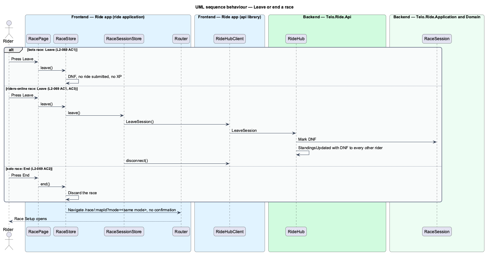
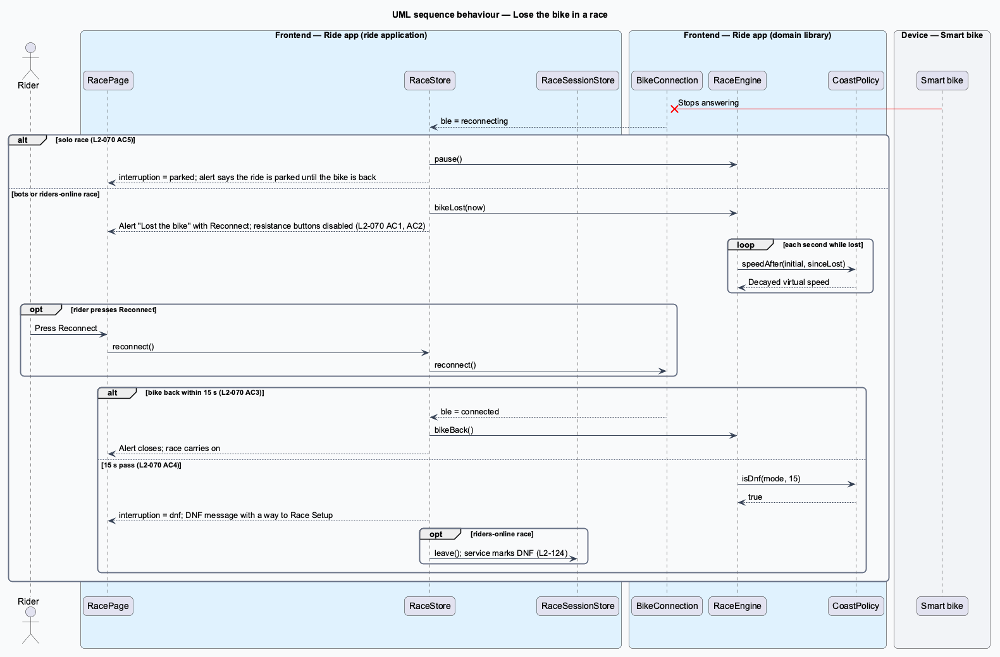

# Pause, leave or lose the bike in a race

## Overview

A race does not always run from Go to the line. The rider may pause a solo race, leave a race
early, or lose the Bluetooth link to the bike mid-race. This feature covers those three
interruptions.

> **solo race** — race against the rider's own ghost, with no other rider in it

> **DNF** — did not finish; the result of a race the rider left or could not complete

> **coast** — 15-second window after the bike stops answering, in which the rider's virtual speed decays while the app reconnects

> **parked** — state of a solo race held still because the bike stopped answering

Only a solo race can pause, because no one else is racing on its clock. Pause holds the clock,
the world and the numbers still; Resume or pedalling carries the race on from where it stopped.
Bots and riders-online races have no Pause.

Leaving is immediate and needs no confirmation. In a bots or riders-online race, Leave ends the
race as a DNF that earns no XP; in a riders-online race every other rider sees the DNF at once.
In a solo race, End discards the race. Either way, Race Setup opens.

Losing the bike is never a silent stop. In a bots or riders-online race the rider coasts for
15 seconds while the app reconnects; if the bike is back in time the race carries on, otherwise
it ends as a DNF with a clear message and a way to Race Setup. In a solo race, losing the bike
parks the race until the bike is back. Bike connection and reconnection themselves are
designed by bike/keep-the-bike-connected.

## Description

**Ride app**

- **`RaceStore`** (`ride`, from ride-a-race) — adds `pause()`, `resume()`, `end()` and
  `leave()`, and watches the `ble` state of `BIKE_CONNECTION`.
- **`RaceEngine`** (`domain/engine`) — adds `pause()`, `resume()` and `bikeLost()`/`bikeBack()`.
  While paused, ticks change nothing. While coasting, the rider's power is treated as 0 W and
  speed decays through `CoastPolicy`.
- **`RideClock`** (`domain/engine`) — `pause()` and `resume()` hold and continue the race
  clock.
- **`CoastPolicy`** (`domain/engine`) — pure rules of a lost bike: decay of the virtual speed
  over 15 seconds, `isDnf(elapsedSinceLostS)` true at 15 s for bots and riders-online races,
  and `parks(mode)` true for a solo race (L2-070). The speed decays in a straight line from
  the speed at the drop to standstill: `v(t) = v₀ · max(0, 1 − t / 15)`, and the rider rides on
  it.
- **`RacePaused`** (`components`, block `race-paused`) — status overlay (`role="status"`):
  "Paused on Cathedral Circuit" and "The world holds still until you pedal again." It uses
  `pointer-events: none` outside its card so it does not block the top bar buttons.
- **`RaceLost`** (`components`, block `race-lost`) — alert (`role="alert"`): "Lost the bike"
  and "Echelon EX-5s stopped answering. Your rider coasts for 15 seconds while we reconnect;
  after that the race counts as a DNF.", with **Reconnect**. For a solo race it says the ride is
  parked until the bike is back: "Echelon EX-5s stopped answering. Your ride is parked until the
  bike is back, then carries on from where it stopped." (`race/solo-disconnected`). After 15 s it
  reads "Did not finish" and "Echelon EX-5s didn’t come back within 15 seconds, so this race
  counts as a DNF and earns no XP.", with a link, **Back to Race Setup** (`race/dnf`), beyond the
  mock's
  "DNF.". The bike name is data rendered as text.
- **`RaceBar`** and **`RaceResist`** (`components`) — Pause becomes Resume while paused; both
  resistance buttons and Pause are disabled while the bike is gone (L2-070 AC2).
- **`RaceWorldStore`** (`ride`, from render-the-race-world) — draws the same frame while
  paused or parked.
- **`RaceSessionStore`** (`ride`) — `leave(reason)` sends `LeaveSession` to the hub for a
  riders-online race and disconnects.
- **`BikeConnection`** (`domain/bluetooth`, token `BIKE_CONNECTION`) — `ble` signal and
  `reconnect()`; designed by bike/keep-the-bike-connected.

A DNF or a discarded solo race submits no ride, so it earns no XP. For a riders-online race the
multiplayer service records the DNF (multiplayer/mark-leavers-and-dnf); it also marks a racing
rider DNF after 15 seconds without progress (L2-124 AC2), which agrees with the coast window.

**Slice 7.5.** What is built, and how:

- The rider's Pause and the bike's absence hold the race the same way: the clock stops, so the
  ticker publishes no second, and the plan, the distance, the field and the standings stand
  still. The race watches the bike and the pedals on the app's `TICKER` beat, once a second,
  since its own ticks stop while it is held (as the class ride does, slice 5.4).
- Pedalling resumes a paused solo race once the bike has reported the rider stopped (cadence 0,
  or none) since the pause, and then a cadence above 0; a rider who presses Pause mid-stroke is
  not carried on by the next stroke.
- Pause is disabled while the bike is gone; Leave and End are not. Leave and End are links to
  Race Setup (`/race/:mapId`); leaving the page stops the race and submits nothing.
- A coasting rider's power counts as none; the speed readout shows the coast. The DNF stops the
  clock where it was and leaves the board as it stood.
- Riders online (`RaceSessionStore`, the hub's DNF) come with journey 15, `RaceWorldStore` with
  journey 8. The mocks' Finish button is drawn for the prototype only and is not built.

## Requirements

The feature realizes the following level-2 (L2) requirements. Each L2 requirement refines a
level-1 (L1) requirement, cited by identifier.

| L2 ID | Refines (L1) | Requirement |
|-------|--------------|-------------|
| `L2-068` | `L1-012` | Only a solo race shall pause. When the rider presses Pause, the clock, world and numbers shall hold still, Pause shall become Resume, and a status overlay shall read "Paused on Cathedral Circuit" and "The world holds still until you pedal again." without blocking the buttons. Resume or pedalling shall carry the race on from where it stopped. A bots or riders-online race shall have no Pause. |
| `L2-069` | `L1-012` | In a bots or riders-online race, Leave shall end the race as DNF without a confirmation, earn no XP, and open Race Setup. In a solo race, End shall discard the race and open Race Setup. In a riders-online race every other rider shall see the leaver marked DNF. |
| `L2-070` | `L1-012` | In a bots or riders-online race, when the bike stops answering, an alert shall read "Lost the bike" and "Echelon EX-5s stopped answering. Your rider coasts for 15 seconds while we reconnect; after that the race counts as a DNF.", with **Reconnect**. The rider's virtual speed shall decay over 15 seconds and both resistance buttons shall be disabled. A bike back within 15 seconds shall close the alert and the race shall carry on. After 15 seconds without the bike the race shall end for the rider as a DNF with a clear message and a way to Race Setup, never a silent stop. In a solo race the race shall pause (L2-068) and the alert shall say the ride is parked until the bike is back. |

## Diagrams

### System context

The rider pauses or leaves the race in Telo Ride, and Telo Ride notices when the smart bike
stops answering. Riders online see a leaver's DNF through Telo Ride.

### Containers

The Ride app handles every interruption locally; for a riders-online race it tells the ride hub
that the rider left.

### Components

`RaceStore` turns the rider's presses and the `ble` state into calls on `RaceEngine`,
`RideClock` and `CoastPolicy`, and shows `RacePaused` or `RaceLost`.

### Class structure

`RaceStore` drives `RaceEngine`, which uses `CoastPolicy` and `RideClock`. `RaceInterruption`
names the state the overlays render.

### Behaviour — pause and resume a solo race

Pause holds the clock, the world and the numbers. Resume or the first pedal stroke carries the
race on.

### Behaviour — leave or end a race

Leave ends a bots or riders-online race as a DNF and tells the hub for a riders-online race. End
discards a solo race. Both open Race Setup without a confirmation.

### Behaviour — lose the bike

The rider coasts for 15 seconds while the app reconnects. The race carries on if the bike comes
back and ends as a DNF if it does not; a solo race parks instead.

