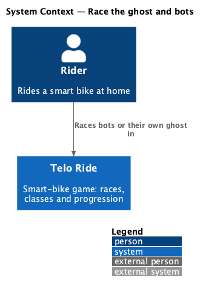
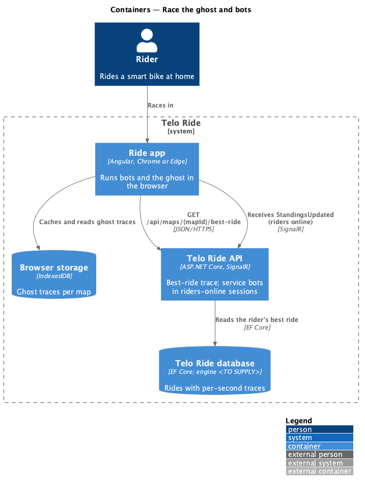
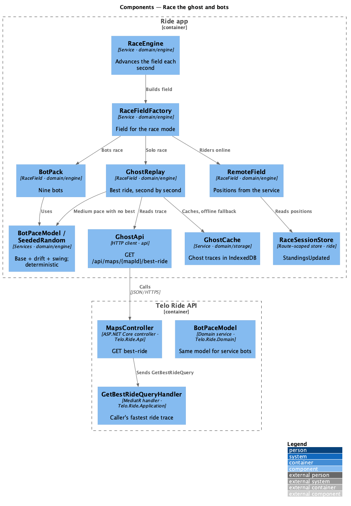
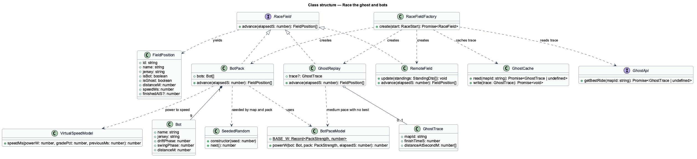
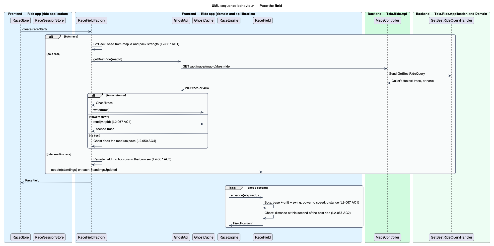

# Race the ghost and bots

## Overview

A race always has opponents. Which ones depends on the race mode chosen on Race Setup
(set-up-a-race).

> **bot** — computer rider with a name from the bot list (Pacer Nova, Rook, Juno, Atlas, Kite, Vale, Moss, Flint, Echo) that rides a pace set by the pack strength

> **pace model** — rule that gives each bot a power for each second: the pack strength's base power plus the bot's own steady drift and swing

> **ghost** — second-by-second replay of the rider's best finished ride on the map

> **race field** — set of opponents in one race and their places on the route

In a bots race the browser runs nine bots. Each rides around the pack strength (about 130 W
easy, 190 W medium, 250 W hard) with its own steady drift and swing, and the same race replays
the same way every time. In a solo race the ghost replays the rider's best ride on the map,
second by second; with no best it rides the map's medium pace (L2-050 AC4). In a riders-online
race the multiplayer service runs the bots that fill open seats, with the same pace model, and
the browser only draws what the service reports (L2-123).

Bots and the ghost run in the browser, so a bots or solo race carries on without a network
(L2-135). The ghost's trace is cached on the device after it is first read.

## Description

**Slices.** Slice 7.4 builds the bots and the ghost in the browser, the standings and gaps they
make, the standings board, and the power panel's place and gaps (L2-059 AC1, AC4, AC5; L2-060).
Rides are first recorded with slice 10.1, after sign-in (journey 9), so no rider has a best yet:
`GHOST_API` is bound to `NoBestRides`, which answers "no best" without a request, and the ghost
rides the medium pace (L2-050 AC4). `GhostReplay` replays a trace second by second already, proved
by its unit tests; `HttpGhostApi`, `GET /api/maps/{mapId}/best-ride` and `GhostCache` come with the
slice that keeps a ride's trace (11.2, personal best). Riders online's `RemoteField` comes with
journey 15.

**The pace model, supplied.** Each bot's power at second `t` is
`base + drift + swing × sin(2πt ÷ period + phase)`, in watts. The base is the pack strength's:
130 W easy, 190 W medium, 250 W hard. The drift is the bot's own steady offset, drawn once in
±12 % of the base; the swing's size is 4 to 10 % of the base, its period 45 to 150 seconds and
its phase 0 to 2π. The draws come from `SeededRandom` (Mulberry32 seeded with the FNV-1a hash of
"`mapId`:`pack`"), nine bots in the bot list's order, drift, swing, period then phase, so the same
map and pack draw the same race. A bot's speed is `VirtualSpeedModel` on its power, the rider's
model, and its distance the sum of its speed second by second. With no best, the ghost rides the
medium base, 190 W, steady.

**Standings and gaps.** `rankStandings` (`domain/engine/standings.ts`, ride-a-race's
`StandingsRanker` and `GapCalculator`) orders the rider and the field by distance, the furthest
first; a tie keeps the rider ahead, then the bot list's order, and gives each
opponent's gap in seconds: the distance between them and the rider ÷ the rider's speed in m/s,
the speed taken as at least 4 m/s (L2-059 AC5); one ahead reads "+0:07", one behind "−0:05" with
a true minus, a level one "0:00". The power panel reads the rider's place ("5th / 10") with the
gaps to the riders either side ("Ahead +0:02", "Behind −0:01"); in a solo race it reads "Ahead" or
"Behind" (level counts as ahead) with "Best" and the ghost's gap. The board lists every rider by
place, the rider's row `aria-current="true"`; it reorders at most once a second, on the race's
tick, and a row that moves slides from its old place over 150 ms (none with reduced motion): `RaceBoard`
compares each row's top with the last check in `ngAfterViewChecked`, after the view updates and
before paint, and animates the difference; a render hook (`afterRenderEffect`) would have added
4.7 kB of Angular to the initial bundle.

**Ride app**

- **`RaceField`** (`domain/engine`) — contract with `advance(elapsedS): FieldPosition[]`, read
  by `RaceEngine` (ride-a-race) once a second. Three implementations follow.
- **`BotPack`** (`domain/engine`) — nine bots for a bots race. Each bot's power at second `t`
  comes from `BotPaceModel`; its speed comes from `VirtualSpeedModel` on the route's grade,
  and its distance advances by that speed. Its random parts come from a seeded generator, so
  equal inputs give an equal race (L2-067 AC1).
- **`BotPaceModel`** (`domain/engine`) — the pace model: `base(pack) + drift(bot, t) +
  swing(bot, t)`. The base powers are 130 W, 190 W and 250 W. The drift and swing are supplied above. The backend's `BotPaceModel` in `Telo.Ride.Domain` implements the
  same documented model for riders-online sessions (L2-123 AC4), and a shared table of test
  cases keeps the two equal.
- **`SeededRandom`** (`domain/engine`) — deterministic generator. The seed is derived from the
  map id and the pack strength, so the same race replays the same way.
- **`GhostReplay`** (`domain/engine`) — replays a `GhostTrace` (distance at each whole second
  of the best ride) and interpolates between seconds. With no trace it delegates to a single
  medium-pace bot from `BotPaceModel`.
- **`RemoteField`** (`domain/engine`) — riders-online field. It holds the latest
  `StandingsUpdated` positions from `RaceSessionStore` and runs no bot itself (L2-067 AC3).
- **`RaceFieldFactory`** (`domain/engine`) — builds the field for a `RaceStart`: `BotPack`,
  `GhostReplay` or `RemoteField`.
- **`GhostApi`** (`api`, token `GHOST_API`, implementation `HttpGhostApi`) —
  `getBestRide(mapId)` over `GET /api/maps/{mapId}/best-ride`, introduced here. It returns the
  rider's own best trace or 404 when the map has no best.
- **`GhostCache`** (`domain/storage`) — keeps each map's ghost trace in IndexedDB, so a solo
  race starts without a network (L2-067 AC4, L2-135 AC3).

**Telo Ride API**

- **`MapsController.GetBestRide`** (`Telo.Ride.Api`) — sends `GetBestRideQuery` for the
  signed-in rider and map.
- **`GetBestRideQueryHandler`** (`Telo.Ride.Application`) — reads the rider's fastest finished
  `Ride` on the map and returns its per-second distance trace. It reads only the caller's rides
  (L2-128). The trace is stored with each submitted ride (finish-a-race).

## Requirements

The feature realizes the following level-2 (L2) requirements. Each L2 requirement refines a
level-1 (L1) requirement, cited by identifier.

| L2 ID | Refines (L1) | Requirement |
|-------|--------------|-------------|
| `L2-067` | `L1-012` | In a bots race each bot shall ride a pace around the pack strength (about 130 W easy, 190 W medium, 250 W hard), each with its own steady drift and swing, and the same race shall replay the same way. In a solo race the ghost shall replay the rider's best ride on that map, second by second. In a riders-online race the bots that fill seats shall be run by the service, not the browser (L2-123). A bots or solo race shall carry on without a network (L2-135). |

## Diagrams

### System context

The rider races opponents inside Telo Ride. No external system takes part.

### Containers

The Ride app runs bots and the ghost itself and caches the ghost trace in browser storage. The
Telo Ride API serves the best-ride trace and, for riders-online races, runs the service's bots.

### Components

`RaceFieldFactory` builds `BotPack`, `GhostReplay` or `RemoteField`. `GhostReplay` reads its
trace through `GhostApi` with `GhostCache` as the offline source.

### Class structure

The three fields implement `RaceField`. `BotPack` composes nine `Bot` values driven by
`BotPaceModel` and `SeededRandom`; `GhostReplay` holds an optional `GhostTrace`.

### Behaviour — pace the field

The factory builds the field from the race mode. Each second the engine advances it: bots from
the pace model, the ghost from its trace, riders online from the latest standings.

## Open questions

- **Grade for bots.** A bot's speed is power alone, as the rider's is (ride-a-race's open question
  on `L2-064` AC2); both take the grade together when the speed model settles it.
- **The ghost's source.** Until 11.2 keeps a ride's trace, every solo race rides the medium pace.
- **The service's pace model.** The backend's `BotPaceModel` for riders online (`L2-123` AC4) is
  built with journey 15 from the same documented model and its table of cases.
