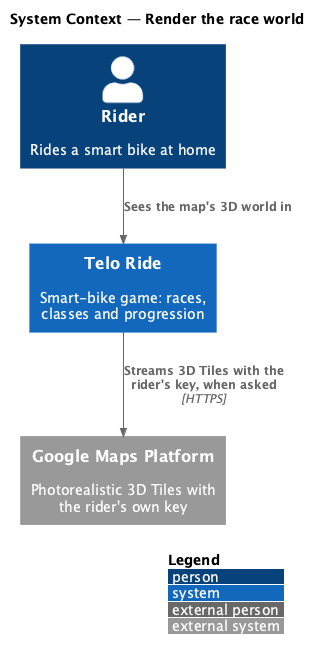
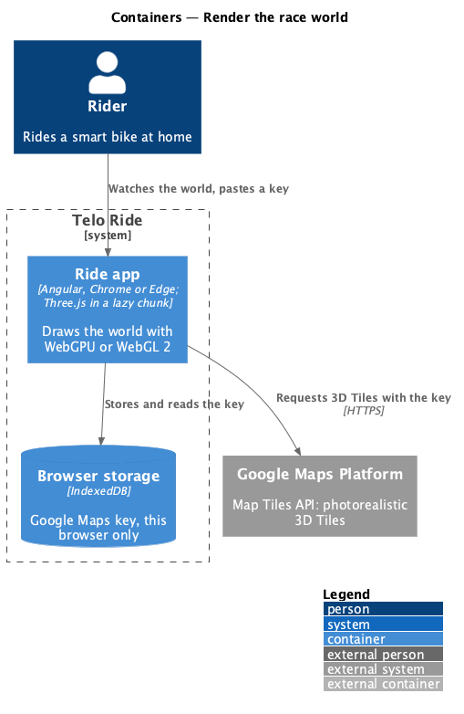
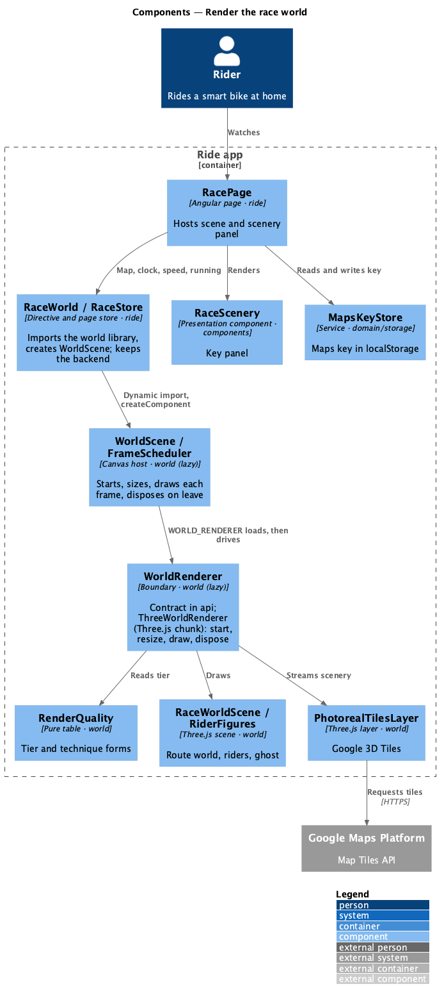

# Render the race world

## Overview

Every map is a route through a 3D world. During a race the world fills the screen behind the
HUD and moves with the rider: the camera sits at the rider's place on the route and travels
forward at the rider's virtual speed. Other riders appear at their places in their jersey
colours; the ghost appears translucent gold.

> **world** — lit, textured 3D scene of one map's route, drawn behind the race HUD

> **renderer tag** — label in the race top bar naming the GPU API that draws the world, "WebGPU" or "WebGL 2"

> **panorama** — still photograph of a map's world, shown when the browser can draw neither WebGPU nor WebGL 2

> **real-world scenery** — optional photorealistic 3D Tiles of a real place, streamed from Google Maps Platform with the rider's own key

The world is the heaviest part of the app. It loads only when a race opens, in its own lazy
chunk, and releases every GPU resource when the race ends. It draws with WebGPU where the
browser grants an adapter and with WebGL 2 otherwise, through one Three.js `WebGPURenderer`
(ADR 0020, ADR 0021). It stops drawing while the tab is hidden; the race clock and telemetry
carry on regardless (L2-133). Its detail is scaled to the device, cheap forms of each technique
first (AGENTS.md, Low-power rendering).

Some maps follow a real place. On those maps a scenery panel offers to stream the real place as
photorealistic 3D Tiles with a Google Maps Platform key the rider pastes. The key stays in the
browser and goes only to Google's Map Tiles API. If Google refuses the key, the built-in world
stays.

### Adelaide Hills on the Willunga road

Use the standard course gearing for a listed distance of 17.11 km. This places the final two work stages across the full 3 km Old Willunga climb. Their original durations and cadence targets also determine the road lengths of all other stages at that gearing. The summit marks the start of the GCN cool-down.

The Adelaide world already specifies summer lighting, heat haze, grade and bends. Before this course was added, the Adelaide map fell through to the generic road. The catalogue now resolves its world to the authored Willunga course and opening panorama. The original class is *HIIT Fat Burn With Mitchelton-Scott*, preserved in `frontend/public/classes.json` at commit `a9be36f6a`. Its warm-up, each work and recovery, cool-down, cadence aims and target resistance supply the course stages.

The Race catalogue names the map. `MapRenderer` resolves its world through `course-worlds.ts` and loads the Blender GLB and centre line through `CourseRenderer` (ADRs 0034–0035). The existing renderer owns scene disposal and stage alignment. Low keeps the outlines of each landmark. The scene groups repeating vine faces and pale posts in spatial chunks with vertex-colour shade at the bases. The distant gulf is visible through gaps on the high ground.

| Rider view | Visible cues and art direction | Reference files in docs/worlds/adelaide |
| --- | --- | --- |
| Opening through the village | Sandstone church, verandahs and pale-trunked gums frame the vanishing point. Keep the spire visible above the HUD. | real-01, 02, 07–10, 13–15 and game-01, 04 |
| Moving between vineyards | Rows converge over the rise. Alternate leaf and post silhouettes against sun-dried grass. White edge lines and a gravel shoulder keep bends readable. A blue gulf sits behind the distant fields in midday haze. | real-03–06, 14 and game-02, 04–05 |
| Hill crowd and expo | The tall inflatable cycle and broad orange canopy rise above the barrier. Separate hat brims, camper vans and coolers by silhouette. Leave a clear racing line. | real-11–12 and game-01–03 |

Compare rider-height captures with `docs/screenshots/caribana/README.md` iterations 007 (landmark silhouette), 025 (sun and haze), 070–072 (vertex occlusion) and 098 (surface wear). Measure the busiest climb separately if the opening 60 s cannot reach it. L2-064 AC6–7 apply to the built-in course; optional streamed scenery remains governed by L2-066.

### Aguascalientes Velodrome

The original world supplied a light preset and training terrain. Map Select now includes the pursuit race. The course registry resolves it to the authored oval and the starting-straight capture supplies its panorama. The original GCN *Olympic Pursuit Efforts* is recorded in `frontend/public/classes.json` at commit `a9be36f6a`. The catalogue uses its recorded time, cadence and target resistance for each stage. On the velodrome, banking runs across the timber surface. The course follows the measurement line around the oval and the rider sees the other straight across the infield.

In a solo pursuit the ghost starts 125 m round the oval from the rider. The replay distance drives its position from that start line on every lap. The board and HUD use the race clock, including after a pause. Two suspended timing faces share one texture updated when the displayed second or lap changes. The official’s bell is mounted beside the home straight.

One authored arena serves every lap. The course centre line repeats for the distance prescribed by the class. Split the track into straights, entry transitions and banked bends. Reuse the same spatial geometry and materials on every lap, and dispose of them with the course. The dark rail and bright apron frame the near edge, officials and team bikes occupy the middle ground, and far seats sit under the continuous open-span roof. Vertex colour under the track rail, seat risers and roof trusses provides shade without an extra shadow pass.

| View from the saddle | Reference intent |
| --- | --- |
| Starting straight | Real 01, 04, 10, 11 and 15 show the low pursuit riding position and plank seams. Games 03–05 show where text and coloured boards remain visible around a rider HUD. |
| Banked turn | Real 02, 03, 05–07 and 12–14 show apron width, stripe separation, turn profile, fencing and the bowl in wide view. Games 01–03 inform legibility at speed. |
| Opposite straight | Real 01, 08, 09 and 12–14 distinguish the building setting, infield access, pit barriers and overhead fixtures. Keep a lap counter, timing display and spectators visible beyond the apron. |

The [world brief](../../../worlds/aguascalientes/README.md) identifies the local details. The indoor references include comparable venues. Preserve the Aguascalientes setting when interpreting them. Compare the actual race with Caribana’s depth layering, surface wear, colour-baked occlusion and geometry batching on the same low-tier tablet profile (L2-064, L2-065, L2-159 and L2-160).

### Algarve Cliffs

The existing Algarve light preset and grade profile establish late afternoon and rolling terrain. The map lacks a catalogue entry, an authored course and a fallback panorama. Restore the schedule from *Get Fit in 40* in the class catalogue at `a9be36f6a`. Map Select opens the race with that plan. The renderer resolves the map’s world to the Blender course, loads the road mesh and centre line on entry, and uses the captured starting road as the fallback. L2-064–066 and L2-159–160 apply.

| View | What the rider sees | References |
| --- | --- | --- |
| Opening above Carvoeiro | Blue-trimmed white houses and terracotta roofs step uphill above the beach. The road turns past umbrella pines and an ochre dirt path. | Real 05–07, 09–11 and 14. Game 01 and 02 show road-edge separation and silhouette scale. |
| Ponta da Piedade and Praia da Marinha | A low wall opens onto a pale beach. Eroded sandstone pillars have dark recesses under pale horizontal beds. The rider can see water through the arch, with small painted boats offshore. | Real 01–03, 08, 12 and 13. Game 03–04 inform framing beside a large moving rider. |
| Benagil and the cape | The course rounds the cave’s open crown. A red lantern above a white lighthouse carries the eye toward the headland while blue water and a distant coast remain below. | Real 04 and 15. Game 05 informs the readable outline against the horizon. |

Use original silhouettes, merged static materials and seeded scrub. Bake shallow ledge shade into rock vertices. Hold the offshore stacks and lighthouse visible beyond the roadside detail window. The boat movement should follow ride time and freeze on pause. Fit the sea, cliff and road heights to the same centre line so an effort adds climbing without letting the road leave its headland. Keep landforms recognizable at Low. Measure submitted frames as well as display callbacks during a moving sample across the cove. Dispose through the course renderer on exit. The route compresses several Algarve landmarks into one ride.

### Alpe d’Huez

The existing world profile sets the light and a generic repeating bend. The actual race needs a catalogue entry, distinct switchbacks along the length of the course and a panorama. Map Select loads the race for the GCN *Elevate Your Climbing Power* class, recovered from `a9be36f6a`. The class clock preserves its stages. Power moves the race rider up the road. The final cool-down continues through the resort.

| Rider viewpoint | Course design | Evidence |
| --- | --- | --- |
| Valley and the first ramp | Bourg-d’Oisans on the valley floor, lower trees and campers beside the first wall, pale kerb and a readable sign for bend 21. Paint follows the tarmac. | Real 01, 02, 10 and 14. Games 01–03 inform corner markings and approach scale. |
| Bend 7 | A wall on the outside of the bend, motorhomes and flags above it. Orange-clad spectators line the inside by Saint-Ferréol. Leave the church visible through the moving smoke. | Real 03–09 show crowd spacing, writing and flags. Real 11 informs the church silhouette. |
| Resort approach | Changing elevation reveals lower stretches of road and the Oisans valley. Distant snow-streaked ridges remain in view behind timber chalets and the lift. | Real 12–15 and games 04–05 show the contrast and depth between green foreground and distant snow. |

One centre line carries the 21 bends. Give each sign and its hairpin the same course distance in the source so they stay aligned through a layout change. Use the original winners attached to the bends. The official tourism records identify the stage winners and the church at bend 7. [Alpe d’Huez stage winners](https://www.alpedhuez.com/fr/activites/activites-ete/velo/les-vainqueurs-du-tour-a-lalpe-dhuez/) · [Oz-en-Oisans route guide](https://www.oz-en-oisans.com/summer/discover/our-must-haves/the-21-bends-of-alpe-dhuez/)

Batch roadside spectators by location. Keep the snowy ridge separate so it stays visible across the valley. The opening, Dutch Corner and upper resort views retain the existing race HUD. Compare the low-detail profile against Caribana’s near crowds and separate skyline. Time the moving world around Dutch Corner and release the models with the course.

### Amsterdam Canals

The existing AmsterdamStreet scene contains the Westertoren, the three gable profiles, an angler, cyclists, planted arks and moving tour boats. Riders praised its look and the way it rides in [#903](https://github.com/QuinntyneBrown/wattzup/issues/903). The backend catalogue lacks an Amsterdam race. Use the existing views in [the rendering history](../../../screenshots/amsterdam/README.md) as the baseline. Map Select opens Herengracht. The course loader requests the Blender model and centre line on entry (ADRs 0030, 0034 and 0035). The nine stages recovered from catalogue revision `a9be36f6a` supply 20 minutes and 8 km of riding. Keep the canal level across bridge approaches by shaping the raised pavement independently.

| View from the saddle | Proportions and detail to retain | References |
| --- | --- | --- |
| Opening quay | Show water between the bike rail and opposite houses. Let the elm canopy frame the cornices. Each frontage is only a few sash windows wide. | Real 01, 03, 05–07, 09 and 10. Game 01 for the opening across water, games 02 and 04 for house height behind the rider. |
| Moving along the moorings | Low, planted ark roofs leave the opposite shore visible. An open launch and a glass tour boat clear the arches. Dapple the red path and preserve the dark three-cross bollards. | Real 10–13. Games 03 and 05 for contrast around a moving cyclist. |
| Bridge approach | Separate the brick arch, its reflection, the iron rail and the moving everyday cyclists. Keep whole bicycle silhouettes at the nearest railing and simplify the distant rows. | Real 02, 04, 08, 13–15. Games 01, 03 and 04 for the approach sightline. |

As at Caribana, bake static wear, contact shadows and far façades into batched geometry. Keep the skyline separate. Time resident traffic from the ride clock, freeze secondary motion for reduced motion, and release the scene with the race. Measure the opening and a moving bridge sample on Low/WebGL 2 with the standard 4× CPU throttle, 9-second warm-up and 60-second ride. Record actual rendering, intervals, draw calls, moving distance and device alongside paired HUD captures.

## Description

**`world` library (`frontend/projects/world`, new)** — the boundary for Three.js, copied from
`main` (ADR 0030). It is imported only by dynamic `import()`, so neither Three.js nor the scene
enters the initial bundle. Adding it adds `ride → world` and `world → api` to the dependency rule
in `AGENTS.md` and to the ESLint boundaries in the same change.

- **`WorldRenderer`** (contract and `WORLD_RENDERER` token in `api`, `main`'s
  `world-renderer-port.ts`) — `start(canvas, world, nextFrame, segments)` resolves false when
  neither WebGPU nor WebGL 2 starts; `resize(width, height, pixelRatio)`, `draw(frame)`,
  `setFramePeriod(ms)`, `pauseBudget()` and `dispose()`. Telo Ride adds `backend`, the GPU API
  drawing the world, for the tag. `ThreeWorldRenderer` implements it with one `WebGPURenderer`,
  which takes a WebGPU adapter when the browser grants one and runs its own WebGL 2 backend
  otherwise (`forceWebGL` only for the performance sweep's test hook); it is the only type that
  names a Three.js type, and `dispose()` releases every GPU resource and the renderer
  (L2-065 AC1, AC2). The loader (`loadWorldRenderer`) imports it, and Three.js with it, on demand.
- **`WorldScene`** (block `world-scene`) — `main`'s canvas host: it loads the renderer after its
  view is in place, measures the display's frame period through `FrameScheduler` (the only
  `requestAnimationFrame` caller), starts the renderer, resizes it on a `ResizeObserver`, draws one
  frame per tick through `SceneDriver` while the race runs, and on destroy stops the loop,
  disconnects the observer, removes its listeners and disposes the renderer. It emits `started`
  with the backend, or `unavailable` once. Its canvas is hidden from assistive technology: the race
  scene around it is the one image.
- **`RenderQuality`** — `main`'s `render-quality.ts`, the pure table of four quality levels
  (ADR 0021): `techniquesAt(tier, backend, reducedMotion)` gives the techniques a level draws,
  those of its level and the levels below, the drawn look's only at `low`; with WebGL 2 it caps
  at `high`, so `ultra` is WebGPU only and a world asked for at `ultra` draws at `high`.
  `startTier()` opens the world at `low` on both backends (L2-065 AC4, AC5). The renderer reads
  the table and holds no rule about which level is in force.
- **`RaceWorldScene`** — `main`'s scene: the road, terrain, sky and props of the map's world,
  each world's scene module (`world-<id>.ts`) built on the shared kit and street table, with the
  panoramas of the worlds that have one served from the app's own origin
  (`projects/ride/public/worlds/<worldId>/`, ADR 0021). The road bends in the vertex stage (ADR
  0023). `SceneDriver` moves the camera along the route at the race's virtual speed each frame,
  and holds it while the race is paused. In a portrait viewport the camera keeps its vertical
  field of view and narrows its aspect, so the world fills the screen without stretching
  (L2-064 AC5).
- **`RiderFigures`** — the race's other riders in view, each one of `main`'s cyclist kit
  (`world-cyclist.ts`) in its jersey colour (`--jersey-<jersey>`), at its place on the route
  and on a line of its own across the road (`ridersOnRoad`); the ghost is the kit's rider in
  one translucent gold material, made with the scene so it compiles while the world loads
  (L2-064 AC3). The race hands the scene its field each second as `SceneFrame.riders`, metres
  from the rider; without them, as in a class, `main`'s simulated pacers ride instead.
- **`PhotorealTilesLayer`** — loads Google's photorealistic 3D Tiles for the map's real place
  through the Map Tiles API with the rider's key, and reports `refused` when Google rejects it.
  It is `3d-tiles-renderer` 0.5.4 (ADR 0021's amendment): a `TilesRenderer` with
  `GoogleCloudAuthPlugin` (the key on every request to `tile.googleapis.com` and nowhere else),
  `GLTFExtensionsPlugin` with Three.js's `DRACOLoader` (its decoder served from `/draco/`) and
  `ReorientationPlugin`, which puts the place's latitude and longitude at the scene's origin,
  up the scene's Y axis. The renderer imports the layer only on `stream`, adds its group to the
  scene, updates it with the camera each frame and disposes it with the scene. It reports
  `refused` when the root tileset fails or holds no root, and `streaming` with Google's
  attribution for the tiles in view each time it changes.

**Ride app**

- **`RaceWorld`** (`ride`, a directive in the race scene) — imports the `world` library when the
  race opens and creates its `WorldScene` in place, handing it the map's world, plan, the race
  clock, the virtual speed and whether the race runs. The scene goes with the race view when the
  rider leaves. `RaceStore` keeps `backend` for the tag and `worldUnavailable`, which removes the
  scene and leaves the map's photo. The race route binds `WORLD_RENDERER`.
- **Race scene** (block `race-scene` of the race page) — one image (`role="img"`) labelled with
  the map's world description ("The Old Town Criterium world: a cobbled old town under a blue sky,
  its cathedral spire on the horizon"). The map's photo (`race-scene__photo`) lies under the
  world's canvas and stays alone as the panorama when neither backend starts (L2-065 AC2).
- **Renderer tag** (element of `RaceBar`) — "WebGPU" or "WebGL 2", title "The GPU API drawing
  this world".
- **`RaceScenery`** (`components`, block `race-scenery`) — rendered only on a map with a real
  place while the world draws (not over the panorama, L2-066 AC9). It reads "Ride the real Bruges · Steenstraat to the Markt" and "Paste a Google Maps
  Platform key to stream it as photorealistic 3D Tiles. It stays on this device.", with a key
  field (placeholder "AIza…") and "Stream it", disabled while the field is empty. It emits
  `streamKey(key)`. Told `refused`, it marks the field invalid and reads "Google refused that key.
  The built-in world stays." (`role="alert"`); told `streaming`, it reads "Streaming the real
  Bruges · Steenstraat to the Markt" over Google's attribution (L2-066 AC4, AC7). From 640 px to
  1023 px no HUD panel covers it (L2-066 AC6).
- **`MapsKeyStore`** (`domain/storage`, the `MapsKey` contract and `MAPS_KEY` token in `api`, bound by the race route) — keeps the Maps
  key in this browser's localStorage only; the next race's panel holds it, and nothing streams
  until "Stream it" (L2-066 AC3, AC8). The key is never sent to Telo Ride's backend.
- **`MapDto.realPlace`** (`api`, served by the catalogue) — the real place's `name` ("Bruges"),
  `route` ("Steenstraat to the Markt"), `latitude` and `longitude`, or `null` for a map with no
  real place (L2-066 AC5). The race page hands it and the key to `RaceWorld`, which hands them
  to `WorldScene` and on to `WorldRenderer.stream(place, key, report)`.

The Content Security Policy that admits the Map Tiles API origin is designed by
security/restrict-third-parties.

## Requirements

The feature realizes the following level-2 (L2) requirements. Each L2 requirement refines a
level-1 (L1) requirement, cited by identifier.

| L2 ID | Refines (L1) | Requirement |
|-------|--------------|-------------|
| `L2-064` | `L1-012` | During a race the map's 3D world shall be drawn from the rider's place on the route, with the camera moving forward at the rider's virtual speed, computed by a documented power-to-speed model whose constants are an open question. Other riders within view shall be drawn in their jersey colours at their places on the route, the ghost translucent gold. Assistive technology shall read the world as one image with a description ("The Old Town Criterium world: a cobbled old town under a blue sky, its cathedral spire on the horizon"). In a portrait viewport the world shall be reframed to fill the screen without stretching. |
| `L2-065` | `L1-012` | With WebGPU the world shall be drawn with WebGPU and the tag shall read "WebGPU"; otherwise with WebGL 2 and the tag "WebGL 2". The tag's title shall be "The GPU API drawing this world". With neither, the world shall be replaced by the map's panorama and the race shall still run. While the tab is hidden the world shall stop drawing and the race clock and telemetry shall carry on (L2-133). |
| `L2-066` | `L1-012` | On Old Town Criterium the scenery panel shall read "Ride the real Bruges · Steenstraat to the Markt" and "Paste a Google Maps Platform key to stream it as photorealistic 3D Tiles. It stays on this device.", with a key field (placeholder "AIza…") and "Stream it", disabled while the field is empty. An entered key shall be stored only in this browser and sent only to Google's Map Tiles API, never to Telo Ride's backend. When Google refuses the key, the built-in world shall stay and the panel shall read "Google refused that key. The built-in world stays." with the field marked invalid. A map with no real place, or a race on its panorama, shall have no scenery panel. From 640 to 1023 px no HUD panel shall cover the panel. While the tiles stream the panel shall read "Streaming the real Bruges · Steenstraat to the Markt" with Google's attribution. A stored key shall fill the field on a later race, and nothing shall stream until "Stream it". |

## Diagrams

### System context

Telo Ride draws the world itself. Google Maps Platform takes part only when the rider streams
real-world scenery with their own key.

### Containers

The Ride app loads world assets from its own origin, keeps the Maps key in browser storage, and
calls Google's Map Tiles API directly. The Telo Ride API takes no part in drawing.

### Components

`RaceWorld` imports the lazy `world` library and creates `WorldScene`, which loads and drives
`WorldRenderer`; the renderer chooses its backend and composes the quality table, scene, rider
figures and the optional tiles layer.

### Class structure

`ThreeWorldRenderer` owns the scene, the figures and the tiles layer and disposes them together.
`WorldScene` holds the renderer; `RaceStore` keeps the backend it reports.

### Behaviour — start, draw and dispose the world

`RaceWorld` loads the chunk, and `WorldScene` starts the renderer, which draws with WebGPU or
WebGL 2 or reports that neither starts, leaving the panorama. No frame is drawn while the tab is
hidden, and leaving the race disposes every resource.

### Behaviour — stream real-world scenery

The key goes to browser storage and to Google's Map Tiles API only. A refused key leaves the
built-in world in place and the panel says so.

## Open questions

- **Slice 8.1 follows `main`'s rendering (ADR 0030).** This design first named a separate
  `RendererBackendProbe`, `start(canvas, map, quality)`, `setVisible` and a `RaceWorldStore` with a
  `RaceScene` component. `main` has none of them: `WebGPURenderer` chooses its backend itself, the
  canvas host is `main`'s `WorldScene` with `FrameScheduler`, and the hidden tab is handled by the
  scheduler requesting no frame. The design now describes `main`'s shape; `main` wins on rendering.
- **The renderer arrives in two slices.** Slice 8.1 carries `main`'s `world-renderer.ts` as far as
  starting, sizing, the frame budget and disposing; slice 8.2 brings the rest of the file, which
  builds and draws the scene, so the canvas stays clear over the map's photo until then.
- **Slice 8.2 draws `main`'s scene as it is.** The camera keeps `main`'s fixed vertical field of
  view in a portrait viewport rather than widening it, which still fills the screen without
  stretching. `main`'s scene reads each segment's start second, which `WorldScene` adds to the
  plan's segments (`timedSegments`). Until slice 8.3 places the race's own riders, the scene
  draws `main`'s six simulated pacers around the rider, as `main` does.
- **Slice 8.3 draws the riders with `main`'s cyclist kit.** This design first named one
  instanced mesh for the riders; `main` draws each rider as a group of the kit's shared
  geometries, and `main` wins on rendering, so a race rider is one of those groups, made the
  first time it rides into view and dressed for the tier (toon twins and warmer ink at low, the
  road's bend). The rider wears the race board's You jersey (`--jersey-you`) rather than
  `main`'s `--color-rider-4`, which Telo Ride's tokens do not have. The race's field moves once
  a second, as the standings do, so a rider's gap changes in whole-second steps.
- **Slice 8.4: the world opens at Low.** `main` opens World Ride at `low`, the drawn look, on
  both backends and never raises the level during a ride (its L2-111 AC3, amended on
  2026-11-21: opening at `ultra` or `high` lowered the tier while the rider watched). `main`
  wins on rendering, so L2-065 AC5 says the same, and L2-159's Auto, L2-152's examples and the
  Settings and World loading mocks follow: Auto starts at Low, or at the level the device check
  found. A chosen level (slice 20.2) and the device check (20.3) are how a rider sees the levels
  above; until then only `main`'s test-only probe pins one.
- **Slice 8.6: a hidden tab draws nothing at all.** `main`'s frame scheduler stops requesting
  frames while the tab is hidden, but `WorldScene` also draws one frame whenever an input
  changes, and the race clock's second is an input, so `main` drew a frame each second in a
  hidden tab. The smallest change to the copied code: `WorldScene` keeps a `visible` signal from
  `visibilitychange`, and its input-driven frame waits for it (L2-065 AC3). The panorama
  (L2-065 AC2) has stood since slice 8.1.
- **Slice 8.7: real-world scenery is built new on `main`'s renderer.** `main` has no 3D Tiles,
  so the tiles layer is new, in `main`'s style, and changes no copied scene: the built-in world
  stays drawn and the tiles join it around the place's origin. Lining the tiles' streets up with
  the built-in road (and hiding the built-in buildings they overlap) is left open. The design
  first named `SettingsStore` and a `RaceWorldStore`; the key has its own `MapsKeyStore` until
  Settings (journey 20) gathers the stored settings, and the race page holds the panel's state.
  A tile's embedded textures and the Draco decoder's worker need `blob:` and
  `'wasm-unsafe-eval'` in the Content Security Policy (L2-131 AC1).
- **Vice City has no world on `main`.** Its race draws South Beach Sunrise, whose terrain its
  catalogue entry already takes (slice 7.3), until a Vice City world is built.
