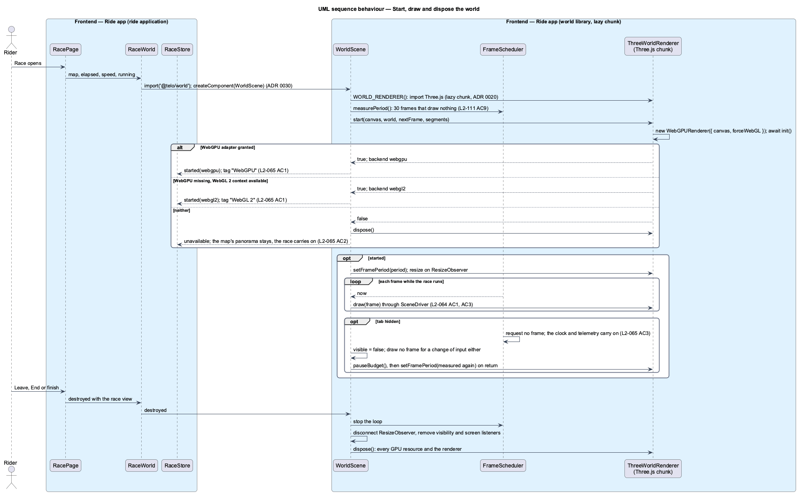

# Render the race world

## Overview

Every map is a route through a 3D world. During a race the world fills the screen behind the
HUD and moves with the rider: the camera sits at the rider's place on the route and travels
forward at the rider's virtual speed. Other riders appear at their places in their jersey
colours; the ghost appears translucent gold.

> **world** — lit, textured 3D scene of one map's route, drawn behind the race HUD

> **renderer tag** — label in the race top bar naming the GPU API that draws the world, "WebGPU" or "WebGL 2"

> **panorama** — still photograph of a map's world, shown when the browser can draw neither WebGPU nor WebGL 2

> **real-world scenery** — optional photorealistic 3D Tiles of a real place, streamed from Google Maps Platform with the rider's own key

The world is the heaviest part of the app. It loads only when a race opens, in its own lazy
chunk, and releases every GPU resource when the race ends. It draws with WebGPU where the
browser grants an adapter and with WebGL 2 otherwise, through one Three.js `WebGPURenderer`
(ADR 0020, ADR 0021). It stops drawing while the tab is hidden; the race clock and telemetry
carry on regardless (L2-133). Its detail is scaled to the device, cheap forms of each technique
first (AGENTS.md, Low-power rendering).

Some maps follow a real place. On those maps a scenery panel offers to stream the real place as
photorealistic 3D Tiles with a Google Maps Platform key the rider pastes. The key stays in the
browser and goes only to Google's Map Tiles API. If Google refuses the key, the built-in world
stays.

## Description

**`world` library (`frontend/projects/world`, new)** — the boundary for Three.js, copied from
`main` (ADR 0030). It is imported only by dynamic `import()`, so neither Three.js nor the scene
enters the initial bundle. Adding it adds `ride → world` and `world → api` to the dependency rule
in `AGENTS.md` and to the ESLint boundaries in the same change.

- **`WorldRenderer`** (contract and `WORLD_RENDERER` token in `api`, `main`'s
  `world-renderer-port.ts`) — `start(canvas, world, nextFrame, segments)` resolves false when
  neither WebGPU nor WebGL 2 starts; `resize(width, height, pixelRatio)`, `draw(frame)`,
  `setFramePeriod(ms)`, `pauseBudget()` and `dispose()`. Telo Ride adds `backend`, the GPU API
  drawing the world, for the tag. `ThreeWorldRenderer` implements it with one `WebGPURenderer`,
  which takes a WebGPU adapter when the browser grants one and runs its own WebGL 2 backend
  otherwise (`forceWebGL` only for the performance sweep's test hook); it is the only type that
  names a Three.js type, and `dispose()` releases every GPU resource and the renderer
  (L2-065 AC1, AC2). The loader (`loadWorldRenderer`) imports it, and Three.js with it, on demand.
- **`WorldScene`** (block `world-scene`) — `main`'s canvas host: it loads the renderer after its
  view is in place, measures the display's frame period through `FrameScheduler` (the only
  `requestAnimationFrame` caller), starts the renderer, resizes it on a `ResizeObserver`, draws one
  frame per tick through `SceneDriver` while the race runs, and on destroy stops the loop,
  disconnects the observer, removes its listeners and disposes the renderer. It emits `started`
  with the backend, or `unavailable` once. Its canvas is hidden from assistive technology: the race
  scene around it is the one image.
- **`RenderQuality`** — `main`'s `render-quality.ts`, the pure table of four quality levels
  (ADR 0021): `techniquesAt(tier, backend, reducedMotion)` gives the techniques a level draws,
  those of its level and the levels below, the drawn look's only at `low`; with WebGL 2 it caps
  at `high`, so `ultra` is WebGPU only and a world asked for at `ultra` draws at `high`.
  `startTier()` opens the world at `low` on both backends (L2-065 AC4, AC5). The renderer reads
  the table and holds no rule about which level is in force.
- **`RaceWorldScene`** — `main`'s scene: the road, terrain, sky and props of the map's world,
  each world's scene module (`world-<id>.ts`) built on the shared kit and street table, with the
  panoramas of the worlds that have one served from the app's own origin
  (`projects/ride/public/worlds/<worldId>/`, ADR 0021). The road bends in the vertex stage (ADR
  0023). `SceneDriver` moves the camera along the route at the race's virtual speed each frame,
  and holds it while the race is paused. In a portrait viewport the camera keeps its vertical
  field of view and narrows its aspect, so the world fills the screen without stretching
  (L2-064 AC5).
- **`RiderFigures`** — the race's other riders in view, each one of `main`'s cyclist kit
  (`world-cyclist.ts`) in its jersey colour (`--jersey-<jersey>`), at its place on the route
  and on a line of its own across the road (`ridersOnRoad`); the ghost is the kit's rider in
  one translucent gold material, made with the scene so it compiles while the world loads
  (L2-064 AC3). The race hands the scene its field each second as `SceneFrame.riders`, metres
  from the rider; without them, as in a class, `main`'s simulated pacers ride instead.
- **`PhotorealTilesLayer`** — loads Google's photorealistic 3D Tiles for the map's real place
  through the Map Tiles API with the rider's key, and reports `refused` when Google rejects it.
  It is `3d-tiles-renderer` 0.5.4 (ADR 0021's amendment): a `TilesRenderer` with
  `GoogleCloudAuthPlugin` (the key on every request to `tile.googleapis.com` and nowhere else),
  `GLTFExtensionsPlugin` with Three.js's `DRACOLoader` (its decoder served from `/draco/`) and
  `ReorientationPlugin`, which puts the place's latitude and longitude at the scene's origin,
  up the scene's Y axis. The renderer imports the layer only on `stream`, adds its group to the
  scene, updates it with the camera each frame and disposes it with the scene. It reports
  `refused` when the root tileset fails or holds no root, and `streaming` with Google's
  attribution for the tiles in view each time it changes.

**Ride app**

- **`RaceWorld`** (`ride`, a directive in the race scene) — imports the `world` library when the
  race opens and creates its `WorldScene` in place, handing it the map's world, plan, the race
  clock, the virtual speed and whether the race runs. The scene goes with the race view when the
  rider leaves. `RaceStore` keeps `backend` for the tag and `worldUnavailable`, which removes the
  scene and leaves the map's photo. The race route binds `WORLD_RENDERER`.
- **Race scene** (block `race-scene` of the race page) — one image (`role="img"`) labelled with
  the map's world description ("The Old Town Criterium world: a cobbled old town under a blue sky,
  its cathedral spire on the horizon"). The map's photo (`race-scene__photo`) lies under the
  world's canvas and stays alone as the panorama when neither backend starts (L2-065 AC2).
- **Renderer tag** (element of `RaceBar`) — "WebGPU" or "WebGL 2", title "The GPU API drawing
  this world".
- **`RaceScenery`** (`components`, block `race-scenery`) — rendered only on a map with a real
  place while the world draws (not over the panorama, L2-066 AC9). It reads "Ride the real Bruges · Steenstraat to the Markt" and "Paste a Google Maps
  Platform key to stream it as photorealistic 3D Tiles. It stays on this device.", with a key
  field (placeholder "AIza…") and "Stream it", disabled while the field is empty. It emits
  `streamKey(key)`. Told `refused`, it marks the field invalid and reads "Google refused that key.
  The built-in world stays." (`role="alert"`); told `streaming`, it reads "Streaming the real
  Bruges · Steenstraat to the Markt" over Google's attribution (L2-066 AC4, AC7). From 640 px to
  1023 px no HUD panel covers it (L2-066 AC6).
- **`MapsKeyStore`** (`domain/storage`, the `MapsKey` contract and `MAPS_KEY` token in `api`, bound by the race route) — keeps the Maps
  key in this browser's localStorage only; the next race's panel holds it, and nothing streams
  until "Stream it" (L2-066 AC3, AC8). The key is never sent to Telo Ride's backend.
- **`MapDto.realPlace`** (`api`, served by the catalogue) — the real place's `name` ("Bruges"),
  `route` ("Steenstraat to the Markt"), `latitude` and `longitude`, or `null` for a map with no
  real place (L2-066 AC5). The race page hands it and the key to `RaceWorld`, which hands them
  to `WorldScene` and on to `WorldRenderer.stream(place, key, report)`.

The Content Security Policy that admits the Map Tiles API origin is designed by
security/restrict-third-parties.

## Requirements

The feature realizes the following level-2 (L2) requirements. Each L2 requirement refines a
level-1 (L1) requirement, cited by identifier.

| L2 ID | Refines (L1) | Requirement |
|-------|--------------|-------------|
| `L2-064` | `L1-012` | During a race the map's 3D world shall be drawn from the rider's place on the route, with the camera moving forward at the rider's virtual speed, computed by a documented power-to-speed model whose constants are an open question. Other riders within view shall be drawn in their jersey colours at their places on the route, the ghost translucent gold. Assistive technology shall read the world as one image with a description ("The Old Town Criterium world: a cobbled old town under a blue sky, its cathedral spire on the horizon"). In a portrait viewport the world shall be reframed to fill the screen without stretching. |
| `L2-065` | `L1-012` | With WebGPU the world shall be drawn with WebGPU and the tag shall read "WebGPU"; otherwise with WebGL 2 and the tag "WebGL 2". The tag's title shall be "The GPU API drawing this world". With neither, the world shall be replaced by the map's panorama and the race shall still run. While the tab is hidden the world shall stop drawing and the race clock and telemetry shall carry on (L2-133). |
| `L2-066` | `L1-012` | On Old Town Criterium the scenery panel shall read "Ride the real Bruges · Steenstraat to the Markt" and "Paste a Google Maps Platform key to stream it as photorealistic 3D Tiles. It stays on this device.", with a key field (placeholder "AIza…") and "Stream it", disabled while the field is empty. An entered key shall be stored only in this browser and sent only to Google's Map Tiles API, never to Telo Ride's backend. When Google refuses the key, the built-in world shall stay and the panel shall read "Google refused that key. The built-in world stays." with the field marked invalid. A map with no real place, or a race on its panorama, shall have no scenery panel. From 640 to 1023 px no HUD panel shall cover the panel. While the tiles stream the panel shall read "Streaming the real Bruges · Steenstraat to the Markt" with Google's attribution. A stored key shall fill the field on a later race, and nothing shall stream until "Stream it". |

## Diagrams

### System context

Telo Ride draws the world itself. Google Maps Platform takes part only when the rider streams
real-world scenery with their own key.

### Containers

The Ride app loads world assets from its own origin, keeps the Maps key in browser storage, and
calls Google's Map Tiles API directly. The Telo Ride API takes no part in drawing.

### Components

`RaceWorld` imports the lazy `world` library and creates `WorldScene`, which loads and drives
`WorldRenderer`; the renderer chooses its backend and composes the quality table, scene, rider
figures and the optional tiles layer.

### Class structure

`ThreeWorldRenderer` owns the scene, the figures and the tiles layer and disposes them together.
`WorldScene` holds the renderer; `RaceStore` keeps the backend it reports.

### Behaviour — start, draw and dispose the world

`RaceWorld` loads the chunk, and `WorldScene` starts the renderer, which draws with WebGPU or
WebGL 2 or reports that neither starts, leaving the panorama. No frame is drawn while the tab is
hidden, and leaving the race disposes every resource.

### Behaviour — stream real-world scenery

The key goes to browser storage and to Google's Map Tiles API only. A refused key leaves the
built-in world in place and the panel says so.

## Open questions

- **Slice 8.1 follows `main`'s rendering (ADR 0030).** This design first named a separate
  `RendererBackendProbe`, `start(canvas, map, quality)`, `setVisible` and a `RaceWorldStore` with a
  `RaceScene` component. `main` has none of them: `WebGPURenderer` chooses its backend itself, the
  canvas host is `main`'s `WorldScene` with `FrameScheduler`, and the hidden tab is handled by the
  scheduler requesting no frame. The design now describes `main`'s shape; `main` wins on rendering.
- **The renderer arrives in two slices.** Slice 8.1 carries `main`'s `world-renderer.ts` as far as
  starting, sizing, the frame budget and disposing; slice 8.2 brings the rest of the file, which
  builds and draws the scene, so the canvas stays clear over the map's photo until then.
- **Slice 8.2 draws `main`'s scene as it is.** The camera keeps `main`'s fixed vertical field of
  view in a portrait viewport rather than widening it, which still fills the screen without
  stretching. `main`'s scene reads each segment's start second, which `WorldScene` adds to the
  plan's segments (`timedSegments`). Until slice 8.3 places the race's own riders, the scene
  draws `main`'s six simulated pacers around the rider, as `main` does.
- **Slice 8.3 draws the riders with `main`'s cyclist kit.** This design first named one
  instanced mesh for the riders; `main` draws each rider as a group of the kit's shared
  geometries, and `main` wins on rendering, so a race rider is one of those groups, made the
  first time it rides into view and dressed for the tier (toon twins and warmer ink at low, the
  road's bend). The rider wears the race board's You jersey (`--jersey-you`) rather than
  `main`'s `--color-rider-4`, which Telo Ride's tokens do not have. The race's field moves once
  a second, as the standings do, so a rider's gap changes in whole-second steps.
- **Slice 8.4: the world opens at Low.** `main` opens World Ride at `low`, the drawn look, on
  both backends and never raises the level during a ride (its L2-111 AC3, amended on
  2026-11-21: opening at `ultra` or `high` lowered the tier while the rider watched). `main`
  wins on rendering, so L2-065 AC5 says the same, and L2-159's Auto, L2-152's examples and the
  Settings and World loading mocks follow: Auto starts at Low, or at the level the device check
  found. A chosen level (slice 20.2) and the device check (20.3) are how a rider sees the levels
  above; until then only `main`'s test-only probe pins one.
- **Slice 8.6: a hidden tab draws nothing at all.** `main`'s frame scheduler stops requesting
  frames while the tab is hidden, but `WorldScene` also draws one frame whenever an input
  changes, and the race clock's second is an input, so `main` drew a frame each second in a
  hidden tab. The smallest change to the copied code: `WorldScene` keeps a `visible` signal from
  `visibilitychange`, and its input-driven frame waits for it (L2-065 AC3). The panorama
  (L2-065 AC2) has stood since slice 8.1.
- **Slice 8.7: real-world scenery is built new on `main`'s renderer.** `main` has no 3D Tiles,
  so the tiles layer is new, in `main`'s style, and changes no copied scene: the built-in world
  stays drawn and the tiles join it around the place's origin. Lining the tiles' streets up with
  the built-in road (and hiding the built-in buildings they overlap) is left open. The design
  first named `SettingsStore` and a `RaceWorldStore`; the key has its own `MapsKeyStore` until
  Settings (journey 20) gathers the stored settings, and the race page holds the panel's state.
  A tile's embedded textures and the Draco decoder's worker need `blob:` and
  `'wasm-unsafe-eval'` in the Content Security Policy (L2-131 AC1).
- **Vice City has no world on `main`.** Its race draws South Beach Sunrise, whose terrain its
  catalogue entry already takes (slice 7.3), until a Vice City world is built.

## Yorkshire Dales (#2109)

The class-world inventory rates Yorkshire Dales at 35%. The existing scene sets the moorland palette. The class needs its own catalogue entry and landmarks on a fixed road, with working walls, sheep, barns, exposed moor and a race-day crowd at the crest. Map Select → Race Setup → Race loads the original Race Winning Intervals plan and lazily opens the native Dales course. Its centre line drives the HUD grade, cyclist and camera together. L1 Race, the ride-a-map journey, L2-064–066, L2-159–160 and ADRs 0021, 0023, 0030, 0034 and 0035 apply.

| Rider view | Composition on Low | References |
| --- | --- | --- |
| Hawes, 0.08 km | Rough grey fronts, shop doors, yellow bikes and rose bunting close to the road | Real 06, 07, 13–14 and game 01 |
| Valley barns, 3.26 km | Patchwork fields, limestone joints and detached barns in the middle distance | Real 08–10, 13, 15 and games 01 and 03 |
| Exposed edge, 7.48 km | A narrow lane, thin white posts and an open fall into Swaledale | Real 01–05 and games 02 and 03 |
| Final ramp, 9.12 km | The crowd and waving flags flank the painted lane. Heather covers the crest | Real 02–07 and games 02, 04 and 05 |
| Flock, 14.52 km | White fleeces and black faces at the green verge below the heather | Real 03, 09, 12–13 and games 01 and 03 |
| Muker, 22.88 km | Stone cottages and pubs rise above the valley floor | Real 08–11, 14–15 and games 01 and 04 |

Bake the far fells and field walls in stable coordinates so they stay fixed behind the moving verge, as Caribana’s skyline does behind the parade. Chunk near walls and use shared bounded geometry for sheep, cloth and the crowd. Preserve the gate openings and grazing scale on Low. Release the scene, material and animation state on leaving the race. Compare six matched rider views. Count submitted frames over a minute at Hawes and again with the crowd visible, with the tablet settings in the performance design.
