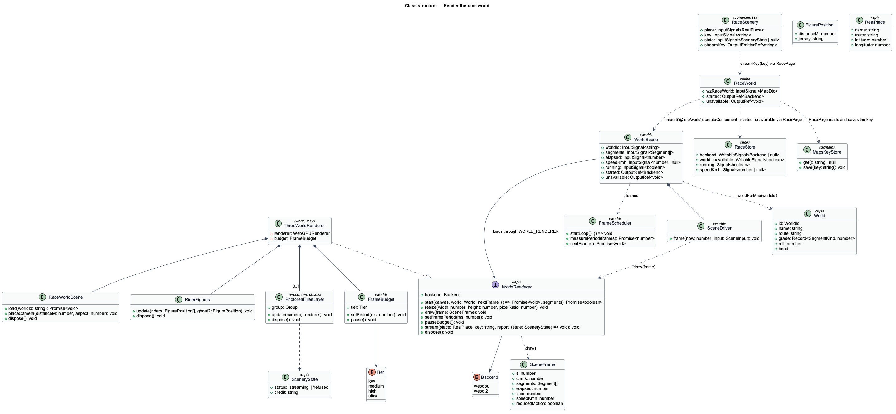
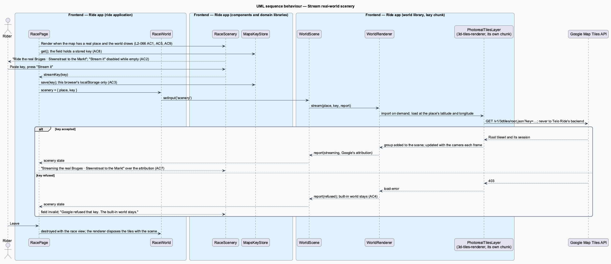

# Render the race world

## Overview

Every map is a route through a 3D world. During a race the world fills the screen behind the
HUD and moves with the rider: the camera sits at the rider's place on the route and travels
forward at the rider's virtual speed. Other riders appear at their places in their jersey
colours; the ghost appears translucent gold.

> **world** — lit, textured 3D scene of one map's route, drawn behind the race HUD

> **renderer tag** — label in the race top bar naming the GPU API that draws the world, "WebGPU" or "WebGL 2"

> **panorama** — still photograph of a map's world, shown when the browser can draw neither WebGPU nor WebGL 2

> **real-world scenery** — optional photorealistic 3D Tiles of a real place, streamed from Google Maps Platform with the rider's own key

The world is the heaviest part of the app. It loads only when a race opens, in its own lazy
chunk, and releases every GPU resource when the race ends. It draws with WebGPU where the
browser grants an adapter and with WebGL 2 otherwise, through one Three.js `WebGPURenderer`
(ADR 0020, ADR 0021). It stops drawing while the tab is hidden; the race clock and telemetry
carry on regardless (L2-133). Its detail is scaled to the device, cheap forms of each technique
first (AGENTS.md, Low-power rendering).

Some maps follow a real place. On those maps a scenery panel offers to stream the real place as
photorealistic 3D Tiles with a Google Maps Platform key the rider pastes. The key stays in the
browser and goes only to Google's Map Tiles API. If Google refuses the key, the built-in world
stays.

### Adelaide Hills on the Willunga road

Use the standard course gearing for a listed distance of 17.11 km. This places the final two work stages across the full 3 km Old Willunga climb. Their original durations and cadence targets also determine the road lengths of all other stages at that gearing. The summit marks the start of the GCN cool-down.

The Adelaide world already specifies summer lighting, heat haze, grade and bends. Before this course was added, the Adelaide map fell through to the generic road. The catalogue now resolves its world to the authored Willunga course and opening panorama. The original class is *HIIT Fat Burn With Mitchelton-Scott*, preserved in `frontend/public/classes.json` at commit `a9be36f6a`. Its warm-up, each work and recovery, cool-down, cadence aims and target resistance supply the course stages.

The Race catalogue names the map. `MapRenderer` resolves its world through `course-worlds.ts` and loads the Blender GLB and centre line through `CourseRenderer` (ADRs 0034–0035). The existing renderer owns scene disposal and stage alignment. Low keeps the outlines of each landmark. The scene groups repeating vine faces and pale posts in spatial chunks with vertex-colour shade at the bases. The distant gulf is visible through gaps on the high ground.

| Rider view | Visible cues and art direction | Reference files in docs/worlds/adelaide |
| --- | --- | --- |
| Opening through the village | Sandstone church, verandahs and pale-trunked gums frame the vanishing point. Keep the spire visible above the HUD. | real-01, 02, 07–10, 13–15 and game-01, 04 |
| Moving between vineyards | Rows converge over the rise. Alternate leaf and post silhouettes against sun-dried grass. White edge lines and a gravel shoulder keep bends readable. A blue gulf sits behind the distant fields in midday haze. | real-03–06, 14 and game-02, 04–05 |
| Hill crowd and expo | The tall inflatable cycle and broad orange canopy rise above the barrier. Separate hat brims, camper vans and coolers by silhouette. Leave a clear racing line. | real-11–12 and game-01–03 |

Compare rider-height captures with `docs/screenshots/caribana/README.md` iterations 007 (landmark silhouette), 025 (sun and haze), 070–072 (vertex occlusion) and 098 (surface wear). Measure the busiest climb separately if the opening 60 s cannot reach it. L2-064 AC6–7 apply to the built-in course; optional streamed scenery remains governed by L2-066.

### Aguascalientes Velodrome

The original world supplied a light preset and training terrain. Map Select now includes the pursuit race. The course registry resolves it to the authored oval and the starting-straight capture supplies its panorama. The original GCN *Olympic Pursuit Efforts* is recorded in `frontend/public/classes.json` at commit `a9be36f6a`. The catalogue uses its recorded time, cadence and target resistance for each stage. On the velodrome, banking runs across the timber surface. The course follows the measurement line around the oval and the rider sees the other straight across the infield.

In a solo pursuit the ghost starts 125 m round the oval from the rider. The replay distance drives its position from that start line on every lap. The board and HUD use the race clock, including after a pause. Two suspended timing faces share one texture updated when the displayed second or lap changes. The official’s bell is mounted beside the home straight.

One authored arena serves every lap. The course centre line repeats for the distance prescribed by the class. Split the track into straights, entry transitions and banked bends. Reuse the same spatial geometry and materials on every lap, and dispose of them with the course. The dark rail and bright apron frame the near edge, officials and team bikes occupy the middle ground, and far seats sit under the continuous open-span roof. Vertex colour under the track rail, seat risers and roof trusses provides shade without an extra shadow pass.

| View from the saddle | Reference intent |
| --- | --- |
| Starting straight | Real 01, 04, 10, 11 and 15 show the low pursuit riding position and plank seams. Games 03–05 show where text and coloured boards remain visible around a rider HUD. |
| Banked turn | Real 02, 03, 05–07 and 12–14 show apron width, stripe separation, turn profile, fencing and the bowl in wide view. Games 01–03 inform legibility at speed. |
| Opposite straight | Real 01, 08, 09 and 12–14 distinguish the building setting, infield access, pit barriers and overhead fixtures. Keep a lap counter, timing display and spectators visible beyond the apron. |

The [world brief](../../../worlds/aguascalientes/README.md) identifies the local details. The indoor references include comparable venues. Preserve the Aguascalientes setting when interpreting them. Compare the actual race with Caribana’s depth layering, surface wear, colour-baked occlusion and geometry batching on the same low-tier tablet profile (L2-064, L2-065, L2-159 and L2-160).

### Algarve Cliffs

The existing Algarve light preset and grade profile establish late afternoon and rolling terrain. The map lacks a catalogue entry, an authored course and a fallback panorama. Restore the schedule from *Get Fit in 40* in the class catalogue at `a9be36f6a`. Map Select opens the race with that plan. The renderer resolves the map’s world to the Blender course, loads the road mesh and centre line on entry, and uses the captured starting road as the fallback. L2-064–066 and L2-159–160 apply.

| View | What the rider sees | References |
| --- | --- | --- |
| Opening above Carvoeiro | Blue-trimmed white houses and terracotta roofs step uphill above the beach. The road turns past umbrella pines and an ochre dirt path. | Real 05–07, 09–11 and 14. Game 01 and 02 show road-edge separation and silhouette scale. |
| Ponta da Piedade and Praia da Marinha | A low wall opens onto a pale beach. Eroded sandstone pillars have dark recesses under pale horizontal beds. The rider can see water through the arch, with small painted boats offshore. | Real 01–03, 08, 12 and 13. Game 03–04 inform framing beside a large moving rider. |
| Benagil and the cape | The course rounds the cave’s open crown. A red lantern above a white lighthouse carries the eye toward the headland while blue water and a distant coast remain below. | Real 04 and 15. Game 05 informs the readable outline against the horizon. |

Use original silhouettes, merged static materials and seeded scrub. Bake shallow ledge shade into rock vertices. Hold the offshore stacks and lighthouse visible beyond the roadside detail window. The boat movement should follow ride time and freeze on pause. Fit the sea, cliff and road heights to the same centre line so an effort adds climbing without letting the road leave its headland. Keep landforms recognizable at Low. Measure submitted frames as well as display callbacks during a moving sample across the cove. Dispose through the course renderer on exit. The route compresses several Algarve landmarks into one ride.

### Alpe d’Huez

The existing world profile sets the light and a generic repeating bend. The actual race needs a catalogue entry, distinct switchbacks along the length of the course and a panorama. Map Select loads the race for the GCN *Elevate Your Climbing Power* class, recovered from `a9be36f6a`. The class clock preserves its stages. Power moves the race rider up the road. The final cool-down continues through the resort.

| Rider viewpoint | Course design | Evidence |
| --- | --- | --- |
| Valley and the first ramp | Bourg-d’Oisans on the valley floor, lower trees and campers beside the first wall, pale kerb and a readable sign for bend 21. Paint follows the tarmac. | Real 01, 02, 10 and 14. Games 01–03 inform corner markings and approach scale. |
| Bend 7 | A wall on the outside of the bend, motorhomes and flags above it. Orange-clad spectators line the inside by Saint-Ferréol. Leave the church visible through the moving smoke. | Real 03–09 show crowd spacing, writing and flags. Real 11 informs the church silhouette. |
| Resort approach | Changing elevation reveals lower stretches of road and the Oisans valley. Distant snow-streaked ridges remain in view behind timber chalets and the lift. | Real 12–15 and games 04–05 show the contrast and depth between green foreground and distant snow. |

One centre line carries the 21 bends. Give each sign and its hairpin the same course distance in the source so they stay aligned through a layout change. Use the original winners attached to the bends. The official tourism records identify the stage winners and the church at bend 7. [Alpe d’Huez stage winners](https://www.alpedhuez.com/fr/activites/activites-ete/velo/les-vainqueurs-du-tour-a-lalpe-dhuez/) · [Oz-en-Oisans route guide](https://www.oz-en-oisans.com/summer/discover/our-must-haves/the-21-bends-of-alpe-dhuez/)

Batch roadside spectators by location. Keep the snowy ridge separate so it stays visible across the valley. The opening, Dutch Corner and upper resort views retain the existing race HUD. Compare the low-detail profile against Caribana’s near crowds and separate skyline. Time the moving world around Dutch Corner and release the models with the course.

### Amsterdam Canals

The existing AmsterdamStreet scene contains the Westertoren, the three gable profiles, an angler, cyclists, planted arks and moving tour boats. Riders praised its look and the way it rides in [#903](https://github.com/QuinntyneBrown/wattzup/issues/903). The backend catalogue lacks an Amsterdam race. Use the existing views in [the rendering history](../../../screenshots/amsterdam/README.md) as the baseline. Map Select opens Herengracht. The course loader requests the Blender model and centre line on entry (ADRs 0030, 0034 and 0035). The nine stages recovered from catalogue revision `a9be36f6a` supply 20 minutes and 8 km of riding. Keep the canal level across bridge approaches by shaping the raised pavement independently.

| View from the saddle | Proportions and detail to retain | References |
| --- | --- | --- |
| Opening quay | Show water between the bike rail and opposite houses. Let the elm canopy frame the cornices. Each frontage is only a few sash windows wide. | Real 01, 03, 05–07, 09 and 10. Game 01 for the opening across water, games 02 and 04 for house height behind the rider. |
| Moving along the moorings | Low, planted ark roofs leave the opposite shore visible. An open launch and a glass tour boat clear the arches. Dapple the red path and preserve the dark three-cross bollards. | Real 10–13. Games 03 and 05 for contrast around a moving cyclist. |
| Bridge approach | Separate the brick arch, its reflection, the iron rail and the moving everyday cyclists. Keep whole bicycle silhouettes at the nearest railing and simplify the distant rows. | Real 02, 04, 08, 13–15. Games 01, 03 and 04 for the approach sightline. |

As at Caribana, bake static wear, contact shadows and far façades into batched geometry. Keep the skyline separate. Time resident traffic from the ride clock, freeze secondary motion for reduced motion, and release the scene with the race. Measure the opening and a moving bridge sample on Low/WebGL 2 with the standard 4× CPU throttle, 9-second warm-up and 60-second ride. Record actual rendering, intervals, draw calls, moving distance and device alongside paired HUD captures.

### Els Àngels, Girona

The existing class scene recycles a wooded climb past a masia. Earlier rider views show the town nearly hidden by trees, and document a fix that held the Pyrenees still as the road turned. Preserve the stripped cork trunks, white bend posts and fixed horizon. Give the start its own riverfront and bring the sanctuary up to rider scale at the finish. [Earlier views](../../../screenshots/angels/README.md)

Map Select takes the rider through Race Start into the lazy course renderer. The backend catalogue and Blender input share the 22 archived stages of GCN’s *Drop Ollie at All Costs*, video `yOJ56kSnsQw`, with a three-second offset. The 40-minute course covers 17.05 km at the prescribed cadences. Sample the same centre line for the road, roadside walls, training groups and camera so all four follow the grade through a bend.

| Rider viewpoint | Source and art direction |
| --- | --- |
| Onyar riverfront | Real 13–14 show coloured, closely packed homes reflected beneath the cathedral. Separate the water, stepped roofline and tower in depth. Game 02 uses a lit road edge to reveal the exit of a bend. |
| Masies and forest | Real 01–03 and 05 give the scale and spacing of groups. Real 09–12 distinguish bare cork trunks, rounded oaks, umbrella pines and ochre farm walls. Game 01, 03 and 05 show how to frame a rider against trees without obscuring the road. |
| Open bends | Real 07–08 layer the Gavarres beyond the sunlit shoulder. Keep the Pyrenees on a fixed background mesh. Use metre stones and hand-painted names to mark progress. Game 04 keeps the horizon readable above the riders. |
| Sanctuary | Real 04 shows a pale, plain gable, round opening and framed portal beside a long building. Real 06 supplies the shaded terrace. Open the trees to a view of the coastal plain using real 15. |

Bake original vertex-coloured masonry, canopy shadows and distant hills. Merge static objects by material and section. Keep a bounded training group, updated from elapsed ride time and removed with its geometry on exit. On Low retain the cathedral, sanctuary, group, road paint and open views. Take paired rider screenshots at town, forest and summit. Measure submitted and display frames through separate 60-second samples at the town and training group on Low, recording p95, longest interval and draw calls. [Reference credits](../../../worlds/angels/SOURCES.md)

### Angkor Temples

The earlier World Ride scene has tiered towers, lotus flowers, monks, tuk-tuks and tall dipterocarps. Its first pass obscured the temple in fog. Keep the taller trees riders singled out, with the broad crown above long, exposed trunks, and preserve an opening across the water. [Rider feedback #929](https://github.com/QuinntyneBrown/wattzup/issues/929) · [Earlier rider view](../../../screenshots/angkor/README.md)

Map Select serves Temple Road from the catalogue. Race Start loads the world library, which loads the Blender centre line and mesh only when the race opens. The archive at `a9be36f6a` records 17 stages for *60 Minute Reverse Pyramid* (`7gxwfezzqdQ`, three-second sync offset). Its stages total **59:00** at the recorded durations and 25.15 km at their target cadences. Retain the published class title. Preserve the actual stages.

| View | Geometry and lighting at rider height | References |
| --- | --- | --- |
| Moat and Angkor Wat | Offset the five tapered towers so the side pairs read separately against the opening sky. Mirror their dark bases below a level waterline and keep mist close to the surface. | Real 04, 05 and 07. Game 01 demonstrates the clearance around a landmark behind a cyclist. |
| Jungle road | Alternate tall trunks and dense understory along narrow tarmac. Leave red dust at both shoulders. Reveal monks, small stalls and moving road users between trees. | Real 02, 03 and 15. Games 02, 04 and 05 show road width and openings under dense canopy. |
| South Gate and Bayon | Frame the opening with two guardian rows and naga rails. Model the brow, eyelids, projecting nose and mouth as broad planes that catch the dawn light. | Real 01, 06, 08–11 and 14. Games 01 and 03 show the sightline with a cyclist in the foreground. |
| Ta Prohm | Carry pale flaring roots over stone lintels and down the broken sandstone coursing. | Real 12–13. Game 05 shows how intersecting trunk silhouettes read in motion. |

Keep campus landmarks fixed in the middle distance. Bake distant silhouettes, stone recesses and reflections. Bound the number of moving road users, share the static materials, and release GPU resources when the rider leaves the race. Compare HUD-visible opening, moving and gate views with the earlier ride. The benchmark uses separate one-minute moving samples after a nine-second warm-up with CPU throttled 4× at 1024 × 768, DPR 1, Low/WebGL 2. Record submitted frame intervals independently of display callbacks. [Reference credits](../../../worlds/angkor/SOURCES.md)

### Angliru

The class scene already has grooved slabs, painted words, fans, flags, livestock, a hórreo and drifting mist. Its visual history records an earlier correction from flat slabs of fog to soft cloud. Keep the cloud soft and the pasture open. The race needs a continuous, measurable ramp, identifiable camper vans, kilometre signs and a summit distinct from the earlier looping corridor. [Earlier rider view](../../../screenshots/angliru/README.md)

Map Select opens the Angliru race and loads the centre line and model with the lazy course renderer. The 21 archived stages of GCN’s *5 Gruelling Minutes* (video `vNcY0mcq4PU`) last 40:00. Their target cadences determine a 17.625 km course. Reserve the 23.5% pitch for a hard work stage near the summit, smooth both transitions and sample that pitch from the baked centre line. Publish uniformly spaced heights from the same bake in the catalogue, so the route panel can show grade and climbing by ridden distance even when the panorama replaces the 3D view. Place painted slogans, runners and flags against the same road tangent as the cyclist. Keep local scene elevation relative to the course and identify the real summit elevation on its sign.

| Section | Rider-height art direction | References |
| --- | --- | --- |
| Lower woods | Shade the narrow tarmac with beech and chestnut crowns. White paint shows the way through darker sections. | Real 01–03 and 07. Games 03 and 05 show canopy height and rider contrast. |
| Open pasture | Stone walls separate the road from brown cattle, black and white horses, a barn and its raised grain store. Keep a clear view past the nearest field to the pale crags. | Real 04, 08–15. Game 04 puts the climbing group in silhouette against a brighter valley. |
| Cueña les Cabres | Expose grooves, wet patches, painted names and the 23.5% sign from the saddle. Leave the riding line clear between fans, cross flags and vans. | Real 01–03 and 05. Games 01 and 02 show the scale of painted letters and the readability of a rider in mist. |
| Summit | The road emerges into bare pasture and limestone under moving low cloud. The metre and elevation markers sit inside the rider’s view. | Real 04–06 and 10–15, with game 04 for sightlines over the shoulder. |

Batch static scenery and reuse a bounded set of animated spectators. Bake the concrete and stone detail, keep the distant ridge fixed and release scene-owned resources on departure. Match opening, pasture, crux and summit rider views. Measure actual frame submissions separately from display callbacks across the lower road and busiest crowd for one minute after nine seconds of warm-up at 1024 × 768, DPR 1, 4× CPU throttle and Low/WebGL 2. [Reference credits](../../../worlds/angliru/SOURCES.md)

### Antwerp Port Sprint

Map Select opens Scheldt Quays. The race requests the Antwerp centre line and GLB through the lazy course renderer. GCN’s *Lead Out Efforts Into Full Sprints* lasts 50 minutes over 17 stages (video `vZ-7ciRpO5s`, sync offset 3 seconds). The class determines 20.9 km at target cadence. Retain the working port, moored shipping, red kite, skyline and moving finish scene that the rider praised in [issue 928](https://github.com/QuinntyneBrown/wattzup/issues/928).

| Rider view | Original models and reference details | Game reference |
| --- | --- | --- |
| Scheldt approach | Place Het Steen’s pointed roofs, crenellations and round towers beside the quay. Bollards, a wide river, embedded rails and the open steel hangar reveal depth. Real 02, 03, 05–08. | Game 05 shows the sightline past a moving rider. |
| Willemdok | Open a basin between the camera and the winding bands of the MAS. Change the orientation of each sandstone storey around a strip of green-grey glass. Beyond the marina, retain the irregular brick bays of the Red Star Line sheds. Real 04, 09, 10, 13, 15. | Games 01 and 02 give the scale and lateral separation of the riders. |
| Lock and Port House | A single triangulated blue-glass volume projects past the old fire station on its inclined support. The lock railing, barriers and bridge pivot pass close in front. Real 01 and 14 give its side and end elevations. | Game 03 gives the relative size of a gate above the HUD. |
| Port sprint | Keep cranes, gantry trolleys and containers at several distances across the open docks. Buses and fans behind barriers lead towards the kite. Flags and an echelon follow ride time. Real 03, 08, 11–13. | Game 04 gives the bunch-sprint framing. |

Keep the cathedral and far port fixed as in Caribana’s skyline. Batch repeated rails, container corrugations and quay furniture by road section. Share moving riders and flag resources, release them on leaving and retain the echelon on Low. Capture matched views on the quay, by the MAS, at the bridge and in the sprint. Measure 60 seconds of submitted frames after nine seconds of warm-up at the opening and in the sprint on 1024 × 768, DPR 1, Low/WebGL 2 and 4× CPU throttle. [Credited references](../../../worlds/antwerp/SOURCES.md)

### Arenberg Forest

Map Select opens Trouée d’Arenberg. Fetch the map’s own centre line and Blender scene only after race entry. The archived GCN class *Don’t Get Dropped* begins three seconds into `CXuq9avimC4`, lasts 25 minutes and has 22 stages. Its target cadences place the finish at 10.725 km. The 2.4 km sector occupies part of the class route. Give it a single straight heading, an approach at Wallers, and a distinct exit back to tarmac.

| View | Fixed geometry and moving action | Reference cues |
| --- | --- | --- |
| Mine approach | The brick works, two sheaves and slanted steel legs of the winding tower stand above the approach. Keep their silhouette distinct from the railway bridge and its parapet. | Real 02, 03, 10 and 11. Game 03 frames the bridge above the rider. |
| Entrance | A sign marks the sector name and five-star rating. Metal barriers carry banners with crowds immediately behind. A commissaire moto travels along the road before a team car. | Real 01, 05–09. Games 01 and 05 show the relative scale of riders, barriers and overhead signage. |
| Forest | Crown the road towards its centre. Give the stones chipped shoulders, irregular widths and dark wet joints. Muddy tracks run outside the pavé. Alternate mature oak and birch crowns so nearer trees cross the distant trunks. | Real 04, 12–15. Game 02 shows riding through airborne grit. Game 04 shows how the foliage frames the road. |

Caribana separates its fixed skyline from moving street subjects. The mine and bridge stay fixed. Keep the two convoy vehicles bounded and time their translation to the ride clock. Batch tree sections, use a repeatable original stone texture at physical scale and release all owned geometry and textures on leaving. Capture matching approach, entrance, forest and exit views. Measure a minute at the entrance and in the forest after nine seconds of warm-up on 1024 × 768, DPR 1, 4× CPU throttle and Low/WebGL 2. [Reference credits](../../../worlds/arenberg/SOURCES.md)

### Philadelphia Art Museum Steps

Map Select opens Benjamin Franklin Parkway. The race lazy-loads the museum course and the class centre line from the same origin as the ride app. GCN’s archived *HIIT Leg Buster* (`fEKKHAEg_B8`) has 16 stages and lasts 19:40. At each target cadence the seven work stages end on the museum terrace. Sample the baked centre line every five metres for the route panel. Set the museum, statue, fountain and skyline once in world coordinates. Vary the length of the park circuits to preserve the original stage distances.

| Rider view | Physical arrangement | Source evidence |
| --- | --- | --- |
| Parkway and Logan Circle | Plane trees, grass medians and national flags narrow in perspective. Swann Fountain’s bronze figures sit below separate upright and arcing jets. | Real 01, 03–05, 15. Game 03 gives the travelling group’s scale. |
| Eakins Oval | The equestrian Washington Monument stands on a tiered plinth, below the limestone museum and above the broad lawn. Keep a clear frontal view into the steps. | Real 02, 06–09 and 13. Games 01–02 show a landmark’s scale against the rider. |
| The steps | Model all 72 granite risers, the landings, shaded column recesses and symmetrical wings. The rider follows a smooth surface through the stair centre. Runners use the adjacent flights, with a raised-arm bronze figure on a plinth at the foot. | Real 07–12. Games 01 and 05 keep a near human subject readable in a low-angle landmark view. |
| Return circuit | Show City Hall with William Penn, the tower crowns and the boulevard behind the museum-bound rider when the route turns back. Share the same portico and flagpoles on each approach. | Real 03, 05 and 14. Game 04 gives skyline separation. |

Use Caribana’s fixed skyline and batched street furniture. Separate the bronze and sandstone silhouettes using baked shading, keep flags and a bounded group of runners on the ride clock and dispose of their shared resources on exit. Match the opening, fountain, monument, steps and return views with the HUD visible. Measure moving world submissions on the Parkway and museum approach for a minute after nine seconds of warm-up at 1024 × 768, DPR 1, 4× CPU throttle, Low/WebGL 2. [Reference credits](../../../worlds/artmuseum/SOURCES.md)

### Atacama Desert

The existing street repeats the shore, birds, boardwalk and truck every 360 metres. Preserve the fixed silhouette of Licancabur from the earlier ride. Give Chaxa, the eroded valley and Miscanti separate locations. The race catalogue resolves the GCN class to its own course GLB and centre line under `courses/atacama`. [Earlier rider views](https://github.com/QuinntyneBrown/wattzup/pull/765)

| Viewpoint | Rider-height landmarks | Reference decisions |
| --- | --- | --- |
| Open salar | A narrow ribbon of charcoal tarmac with broken edge paint divides an open crust. The cone stands clear of the distant range. | Real 01–06, 12 and 14 give salt colours, road proportions and volcano taper. Games 01, 02 and 05 separate the road from distant relief. |
| Chaxa | Distinct pink waders feed along the irregular wet margin of a shallow blue lagoon. | Real 07–09 and 15 show pale flanks, black wing tips and salt banks. Game 04 gives legibility against a rider. |
| Valle de la Luna | Scalloped strata, short shadowed gullies and wind-cut dunes break the ochre and violet middle ground. | Real 10–11 and game 03 establish the layered relief. |
| Miscanti | A second broad blue lagoon below the peaks. Sparse yellow grass and grazing vicuñas occupy the dry bank. | Real 02 and 13–15. Game 05 keeps mountains visible above the rider. |

Bake chunked local landforms, using original salt and rock colours. Keep the distant Andes fixed like Caribana’s skyline. Animate a bounded group of feeding birds on the ride clock, hold their pose on pause, honour reduced motion and dispose of geometry and materials on exit. Measure actual render submissions over the open salar and at Chaxa for 60 moving seconds after 9 seconds of warm-up on Low/WebGL2, 1024 × 768 and 4× CPU throttle. [Credits](../../../worlds/atacama/SOURCES.md)

### Atlantic Ocean Road

The initial world has its own sky and terrain settings. The shared street supplies roadside posts and the race catalogue has no Atlantic Ocean Road entry. Restore GCN Training’s nine-stage class and make Map Select start the lazy `atlanticroad` course. Place bridge supports and deck rails from the same sampled centre line as the wheels. Build the open map from the archived video timing.

| View | Shape, lighting and reference decisions |
| --- | --- |
| Low approach | Run a low fill embankment across the water, with irregular rock and steel posts close enough to read at speed. Real 05, 10, 11 and 14 give the height of the road above the sea. Games 02 and 05 show the contrast between deck and water. |
| Storseisundet | Use a rising reverse curve, deeper concrete haunches over the middle piers, a thinner centre span and a descending roadway hidden behind the crest. Real 01–04 and 06–09 define the approach silhouette. Game 01 keeps open sky behind a bridge. |
| Fishing spans | Raise a pedestrian walkway outside the road rail with several anglers looking down at the sea. Paint red timber cabins and white trim on the islands. Real 12–15 and games 03–04 establish the scale of skerries, figures and shoreline. |
| Changing weather | Separate the near foam and spray from low islands and fixed grey mainland peaks, following Caribana’s foreground and skyline. Real 05, 08, 10, 13–15 show the open water and horizon. |

Bake the embankment, cut rock and original bridge components in course chunks. Use shared bounded spray geometry on the race clock, with reduced-motion and pause handling. Capture matched rider positions on the causeway, below the cantilever, at its crest and on the fishing walkways. Measure real draws through the opening and busy bridge after nine seconds of warm-up for sixty moving seconds each on the simulated tablet. [Reference credits](../../../worlds/atlanticroad/SOURCES.md)

### Col d’Aubisque

The original shared street sets the Pyrenean palette but lacks a physical balcony, a summit and a race catalogue entry. Map Select loads `courses/aubisque.glb` and its own centre line through the lazy race world. Use GCN’s original 37 stages. The title says 35 minutes and the stage durations total 33. The neighbouring passes and the finish stay fixed in the world.

| From the saddle | Original reference decisions |
| --- | --- |
| Col du Soulor | Timber chalet, direction signs and open green slopes. Real 05, 07, 09, 11, 12 and 15 give the pasture and slate roofs. Games 03 and 05 give the scale of a cyclist beside the pass. |
| Cirque du Litor | Follow the cliff on one side, with low irregular stone blocks and a deep view into the Ouzom valley on the other. Two rough-hewn rock portals interrupt the balcony. Real 01, 12, 14 and 15 inform the skyline, road width and continuous cliff strata. Games 01 and 02 show the rock edge from riding height. |
| Livestock and weather | Horses hold a long neck above the rider, cattle have a lower, broad silhouette and sheep stay small in the pasture. Follow the placement of road users and animals in real 02, 04, 10 and 11. Use low cloud at different depths and preserve a clear travel line. |
| Summit | The col sign, café, parking area and visitors sit under the high ridge. The three giant bikes have open wheels and recognisable yellow, green and dotted frames. Real 03, 06, 08 and 13 and game 04 set relative scale. |

Use an independent fixed skyline and a bounded animated foreground, as Caribana does. Bake rock and road into chunks, share materials across livestock and reuse cloud sprites on ride time. Hold motion when paused, support reduced motion and release every GPU resource on exit. Capture matched race views through Soulor, the cliff, a tunnel, livestock and the summit. Measure submitted frames on Low/WebGL2, 1024 × 768, DPR 1 and 4× CPU throttle, with a nine-second warm-up and two moving sixty-second samples. [Reference credits](../../../worlds/aubisque/SOURCES.md)

### Sixth Street, Austin

Map Select loads the closed street through the lazy race world. The original GCN Training class supplies all 39 stages. Race distance fixes the position of each intersection. Reserve the centre of the street for racing and use the old buildings to frame the Driskill, the Ritz and the distant glass crown.

| From the rider’s saddle | Local appearance and motion |
| --- | --- |
| Brazos Street | Model the Driskill corner in pale stone with curved window heads, heavy cornices and balustrades. Set the Frost Bank crown behind the blocks. Real 03, 07, 10 and 11 establish scale. Games 01 and 03 show the viewing angle between buildings. |
| The Ritz and clubs | Use a projecting red vertical RITZ sign, parallel warm bulbs and recessed stage doors. A guitarist strums and a drummer lifts the sticks on ride time. Real 01, 02, 08 and 13 and games 02 and 04 guide sign legibility. |
| Barricaded festival blocks | Follow real 04, 05, 06 and 14 for star-and-wire spans, pools of lamplight and cross-street streaks. Batch revellers behind metal barriers and near open stage windows. Place food trucks, pedicabs and festival banners along the curb. |
| East Sixth | Vary painted brick bays, low cornices, mural walls and neon accents with architecture from real 09, 12 and 15. Game 05 shows how tall illuminated signs frame a travelling cyclist. |

Bake static surfaces in distance chunks with vertex shade beneath awnings. Keep the skyline in a separate fixed mesh. Share geometries for the active band and crowd, update their poses from ride time, respect reduced motion and dispose the batch when leaving. Compare matched rider views and measure two moving 60-second samples on Low/WebGL2 at 1024 × 768 with 4× CPU throttling. [Reference credits](../../../worlds/austin/SOURCES.md)

### Bathsheba, Barbados

The race follows the East Coast Road, with the Atlantic on one side and the eroded hills on the other. Map Select uses a baked centre line derived from the nine stages of GCN Training’s *Take It Easy*. Fix rocks, boats, houses and the inland ridges in world space. The changing sightline reveals the bay as the coast road rounds the headland.

| Place | Original visual decisions |
| --- | --- |
| Coast road and village | Roads in real 02, 03 and 12 have narrow shoulders, little paint and palms at different inclinations. Real 06, 11 and 14 inform the rum shop lettering, shutter colours and veranda proportions. Games 01 and 03 show the clear riding corridor. |
| Soup Bowl | Real 04 and 05 show rough pale caps over darker stems, softened by erosion at the waterline. Real 08, 09 and game 05 give the open sightline over the surf. Place the largest rock ahead of the near sea wall, with lower rocks farther offshore. |
| Beach and reef | Real 07, 08 and 13 and game 02 give the white-gold sand and contrast between the reef pools and deeper Atlantic. Shoreward breakers curl around exposed rock and fade toward the beach. Set painted fishing boats above the wash. |
| East coast hills | Real 01, 10 and 15 give receding headlands and broken green slopes. Keep the inland ridge fixed and haze distant coastal spurs. Game 04 separates close palm fronds from the clear blue sky. |

Bake houses, trees, shore walls and the distant landscape. Use bounded shared geometry for foam and trade-wind spray, running on ride time. Hold motion on pause, respect reduced motion and release render resources on exit. Compare matched views through the rider HUD and sample two moving minutes on Low/WebGL2 at 1024 × 768, DPR 1 and 4× CPU throttle. [Reference credits](../../../worlds/bathsheba/SOURCES.md)

### Bay of Islands Group Ride

The course links riding views of Paihia, Waitangi and Russell in an original composite route. Map Select launches the normal solo or bunch race. Use GCN’s original 23 stages and stage durations. Place native trees close enough for their branch structure to pass overhead. Keep Russell’s white houses, Paihia’s wharf and the offshore rock islands fixed as the rider travels along the bays.

| Rider view | Shape, materials and light |
| --- | --- |
| Paihia waterfront | Real 01, 02, 05 and 07 give low commercial façades, piles, rails and the wharf roof. Game 02 sets the rider-height view of the pier. A passenger ferry crosses offshore with a wake. |
| Sheltered bays | Use the exposed rocky base, irregular bush crown and cove colours from real 08–10 and 14. Games 03 and 04 establish sky visibility and the distance between the nearest boats and the hills. |
| Waitangi | Real 11–13 give the carved red gable, open flagstaff lawn, simple bridge deck and moored tall ship. Preserve an unobstructed view towards the lawn. Game 05 gives the space occupied by a passing bunch. |
| Russell | Real 03, 04 and 06 set the broad overhanging trees, white weatherboard fronts and waterfront proportions. Real 15 guides sunset over the water framed by dark pohutukawa branches. Game 01 keeps the street legible from the saddle. |

Use a separate hazed island silhouette, chunked road furniture, shared yacht geometry and a bounded ferry drawn by the lazy world renderer. Stop vessel motion on pause and honour reduced motion. Dispose of the vessel batch, materials, wake texture and light state on exit. Compare matched locations and measure two moving one-minute samples after nine seconds of warm-up at Low/WebGL2, 1024 × 768, DPR 1 and 4× CPU throttling. [Reference credits](../../../worlds/bayofislands/SOURCES.md)

### Beach Road, Melbourne

Ride the sweeping bayside road from the St Kilda pier past Brighton’s bathing boxes and the sandstone reef at Beaumaris. The GCN class supplies all 48 stage timings and targets. The map’s physical centre line anchors bike-lane paint, the foreshore route and the club bunch. A rider can follow the normal solo, bot or live entry.

| From the road | References and original geometry |
| --- | --- |
| St Kilda | Real 05, 06 and 10 show the long piled deck, rail height, curved lamps and pavilion. Game 05 provides the approaching pier sightline. Warm the sky at the final pier using real 14. |
| Brighton | Real 03, 04 and 07 give the peaked roofs, narrow timber façades, coloured stripes and hut spacing. Put the boxes on the sand below the road. Game 02 establishes scale at riding speed. |
| Bunch and clifftop path | Use real 01, 02, 11, 13 and 15 for the bay curve, shared path, scrub and tall Norfolk pines. Game 01 shows spacing between working cyclists. |
| Ricketts Point | Real 08 and 12 show the low rock shelves and shallow pools; real 09 sets the shape of the distant city. Games 03 and 04 place the rider against the horizon under changing light. |

Keep the CBD fixed beyond the water. Bake the repeated boards, gables, pier and lamps in chunks. Use the existing course cyclist kit for the club bunch, share its geometry, keep rider count bounded and update turns and pedalling on ride time. Release resources when leaving. Compare matched captures and record actual draws at Low/WebGL2 with a 1024 × 768 tablet, DPR 1, CPU at 4× throttle and two moving sixty-second samples. [Reference credits](../../../worlds/beachroad/SOURCES.md)

## Description

**`world` library (`frontend/projects/world`, new)** — the boundary for Three.js, copied from
`main` (ADR 0030). It is imported only by dynamic `import()`, so neither Three.js nor the scene
enters the initial bundle. Adding it adds `ride → world` and `world → api` to the dependency rule
in `AGENTS.md` and to the ESLint boundaries in the same change.

- **`WorldRenderer`** (contract and `WORLD_RENDERER` token in `api`, `main`'s
  `world-renderer-port.ts`) — `start(canvas, world, nextFrame, segments)` resolves false when
  neither WebGPU nor WebGL 2 starts; `resize(width, height, pixelRatio)`, `draw(frame)`,
  `setFramePeriod(ms)`, `pauseBudget()` and `dispose()`. Telo Ride adds `backend`, the GPU API
  drawing the world, for the tag. `ThreeWorldRenderer` implements it with one `WebGPURenderer`,
  which takes a WebGPU adapter when the browser grants one and runs its own WebGL 2 backend
  otherwise (`forceWebGL` only for the performance sweep's test hook); it is the only type that
  names a Three.js type, and `dispose()` releases every GPU resource and the renderer
  (L2-065 AC1, AC2). The loader (`loadWorldRenderer`) imports it, and Three.js with it, on demand.
- **`WorldScene`** (block `world-scene`) — `main`'s canvas host: it loads the renderer after its
  view is in place, measures the display's frame period through `FrameScheduler` (the only
  `requestAnimationFrame` caller), starts the renderer, resizes it on a `ResizeObserver`, draws one
  frame per tick through `SceneDriver` while the race runs, and on destroy stops the loop,
  disconnects the observer, removes its listeners and disposes the renderer. It emits `started`
  with the backend, or `unavailable` once. Its canvas is hidden from assistive technology: the race
  scene around it is the one image.
- **`RenderQuality`** — `main`'s `render-quality.ts`, the pure table of four quality levels
  (ADR 0021): `techniquesAt(tier, backend, reducedMotion)` gives the techniques a level draws,
  those of its level and the levels below, the drawn look's only at `low`; with WebGL 2 it caps
  at `high`, so `ultra` is WebGPU only and a world asked for at `ultra` draws at `high`.
  `startTier()` opens the world at `low` on both backends (L2-065 AC4, AC5). The renderer reads
  the table and holds no rule about which level is in force.
- **`RaceWorldScene`** — `main`'s scene: the road, terrain, sky and props of the map's world,
  each world's scene module (`world-<id>.ts`) built on the shared kit and street table, with the
  panoramas of the worlds that have one served from the app's own origin
  (`projects/ride/public/worlds/<worldId>/`, ADR 0021). The road bends in the vertex stage (ADR
  0023). `SceneDriver` moves the camera along the route at the race's virtual speed each frame,
  and holds it while the race is paused. In a portrait viewport the camera keeps its vertical
  field of view and narrows its aspect, so the world fills the screen without stretching
  (L2-064 AC5).
- **`RiderFigures`** — the race's other riders in view, each one of `main`'s cyclist kit
  (`world-cyclist.ts`) in its jersey colour (`--jersey-<jersey>`), at its place on the route
  and on a line of its own across the road (`ridersOnRoad`); the ghost is the kit's rider in
  one translucent gold material, made with the scene so it compiles while the world loads
  (L2-064 AC3). The race hands the scene its field each second as `SceneFrame.riders`, metres
  from the rider; without them, as in a class, `main`'s simulated pacers ride instead.
- **`PhotorealTilesLayer`** — loads Google's photorealistic 3D Tiles for the map's real place
  through the Map Tiles API with the rider's key, and reports `refused` when Google rejects it.
  It is `3d-tiles-renderer` 0.5.4 (ADR 0021's amendment): a `TilesRenderer` with
  `GoogleCloudAuthPlugin` (the key on every request to `tile.googleapis.com` and nowhere else),
  `GLTFExtensionsPlugin` with Three.js's `DRACOLoader` (its decoder served from `/draco/`) and
  `ReorientationPlugin`, which puts the place's latitude and longitude at the scene's origin,
  up the scene's Y axis. The renderer imports the layer only on `stream`, adds its group to the
  scene, updates it with the camera each frame and disposes it with the scene. It reports
  `refused` when the root tileset fails or holds no root, and `streaming` with Google's
  attribution for the tiles in view each time it changes.

**Ride app**

- **`RaceWorld`** (`ride`, a directive in the race scene) — imports the `world` library when the
  race opens and creates its `WorldScene` in place, handing it the map's world, plan, the race
  clock, the virtual speed and whether the race runs. The scene goes with the race view when the
  rider leaves. `RaceStore` keeps `backend` for the tag and `worldUnavailable`, which removes the
  scene and leaves the map's photo. The race route binds `WORLD_RENDERER`.
- **Race scene** (block `race-scene` of the race page) — one image (`role="img"`) labelled with
  the map's world description ("The Old Town Criterium world: a cobbled old town under a blue sky,
  its cathedral spire on the horizon"). The map's photo (`race-scene__photo`) lies under the
  world's canvas and stays alone as the panorama when neither backend starts (L2-065 AC2).
- **Renderer tag** (element of `RaceBar`) — "WebGPU" or "WebGL 2", title "The GPU API drawing
  this world".
- **`RaceScenery`** (`components`, block `race-scenery`) — rendered only on a map with a real
  place while the world draws (not over the panorama, L2-066 AC9). It reads "Ride the real Bruges · Steenstraat to the Markt" and "Paste a Google Maps
  Platform key to stream it as photorealistic 3D Tiles. It stays on this device.", with a key
  field (placeholder "AIza…") and "Stream it", disabled while the field is empty. It emits
  `streamKey(key)`. Told `refused`, it marks the field invalid and reads "Google refused that key.
  The built-in world stays." (`role="alert"`); told `streaming`, it reads "Streaming the real
  Bruges · Steenstraat to the Markt" over Google's attribution (L2-066 AC4, AC7). From 640 px to
  1023 px no HUD panel covers it (L2-066 AC6).
- **`MapsKeyStore`** (`domain/storage`, the `MapsKey` contract and `MAPS_KEY` token in `api`, bound by the race route) — keeps the Maps
  key in this browser's localStorage only; the next race's panel holds it, and nothing streams
  until "Stream it" (L2-066 AC3, AC8). The key is never sent to Telo Ride's backend.
- **`MapDto.realPlace`** (`api`, served by the catalogue) — the real place's `name` ("Bruges"),
  `route` ("Steenstraat to the Markt"), `latitude` and `longitude`, or `null` for a map with no
  real place (L2-066 AC5). The race page hands it and the key to `RaceWorld`, which hands them
  to `WorldScene` and on to `WorldRenderer.stream(place, key, report)`.

The Content Security Policy that admits the Map Tiles API origin is designed by
security/restrict-third-parties.

### Caribana Parade

The catalogue must expose the historical GCN Training class *Intense Interval Blast*. The existing performance fixture instead copies another map and supplies a Caribana ID. Use the class’s 19 stages for the catalogue, setup, HUD and finish distance. Map Select opens the existing lazy world renderer. The Caribana branch loads the Ride One rider and cadence animation, with the existing chase camera, alternating bends and two rolling rises per 360 m. [Original rider and camera work](https://github.com/QuinntyneBrown/wattzup/pull/2060)

Low loads `worlds/caribana/caribana-tablet.glb`. The 24 m blocks share geometry and materials and draw up to 160 m ahead. The Toronto skyline uses its own material for a fixed backdrop. Higher tiers load `world-caribana.ts` and its crowd module. The detailed street already marches at 0.6 m/s. Low’s street clock currently does nothing. Keep kerbs, spectators and skyline fixed while moving selected band members with ride time. Register new GPU resources with the owning street and keep the actor count bounded across laps and screen exits.

| Rider view | Details to check | Reference |
| --- | --- | --- |
| Opening behind the band | Warm hard shadows, road paint, barricades, crowd scale and island flags | Real 01–04, 08–10, 15 and game 01–02 |
| Moving with the mas band | Feathered backpieces, King or Queen above the band, stilt walkers and steel orchestra | Real 05–07, 10–11 and game 03, 05 |
| Busy waterfront stretch | Layered crowds, tree cover and water, Gardiner spans, cream pavilion and stable CN Tower beyond the near band | Real 08–09, 12–14 and game 04–05 |

Use paired normal-HUD shots on a simulated bike. Count actual renderer submissions as well as animation callbacks over two moving samples on the production build, with the original benchmark’s viewport, CPU throttle and warm-up. The original 59.65 FPS callback measurement provides historical context. Compare the retained art against the [Caribana iteration record](../../../screenshots/caribana/README.md) and [source credits](../../../worlds/caribana/SOURCES.md).

### Central Park Loop

The historical *15 Minute Cardio HIIT* supplies 16 stages and a 6.450 km finish. The catalogue currently omits the map. The concept street already provides a trotting carriage, joggers, a winged fountain and skyline, but its roadside objects recycle and towers travel with the camera. Map Select and setup must open a single physical Park Drive lap. Compress the park to the class length. The reservoir and Bethesda Fountain occupy separate bodies of water.

| Station | Rider-height target | Sources |
| --- | --- | --- |
| Southern carriage drive | Red and ivory hansoms beside painted lanes under mature trees. Driver, shafts, harness and spoked wheels read in profile. | Real 01–06, 12–13, 15 and games 01, 05 |
| Bethesda Terrace | Bronze wings above two bowls, brick paving, stair balustrades, nearby park furniture and the Lake behind. | Real 10–11 and games 02, 04 |
| Engineers’ Gate and reservoir | Runners, Citi Bikes and club cyclists pass the black fence and cinder path. The jet and tower reflections break a broad expanse of water. | Real 03, 05, 07–09, 14 and games 01, 03, 05 |
| West Drive and the southern finish | The two San Remo crowns and distinct slender Midtown towers pass behind autumn gold and green canopy in low pink light. | Real 01, 04, 06, 08–09, 12 and games 02, 04 |

Use the scene’s existing carriage proportions, trotting diagonal pairs and seeded runner speeds. The static Blender export owns terrace, fixed skyline, benches, painted lanes, rail and water reflections. Animated figures follow the physical centre line, advance on ride time, and release all meshes and materials on exit. Instance repeated figures and split static meshes into culled sections. Keep the camera at rider height. Compare identical HUD distances on the original street and the revised lap, then count submitted frames on the production tablet build. [Source credits](../../../worlds/centralpark/SOURCES.md)

### Cherry Blossom Festival, D.C.

The concept registers a blue spring sky and a pink haze around a generic street. Its historic class has 59 stages but no public map. Model five physical circuits of the basin in the class distance, using the same shore and fixed monuments each time. Store the original video, timings, cadence and target resistance with the course. Match the public map and rider HUD to that plan.

| Where to look | Rider-height details on Low | Sources |
| --- | --- | --- |
| Yoshino canopy | Low spreading dark limbs frame clusters of white and pale pink flowers. A narrow granite edge separates path and water. | Real 01–05, 11, 13–14 and games 01–02 |
| Jefferson and the water | White ring of Ionic columns, broad shallow dome and front steps on the opposite shore. Rippled reflections below the portico and trees. | Real 03–06, 14 and games 02, 04 |
| Mall lawns | Washington Monument’s tapered shaft and pyramidion extend above festival tents, banners, portrait photographers and families flying kites. | Real 01–02, 07–10, 12–13, 15 and games 03, 05 |
| Boat landing | Blue pedal boats carry passengers in front of the seawall and blossoms. Close visitors move against the fixed horizon. | Real 02–05, 11–14 and games 01, 04 |

Race Setup uses the existing segmented radio group for Daylight and Sunrise on a local ride. Carry the choice on that ride’s route into WorldScene and its renderer options. Store no account preference. The route, static mesh and moving actors are shared by both looks. Batch blossom clusters and visitors, bake distant reflections and animate bounded kite and boat groups on ride time. Compare normal-HUD views and observe real submitted frames on the simulated tablet. [Credited references](../../../worlds/cherryblossom/SOURCES.md)

### Champs-Élysées Finale

The concept street already draws the arc, Haussmann houses, plane trees, barriers, flags and spectators. The bounded street recycles past the rider and the public catalogue omits this class. Open the historical 27-stage sprint session through Race and model three compact laps between Place de la Concorde and Place Charles de Gaulle. Opposing carriageways share the same monument, wide pavement and city block positions throughout. The final gantry lies on the same line on each lap.

| View at rider height | Details to retain in Low | Sources |
| --- | --- | --- |
| Lower avenue | Granite setts, railings, shops and cafés beneath limestone balcony bands and slate mansards. Paired clipped plane rows keep the avenue axis open. | Real 01–06, 10, 13–14 and games 03, 05 |
| Charles de Gaulle turn | Large open main vault, secondary passage, relief panels, frieze, attic and projecting cornice. The bunch rounds the island. | Real 05–07, 10 and games 01–03 |
| Concorde return | Gold-tipped obelisk, bronze and gilt fountains, evening lamp silhouettes and Eiffel lattice crown beyond the Seine. | Real 08–09, 11–12, 15 and games 04–05 |
| Final sprint | Rows of moving tricolores, spectators, grandstands, distance boards and the gantry. The moving bunch broadens across the lane. | Real 01–04, 13–14 and games 01–02, 05 |

Bake surface wear and recesses into the shared street meshes. Use fixed skyline geometry and repeated spectator figures as in Caribana. Bound the moving cyclists and wind-driven cloth and animate both on ride time. Release their shared resources with the course. Photograph the original street and the physical route at equivalent HUD distances, then measure actual scene submissions on the production tablet build. [Credited reference folder](../../../worlds/champs/SOURCES.md)

### Chicago Loop Crit

The original Chicago concept supplies a sky and palette. Build one physical 1.75 km circuit shared by five laps of *20 Minute Crit Sprints*. Preserve the historical GCN video offset, target resistance and cadence for all 14 stages. Use eased quarter-circle kerbs at the square corners and fixed coordinates for both river crossings and every building.

| Location | Details at rider height | Reference material |
| --- | --- | --- |
| Wabash straight and CTA station | Green and weathered ochre I-columns, riveted gussets, paired girders, closely spaced ties and platform stairs. The moving silver train has dark windows, doors, couplings and bogies. Repeated track shadows break across the road. | Real 01–07 and games 01–02 |
| North river crossings | Span hinges, red-brown side trusses and grating over green water. Marina City has paired cylindrical concrete balcony stacks. The Sears/Willis silhouette and antennae remain fixed behind masonry and glass blocks. | Real 03–05, 10, 14 and games 02, 04 |
| State Street return | Chicago Theatre vertical letters and marquee, older stone window bays, modern reflective towers and stoplights. Barrier feet, spectators and sponsor banners delineate corner entry. | Real 07–13, 15 and games 01, 03, 05 |
| Roadside detail | Tyre-worn crosswalks, utility covers, patched pavement, yellow cabs and newspaper boxes. A shared steam sprite rises above selected grates and holds on pause. | Real 01–03, 06–12, 15 and games 01, 04–05 |

Build and batch static geometry in Blender. Animate short train consists and steam on ride time. Synthesize the rail rumble locally with a bounded audio graph, gated by distance, pause, and the rider’s sound preference. Dispose it when the race closes. Ride from the normal map catalogue to record paired shots and moving submitted-frame samples. [Credited sources](../../../worlds/chicago/SOURCES.md)

### Chichén Itzá

The existing class world repeats a 400 m causeway and paints the nine-terrace pyramid in its horizon. Earlier rider evidence records a uniform canopy and hidden lower terraces, then a fix to keep the pyramid upright on bends. Preserve the raised road, textile patterns, visiting families and flying parrots. Give the cenote, temples and plaza separate, fixed places on the 12.7 km route. Preserve *The Full Pyramid*’s 21 stages and its original video.

| Section | What the rider sees | Source references |
| --- | --- | --- |
| Sacbé and shade | Dusty pale road, rubble shoulders, slender trunks and ceiba buttresses at different distances. Hand-painted textiles and visitors stand outside the racing line. | Real 01, 03, 05, 08 and games 01–03 |
| Cenote rim | Irregular sheer walls with recessed bands, hanging roots, reflected foliage and still green water below the road. The rim curves long enough to reveal the depth. | Real 03, 08, 13 and games 03–04 |
| Temple approach | Long staggered rows of stone columns, individual drum seams, terraced Warriors temple with carved uprights, serpent heads and low weathered relief platforms. | Real 04, 09–12, 14–15 and games 01, 05 |
| Plaza finish | Four stairs climb nine stepped terraces to the summit temple. Grey limestone stands in harsh overhead light over grass and pale bare ground beneath towering cumulus. Visitors give the monument scale. | Real 02, 06–07, 09, 14 and games 02, 04–05 |

Use physical centre-line positions for the camera, grade, surfaces and actors. Batch forest cutouts in sections; keep the temples separate from near-road culling. Animate the bounded group of parrots, moving visitors and cloud drift on ride time. Compare normal race entry on the simulated bike with the [earlier scene](../../../screenshots/chichen/README.md) and the [credited sources](../../../worlds/chichen/SOURCES.md).

### Cinque Terre · motion on the SP370

Keep the existing Blender-built corniche, the original 20 class stages and the five village sites. Earlier course passes built the terraced vineyards, capstones, boats on chocks, Doria tower, cafés, balconies, shutters, fishermen’s nets, churches and trail crossings. They also corrected the moving horizon and made the castle visible from the road. Build on those assets. The fishing boats offshore and walkers at the crossings currently stand in baked geometry.

| Sightline | Treatment from the saddle | Credited references |
| --- | --- | --- |
| Corniche and terraced hills | Retain capstones, grade, vines, scrub, olives, agaves and the stone stair. Make walkers with packs and separate trekking poles advance at human pace where the path meets the road. | Real 01–03, 11, 14–15 and games 01, 03, 05 |
| Vernazza | Keep Santa Margherita and the Doria tower fixed over the harbour. Moor original double-ended painted gozzi with a dark gunwale, benches and oars. Animate rocking and nearby broken foam together on ride time. | Real 07–09, 14 and games 02, 04 |
| Manarola, Corniglia and Riomaggiore | Preserve each village’s original geometry. Dark green shutters, terracotta coping and warm façade colours stand against deeper blue-green sea and cooler headlands. The afternoon light warms approaching the finish. | Real 01, 04–06, 09–13 and games 01, 03, 05 |

Determine boat and path positions from the authored centre line; keep the original fixed boats on their chocks. Use bounded shared geometry and materials for walkers, boats and surf. Sample actual submitted frames and capture the existing and revised race at the same chainages. [Earlier course views](../../../screenshots/cinqueterre/README.md) and [reference credits](../../../worlds/cinqueterre/SOURCES.md).

### Cliffside Coast · Headland Road

The catalogue exposes `cliffside-coast` after the Prairie Paceline bot-race unlock. Race Setup passes world `coast` to the course renderer. The existing Blender course already has guardrails, cottages, scattered pines, an offshore rock field and a banded lighthouse. The long folded road doubles back across the same land. The shoreline loses its place on the right, yellow gorse reads as isolated lumps and there are no moving breakers or occupied overlooks.

| From the saddle | Geometry, material and movement | References |
| --- | --- | --- |
| Opening and first surge | Follow the contour with a succession of coves on the right. Keep the stage distances and existing centre-line heights. Model layers of weathered pale cliff over a darker tidal band, with turf overhanging the top. The sun stands low over the sea ahead and to the right. | Real 01–07 and 13, games 01, 02 and 04 |
| Lookout and lantern | Build out the lay-by beyond the running lane with stone coping, a parked car, walkers and a path to the viewpoint. Keep a single tapered white tower on its promontory with windows, a gallery, glazed lantern, roof and finial. | Real 11, 12, 14 and 15, games 02 and 03 |
| Coves and lower headlands | Break foam into separate lines that advance and fade where the water reaches the rocks. Keep the distant surf broad and the closest wash finer. Baked silhouettes and material variation define the windward grass, gorse flowers and heather. | Real 05–10 and 13–15, games 03–05 |

Use Caribana’s separation of near surface detail and fixed skyline. Batch the cliff strata and plants into native course sections. Derive the moving surf and lookout positions from the built coast and animate them on ride time. The world owns and disposes the shared actor meshes. Keep both graphics backends and the existing fallback. Compare matched opening, crest, cove, lookout and lighthouse views through the simulated race. Measure two one-minute runs on Low at 4× CPU throttle. [Visual references](../../../worlds/coast/SOURCES.md).

### Lake Como · the shore road

The original Como class scene built villas, launches, ferries, Bellagio’s point and a wooded far shore. Earlier rider feedback fixed the mountains sliding sideways in bends. The race catalogue lacks a Lake Como entry. Restore the original Seated Surges plan and route `lake-como` through Race Setup to the lazy course renderer and `courses/como` assets (ADR 0034 and ADR 0035). Keep the far shore fixed. The western shore and Bellagio and Varenna sightlines compress real distances into the workout.

| View from the saddle | Construction and motion | References |
| --- | --- | --- |
| Shore and villages | Set a downhill lake edge behind a narrow coping or iron rail. Vary the pastel buildings, shutters and roofs with site-specific church towers. Keep water close to the road through the bends. | Real 01–06, 11–14 and games 01, 04, 05 |
| Villas and galleries | Villa Carlotta stands behind linked garden terraces. Balbianello has two slim towers, a loggia and a rocky wooded point. Give the short gallery actual openings at both ends. Plane crowns and cypresses frame the sightlines. | Real 07–09, 11, 14–15 and games 01–03 |
| Open lake | Use fixed, increasingly pale mountain layers for depth and share materials across landings and vessels. A white two-deck ferry and low hydrofoil follow separate crossings with wakes driven by ride time. | Real 02–04, 06, 09–10, 12–13 and games 02–05 |

Caribana’s foreground, middle distance and fixed skyline inform the rail, moving boats and mountains. Match HUD-visible views to the same chainages before and after. Test pause and resume through Map Select and measure actual Low/WebGL 2 submissions through the promenade and the ferry crossing on the simulated tablet. [Reference credits](../../../worlds/como/SOURCES.md).

### Comuna 13 · the escalator streets

The older class maps `comuna13` to a midday palette and a bending road. It has no dedicated race catalogue entry. Race Setup must pass the restored class stages to the existing engine, with the Blender-built course loaded through the lazy world renderer. Keep the bike on sloping concrete beside the stair and escalator flights. Compress the neighbourhood into a succession of switchback blocks, increasing the rise in the harder stages.

| Section | Construction and movement | Reference IDs |
| --- | --- | --- |
| Entrance and painted lanes | Hang pennants between houses. Place original local-scale portraits, birds and flowers on masonry; bake pigment wear and mortar lines. Reuse the texture across distinct wall panels, leaving clear sightlines through the bends. | Real 03–05, 07, 09, 11, 12, 14; games 01–03 |
| Escalator flights | Place shallow-pitched orange roofs on thin posts and rise from a real lower landing to an upper one. Move riders with the treads. The road and painted stairs keep separate paths. | Real 01, 02, 06, 07, 15; games 02, 04 |
| Dance terrace and market | Dancers alternate a crouch, a turn and floorwork. Place a watching group beyond the riding line and fruit, griddle and crafts beneath awnings. Use bounded repeated figures and cover the closest faces with artwork at rider scale. | Real 02–05, 08–10; games 01, 02, 05 |
| Upper hillside | Layer brick homes, sheet-metal roof ribs, rebar, tropical plants, distant city towers and the opposite mountain ridge. Keep the panorama in world coordinates. | Real 06, 08, 13–15; games 03–05 |

As on Caribana, foreground actors move against a separately drawn fixed skyline. Hold motion on the race clock. Use shared meshes for repeating people and release textures and buffers on exit. Measure submitted world frames in two one-minute Low/WebGL 2 samples and match each HUD screenshot to the existing class view at the same distance. [Reference credits](../../../worlds/comuna13/SOURCES.md).

### Coney Island Boardwalk

The course keeps the original boardwalk from [rider feedback #926](https://github.com/QuinntyneBrown/wattzup/issues/926). The physical course supplies distance and elevation. Its scene reuses the existing ConeyStreet plank texture, ribbons, chalk, beach furniture, façades and ride structures. A single owner releases the street geometries, textures and materials on race exit. The ride clock supplies the wheel angle and train position so a pause holds their pose. The landmarks keep their positions along the boardwalk as the rider passes.

| View | Detail at riding speed | References |
| --- | --- | --- |
| Planks and promenade | Keep the timber colour variation, nail heads and herringbone scale. Green railings separate the walkway from the Atlantic. | Real 01–03, 06–07 and 14, games 01 and 03 |
| Clam bars | Ruby’s and Paul’s Daughter carry individual lettered fascias, service windows, counters, awnings and bunting. | Real 03–05, games 01 and 04 |
| Wonder Wheel | Fixed gondolas stay outside the paired rims. The inner gondolas run on curved tracks and remain upright. | Real 08–09, games 02 and 05 |
| Cyclone and Thunderbolt | The Cyclone train follows its timber-supported track. The Thunderbolt’s steel lift and orange track give the two rides distinct silhouettes. | Real 04, 10–11 and 15, games 02 and 04 |
| Beach and horizon | Beachgoers, towels and umbrellas sit in front of the surf. The pier piles lead toward open water and the red tower rises above the sand. | Real 06–07 and 12–14, games 03 and 05 |

### Copacabana Promenade

The red ciclovia follows the bay from the fort towards Leme. Its course takes distance, target resistance and cadence from the original GCN Training Quick Sprint Session. A fixed landmark group carries the granite domes behind the curved shore. The foreground follows Caribana’s separation of nearby activity from its skyline. Limited groups of figures and breakers advance on the ride clock and release their shared buffers when the rider leaves.

| View | Construction and sightline | References |
| --- | --- | --- |
| Posto 6 and quiosques | Lay Portuguese-stone wave bands in metres alongside the red cycle lane. Build round kiosks with serving windows, canvas shades and yellow chairs. | Real 01–04, games 01–02 |
| Beach courts | Tensioned nets and posts stand perpendicular to the water. Players shift their weight and reach to receive the ball through a repeating rally. | Real 05 and 08–09, games 02 and 04 |
| Avenida Atlântica | Coconut trunks lean toward the water. Broad tropical almond crowns shade the avenue and kiosk tables. Crossings and kerbs separate the cycle lane from traffic. | Real 01–03, 09–10 and 13–14, games 01 and 03 |
| Copacabana Palace | The white central pavilion, projecting wings, upper cornice, balconies and arched windows interrupt the apartment façades. | Real 09–11 and 14, games 01 and 03 |
| Leme and Sugarloaf | Pão de Açúcar has a steep granite face above a green base. Nearer headlands overlap it differently round the bay. | Real 05–07, 12 and 15, games 04–05 |
| Atlantic | Repeated shallow waves fold into strips of foam. Warm sunset reflections stretch toward the beach, opposite the apartment shadows. | Real 05–07, 09, 13–15, games 04–05 |

### Copenhagen Cycle Superhighway

The race follows a condensed Supercykelsti from the commuter avenues to the harbour. The physical route uses the original class stages. Caribana’s fixed skyline and moving parade inform the separation between copper spires, waterfront façades and near-field riders. Repeated bicycle wheels and frames share geometry. The race clock drives pedals, traffic lights and speed markers, including pause and resume.

| View | Construction and riding sightline | References |
| --- | --- | --- |
| Protected track | Granite kerb, blue crossing paint, asphalt wear, orange C signs, counter display, public pump and low footrest. Signals face the bike lane. | Real 01–02, 06–07 and 13–14, games 01 and 03 |
| Commuter rush | High handlebars, coat silhouettes, mudguards and baskets identify upright city bikes. A two-wheeled long-john and three-wheeled front-box cycle have distinct frames, boxes and wheelbases. | Real 01–02 and 06, games 01 and 03–05 |
| Cykelslangen | The orange running surface rises into an S bend above the water on slender piers with closely spaced rail pickets. | Real 03–05 and 12, games 02 and 04 |
| Harbour baths | Timber decks and stairs enclose blue water with swimmers, a lookout and a striped red-and-white marker. | Real 10–11 and 15, games 02 and 05 |
| Nyhavn | Narrow gables, uneven roof heights, windows and awnings rise across a row of wooden vessels. Trees and crowded racks stand in the foreground. | Real 08–09 and 15, games 02 and 03 |
| Inner harbour bridge | Distinct bridge rails and spans open views towards the distant quays and copper spires in low northern light. | Real 05, 11–12 and 15, games 02 and 04 |

### Cornish Harbour

The same 2.4 km circuit returns to the harbour for three passes during Nasty Pasty Sprint Session. The route draws on Padstow, Mousehole, St Ives and Polperro. Its slate sky and wet grey lanes preserve the earlier minimalist direction. Detail is concentrated where the rider can recognise it, with open water and uncluttered approaches between the quay, shops and headland. The fixed lighthouse and receding cottages use Caribana’s separation of foreground activity from a fixed skyline. [Rider feedback #932](https://github.com/QuinntyneBrown/wattzup/issues/932)

| View | Construction and riding sightline | References |
| --- | --- | --- |
| Lane and climb | Pale walls, slate roof pitches, chimneys, granite kerbs and one parked vehicle follow the slope. | Real 03, 06–07, 10, 14–15, games 01 and 03 |
| Harbour boats | Blue, red and off-white fishing hulls carry small wheelhouses, rails and working gear. Boats in deep water bob, grounded boats heel on the sand. | Real 01, 04–05 and 08–11, games 02 and 05 |
| Quay wall | Dark wet lower courses line pale granite coping, iron ladders, bollards and coiled pots. Fishermen and a dog share the quay path. | Real 01–02, 04–05 and 09, games 01 and 04 |
| Shop corner | The pasty shop has a painted fascia and display window, a chalkboard and a hanging basket. Visitors gather in small groups. | Real 03, 06–07 and 13–15, games 01 and 03 |
| Harbour mouth | A lighthouse ends the stone arm. Gulls with dark wingtips pass the green headland. Low light glints on water, wet sand and stone under a broken cloud layer. | Real 08–12, games 02, 04 and 05 |

## Requirements

The feature realizes the following level-2 (L2) requirements. Each L2 requirement refines a
level-1 (L1) requirement, cited by identifier.

| L2 ID | Refines (L1) | Requirement |
|-------|--------------|-------------|
| `L2-064` | `L1-012` | During a race the map's 3D world shall be drawn from the rider's place on the route, with the camera moving forward at the rider's virtual speed, computed by a documented power-to-speed model whose constants are an open question. Other riders within view shall be drawn in their jersey colours at their places on the route, the ghost translucent gold. Assistive technology shall read the world as one image with a description ("The Old Town Criterium world: a cobbled old town under a blue sky, its cathedral spire on the horizon"). In a portrait viewport the world shall be reframed to fill the screen without stretching. |
| `L2-065` | `L1-012` | With WebGPU the world shall be drawn with WebGPU and the tag shall read "WebGPU"; otherwise with WebGL 2 and the tag "WebGL 2". The tag's title shall be "The GPU API drawing this world". With neither, the world shall be replaced by the map's panorama and the race shall still run. While the tab is hidden the world shall stop drawing and the race clock and telemetry shall carry on (L2-133). |
| `L2-066` | `L1-012` | On Old Town Criterium the scenery panel shall read "Ride the real Bruges · Steenstraat to the Markt" and "Paste a Google Maps Platform key to stream it as photorealistic 3D Tiles. It stays on this device.", with a key field (placeholder "AIza…") and "Stream it", disabled while the field is empty. An entered key shall be stored only in this browser and sent only to Google's Map Tiles API, never to Telo Ride's backend. When Google refuses the key, the built-in world shall stay and the panel shall read "Google refused that key. The built-in world stays." with the field marked invalid. A map with no real place, or a race on its panorama, shall have no scenery panel. From 640 to 1023 px no HUD panel shall cover the panel. While the tiles stream the panel shall read "Streaming the real Bruges · Steenstraat to the Markt" with Google's attribution. A stored key shall fill the field on a later race, and nothing shall stream until "Stream it". |

## Diagrams

### System context

Telo Ride draws the world itself. Google Maps Platform takes part only when the rider streams
real-world scenery with their own key.

### Containers

The Ride app loads world assets from its own origin, keeps the Maps key in browser storage, and
calls Google's Map Tiles API directly. The Telo Ride API takes no part in drawing.

### Components

`RaceWorld` imports the lazy `world` library and creates `WorldScene`, which loads and drives
`WorldRenderer`; the renderer chooses its backend and composes the quality table, scene, rider
figures and the optional tiles layer.

### Class structure

`ThreeWorldRenderer` owns the scene, the figures and the tiles layer and disposes them together.
`WorldScene` holds the renderer; `RaceStore` keeps the backend it reports.

### Behaviour — start, draw and dispose the world

`RaceWorld` loads the chunk, and `WorldScene` starts the renderer, which draws with WebGPU or
WebGL 2 or reports that neither starts, leaving the panorama. No frame is drawn while the tab is
hidden, and leaving the race disposes every resource.

### Behaviour — stream real-world scenery

The key goes to browser storage and to Google's Map Tiles API only. A refused key leaves the
built-in world in place and the panel says so.

## Open questions

- **Slice 8.1 follows `main`'s rendering (ADR 0030).** This design first named a separate
  `RendererBackendProbe`, `start(canvas, map, quality)`, `setVisible` and a `RaceWorldStore` with a
  `RaceScene` component. `main` has none of them: `WebGPURenderer` chooses its backend itself, the
  canvas host is `main`'s `WorldScene` with `FrameScheduler`, and the hidden tab is handled by the
  scheduler requesting no frame. The design now describes `main`'s shape; `main` wins on rendering.
- **The renderer arrives in two slices.** Slice 8.1 carries `main`'s `world-renderer.ts` as far as
  starting, sizing, the frame budget and disposing; slice 8.2 brings the rest of the file, which
  builds and draws the scene, so the canvas stays clear over the map's photo until then.
- **Slice 8.2 draws `main`'s scene as it is.** The camera keeps `main`'s fixed vertical field of
  view in a portrait viewport rather than widening it, which still fills the screen without
  stretching. `main`'s scene reads each segment's start second, which `WorldScene` adds to the
  plan's segments (`timedSegments`). Until slice 8.3 places the race's own riders, the scene
  draws `main`'s six simulated pacers around the rider, as `main` does.
- **Slice 8.3 draws the riders with `main`'s cyclist kit.** This design first named one
  instanced mesh for the riders; `main` draws each rider as a group of the kit's shared
  geometries, and `main` wins on rendering, so a race rider is one of those groups, made the
  first time it rides into view and dressed for the tier (toon twins and warmer ink at low, the
  road's bend). The rider wears the race board's You jersey (`--jersey-you`) rather than
  `main`'s `--color-rider-4`, which Telo Ride's tokens do not have. The race's field moves once
  a second, as the standings do, so a rider's gap changes in whole-second steps.
- **Slice 8.4: the world opens at Low.** `main` opens World Ride at `low`, the drawn look, on
  both backends and never raises the level during a ride (its L2-111 AC3, amended on
  2026-11-21: opening at `ultra` or `high` lowered the tier while the rider watched). `main`
  wins on rendering, so L2-065 AC5 says the same, and L2-159's Auto, L2-152's examples and the
  Settings and World loading mocks follow: Auto starts at Low, or at the level the device check
  found. A chosen level (slice 20.2) and the device check (20.3) are how a rider sees the levels
  above; until then only `main`'s test-only probe pins one.
- **Slice 8.6: a hidden tab draws nothing at all.** `main`'s frame scheduler stops requesting
  frames while the tab is hidden, but `WorldScene` also draws one frame whenever an input
  changes, and the race clock's second is an input, so `main` drew a frame each second in a
  hidden tab. The smallest change to the copied code: `WorldScene` keeps a `visible` signal from
  `visibilitychange`, and its input-driven frame waits for it (L2-065 AC3). The panorama
  (L2-065 AC2) has stood since slice 8.1.
- **Slice 8.7: real-world scenery is built new on `main`'s renderer.** `main` has no 3D Tiles,
  so the tiles layer is new, in `main`'s style, and changes no copied scene: the built-in world
  stays drawn and the tiles join it around the place's origin. Lining the tiles' streets up with
  the built-in road (and hiding the built-in buildings they overlap) is left open. The design
  first named `SettingsStore` and a `RaceWorldStore`; the key has its own `MapsKeyStore` until
  Settings (journey 20) gathers the stored settings, and the race page holds the panel's state.
  A tile's embedded textures and the Draco decoder's worker need `blob:` and
  `'wasm-unsafe-eval'` in the Content Security Policy (L2-131 AC1).
- **Vice City has no world on `main`.** Its race draws South Beach Sunrise, whose terrain its
  catalogue entry already takes (slice 7.3), until a Vice City world is built.

## Bealach na Bà (#2080)

Model the road as a single continuous ribbon shared by rider physics, mesh and elevation readout. Begin beside Loch Kishorn and widen one verge into signed passing places. Near the headwall, measure grade against horizontal distance and ease the steering into reversing switchbacks. Keep the warning panel, cattle-grid bars and wall capstones in the foreground. The pen floats and mooring cages belong to the loch in world coordinates. Separate the headwall from the farther island ridges so both retain their position as a rider turns.

| Rider view | Real references | Game references | Low-tier treatment |
| --- | --- | --- | --- |
| Foot and lower moor | 05, 08, 11, 15 | 01, 03 | Original warning lettering, broken tarmac, grazed verge and blue passing-place plates. Batch the drystone walls, fences and grid rails. |
| Loch Kishorn | 04, 07, 09, 14 | 02 | Dark water, circular cage rims and anchored barges. Retain a clear sightline from the turning road. |
| Corrie headwall | 01, 02, 03, 10 | 03, 04 | Expose the grade on the narrow switchbacks. Merge layered sandstone, talus, heather and bracken into distance sections. |
| Summit and Inner Sound | 12, 13, 14 | 02, 05 | Keep Raasay low in front of the sharper Cuillin. Drift low cloud and light through the corrie on ride time. |

The workout selects the archived stage sequence. The profile panel samples course geometry. Update approaching sheep, distant deer and bounded drizzle with the same elapsed time, and release their scene resources on exit. Measure the lower road and upper hairpins with the simulated bike in headed Chromium on Low/WebGL 2. [Reference credits](../../../worlds/bealach/SOURCES.md)

## Big Sur (#2081)

Lay the road around both mouths of Bixby Canyon so the rider approaching on the northern slope can see the outer bridge face. Keep the deck level across the gorge, and build the arch under the same metre-indexed centre line. Rocky Creek has a shorter arch, more closely spaced piers and a tree-framed approach. The coastal bends use worn double yellow lines and low rails interrupted at gravel turnouts. The inland slope changes from golden grass and chaparral to darker redwood crowns. Only the course's original geometry and textures ship.

| View from the road | Real references | Game references | Implementation |
| --- | --- | --- | --- |
| Bixby Creek Bridge | 05, 06 and 10 | 03 and 04 | Construct the pale concrete arch ribs, spandrel columns and parapet slots separately. Cast dark baked shading under the deck and keep both anchorages visible over the canyon. |
| Highway 1 and Rocky Creek | 01–04, 07, 08 and 11 | 01 and 05 | Carve the two lanes into the hillside, with short passing turnouts, low scrub, cypress silhouettes and a redwood-filled creek valley. |
| McWay Cove and Pacific | 09 and 13–15 | 02 and 04 | Recess the pocket beach into a headland. Drop fresh water from the cliff to sand, with spray below. Offshore breakers wrap around dark stacks at different phases. |
| Marine layer | 10–12 | 02 and 05 | Drift a few translucent banks across the hills on ride time. Keep the nearest edge line and both bridge decks visible under low detail. |

Use the physical rider distance for the HUD and the grade. Bake static detail into shared route chunks, draw moving spray in bounded batches, and release geometry and materials on leaving the course. Preserve the archived GCN stage sequence. Compare six rider views to the baseline and time two moving one-minute samples in headed Chromium. [Credited references](../../../worlds/bigsur/SOURCES.md)

## Blackpool Illuminations (#2082)

The existing scene establishes the switch-on, coloured arches, trams and the illuminated tower. Bring those details to the full 5.63 km course and place the rails on the seaward side of the road as in the reference photos. Give the Tower a fixed lattice silhouette above the arcade roofs. The geometry and catalogue share one course centre line. Keep shop signs, wet rails and the ends of piers readable across all nine stages.

| Location | Real photographs | Game views | Low-tier construction |
| --- | --- | --- | --- |
| Tower and Comedy Carpet | 01, 02, 06, 09–11, 14 | 01, 04 | Four tapering lattice legs support galleries, a lit crown and flagstaff. The foreshore has original embedded lettering and a cluster of spectators. |
| Golden Mile, Central Pier | 01, 05, 08, 12, 13 | 02, 05 | Bays of lit arcade and chip-shop windows, stepped seawall, Victorian piles and the Central Pier wheel separate the three planes of the view. |
| Heritage and Flexity trams | 03, 04, 07, 08, 15 | 03 | Different body lengths, liveries, lit upper saloon and articulation. A continuous dwell-and-depart cycle follows the rails, with bounded moving batches on the ride clock. |
| North Pier and Gynn Square | 02, 05, 06, 12 | 02, 04, 05 | Grade the sky from autumn blue to charcoal. Individual festoon bulbs, shaped illuminated figures and their wet-surface reflections lead towards the pier lights and northern displays. |

Load the course assets when the race is entered. Bake repeated frontage, railings, lights and spectators into shared material groups. Reserve runtime motion for trams, the wheel and the illumination sequence, and dispose of scene resources on exit. Measure at the Golden Mile and Tower through the simulated bike with the same tablet settings used for Caribana. [Credited references](../../../worlds/blackpool/SOURCES.md)

## Blue Mountains, Jamaica (#2083)

The baseline race has the rider, HUD, resistance and cadence but no place-specific course in the map catalogue. Restore the archived stage sequence in the catalogue. Load the authored model at race entry through the course renderer. Its physical centre line supplies the stage distances, reversing bends and physical elevation. Follow L2-064–066 and L2-159–160 for the rider view, local scene and submitted-frame budget.

| Rider viewpoint | Real references | Game references | Low-tier treatment |
| --- | --- | --- | --- |
| Mavis Bank coffee works and planted terraces | 04, 06–08, 12, 13 | 01 and 02 | Tin sheds, gate, coffee drying beds and actually stepped soil. Merge coffee crowns, bright leaf highlights and clusters of red cherries into nearby groups. |
| Sound-system yards | 10, 14, 15 | 02 and 04 | Original speaker cabinets, recessed cones, painted shutters and open shop counters. Drive the cones and people beside the decks from elapsed ride time. Follow the rider’s sound settings for any audible cue. |
| Switchbacks and Hagley Gap | 04, 05, 09, 12, 13 | 01, 03, 05 | Alternate the direction of travel on real turns. Cut local gullies and broken shoulders into the lane. Place a church and village homes behind banana stands and tree ferns. |
| Blue Mountain Peak and lower Yallahs valley | 01–03, 05–08, 11 | 03, 04, 05 | Fix the layered ridges and low Kingston silhouette in world coordinates. Move soft mist across nearby tree trunks, with gaps that reveal slope and distance. |

The race condenses several villages into one workout. Use low-cost silhouettes for distant neighbourhoods and keep individual cherries and speaker detail close to the road. Compare matched rider views to the generic race and measure two moving 60-second tablet samples. Release every scene allocation on exit. [Credited references](../../../worlds/bluemountains/SOURCES.md)

## Blue Ridge Parkway (#2084)

The historical world preset supplies autumn light. The current map catalogue and list of Blender courses omit this ride. Restore the 13-stage class and enter through Map Select, Race Setup and Race. The course renderer loads `courses/blueridge.course.json` and `courses/blueridge.glb` on either graphics backend. Use physical road distance for the scene, standings and profile. The 24.25 km workout condenses locations along the Parkway into a single ride.

| Rider view | Real photos | Game views | Geometry and light |
| --- | --- | --- | --- |
| Meadows and the canopy on the two-lane approach | 01, 04, 07–09 | 01–03 | Hardwoods overhang the bends. Give maples irregular red crowns, hickories gold leaflets, oaks deeper orange and mountain laurel a low evergreen silhouette. Use split-rail fences on open farmland. |
| Memphis Ridge and Grandview overlooks | 05, 10–12, 14 | 02, 04 | A paved pull-off has a low wall of individually coloured fieldstones and a named timber sign. Cooler fixed ridgelines overlap into the distance. Thin banks of morning fog drift below the road. |
| Linn Cove, the stone arch and the rock tunnel | 02, 03, 06, 15 | 04, 05 | Expose the curved segmented concrete deck, tapered piers and open gap below from the preceding bend. Model the masonry arch and dark tunnel bore separately, using inset joints and road-aligned abutments. |
| Mabry Mill | 09, 13, 14 | 01, 03 | Timber siding, pitched metal roofs, pond and the open wooden wheel form one silhouette. Turn the paddles on ride time, with a soft reflection under the far bank. |

Follow ADRs 0021, 0023, 0030, 0034 and 0035. Keep the skyline fixed like Caribana’s Toronto skyline. Merge static colour and wear into the local meshes and bound the dynamic fog and wheel geometry. Stop animation when paused and dispose of scene-owned assets when the rider exits. Capture rider-height views with the HUD before and after. Run two moving 60-second low/WebGL2 samples with fourfold CPU throttling and record submitted frames and draws. The restored photos and game images stay in the reference folder. [Credits](../../../worlds/blueridge/SOURCES.md)

## Bondi to Bronte (#2085)

The old Bondi preset provides daylight and a rider. Map Select currently lacks the class and the renderer lacks an authored coastal course. Restore the archived workout and draw `courses/bondi.glb` using `courses/bondi.course.json` for the centre line, timed stages and camera. The 6.15 km course brings the cemetery overlook into a headland loop before returning to finish alongside Bronte Baths.

| Rider view | Real references | Game references | Scene on the tablet |
| --- | --- | --- | --- |
| Promenade and Icebergs | 01–03, 11–13 | 01, 02 | Curve the beach and shoreline around Bondi Bay. Set the big lap pool and smaller pool inside white seawalls, retain lane marks below the water, and step the club building up the headland. Show surfers outside the swimming area. |
| Sandstone, Tamarama and its surf club | 04, 09, 15 | 01, 03, 04 | Shape exposed sandstone beds, dark recesses and rounded shelves. Break swell against the shelf toe, with surfers farther out. Keep the ochre surf club and its blue lettering in the small cove. |
| Waverley boardwalk | 05 and 06 | 03–05 | Timber decking and a seaward metal rail round the cliffs below stepped rows of white headstones. Stairs connect pedestrian landings without breaking the rider’s centre line. Walkers and runners keep to the verge. |
| Bronte beach and baths | 07, 08, 10 and 14 | 02, 04, 05 | A distinct beach and park precede the rock bath at the southern end. Norfolk pine tiers and coastal scrub identify the skyline. Use a hard sun, blue water and sunlit trim on wave crests. |

Apply the fixed depth layers, baked wear and shared moving geometry used by Caribana. The ride clock drives whitewater, surfers and path users. Merge static landmarks into cullable route sections. Dispose of scene geometry, textures and moving buffers on exit. Measure the 4× CPU low/WebGL2 ride at the pools and Waverley boardwalk after the warm-up, including submitted frames. Preserve both graphics backends under ADRs 0021, 0023, 0030, 0034 and 0035. [Credited references](../../../worlds/bondi/SOURCES.md)

## Bonneville Salt Flats (#2086)

Rider feedback specifically praises the original World Ride road. Keep its seeded packed-salt texture, dark parallel tyre scoring, narrow black guide line, open white shoulders, flags, crew colours and mountain horizon. The original `BonnevilleStreet` assembles the pits, timing equipment and a moving streamliner on a short recycling street. Race currently has no authored catalogue course for the 20-stage class. Load an 8.25 km level course with physical mile markers through Map Select and Race Setup. Share the existing road texture with the lazy course renderer. [Rider feedback #918](https://github.com/QuinntyneBrown/wattzup/issues/918)

| View from the saddle | Real references | Game views | Treatment |
| --- | --- | --- | --- |
| Start and the black line | 01–05, 12 and 15 | 01, 03 | Broad pale flats, a packed strip with tyre scoring, one black line and a timing gantry. Local polygonal crust and windblown ridges give way to a continuous white silhouette. |
| Speed Week staging | 06–11 | 02, 04, 05 | Vary motorhome bodies, enclosed haulers, canopies and team markings. Give streamliners long tapered noses and tiny cockpits, hot rods exposed wheels, and the push truck a low bumper. Animate the staged vehicle and crew together. |
| Mile boards and the Silver Island Mountains | 01, 04, 05, 12–15 | 01 and 03 | Number boards at actual miles. Fix the low irregular range to the northwest. Place an inverted silhouette and a moving shimmer beneath it; use the photos of wet salt for the far reflection. |
| I-80 and the viewing area | 03, 12 and 15 | 01, 03, 04 | A low, separate divided highway and stationary rest-area shelter sit across the southern plain. Moving highway traffic and intermittent puddles distinguish the scales. |

Follow L2-064–066 and L2-159–160, ADRs 0021, 0023, 0030, 0034 and 0035, and the performance design. Like Caribana’s skyline, the ridge keeps its position while near crews and vehicles move on the ride clock. Chunk the static pits and timing equipment, instance the moving detail and release it on exit. Preserve the original visual identity on both graphics backends. Measure two submitted-frame samples of 60 moving seconds on the simulated tablet. [Reference credits](../../../worlds/bonneville/SOURCES.md)

## Indianapolis Brickyard (#2087)

Map Select currently lacks a race catalogue entry for *90-Second Extended Accelerations*. The original class renderer’s 400 m repeating straight includes brickwork, pit crews, a waving starter and a fixed Pagoda. Its two existing rider captures document a correction that keeps the tower upright in bends. Preserve these features on the 12.00 km class course. No separate issue with Brickyard rider feedback appeared in the title search. [Original captures](../../../screenshots/brickyard/README.md)

Use one physical 4.00 km oval for three laps. The 19 effort stages retain their original timestamps and targets. In the course file, distance increases through the repeated coordinates. Model the trackside structures once so each lap sees identical sightlines and the final brick strip is the starting strip. Four constant-radius left turns link the front and back straights to two short chutes. Crossfall increases smoothly to nine degrees in each turn. The riding line stays level, with zero climbing across the class.

| View from the saddle | Real references | Game views | What the rider sees |
| --- | --- | --- | --- |
| Yard of Bricks and Pagoda | 01–03, 10–11, 13 | 01, 05 | A single yard of staggered reddish bricks crosses rubbered grey asphalt. Stepped glass bands and projecting steel decks silhouette the Pagoda to the left. |
| Pit exit and Turn One | 04–09, 12 | 02, 03 | A continuous white wall and catch fence follow the banking. Distinguishable stand tiers, roof trusses, crowd patches and pit-lane paint show the scale of the front straight. |
| Short chute and infield | 06–09, 15 | 02, 04 | Open fairways, sand bunkers, groves and a low museum sit inside the oval. They reveal the long sightline across the infield and summer cloud against a flat horizon. |
| Turn Four and finish | 01–05, 12–14 | 01, 03, 05 | A numbered, narrow scoring pylon precedes the fixed Pagoda. The flag stand, airborne balloons and roof flags move on the ride clock; the distant stands stay still. |

Use Caribana’s layered grandstand and fixed skyline as the reference for crowd scale and depth. Merge the stand fascia, benches, pit boxes and spectators into spatial chunks, and keep the distant tower silhouette whole. Batch repeated moving details into bounded buffers owned by the course scene and release them when the rider leaves. Compare six matched Low/WebGL 2 rider views and take separate 60-second samples on the front straight and the Turn Four approach, including actual submitted frames, p95 and longest interval and peak draw calls. Follow journey 8, L2-064–066 and L2-159–160, the performance design and ADRs 0021, 0023, 0030, 0034 and 0035. [Credited references](../../../worlds/brickyard/SOURCES.md)

## Brighton Pride (#2088)

Brighton has a class-world colour preset and a gentle cadence-driven bend. Map Select has no authored course for the 13 stages of *Emily’s Short Mix*. Restore the credited reference set, then load a Blender course lazily from the race catalogue. Three circuits join the lower westbound Madeira Drive to a slightly higher eastbound Marine Parade. Their combined 13.075 km follows the original class timestamps. Scale the linking ramps to the class and keep the pier, i360, lift and railway in fixed positions. No earlier Brighton issue appeared in the title search.

| Position | Real / game references | Rider-visible geometry and motion |
| --- | --- | --- |
| Madeira Drive and colour guard | Real 01–06, 07; games 01–03 | The road runs beside the cliff, with barriers between riders and performers. Alternate original rainbow and Progress Pride banners, dancers, colour guard, a decorated float and an open-top parade bus. Vary faces, sleeves, skin tones and costumes. |
| Cast-iron terraces and railway | Real 07–09, 13; games 02 and 04 | Green arches with spandrels, slender columns, upper balustrade and lift roof frame the inland side. Sleepers and twin narrow rails run above the shingle. A small electric carriage passes independently. |
| Pier and Channel | Real 10–13, 15; games 01 and 05 | Repeated dark piles support a long white pavilion with distinct domes, lights and the silhouette of a ride near its seaward end. Pebbles and timber groynes separate the promenade from grey-green water. The observation pod appears on its slender western mast. |
| Marine Parade return and spectators | Real 01–06, 12 and 14; games 03–05 | Cream stucco terraces, bow fronts, balconies and cornices stand above the cliff. The elevation exposes the beach and lower procession from a second angle. |

Follow the Caribana separation of close performers, a recognisable middle-distance landmark and fixed horizon. Batch the static crowd and ironwork, share flags and vehicle materials, move the parade using ride time and release all geometry and textures when leaving. The supplied images guide proportions and remain reference-only. Compare rider views against the existing race and take two 60-second moving samples at 1024 × 768, DPR 1, 4× CPU throttle on Low/WebGL 2, reporting submitted FPS, intervals and draw calls. See journey 8, L2-064–066 and L2-159–160, the performance design and ADRs 0021, 0023, 0030, 0034 and 0035. [Reference credits](../../../worlds/brighton/SOURCES.md)

## Brooklyn Bridge Commute (#2089)

The class renderer has a Brooklyn colour preset. Its music is *Beautiful Boom Bap* by Music_Unlimited, specifically praised as the rider’s third favourite. Keep the existing music assignment. Map Select lacks the 22-stage class course. Bring *Get to Work on Your Cycling Fitness* to Race as a 10.70 km morning ride. Take the raised promenade across the East River, turn through connected city streets, return to Brooklyn and cross once more to finish in Manhattan. The eastbound view looks back toward Brooklyn; the skyline stays fixed. [Rider feedback #938](https://github.com/QuinntyneBrown/wattzup/issues/938)

| Rider viewpoint | Real and game references | Treatment |
| --- | --- | --- |
| DUMBO to the rising deck | Real 04, 10–11, 15; games 01, 05 | Bonded red brick, industrial window bays, cobbled joints and the Manhattan Bridge down a side street introduce the ascent. |
| Near granite tower | Real 01–04, 12, 14; games 01–03 | Give each opening a pointed spring and deep stone reveal. A central pier and two buttressed outer piers meet a stepped crown. Baked stone courses and recess shadows read at Low. |
| Timber promenade and midspan | Real 01, 05, 08, 12–14; games 01, 03–04 | Worn transverse planks, a painted line, iron rails and vintage lamps place the rider above the traffic decks. Main cables sag between the towers; the diagonal stays fan to the edge and the suspenders run vertically. |
| Manhattan landing | Real 05–09, 11, 14; games 02, 04–05 | Set the faceted spire of One World Trade Center among several distinct Financial District silhouettes. Directional morning light picks out their east elevations. A ferry crosses the moving river below the neighbouring bridge. |

Use Caribana’s fixed skyline and staged levels of street detail. Merge static cables and lamps into local spatial chunks. Share bounded instance buffers for commuters, yellow cabs and cars; animate them on the ride clock without moving the deck beneath the rider. Release every buffer and material on exit. Supply paired Low/WebGL 2 views and separate tower and midspan moving measurements with 4× CPU throttle. Trace to journey 8, L2-064–066 and L2-159–160, the performance design and ADRs 0021, 0023, 0030, 0034 and 0035. [Reference credits](../../../worlds/brooklyn/SOURCES.md)

## The Bund, Shanghai (#2090)

The class world has a Bund palette. Race lacks a physical course for *30 Minute High Cadence HIIT*. Its 23 intervals total 1,803 seconds. Run three flat laps along a raised promenade beside the Huangpu, with a northern turn near Suzhou Creek and a return along Zhongshan Road. Use that curve to frame the landmark group across the river from rider height, keeping all four towers on the same bank. Catalogue, timing and progression use the original class. No separate rider-feedback issue appeared in the title search.

| Viewpoint | Photographs and games | Geometry and light on Low |
| --- | --- | --- |
| Golden Bund facades and Peace Hotel | Real 01–04, 07, 13–15; games 03–05 | Floodlight the ashlar pilasters and cornices, colonnaded dome, Customs House clock tower and green pyramidal hotel roof. Keep the raised paving and rail distinct from the broad boulevard. |
| Pudong bend | Real 05–06, 11–12; games 01–03 | Model the Oriental Pearl’s splayed legs, two spheres and antenna, Jin Mao’s stepped tiers, the Financial Center’s trapezoidal opening and Shanghai Tower’s twisting taper. The dark water carries broken reflections between a barge and lit cruise vessel. |
| Huangpu Park | Real 02, 07–09, 12; games 01–02 | Low tree canopies frame the three rising blades of the People’s Heroes monument. Tourist pairs and groups gather at the rail, leaving the race lane clear. |
| Waibaidu crossing | Real 08–10; games 03–05 | Fixed steel through-truss portals, overhead bracing, riveted lower chords and a green wash form a short enclosed sightline before the southern return. |

Use Caribana’s fixed skyline and foreground crowd depth. Bake facade uplights and major LED lines into the geometry, batch the moving people and traffic and animate the water and boat on race time. The waterfront remains legible on Low without screen-space reflections. Release all dynamic buffers and materials on leaving. Compare matched rider views and sample a full minute on the promenade and bridge approach with 4× CPU throttling. Trace journey 8 and L2-064–066, L2-159–160, the performance design and ADRs 0021, 0023, 0030, 0034 and 0035. [Reference credits](../../../worlds/bund/SOURCES.md)

## Sa Calobra, Mallorca (#2092)

The existing GCN *Aerobic Cadence Workout With Team Sky* already has a purpose-built world. Its class uses four stages (300, 1,180, 20 and 330 seconds). The race catalogue must expose the same class progression. In #921 the rider singled out the concept, camera and movement alongside Ibiza. Keep the existing hot spring light, fluted limestone, seeded goats, team car with roof-mounted bikes and unlined ribbon of asphalt. Capture the current chase camera and bend entry before altering the view. Use a continuous ride clock for moving vehicles and riders, including after pause.

Map Select → Race Setup → Race → the lazy world renderer → the Sa Calobra scene. The current scene already builds the cove, rock fins, vegetation, parapets and mountain backdrop. Its mountain carries twelve disconnected legs, and its knot consists of a torus and solid block. Build a continuous 26-bend route and a real open passage under the knot. Align the bridge soffit, road grade and retaining wall so the approach, underpass and upper deck read as views of the same structure. Preserve the chase camera’s height above the road, the bend-following look-ahead and smooth frame-to-frame placement that earned the earlier feedback.

| Rider view | References | Visible detail |
| --- | --- | --- |
| Port and gorge | Real 04, 12–15 and games 01, 04 | Small working waterfront, dark blue cove, rough shaded limestone fissure, trees breaking into the bright sun. |
| Stacked mountain road | Real 03, 05–08 and 15, games 01–03 | Low stone walls on the drop, grey cut faces on the inside. Separate the near road, opposing legs and distant Puig Major through parallax and haze. |
| Nus de sa Corbata | Real 01–02, 06, 09 and 11, games 02–03 | Distinct approach under the stone deck, 270-degree turn back onto it, parapet coping and arch shadow. |
| Coll dels Reis | Real 03, 08 and 10, games 01, 04–05 | Brown pass sign, stone café and parked bikes beside regrouping riders. A coach negotiates a bend clear of the rider lane. |

Reuse shared materials and bounded rider and vehicle parts on both rendering backends. Keep distant legs and peaks cheap on Low, with individual masonry, worn asphalt and shadows nearest the rider. Dispose all owned textures, meshes and shared buffers on exit. Compare matched views against the old class and the 20 credited images. Measure actual draws during two moving minute-long Low/WebGL2 samples, including the busiest knot approach, on the same throttled tablet settings as Caribana. Record p95, longest interval, peak calls and both HUD distances.

## Passo Campolongo (#2093)

Journey 7 reaches a class scene with a recycled forest road, chairlift, sign and rifugio. Keep the summer light, lift movement and the two distinct mountain silhouettes. Map Select must offer the eleven stages of GCN’s *Intense Climb: Passo Campolongo*, lasting 21:50 over 8.235 km. The independent race climbs from Corvara at 1,568 m to the 1,875 m sign. A title search found no separate rider-feedback issue.

| View from the saddle | Reference decisions |
| --- | --- |
| Corvara | Real 03, 07–08, 10, 12 and 14 establish white plaster, dark timber balconies, church scale and the position of Sassongher behind the village. Retain multilingual place names. Game 04 places the next turn above the rider’s shoulder. |
| Lower bends | Real 01–05 and games 02, 03 and 05 guide tree spacing, guardrails, smooth asphalt and chevrons. Model the opposing return leg on the same slope. |
| Ski crossing and meadow | Real 05, 06, 11 and 13 show clear pistes through the forest, suspended cabins and brown-and-white cattle. Game 01 guides the open sightline between cyclists and meadow. |
| Saddle | Real 06, 09, 11 and 15 guide the wide pasture, pale stratified Sella wall and surviving snow. The rifugio, signed altitude and Piz Boè complete the climb. |

Use the existing Sella Ronda Blender kit’s Corvara buildings and hotel details where their proportions match the reference images. Keep a single fixed Sassongher horn above the village and a separate flat-topped Sella massif and Piz Boè. Place the near forest, middle-distance pasture and distant cliff tiers at different physical depths. Merge static parts by visible road section. The lift follows fixed support towers and gently sagging spans. A bounded set of chairs and cattle update on race time and release their materials and geometry when the scene closes.

Trace Map Select through Race Setup to the lazy course renderer, the same-origin GLB, physical elevation and original interval plan. Preserve the two rendering backends and the existing HUD. Compare rider-height captures with the original course at matched distances. Count submitted frames, draw calls, p95 and longest frame through two moving Low/WebGL2 samples. Keep these captures and benchmarks opt-in.

## Cabot Trail (#2091)

Journey 7 currently reaches a generic rolling Cabot class world with its own bend, grade and clear morning lighting. Give Map Select a physical route for GCN’s 60 Minute Endurance Intervals. Retain all seven original stages, cadence, target resistance and 60:00 duration. Compress the geography to 25.075 km. No other Cabot Trail rider-feedback issue appeared in the title search.

| Rider viewpoint | References | Geometry on Low |
| --- | --- | --- |
| Chéticamp harbour | Real 10–12 and 14, games 02 and 05 | A timber wharf on piles and moored fishing boats sit below clapboard houses. Saint-Pierre’s square tower and silver spire rise above the roofs against the hills. |
| French Mountain | Real 01–06, 08 and 13, game 04 | Switchbacks follow a rock cut on one side and gravel shoulders, guardrail and Gulf on the other. The next section of road remains visible across the slope. |
| Highland plateau | Real 07, 09, 12 and 15, games 01 and 03 | Break the spruce canopy around bog pools. A yellow diamond with a dark moose silhouette stands before a grazing animal. Rust and gold maples cluster on the slopes below the spruce. |
| MacKenzie lookout | Real 03, 05–08, 13 and 15, games 02 and 04 | A gravel pullout overlooks successively paler headlands, the river valley and the descending road. The sea keeps a single elevation through the switchbacks. |
| Pleasant Bay | Real 10–11 and 14, game 05 | The road drops into the village. The fishing boat’s high bow, wheelhouse, working deck and trailing dinghy distinguish it from the wharf. |

Use the existing catalogue and Race Setup path into the lazy authored-course renderer. Read the arc-length course JSON and GLB from the ride's same-origin course assets. Bake cliff strata, roadside wear and canopy shade into shared geometry. Keep the far headlands in fixed coordinates like Caribana’s Toronto skyline. Merge local details into distance-culled sections. Use shared geometry for boat and animal parts on both backends, seed variation at construction, update from race time and dispose on departure. Keep class progression and HUD on the existing race engine.

Measure two sixty-second samples from the normal race entry with the simulated bike, nine seconds of warm-up, Low/WebGL2 and fourfold CPU throttle. Capture matched rider views before and after and record actual submissions, display callbacks, p95, longest interval, peak draw calls and advancing HUD distance. The performance and capture suites stay opt-in.

## Cypress Mountain (#2108)

The catalogue records the old version at 35%. Its mountain terrain supplies a climbing gradient and coastal colour. The normal entry needs a dedicated map for the historical class and a course that places each lookout, bridge and ski station at a fixed point. Keep the existing race HUD, the class plan and the foreground cyclists’ scale. L1 Race, the ride-a-map journey, L2-064–066 and L2-159–160 cover this route. ADRs 0021, 0023, 0030, 0034 and 0035 govern loading, rendering and Low. The performance design covers the moving tablet sample.

| Rider view | Local detail | Reference |
| --- | --- | --- |
| Lower forest, 0.08 km | Tall narrow conifers, broken canopy, wet lane and climbing cyclists | Real 09, 10, 13 and 15. Games 01 and 02 |
| Lower switchback, 2.67 km | Broad asphalt return, concrete barriers, chevrons and a cut slope | Real 01 and 09. Games 01 and 05 |
| Highview, 5.65 km | Turnout, viewing plaque, two suspension towers and downtown beyond the inlet | Real 01–04, 08 and 12. Games 02 and 03 |
| Howe Sound, 9.32 km | Forest gives way to blue islands and overlapping coastlines | Real 09, 11 and 14. Games 02 and 05 |
| Upper mountain, 14.54 km | Black Mountain, Strachan and twin Lions with cleared ski runs | Real 07, 11 and 15. Games 01–03 |
| Ski area, 17.94 km | Timber lodge, lift terminal, visible moving chairs and warmer light | Real 05–07. Games 03–05 |

Map Select → Race Setup → Race loads the historical plan, then the world-specific course through the lazy renderer. The road centre line supplies the route panel and the physical camera. Fixed low-poly geography and bounded forest batches keep the horizon steady while near trunks pass the rider, following Caribana’s separation of near and far detail. Low uses the same skyline and chair silhouettes as the higher tiers. Clock-driven cyclists and chairs release their shared meshes and materials on exit. Compare six original and revised rider views, then count submitted frames in the two one-minute samples at 55 m and 5,400 m.

## Yorkshire Dales (#2109)

The class-world inventory rates Yorkshire Dales at 35%. The existing scene sets the moorland palette. The class needs its own catalogue entry and landmarks on a fixed road, with working walls, sheep, barns, exposed moor and a race-day crowd at the crest. Map Select → Race Setup → Race loads the original Race Winning Intervals plan and lazily opens the native Dales course. Its centre line drives the HUD grade, cyclist and camera together. L1 Race, the ride-a-map journey, L2-064–066, L2-159–160 and ADRs 0021, 0023, 0030, 0034 and 0035 apply.

| Rider view | Composition on Low | References |
| --- | --- | --- |
| Hawes, 0.08 km | Rough grey fronts, shop doors, yellow bikes and rose bunting close to the road | Real 06, 07, 13–14 and game 01 |
| Valley barns, 3.26 km | Patchwork fields, limestone joints and detached barns in the middle distance | Real 08–10, 13, 15 and games 01 and 03 |
| Exposed edge, 7.48 km | A narrow lane, thin white posts and an open fall into Swaledale | Real 01–05 and games 02 and 03 |
| Final ramp, 9.12 km | The crowd and waving flags flank the painted lane. Heather covers the crest | Real 02–07 and games 02, 04 and 05 |
| Flock, 14.52 km | White fleeces and black faces at the green verge below the heather | Real 03, 09, 12–13 and games 01 and 03 |
| Muker, 22.88 km | Stone cottages and pubs rise above the valley floor | Real 08–11, 14–15 and games 01 and 04 |

Bake the far fells and field walls in stable coordinates so they stay fixed behind the moving verge, as Caribana’s skyline does behind the parade. Chunk near walls and use shared bounded geometry for sheep, cloth and the crowd. Preserve the gate openings and grazing scale on Low. Release the scene, material and animation state on leaving the race. Compare six matched rider views. Count submitted frames over a minute at Hawes and again with the crowd visible, with the tablet settings in the performance design.

## Daytona Beach Sand (#2110)

The inventory records 74% implementation and a 33/100 visual score. DaytonaStreet already has packed tyre tracks, wet and soft sand ribbons, moving foam, lifeguard towers, umbrellas, strollers, stock cars and a start tree. Its 400 m loop repeats the pier and hotel silhouettes. [Rider feedback #905](https://github.com/QuinntyneBrown/wattzup/issues/905) praises the low-memory ride. Keep its pooled surface and people. Give the stepped Hilton, Bandshell, pier and amusement rides separate positions along Tide Line. Map Select → Race Setup → Race loads the original Drag Race plan and its dedicated course. The same flat physical centre line positions the cyclist, HUD and nearby props.

| Rider view | Composition on Low | Reference |
| --- | --- | --- |
| Start, 0.08 km | Grooves and low reflected sunlight on packed sand | Real 01–04, games 01–02 |
| Beach traffic, 0.71 km | Slow cars on the shore side of the ramp, separated from the tide-line race | Real 01–02 and 06, games 01 and 03 |
| Hilton, 2.33 km | The stepped mass and balcony rows rise landward of umbrellas | Real 04–06, 09–10 and 12, games 03 and 05 |
| Bandshell, 3.48 km | Coquina arch and towers, seating terrace and boardwalk approaches | Real 06, 12–13 and 15, games 03–05 |
| Pier, 3.83 km | Low diagonal pilings and the restaurant cross the surf, backed by the wheel and Sky Coaster | Real 03, 07–08, 11, 13–14 and games 01, 03 and 05 |
| Southern shore, 6.62 km | Lifeguard huts, ramps, loungers and Atlantic breakers continue beyond the pier district | Real 01–04, 09–10 and 12, games 01–02 |

As in Caribana, the foreground follows race time while the skyline remains fixed. Use packed static geometry for the pier and hotels, bounded pools for cars and waves and shared materials for repeating beach furniture. Dispose the loaded assets with the course. L1 Race, the ride-a-map journey, L2-064–066, L2-159–160, the performance design and ADRs 0021, 0023, 0030, 0034 and 0035 apply. Capture the six viewpoints before and after and measure actual moving frames at 45 m and 3,370 m.

## Death Valley (#2111)

Select Death Valley in Map Select, open Race Setup and start Badwater Road. The maps catalogue supplies the Sufferfest plan and the dedicated course supplies the centre line, camera and physical gradient. The inventory records 80% implementation. Earlier iterations added modelled ridges, dunes, parasols, ravens and a roadside crowd (#310, #312, #314 and #315). The existing scene repeats the aid station, sign and thermometer on a short loop. Keep the salt and scrub variation, hot-air shimmer and raven flight. Place the two landmarks at their own distances. Concentrate people at the Badwater trailhead and Furnace Creek so the long stretches between still feel empty.

| Rider view | Composition on Low | References |
| --- | --- | --- |
| 0.08 km | Twin yellow lines cross sun-bleached asphalt beneath the near Black Mountains. | Real 01–02, 09–10 and game 01 |
| 0.89 km | The Badwater elevation sign, timber boardwalk and shallow brine mark the edge of the basin. | Real 03–06 and games 01–02 |
| 2.28 km | Raised polygon rims cross the bright flats below the distant Panamint Range. | Real 04–08, 15 and games 02–03 |
| 4.63 km | Gravel fans spill from banded canyons into low clumps of creosote and desert holly. | Real 09–10, 14–15 and games 01 and 04 |
| 7.74 km | A stepped series of golden Mesquite dune crests rises above the road mirage. | Real 11–13 and games 03–05 |
| 9.07 km | The Furnace Creek thermometer rises beside the shaded race aid stop. | Real 03, 09, 13 and games 02 and 05 |

Use Caribana’s fixed skyline technique to separate the Panamints from the near alluvial fans and roadside salt edges. Bake canyon strata and dune lee slopes into vertex colours. Pool foreground scrub and wildlife, update the mirage and wingbeats on the ride clock, and release geometry, maps and materials when the course closes. The valley landmarks are condensed to the original workout. L1 Race, the ride-a-map journey, L2-064–066 and L2-159–160 trace to the performance budget and ADRs 0021, 0023, 0030, 0034 and 0035. Measure submitted frames beginning at 540 m and 8,560 m and capture six paired rider-height views with the HUD.

## Diwali, Marine Drive (#2112)

The world inventory lists a 35% concept. The original workout exists in the historical class catalogue, while the race has no dedicated Blender course or physical seafront. Map Select → Race Setup → Race must load the 22 stages and the authored centre line together. Use the historical 25:05 workout length and extend the arc of Marine Drive along its 10.163 km ride. A search of the repository’s GitHub feedback for Marine Drive located the feature issue and no separate rider report.

| Rider view | Composition on Low | References |
| --- | --- | --- |
| 0.08 km | Nariman Point towers and the first gold lamps frame the dark bay. | Real 01–04, 07–08 and games 01–02 |
| 1.27 km | Rounded balconies, vertical fins and pastel walls overlook parked black-and-yellow taxis. | Real 04–07, 14 and games 02–04 |
| 2.68 km | Akash kandil lanterns, oil lamps and rangoli cluster outside the apartment entrances. | Real 05–06, 11–13, 15 and games 03 and 05 |
| 4.84 km | The sodium lamps arc around the bay, with visible gaps between them and the far skyline. | Real 01–03, 07–08 and games 01 and 05 |
| 6.46 km | Fireworks rise above the sea wall and colour the water behind families on the promenade. | Real 03–04, 08–12 and games 01, 03–04 |
| 9.21 km | Malabar Hill rises across the water beyond Chowpatty and the last light-wrapped palms. | Real 01–03, 07–08, 11 and games 03 and 05 |

Bake bevels, balcony shadows, tetrapods and the far silhouettes into section geometry. Give the recessed round balcony corners and stepping rooflines the same attention Caribana gives its CN Tower. Reuse static lamp pools and reflections at Low. Bound the festive crowd, firework trails and taxi draws, move them with ride time, and dispose their shared assets with the renderer. Roadside lamp spacing and fixed views across the bay should read at riding speed. Capture the six views before and after and measure submitted frames at 55 m and 6,040 m. Apply L1 Race, the ride-a-map journey, L2-064–066 and L2-159–160, the performance design and ADRs 0021, 0023, 0030, 0034 and 0035.

## Neon Docklands (#2113)

Map Select → Race Setup → Race already loads the native docklands GLB and its course file. The historic class inventory describes one-minute punches. The live map has eight 30-second work intervals within 17 stages and 30:00. Preserve that shipped plan, all resistance and cadence values, the 21.6 km centre line and its 120 m of climbing. The inventory records 85% implementation and 35/100 visual quality. The current generator repeats paired rectangular pylons with fanned stays, boxes for hulls and superstructures, and sheds with few loading-bay details. Keep the existing wet asphalt (#317), drizzle (#68), umbrellas (#76, #285) and neon signage (#47, #212) as visual references.

| Rider view | Composition on Low | References |
| --- | --- | --- |
| 0.08 km | Wet paint and mooring furniture lead away from the port start. | Real 04–05 and games 01–02 |
| 1.32 km | Floodlit brick canal warehouses rise in gabled bays behind waterside cafés. | Real 06–08, 13–15 and games 02–03 |
| 4.05 km | The inclined white cable-stayed pylon rises above the first effort ramp. | Real 01, 09–10 and games 03–04 |
| 6.50 km | Twin illuminated pylons stand above the second effort and its water reflections. | Real 02–05 and games 01 and 04 |
| 8.17 km | A passenger liner, tall-ship rigging and the ferry landing mark the terminal. | Real 05, 11–14 and games 02 and 05 |
| 10.78 km | A series of lit steel arches encloses the effort deck above the black water. | Real 01–04, 10, 14–15 and games 03–05 |

Adapt Caribana’s layered street and skyline by keeping existing towers fixed, placing ship and bridge silhouettes at their real course distances and adding nearby people and wet quay fittings. Share hull, porthole and promenade materials. Batch repetitive handrails, moorings and brick details by section. The ferry and walkers use the ride clock and release their geometry and textures on exit. Measure submitted frames at 60 m and 8,150 m on Low and inspect matched views. Trace to L1 Race, the ride-a-map journey, L2-064–066 and L2-159–160, the performance design and ADRs 0021, 0023, 0030, 0034 and 0035.

## Dolomites (#2114)

Map Select loads the seeded Dolomites map after two stars on Cliffside Coast. Race Setup and Race resolve its native course JSON and GLB through the lazy world library. Preserve its physical centre line, all 17 stages, 30:00 duration and existing grade. The current generator provides a guardrail, generic mountain scenery, conifers and repeated chalets. Distinguish all three massifs, the three village centres, larch fringes and a crossing lift on this same SS242 alignment. The feedback search found the current issue as the only Dolomites-titled issue.

| Rider viewpoint | Low-tier target | Sources |
| --- | --- | --- |
| 0.08 km | Ortisei’s onion dome rises above timber balconies and flower boxes. | Real 01 and 04, game 04 |
| 2.10 km | Mown meadows and hay huts open a view to the pale Sassolungo wall. | Real 02, 03, 05 and 14, games 01 and 05 |
| 8.40 km | Santa Cristina’s white church steps up the hillside above the SS242. | Real 06, 09 and 10, games 02–03 |
| 15.10 km | A gondola crosses the valley above the spruce canopy and lime-green larch. | Real 03, 09, 10 and 14, game 02 |
| 23.50 km | The Geisler needles rise beyond a fenced meadow and a low stone wall. | Real 08, 11, 12 and 15, games 01 and 05 |
| 32.60 km | Behind Selva’s Tyrolean hotels, the plateau of the Sella closes the valley head. | Real 03, 07, 08 and 13, games 03–04 |

Follow Caribana’s separation of foreground batches from fixed skyline geometry. Work in the course coordinate system, build the three village groups at their own chainages, and share repeating balcony, stone-wall and tree materials. Use the existing course cableway and ride clock for a moving cabin. Dispose of scene geometry and textures on leaving the race. Measure real submissions near Ortisei and Santa Cristina with the HUD visible, and compare the matched views against the existing ride. See the performance budget design and ADRs 0021, 0023, 0030, 0034 and 0035.

## Dubai Marina (#2115)

The class uses DubaiStreet with shared Yachts, Crowd and Ribbons, a 75-storey twisting Cayan Tower, UAE flags, window textures and lit water. Feedback #923 ranks its ride alongside Ibiza, Sa Calobra and Amsterdam. Keep the pale promenade, boat silhouettes, terraced podiums, dusk palette and glass reflections. The current race catalogue has no Dubai Marina entry. Add the historical 14-stage GCN Training class Sprint Into the Effort through Map Select and use the source timings to drive the native course. Its 20:00 ride covers 8.600 km and the low approach to the pedestrian bridge adds 3 m.

| Rider viewpoint | Composition on Low | Reference IDs |
| --- | --- | --- |
| 0.08 km | Amber promenade lamps and brushed rails lead into the blue hour. | Real 01–03 and games 01, 05 |
| 0.78 km | Cayan Tower twists through a quarter turn above the far bank. | Real 03, 06, 14–15 and games 01–02 |
| 1.65 km | Stern-to yachts and a timber dhow are moored against the lit pontoons. | Real 04–05, 07 and 13, games 02 and 04 |
| 3.43 km | Palm planters, café terraces and spectators line the sprint barriers. | Real 08–09, 11–12 and games 02 and 05 |
| 5.64 km | A low bridge crosses the canal and its warm underside reflects in the water. | Real 01, 08–10 and game 04 |
| 7.76 km | Ain Dubai’s illuminated rim rises beyond the marina mouth. | Real 03 and 14 for skyline scale, game 03 for the observation wheel |

Place Cayan Tower, pedestrian bridges and Ain Dubai in fixed world coordinates. Group the static pontoons, cafés, balcony bands and palms into visibility sections. Reuse the class’s yacht and figure proportions and wardrobing. Use ride time for the bobbing dhow and rippling reflections. Share their surfaces across both rendering backends, and dispose of geometries, materials and texture maps on exit. Caribana’s tapered landmark and near-to-far parallax inform the tower, the boats alongside and the distant skyline. Consult ADRs 0021, 0023, 0030, 0034, 0035 and the performance budget design. Capture the six matched race views and measure two one-minute Low rides.

## Edinburgh Fringe (#2116)

EdinburghStreet already animates a juggling cascade, with stone façades, crowds and Fringe posters. Rider feedback #911 asks to keep its look and feel. The race catalogue has no Edinburgh entry. Use the original 17 stages of GCN Training’s 20 Minute HIIT to make its 20:00, 8.655 km race accessible from Map Select. The climbing route condenses the lower Canongate, High Street, Lawnmarket and Castlehill into a sequence sized to the workout. Bends and changing rooflines reveal the church spires before the Esplanade opens out.

| Viewpoint | Rider-height target | Sources |
| --- | --- | --- |
| 0.08 km | Granite setts rise between tall stone lands and narrow closes. | Real 01–02, 06 and 15, games 01 and 05 |
| 1.34 km | The Tron Kirk spire marks the entrance to the High Street. | Real 02, 06–07 and 13, games 02 and 03 |
| 2.57 km | A juggler and a fire performer draw separate audience circles on the setts. | Real 01–05 and 12, games 03 and 05 |
| 4.68 km | Four open Gothic ribs support the crown above St Giles’ Cathedral. | Real 08–11, games 02 and 04 |
| 5.41 km | The Heart of Midlothian is picked out in the paving by the west door. | Real 08–11 and game 01 for the scale of the paving |
| 8.39 km | The street opens onto the Esplanade below the Castle on its rock. | Real 13–15, games 04 and 05 |

Give the Castle, St Giles and Tron Kirk separate fixed silhouettes, following Caribana’s landmark parallax. Batch the setts, stone surrounds and street furniture, retain the juggling cascade, and add fire and damp-stone highlights on ride time. Keep temporary stages, flyering queues and the Heritage Heart clear of the racing line. Group spectators and posters by visible section and release every owned texture, material and geometry on exit. Consult the performance budget design and ADRs 0021, 0023, 0030, 0034 and 0035. Measure the opened race with the six matched views and two minute-long tablet runs.

## Engadin Lakes (#2117)

The original class supplies a clear alpine day, gentle bends and the 28 stages of GCN’s 60 Minute Turbo Trainer Class. Its scene is selected in `worlds.ts` and lit in `world-renderer.ts`. The race catalogue has no Engadin entry. Add its 24.625 km lakes road to Map Select with the unchanged 60:00 plan. The route follows the sequence of the real lakes, compressing the distances to the class. A search for Engadin-specific rider feedback found the current issue.

| Rider viewpoint | Composition and reference |
| --- | --- |
| Maloja, 0.08 km | White edge markings, yellow cycle lane, granite kilometre stone and road converging below the peaks. Real 01–03, games 01 and 05. |
| Lej da Segl, 3.14 km | Near shore, reflective water and larch-covered far bank occupy distinct depths. Real 05, 07, 14 and 15, games 02 and 04. |
| Sils, 7.44 km | White houses with painted surrounds, pasture cattle and split-rail fences line the village approach. Real 02, 04 and 14, games 02 and 03. |
| Silvaplana, 12.82 km | Kites and their riders track the lake below Corvatsch. Pines and larches frame the far shore. Real 07 and 09–10 establish the shore, games 01 and 04 the rider scale. |
| Railway, 19.36 km | A red Rhaetian passenger train runs alongside the rider, with overhead wire and station platforms. Real 11–12, game 03. |
| St. Moritz, 23.91 km | The hotels step up the hill toward the characteristic leaning tower and church. Real 06, 08 and 10–13, games 04–05. |

Keep the Corvatsch and Bernina skyline fixed in world space, as Caribana does with the Toronto landmarks. Fence rails, near trees, rocks and villages should pass independently of the mountains. Bake the road and shore profile in Blender under ADRs 0034 and 0035. Load any animated content with the Engadin course in the existing world library under ADR 0030. Advance the kites and the red train on ride time. Use one set of shared materials and window the roadside batches. Dispose of textures, materials, geometry and scene objects on exit. Preserve Chromium WebGL 2 and WebGPU under ADR 0021, and keep the physical course aligned through its bends under ADR 0023. Follow the performance design for a nine-second warm-up and two moving sixty-second samples, with paired rider views at the six chainages.

## Mount Etna (#2118)

The original EtnaStreet sets loose blocks and broom on a cinder verge. It animates summit steam, white off-road buses and crater walkers. Issue #948 reports suspended birches and flow blocks where the ground flattens by the road. Sample the same terrain height for the native road cuts, birch roots and lava footings. Retain the half-buried house, snow pockets, yellow flowers, buses and the windward drift of the existing plume. Map Select currently has no Etna race. Supply a 12.885 km physical climb for the 14 stages of GCN Training’s Go Until You Blow, with 798 m of ascent.

| Rider viewpoint | Composition and source |
| --- | --- |
| Opening, 0.08 km | A dark cone behind the clinker and pale road markings. Real 02–03 and 14, games 01–02. |
| SP92, 2.28 km | Stone-edged hairpins cut through older black flows with birch and broom. Real 01–05, games 03–04. |
| Coastal outlook, 4.76 km | A break in the downhill bank reveals the blue-grey Ionian horizon. Real 01 and 05 establish the slope and haze, game 05 the moving sightline. |
| Silvestri, 8.38 km | Oxidised cinder rims and walkers stand out against black lava and harsh sunlight. Real 07–11 and 15, games 01 and 03. |
| Refuge, 10.74 km | Chalet gables, stone base, shop fronts, parking and white tour buses form the terrace below the cableway. Real 04, 06, 09 and 12, games 03–04. |
| Funivia, 12.18 km | Red gondolas hang from a sloping cable above the ash field under summit cloud. Real 13–14, games 02 and 05. |

Place the summit in world space as Caribana does with the CN Tower. Build the crater rims and switchbacks against the resistance-derived route, and group near-field cuttings in short visible sections. Load plume, walkers and gondolas with the Etna course, reusing the class movement where possible. Freeze each on pause and suppress motion for reduced motion. Dispose of textures, geometry, materials and ride-clock animation state on exit. Follow ADRs 0021, 0023, 0030, 0034 and 0035 for the graphics backends, road geometry, lazy world library and course assets. The performance design measures actual scene submissions after nine seconds of warm-up, on the opening climb and at the refuge.

## Fenland Time Trial (#2119)

The class world defines long straights, two-degree bends and a maximum work grade of 0.5%. The race catalogue lacks a Fenland course. Follow the existing eight-stage, 35:00 Tough Time Trial Efforts ride over 15 km, preserving its target resistance and cadence. Keep the horizon level except for the brief approaches to field crossings and the raised Great Ouse bank. The villages and waterways form a condensed route.

| Rider viewpoint | Composition and source |
| --- | --- |
| Drove, 0.08 km | A single strip of broken asphalt runs straight between ditches and peat fields. Real 01, 03–05 and game 04. |
| Drain, 2.46 km | Reeds and a farm-access bridge trace the Forty Foot Drain beside the lane. Real 02, 06, 09 and 15 and game 05. |
| Harvest, 5.45 km | Wind blows dust across the lane between wheat stubble and ridged dark soil. Real 05, 09, 13–14 and games 01 and 05. |
| Pump, 7.89 km | An old drainage windpump stands by the water, with taller white turbines on the far horizon. Real 10 and 14 and game 03 for landmark scale. |
| Ouse, 10.72 km | The lane climbs the grass bank to cross the Great Ouse above the fields. Real 08, 09 and 15 and games 02 and 04. |
| Ely, 13.94 km | Ely Cathedral’s west tower and crossing lantern rise beyond poplars and an isolated farm. Real 07 and 10–12 and games 02–03. |

Use short merged sections for the lane, sloped banks, crop rows and water. Fixed silhouettes behind the near reeds and poplars give the parallax of Caribana’s parade and CN Tower. Ely has two distinct high points, the west tower and the octagonal crossing lantern. Keep the turbine rotor centres on their towers. Move the blades, roadside dust and cloud shadows on ride time and hold them on pause. The Fenland course loads these resources with its native scene and disposes of their geometry, materials and textures on exit. Follow ADRs 0021, 0023, 0030, 0034 and 0035. Measure submitted frames on the opening straight and at the river crossing after nine seconds of warm-up.

## Fish Hill, Cotswolds (#2120)

The class defines a strong effort grade and tight bends. Its renderer uses amber light, dry ground and a general road palette. There is no Fish Hill race in Map Select. Preserve Leg Burner’s 16 intervals on an 11.6 km course from Broadway to the ridge. Put the steepest rise on the wooded scarp, with short descents on the upper pastures. A damp surface and pale overcast light preserve detail in the limestone.

| Rider viewpoint | Composition and reference |
| --- | --- |
| Broadway, 0.08 km | Honey-coloured shop fronts and broad grass verges frame Broadway High Street. Real 03–04, 07 and 09, games 01 and 05. |
| Cottages, 1.06 km | A red phone box, thatch, wisteria and low garden walls mark the village edge. Real 05–06, 08–09 and 14, games 01 and 05. |
| Cutting, 3.72 km | A red-bordered grade sign and white lines lead into the steep A44 cutting beneath the beeches. Real 01–02 and 15, games 02 and 04. |
| Vale, 6.48 km | The wooded scarp opens to the patchwork fields of the Vale of Evesham. Real 12–14, games 02–03. |
| Pasture, 8.63 km | Sheep graze beyond a rough limestone wall beside the ridge road. Real 10–13, games 01 and 03. |
| Tower, 11.37 km | Three round turrets and a crenellated parapet identify Broadway Tower on the ridge. Real 10–11, game 04 for the approaching sightline. |

Place Broadway Tower at a fixed position, as Caribana does with the CN Tower. Build the turrets and battlements in three dimensions for the final approach. Separate the near wall, wooded scarp and distant patchwork vale. Batch cottages, coping stones, signs, gateposts and garden planting by section. Keep sheep movement and leaf motion deterministic on ride time and hold them on pause or reduced motion. Load the course, materials and moving figures on entry, then release each on exit. Follow ADRs 0021, 0023, 0030, 0034 and 0035. The performance design measures submitted frames on the High Street and in the beech cutting after nine seconds of warm-up.

## Mount Fuji Road (#2121)

The class defines a 3–7% ramp, repeated bends and a cool forest palette. Map Select has no Subaru Line race. Preserve the 11 intervals of 30 Minute HIIT Ramp Session on a 13.25 km course, beginning at 1,450 m and finishing at 2,305 m. Condense the lower approach and place signs at the physical elevations the rider passes. The fifteen photographs, five game views and source credits were recovered from Git history before choosing these compositions.

| Rider viewpoint | Composition and source |
| --- | --- |
| Toll, 0.08 km | The toll canopy spans the broad Subaru Line, with Japanese lane signs and dense forest behind it. Real 01–02 and 14, games 01 and 04. |
| Forest, 2.21 km | Conifers and pale birch trunks crowd the smooth first switchbacks. Real 01 and 04–05, games 04–05. |
| Okuniwa, 5.36 km | Gold larch and dwarf trees reveal the pale summit above rust-red scoria. Real 03–05, 07 and 09, games 01 and 03. |
| Lakes, 7.47 km | An open slope looks down over Lake Kawaguchi and the Yamanashi plain. Real 07–08 and 15, games 02–03. |
| Clouds, 9.84 km | Layered cloud lies below the road, with the summit clear beyond the scoria verge. Real 08–11, games 02–03. |
| Station, 12.91 km | Buses, timber-clad shops, waiting visitors and the red shrine gate mark the fifth station. Real 06, 09 and 12–14, games 01 and 03. |

As with Caribana’s CN Tower, fix Fuji in world coordinates so nearby branches move across its outline on bends. The near forest, far lake basin and cone occupy separate depths. Batch road furniture, birches and larch, swap to lower growth at the scoria shoulder, and keep small details near the bike. Draw a few translucent cloud layers below the overlook and keep the fifth-station shuttle on a short forecourt loop. Advance movement on ride time, freeze it on pause, and suppress motion for reduced motion. Load and dispose of course-specific geometry and textures with the world. Follow ADRs 0021, 0023, 0030, 0034 and 0035. Use the performance design’s nine-second warm-up and sixty-second submitted-frame samples in the forest and on the station approach.

## Furka Pass (#2122)

The class supplies repeated bends, effort grades and crisp alpine light. The catalogue has no Furka Pass race. Lay out a 20.025 km climb that starts at 1,757 m in Gletsch and finishes at 2,429 m. Retain the 15 stages and 45:00 duration of GCN’s 45 Minute VO2 Max Intervals. Place the hotel on the inside of the hairpin and establish the glacier basin on its own downhill terrain.

| Rider viewpoint | Composition and reference |
| --- | --- |
| Gletsch, 0.08 km | Gletsch’s white chapel, stone hotel and road junction frame the valley-floor start. Real 09–11 and 13, games 01 and 04. |
| Pasture, 2.46 km | Cows graze on flowered pasture beside the lower stone kerbs. Real 08–09 and 13, game 04. |
| Hairpins, 6.72 km | Low walls trace the stack of switchbacks below the granite and snowfields. Real 03, 05, 08–10 and 12, games 02–03. |
| Belvedere, 12.28 km | The rounded red gallery of the shuttered Hotel Belvédère stands inside the hairpin. Real 01–02 and 06, games 04–05. |
| Glacier, 14.46 km | The fractured Rhône ice tongue, white protective blankets and meltwater lake lie below the road. Real 04, 06, 11 and 15, games 01–03. |
| Summit, 19.72 km | A yellow pass sign and delineators mark 2,429 m below the bare peaks. Real 05, 07, 12 and 14, games 02 and 05. |

Stage the nearest delineators and coping stones in front of the hotel and glacier basin, with Galenstock and Dammastock in fixed world positions like Caribana’s tower and skyline. Keep the hairpin arms clear of each other’s terrain. Draw the blanket seams, ice tongue and meltwater as separate surfaces so the rider can read their relationships on Low. The yellow postbus follows the actual turning road. Cows graze on the lower slopes and cloud rises from below. Tie motion to ride time, hold it on pause and honour reduced motion. Load and release each course-specific asset with its scene. Follow ADRs 0021, 0023, 0030, 0034 and 0035. Sample submitted frames after nine seconds of warm-up at Gletsch and the Belvédère bend.

## Col du Galibier (#2123)

The existing class repeats 360 metres of snow banks, Tour road paint, fans and flags. It already models the monument and La Meije. Preserve those subjects, the early-summer light and the moving crowd. A single ride from Map Select needs a continuous route, a tunnel branch and a legible summit sign. The 26.05 km route joins sections of both sides of the pass to fit the 60-minute workout. The high road stays open past the tunnel mouth.

| Rider viewpoint | Composition and reference |
| --- | --- |
| Lachat, 0.08 km | Timber chalets and the river mark the Plan Lachat valley approach. Real 09–12 and 14, games 02 and 04. |
| Switchbacks, 6.72 km | White edge dashes, shale, low walls and chevrons lead around the exposed hairpins. Real 02–04, 08 and 11, games 02–03. |
| Tour, 11.52 km | Painted riders’ names lead past flags and fans on a narrow shoulder. Real 02–03 and 08, games 01 and 04. |
| Tunnel, 18.42 km | The stone portal takes the lower branch while the rider climbs between cut snow banks. Real 01 and 06–07, games 03 and 05. |
| Desgrange, 22.36 km | The carved granite memorial stands above the southern approach with La Meije across the valley. Real 05, 10 and 13, games 02 and 04. |
| Summit, 25.82 km | A rough stone plinth carries the altitude and both departmental signs. Real 03, 07, 13 and 15, games 01 and 05. |

The map catalogue supplies the original 20 class stages. CourseRenderer loads the Blender road, elevation samples and tier-appropriate scenery only when the rider enters the course. Use short terrain sections around the summit fork and retaining walls. Give the nearby stone arch and engraved memorial physical depth, with the fixed glaciated skyline beyond the valley. Share repeatable road and slate textures with the class where practical. Use instancing for cycling fans, ride-clock flag movement and clouds. Release their materials, textures and geometry on exit. ADRs 0021, 0023, 0030, 0034 and 0035 govern rendering and quality. Follow the performance design for two headed simulated-tablet rides, measuring actual submissions after nine seconds of warm-up.

## Passo Gardena (#2124)

The class’s 480 m loop already supplies meadows, cows, larches, hikers, gliders, flags and shelters. A full car-free race needs a peloton, distinct opposing mountain faces and a fixed sequence of bends and rifugi. Join the Selva approach to the 2,121 m saddle in 8.975 km, with 506 m of climbing. Keep GCN’s ten progressive efforts and 20:00 duration.

| Rider viewpoint | Composition and reference |
| --- | --- |
| Selva, 0.08 km | Bike Day riders leave the larch-lined approach with Sassolungo behind the return bend. Real 03, 06 and 14, games 01–02. |
| Barns, 1.44 km | Dark timber hay barns overlook flowered pasture and grazing cattle. Real 01, 07, 12 and 14, games 01 and 03. |
| Sella, 3.18 km | A pale sheer Sella wall rises above the larches on the right. Real 02, 04, 09–11 and 15, games 02–03. |
| Hairpins, 5.43 km | Cyclists ahead climb the next hairpin arm across the meadow. Real 03–04, 06 and 08, games 01–02. |
| Cir, 7.13 km | The Cir needles stand apart on the left as the road turns towards the saddle. Real 05–06 and 12–14, games 03–05. |
| Saddle, 8.76 km | The final bend opens onto the pass-top rifugi, parking and trilingual pass sign. Real 01, 08–09 and 13, games 01, 04 and 05. |

The catalogue supplies the class plan and sampled elevation. CourseRenderer loads the Blender road and a lazy Gardena scene. Place Sella, Cir and Sassolungo separately in world coordinates so a return bend changes which face the rider sees. Model the foreground barns and rifugi, batch larches, and use the Ride One cyclist kit for the nearest Bike Day riders. Bound the number of pedalling riders; place riders on the sampled road, cattle and trees on the same meadow surface drawn beneath them. This addresses rider report #948 about floating props. Use ride time for the peloton, grazing and cloud drift. Release all scene-owned geometry, materials and textures on exit. ADRs 0021, 0023, 0030, 0034 and 0035 apply. Measure submitted frames on the lower road and crowded middle hairpins after nine seconds of warm-up.

## Ghent Six-Day (#2125)

The class recreates a straight every 166 m. It already has a textured pine floor, blue apron, spectators, cabins, trusses and a distance-driven board. The race needs a continuous oval with the other straight always across the infield. The ten-minute, 4.575 km race covers 27 complete laps and part of the next. The measurement line is level. Banking changes the cross-slope and rider lean without adding course climbing.

| Rider viewpoint | Composition and reference |
| --- | --- |
| Boards, 0.014 km | Pine boards, the black measurement line and red sprinter’s line lead into the first bend. Real 03–05, 08 and 10, games 01 and 04. |
| Bank, 0.045 km | The rider and chase camera lean into the steep bend above the blue côte d’azur. Real 04–06, 09 and 11, games 02 and 05. |
| Bars, 0.087 km | Bar tables and spectators fill the infield under trusses, with the opposite stand in sight. Real 01–03, 12–13, games 01 and 03. |
| Board, 0.148 km | The illuminated lap board and brass bell face the home straight above the infield rail. Real 01–03 and 07, games 02 and 04. |
| Madison, 0.537 km | A resting rider drops from the banking to meet a teammate for a Madison change. Real 06–11 and 14–15, games 04–05. |
| Night, 4.422 km | Warm floodlights pick out the packed stands and hoardings on a late six-day lap. Real 01–05 and 12–13, games 01–03. |

The catalogue carries the eleven original workout stages. Bake one compact Kuipke bowl, then sample its periodic centre line and bank angle over the full session. Register the course with the lazy renderer. Lift riders in the outside lanes onto the drawn boards and roll the chase camera through the banking. Keep the advertising rail, spectators, stairs, bar counters and roof trusses fixed in the building. Position each Madison pair on the same banked oval as the rider and coordinate their arms, lanes and pace during a change. Update the board only when the lap changes. Use the shared World music player for an original brass-band race arrangement. The existing Ghent class soundtrack has its own credit. Respect the music preference, race status and teardown. Use the nearest tier for the active riders and batches for repeated fans, furniture and lamps. Follow ADRs 0021, 0023, 0030, 0034 and 0035. Measure actual frame submissions after nine seconds of warm-up on both sampled laps.

## Giza Plateau (#2126)

The class scene repeats a 400 m roadside with a moving camel caravan, mastabas and a recurring Sphinx. Its compact geometry drew praise for running well on low-memory devices in #904. The race catalogue needs the original GCN class and a fixed Plateau Road. Keep its ten intervals and fit the road to 9.4 km. The route panel reads the same centre line as the chase camera. Use the normal race loader and the Blender export under ADRs 0021, 0023, 0030, 0034 and 0035.

| Course section | Reference and construction |
| --- | --- |
| Khafre approach | Real 01–04 and games 01–02 establish the bend, casing cap and warm side light. A low kerb separates sand drifts from darker tyre paths. |
| Khufu | Real 06–08 and game 03 establish near masonry scale. Model the outline in stepped courses and bake chipped blocks and mortar joints into the surface. Keep the long shadow fixed on the sand. |
| Queens’ pyramids | Real 03, 12 and 14 and game 05 inform the smaller ruined profiles, mastabas and dry western horizon. |
| Sphinx and valley temple | Real 10–11, 13 and 15 inform the headdress, weathered face, long paws, stone enclosure and causeway. Game 04 informs visibility from the riding line. |
| Panorama turnout | Real 02, 09 and 12 and games 01 and 03 place saddled dromedaries, a harnessed horse and cart, handlers and visitors behind low barriers. |
| Return toward Cairo | Real 04–06 and 15 inform the low sun, successive bands of development and distant minarets. Game 02 informs atmospheric depth. |

Bake the pyramids and Sphinx in world coordinates so the rider sees different faces through the turns. Separate sand, roadside stone and distant city by scale and contrast. Batch repeated tomb blocks and shaded awnings. Use a small number of articulated animals at the turnout with shared materials and deterministic motion on ride time. Release their graphics resources on exit. Measure the opening and turnout through the simulated ride after nine seconds of warm-up. Compare six HUD captures from the same entry and cadence.

## Glasgow World Championships (#2127)

The class already draws wet tarmac, grey air and short sightlines. Its generic bending street has no identifiable City Chambers or fixed sequence of championship corners. The race takes its sixteen stages from GCN Training’s *VO2 Max Race Simulation*. Fit George Square, the Merchant City grid and their approaches to the 13.1 km race. Restore the fifteen photographs, five game views and their credits from repository history. Real 12 depicts Calgary and informs wet-surface response only.

| View | Construction and references |
| --- | --- |
| Square, 0.08 km | The City Chambers clock tower, three-part frontage, raised statue columns and grass islands orient the opening. Real 05–07 and 14, games 01 and 05. |
| Tenements, 1.38 km | Stack bay windows, cornices, chimney pots and ground-floor shops in blond and red sandstone. Real 02 and 08–11, game 03. |
| Merchant City, 3.54 km | Turn between fixed façades over white stop lines and inset iron covers. Keep corner radii rideable and preserve clear sightlines beyond the bike. Real 08–13, games 03–04. |
| Wellington, 6.18 km | Model the mounted figure on its stone plinth outside the gallery, with the orange cone distinct against the portico. Real 07–08 inform street and statue scale. Games 01 and 04 inform recognition from the saddle. |
| Crowds, 9.24 km | Umbrella canopies, rain jackets and rainbow bands line the barriers. Vary spectator pose, fabric and spacing as in Caribana. Real 01–04 and 12, game 02. |
| Finish, 12.98 km | Return to the square and face the City Chambers clock and towers over the finish gantry. Real 05–07 and 14–15, games 01 and 05. |

Register the physical course in the race loader and use the same sampled centre line for route progress, grade and the chase camera. Batch the streets in view, reuse façade materials, and bake recessed-window shading. Use cheap wet reflections, a bounded rain and spray buffer, and shared umbrella geometry on both graphics backends. The ride clock holds animation on pause. Release geometry, materials, textures and listeners on leaving the race. Apply ADRs 0021, 0023, 0030, 0034 and 0035 and measure submitted frames at the opening and busy crowd section after nine seconds of warm-up.

## Glastonbury Fields (#2128)

The original festival world supplies the panel trackway, wet shoulders, tents, flags, stalls, Pyramid Stage, Ribbon Tower and Tor. Give the authored 10.515 km loop a common physical centreline for the rider, elevation, signage and scenery. Bind the original 35-stage Sprint to the Music programme to this map in the catalogue. Use the existing race HUD and progression.

Start on the Pyramid field at 58 m. Follow metal and plastic panels uphill to the 88 m campsite, descend between hedges to West Holts and the Other Stage, pass the Arcadia spider, then climb to 99 m at the Park’s Ribbon Tower. Return through the evening stalls to the original line and the lit Pyramid Stage. Preserve worn joints and drainage between panels. Build the stage silhouette from its triangular roof, open truss and two screens. Keep the Tor and tower fixed behind the fields. Cluster differently coloured dome tents on slopes and alternate food trailers, fence panels, bins and signposts beside the route.

Render nearby flags and spectators from deterministic instance buffers. Use ride time for cloth and crowd motion, including pause and resume. Bake stage trusses, stall fittings and lamp colour into static sections. Use pooled bulbs for evening strings and keep the screens visible on Low. Dispose buffers and materials on exit. Review the six matched normal-entry views and measure rollout and finish crowd at 1024 × 768, DPR 1, 4× CPU throttle.

[pyramid](../../../mocks/pages/race/glastonbury-pyramid.html) · [camp](../../../mocks/pages/race/glastonbury-camp.html) · [west-holts](../../../mocks/pages/race/glastonbury-west-holts.html) · [arcadia](../../../mocks/pages/race/glastonbury-arcadia.html) · [ribbon](../../../mocks/pages/race/glastonbury-ribbon.html) · [lights](../../../mocks/pages/race/glastonbury-lights.html)

## Golden Gate Park (#2129)

JFK Drive starts east at the Conservatory of Flowers. The normal Map Select entry uses the original 17-stage class and existing progress rules. Share the course centreline between the rider, race preview, park grade and camera. Take the promenade west and descend from 72 m to 6 m over 6.375 km. Keep skaters, runners and walkers on their side of the car-free promenade.

The glasshouse has a white ribbed dome and glazed wings behind the palms. Stow Lake has rough stone arches and green water. Spreckels Lake has cypress on the far shore, model sails and ducks. The fenced bison meadow is sandy, with the dark shoulder hump and lowered grazing heads recognisable at road speed. Beyond it the four pale sails of the Dutch Windmill stand above Queen Wilhelmina’s flower beds. The Great Highway marks the final transition to coastal grasses and Pacific breakers. Use real 03 and 06 (Murphy Windmill) for construction details. The required west-end landmark is the Dutch Windmill.

Draw fog between successive wooded layers. Instance hand-shaped cypress and peeling eucalyptus alongside the existing promenade furniture. Keep the bison and boats anchored to their paddock and lake and drive animation from the ride clock. Keep sightlines through the bends on Low. Dispose shared assets and textures on exit. Verify the six rider views, pause/resume, the mapped class and two headed one-minute Low/WebGL 2 tablet runs.

[conservatory](../../../mocks/pages/race/goldengate-conservatory.html) · [stow](../../../mocks/pages/race/goldengate-stow.html) · [spreckels](../../../mocks/pages/race/goldengate-spreckels.html) · [paddock](../../../mocks/pages/race/goldengate-paddock.html) · [mill](../../../mocks/pages/race/goldengate-mill.html) · [beach](../../../mocks/pages/race/goldengate-beach.html)

## Grand Canyon South Rim (#2130)

Map Select binds Desert View Drive to the 32-stage VO2 Max Booster programme. The 13.425 km centreline gives the rider, course panel and chase camera the same physical grade. Ride east through ponderosas and pinyon-juniper. Open the treeline for Grandview, Moran, Lipan and Navajo Points. Place the Watchtower and its round observation building at Desert View, visible before reaching the finish.

Model the rim as a pale overhanging limestone cap, followed by alternating stair-step benches and steep bands with original weathered strata. Cut tributary ravines through these layers. Keep the Colorado River far below in the eastern overlooks. Give individual temples and buttes distinct profiles against successive hazed ridges. Bake light from the west and darker recesses on the eastern faces. Build the mortared terraces, tubular rails, visitor groups and parked cars at the turnouts. Share geometry across the pines and keep the forest on the inland side of each open view.

Move a shuttle and passing cloud shadows from the ride clock. Batch repeated props by course section, retain the distant canyon skyline on Low and release the buffers and materials on exit. Verify six matched rider views, pause and resume, original stage fidelity, and two one-minute headed tablet samples.

[forest](../../../mocks/pages/race/grandcanyon-forest.html) · [grandview](../../../mocks/pages/race/grandcanyon-grandview.html) · [moran](../../../mocks/pages/race/grandcanyon-moran.html) · [lipan](../../../mocks/pages/race/grandcanyon-lipan.html) · [navajo](../../../mocks/pages/race/grandcanyon-navajo.html) · [tower](../../../mocks/pages/race/grandcanyon-tower.html)

## Col du Granit (#2131)

The existing catalogue unlocks Col du Granit after three stars on Dolomites. Keep its existing course key, 16.1 km physical distance, 1,240 m climbing and 17-stage 30:00 race plan. The course file already drives the rider, clock and grade. Preserve its stage boundaries and elevation while shaping the horizontal road into stacked turns.

Build a shadowed granite face with sloping joints and a broken crest. Baked first light picks out the distant ridges. Place short battered stone retaining walls below the upper branches of the road and parapets over the drop. Bornes display sampled altitude and the next kilometre’s grade. Worn rider names, patched tarmac, red-white posts and drainage paths give scale. Replace the lower larches progressively with scree, boulders and isolated late snow. Run shallow meltwater from the gullies and let thin mist drift on the ride clock. The saddle opens to a cairn, refuge and col sign.

Keep distant peaks visible on Low. Batch walls, posts, branches and road lettering by section. Release the course materials and animated water on exit. Verify entry with the earned unlock, six comparable rider views, pause/resume and the two headed tablet samples.

[forest](../../../mocks/pages/race/granite-forest.html) · [hairpins](../../../mocks/pages/race/granite-hairpins.html) · [face](../../../mocks/pages/race/granite-face.html) · [gully](../../../mocks/pages/race/granite-gully.html) · [parapet](../../../mocks/pages/race/granite-parapet.html) · [saddle](../../../mocks/pages/race/granite-saddle.html)

### Great Ocean Road (#2132)

L1 Race, L2-064–066 and L2-159–160 apply to the Map Select → Race Setup → Ride journey. The world brief and reference photographs already exist. The baseline lacks a catalogue entry and an authored ride through the ten landmarks. Restore the 14 stages of *Hold Your Intensity*, including its video offset, before attaching the baked route. The scenic route compresses distances between Eastern View and the Port Campbell coast to 8.45 km. Existing race progress, controls, resistance and HUD remain authoritative.

- At 0.08 km the timber lintel of the Memorial Arch spans both lanes. The cut bank, guardrail and coastal road at 1.67 km follow real 01–05, with close road furniture scaled against game 01. Yellow centrelines follow the issue brief. Apollo Bay signs and settlement proportions use real 11–12.
- At 3.12 km turn inland under Otway eucalypts and broad tree ferns. Use real 03, 13–14 for tree height and wind exposure and game 04 for sightlines through vegetation. On leaving the forest the banksia, tussocks and stunted heath open the sea horizon.
- At 5.05 km look across separated, individually shaped limestone stacks. At 6.55 km a sheltered crescent of sand lies between the gorge walls. At 8.24 km the surviving span of London Bridge stands offshore. Real 06–10 and 15 establish rock proportions, erosion, negative space and the relation of cliff edge to surf. Games 02–03 and 05 establish readable landmarks beside a moving cyclist. The #2132 thread contains no earlier rider comments.
- The catalogue provides the course key to the lazy world renderer. Share materials and merge static clifftop geometry by road section. Give fixed stacks a longer visibility range than roadside scrub. Reuse water and spray geometry, advance crests and cloud light from the ride clock and release owned textures, materials and meshes when the ride ends.
- Capture six matched 1024 × 768 views with the HUD. Measure two headed Chromium low/WebGL2 rides with 4× CPU, DPR 1, 9 s warm-up and 60 s of moving frames on the opening bends and the approach to the stacks. Record distance, frame submission, average FPS, p95, longest frame and peak draw calls beside the Caribana comparison. ADRs 0021, 0023, 0030 and 0034–0035 govern fallback rendering and measurement.

### Haleakalā (#2133)

Map Select and Race Setup already open the baked Haleakalā course. Preserve its eleven stages, 15.75 km centre line, 923 m climb, earned progress, three-second class video offset and existing course key. The road, native beach park, ranch homesteads, jacaranda avenues, silversword colonies, summit shelter, crater cones and Science City buildings already ship. Refine surfaces, motion and distant detail within the lazy renderer. All work traces to L1 Race, L2-064–066 and L2-159–160.

- Pāʻia and Kula use real 07–09 for coastline, canopy, animals and pasture. The camera must show a transition from sea level to planted slope. The ranch fences and vegetation use the actual terrain height; GitHub #948 describes floating vegetation and roadside objects in the older repeating world.
- The cloud belt uses real 03–04, 06 and 15. Distinguish moving low cloud from the fixed island silhouettes. Upper switchbacks follow real 10–12 and game 03, with yellow paint and reflector posts. Preserve the original continuous road.
- Real 01–02 show the difference between the broad basal silversword rosette and its flowering stalk. Real 05–06 establish the white observatory drum, dome openings and solar tower. Real 10 and 12–15 define the broad crater walls, distinct cinder cones and sparse vegetation. Games 01–05 inform silhouette, hazard-free road position and readable depth at riding speed.
- Keep static geometry merged by section. Drive cloud movement and ranch motion from ride time and freeze both on pause. Bound repeated plants and release route-owned buffers, textures and materials on exit. Use the six rider-height mock positions, HUD visible, for a paired comparison with Caribana. Benchmark Pāʻia and the upper silversword section with Chromium low/WebGL2, DPR 1, 1024 × 768, 4× CPU throttle, nine seconds of warm-up and 60 seconds of actual submitted frames as required by ADRs 0021, 0023, 0030 and 0034–0035.

### Han River Parks, Seoul · L2-2134

Model the broad Han as a continuous water surface. Keep the 63 Building’s gold taper, paired red Parc1 frames and the IFC slabs on the far bank. Place N Seoul Tower on a separate Namsan ridge. Real 05 and 12–14 establish their relative silhouettes. Real 04 shows the Hàn River in Vietnam and informs only the light reflected on water. Game 01, 03 and 05 set their riding scale behind the cycleway.

The path dips below the lit concrete bridge deck and passes its fountain face on a bend. Preserve clearance under the deck. Alternate warm pier lights and cool fascia lights, reflected in narrow broken streaks. Model Banpo’s jets as shared curved ribbons with ride-clock colour and flow. Real 02–03 and 08–09 show the arc spacing and the open space between piers. Game 04 guides the approaching sightline.

Use yellow centre lines, worn stencils, path lamps, stepped grass banks, picnickers and green rental frames at the park and promenade. Real 01, 06–07, 10–11 and 15 guide these near-field details. Game 02 informs passing distance. Batch static geometry in road sections. Reuse geometry for evening riders and hold all movement on pause. Dispose textures, materials and moving instances when leaving the race.

Review the Yeouido, park, piers, Banpo, Namsan and promenade mocks in the race mock directory. Capture those positions from the normal saddle camera and measure the park and fountain sections with the low-tier tablet fixture.

### Hardknott Pass · L2-2135

The original World Ride loops its verge every 400 m. Preserve its sign artwork, bracken, scree and fell colour where possible and give the race a continuous 10.3 km centreline. Start on the Eskdale side, climb past Mediobogdum and the upper ramps, then cross the watershed towards the Duddon. Real 01–04, 07 and 11–13 establish the road section, upland contours and valley relationships. Game 02 informs how far the next turn remains visible.

Put the warning signs and cattle grid at the foot. Real 08–09 show the roadside boards in context. Keep grass discontinuous down the centre of the damp, narrow tarmac. Carry dry-stone walls on the bank outside the turn, retaining the existing clear road through sharp hairpins. Real 05–06 and 10 inform these wall and bend profiles. Model the fort as low, rectangular stone enclosures with gate gaps on a fixed spur. A meandering Esk, enclosed fields, scattered farms and the summit ridge give the turns a fixed frame of reference. Real 14 supplies a neighbouring beck and bridge study, real 15 a local rock study.

Give Herdwicks stocky grey bodies, white faces and distinct grazing and walking poses. Apply the ride clock to sheep movement, thin strips of mist and broad breaks in the light. Games 01 and 03 inform silhouette and visibility in mist, game 04 the grass texture scale and game 05 the legibility of grade and road markings. Batch stone courses, grass, sheep and scree. Cull roadside detail by distance. Compare the sign, Eskdale, fort, Herdwick verge, upper hairpin and summit approaches with the six race mocks and measure the two tablet sections.

### Havana Malecón · L2-2136

Map Select supplies the Malecón race and the historic 30 Sec On, 2 Min Off workout. The world library currently loads HavanaStreet through its street registry. Preserve the original class art, including the portales, fishing lines, drivers, finned taxis, El Morro and the shaded balconies documented in the Havana screenshot history. The ride remains usable offline. Release the loaded scenery, shared geometry, maps and animated instances on departure.

For the tablet, adapt Caribana’s batching of street sections and keep fixed landmarks apart from the close traffic and spray. Place Hotel Nacional above Vedado and leave El Morro across the water near the eastern end. Give each its own recognisable outline. Real 04, 07, 09–10 and 15 guide headland scale and positioning. Games 01 and 05 guide their visibility at speed.

Reference photos 01, 03 and 11–14 guide the car profiles, deep arcades, railings and pastel façades. Compress repeated window detail in distant blocks and keep the existing modelled cornices and open colonnades nearby. Real 02, 04–08 and 15 distinguish a rising crest, over-wall spray and water sheeting down to the road. Read the low late light from real 06 and 08. Games 02–04 guide colour, clearance and the approach to the denser façades.

Capture Vedado, Hotel Nacional, the portales, the breakers, the promenade musicians and the harbour mouth from the normal saddle with the race HUD. Measure submitted frames after nine seconds of warm-up with the simulated bike on Low/WebGL 2 at 1024 × 768, DPR 1 and 4× CPU.

Havana’s original 400 m class street remains available on the higher tiers. The Low course follows the complete avenue by distance. Its offline bake renders sixteen original façades orthographically and flattens the existing taxi, rickshaw, street vendor, bus stop, musicians, domino players and fortress models. The fixed hotel has windows on both ends of its towers. The chase camera keeps the original Havana street’s 5.5 m following distance. The two seaward stretches open the view gradually towards the surf and performers.

### Hoover Dam · L2-2137

Map Select currently has no Hoover Dam race entry. The class registry resolves HooverStreet through the world library and draws a short repeating crest. Issue #940 described the earlier generic road. Preserve the subsequent class’s bronze figures, square Deco lamps, intake towers and bridge silhouette. Restore the historical GCN workout with its three-second video cue. Use the catalogue’s elevation profile and the same physical distance in the map, HUD and road. ADRs 0021, 0023, 0030, 0034 and 0035 govern loading, rendering and tier selection.

Place the dam and bypass at fixed positions. The approach road curves towards them from above so that the downstream arch is visible between dark volcanic abutments. The convex side of the dam drops to the Colorado, the concave side holds back Lake Mead. The tower drums, ribs, upper glazing and bridges remain distinct on Low. The plaza’s seated figures, clocks and light standards give a human scale. The long shore road carries the white mineral band continuously around headlands. Keep barriers solid around the drop and vary the rocky verge density on the approaches.

Real 03–06 establish the cut heights and approach signs. Games 01–04 guide their sightlines from rider height. Real 07–10 and 12–14 locate the crest, bypass bridge, downstream river and upstream towers. Use real 11 for the silhouettes only, since the ride takes place in bright daytime. Real 02 and 15 guide the architectural details and plaza. Real 01 is Davis Dam and supplies a comparison for low road furniture only. Real 13 and game 05 guide water-level contrast with the adjoining rock. Retain the credits in the world folder.

Merge static near scenery into track sections; keep the remote bridge, cliffs and towers independent of the foreground visibility window. The tablet shares materials and instances, uses baked occlusion and runs a small heat shimmer on the ride clock. Release each loaded geometry, texture and instance when the rider leaves. Capture the six mock positions from a simulated solo ride and measure both the opening and busiest crest section on Low/WebGL 2 at 1024 × 768, DPR 1, 4× CPU, following the performance budget design.

The authoring file builds a 380 m crest from sections of a 276 m radius arc. Its taper extends down to the powerhouse level. The bypass spans the actual downstream channel and remains visible through the opening in the western shoulder. A generated volcanic breccia texture and a separate generated Boulder Basin panorama are original game art. The mineral strand, road cuts, spandrel supports, tower ribs, clocks and terrace are geometry or original class artwork. The mounted camera uses the desert class’s longer haze range so the pale concrete reads against the dark volcanic abutments.

### Ibiza Sunset Strip · L2-2138

Map Select already lists Ibiza, independent of the class screen. The catalogue resolves `ibiza-sunset-strip` to `ibiza`, which loads the native course, the cyclist kit and CourseRenderer through the world library. Keep the existing ground, track and elevation samples, both roadside signs, palm silhouettes and final approach into the photographed sunset. The earlier captures and the frame-budget history remain under screenshots/courses/ibiza. The rider’s #919 comparison is the baseline.

Retain the shared static batches for distant people, club architecture and boats. Give nearby terrace dancers different joint poses at the same beat with stable phase offsets. Animate anchored hulls, line and bulbs together using bounded meshes and ride time. Keep the DJ beam root at the booth and move its far end. The passing Caló des Moro shore gains rough limestone, shallow surf, a low coping and slate joints in the promenade. Distinct cloth awnings, soft cushions and low terrace furniture break up the backlit white buildings. Release the Ibiza-only geometry, materials and textures on departure under ADRs 0021, 0023, 0030, 0034 and 0035.

Real 01, 04, 09–11 and 15 inform the horizon, Conillera’s low profile and water colour. Real 02–03, 05–07 and 12–14 supply the dimensions, awning shadows, wall heights and crowd placement along the club fronts. Real 08 and 14 guide cove geometry. Games 01–03 guide coastal sightlines; games 04 and 05 guide sign, crowd and beam clearance at speed. The six 1024 × 768 rider captures cover the grid, first letters, cove, DJ, final club strip and Conillera. Compare against the original at identical physical distance. The two moving Low/WebGL 2 rides use 4× CPU, DPR 1 and nine seconds of warm-up.
### Iceland Ring Road · #2139

The world registry describes Route 1 and supplies its original stage grades. The previous renderer gives Iceland a warm horizon and dark earth. Its historical class defines nineteen stages over 30 minutes at 80 rpm. Restore that plan to the race catalogue, keep the video at offset zero, and use an authored course in the lazy world library (ADRs 0021, 0023, 0030, 0034 and 0035). The compact 12 km route follows the landmarks in geographic order.

| Road section | Rider sightline and craft | Reference files |
| --- | --- | --- |
| Western approach and falls | Yellow roadside markers lead to small white farm buildings. Seljalandsfoss has a thin separated jet beneath an overhang. Skógafoss is a broad curtain against a flat basalt lip. Reuse the spray geometry and animate its alpha. | Real 01, 03, 05, 06 and 13. Games 01 and 03. |
| Vík and Eldhraun | Black sand, a narrow white surf line and dark offshore stacks precede irregular moss caps. Break the lava silhouette with low lobes and reserve surface grain for the near road. | Real 07–09 and 14. Games 02 and 05. |
| River and lagoon | An open steel bridge frames the braided channels. Model the glacier tongue between darker valley sides and put its crevasses into baked colour. Nearby stocky horses and sheep graze. Pale blue bergs float in front of the glacier as the low sun casts long shadows. | Real 02, 04, 10–12 and 15. Games 01 and 04. |

As in Caribana, fix the distant landmark in world space and concentrate geometry in the moving foreground. Isolate the water, grazing and iceberg materials to this course. The course owns their disposal with the route. Retain silhouettes on Low and share each motion across batched geometry. Test Map Select → Race Setup → Ride with fixtures, including pause and resume. Photograph the same six chainages before and after. Measure the opening and lagoon per the performance design with two 60-second submitted-frame samples after nine seconds of warm-up.

The baked route ascends 91 m. Each stage contributes its original time and cadence to its road length. A common grade increment per resistance level and a small background rise account for the climbing and the 21 m net elevation gain. The headlands, outlets and water sit at fixed positions. Lake ice floats on the common 45.8 m lagoon surface. The distant ice-cap plate is original generated artwork, with translucent edges fading into the modeled terrain. The terminal tongue, basalt strata, fractured bergs, two waterfall profiles, surf, farm buildings and livestock are original meshes. The basalt-grain and moss channels come from the repeatable bake in `tools/blender/iceland_surface.py`.
### Independence Pass · #2140

Restore the historical 35-minute GCN workout and its ordinary unlock behaviour in the race catalogue. Compile the 15.2 km road and its elevation profile into the native Blender course and load it only for this map (ADRs 0021, 0023, 0030, 0034 and 0035). The west approach climbs from 2,790 m to the 3,687 m divide. Across the eastern sightline Twin Lakes remains below the rider. The course finishes at the sign.

| Section | Low-tier geometry and sightline | References |
| --- | --- | --- |
| Lower Highway 82 and river | Break the crowns into gold and green patches, leaving the dark branch forks and white trunks readable. Frame the river between boulders and open the road edge at the cascade. | Real 02, 09, 13 and 14. Games 03 and 05. |
| Mining meadow and treeline | Cabin wall logs terminate at the corners. Vary collapsed, stripped and roofed structures. Narrow the spruce silhouettes with altitude before the tundra opens. | Real 05, 06, 08, 11 and 14. Games 02 and 04. |
| Exposed summit approach | Smooth descending sightlines across tight folds, galvanised rails, thawing snow and rough scree. Keep the sign’s brown silhouette and pale lower panel legible. Anchor the two blue lakes and snow-streaked Sawatch skyline to the valley. | Real 01, 03–05, 07, 08, 10, 12 and 15. Games 01, 02 and 04. |

Caribana’s fixed skyline and detailed moving foreground guide the distribution of GPU work. The river and near leaves share bounded materials owned by the scene. Keep the summit lettering legible on Low without changing the HUD. Verify six positions through the simulated bike. Compare the opening and busiest summit approach on Low/WebGL2 with nine seconds of warm-up and a moving one-minute sample per section.

The tree atlas and distant Sawatch range use original generated artwork. The native geometry places the trees, boulders, log cabins, guardrail, summit board and two lake surfaces. The summit board has a separately drawn face so its elevation lettering survives tablet scaling. At the overlook the chase camera swings around the cyclist toward the lakes and eases back onto Highway 82.
### Isle of Man Mountain Course · #2141

Trace the existing Isle of Man registry entry into the race catalogue and its lazy native course (ADRs 0021, 0023, 0030, 0034 and 0035). Restore *Full Gas Sprints*, including the three-second video offset. The condensed A18 covers 8.133 km with its stage distances proportional to target cadence and time. The lower lanes climb toward the Bungalow before the descent to Creg-ny-Baa.

| Section | Rider-height treatment | References |
| --- | --- | --- |
| Lower road and Snaefell | Model rough limestone boundaries close to the white-dashed two-lane road. Open the banks to a smooth grassy summit with summit masts. An original heather surface and distant sea occupy separate depth layers. | Real 03, 06, 09–10, 14–15. Games 01, 04 and 05. |
| Bungalow | Thread the rails obliquely through the tarmac. A red and cream electric tram runs along its own track under catenary poles. Keep the two long staircases, black sponsor fascia and open underside of the bridge recognizable at speed. | Real 02, 04–05, 10, 12–13 and 15. Games 02 and 03. |
| Creg-ny-Baa and descent | Put the white hotel and grandstand on the outside of the curve. Alternating kerb blocks, wrapped straw, watching spectators and orange marshals read before the corner. Round shoulders show sheep and a sea horizon under broad moving cloud shadows. | Real 01, 07–09, 11 and 14. Games 01, 03–05. |

Use the fixed skyline and batched crowd approach from Caribana. Keep the rails, stairs, pub windows and marshals legible on Low. Release the textures, shared materials and tram geometry when the course leaves the screen. Test the ordinary rider entry, pause and resume through the fixture bike. Compare matching photos and measure two submitted one-minute samples after nine seconds of warm-up.

The native scene models the slate courses, low hawthorn and ash, sheep, Snaefell summit masts, catenary, railway buildings, stair treads, Creg-ny-Baa windows and spectator stand. The train, marshal flag and illumination follow the ride clock. The changing cloud light uses an original generated Manx panorama. Crossing poles stand clear of the carriageway. White dashes share a continuous surface with the asphalt so depth precision on Low preserves the paint.
