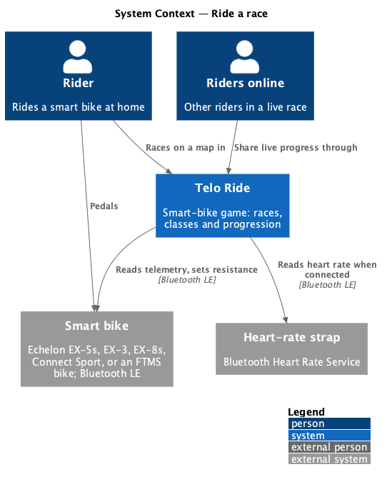
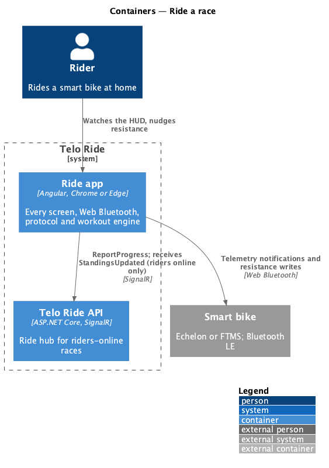
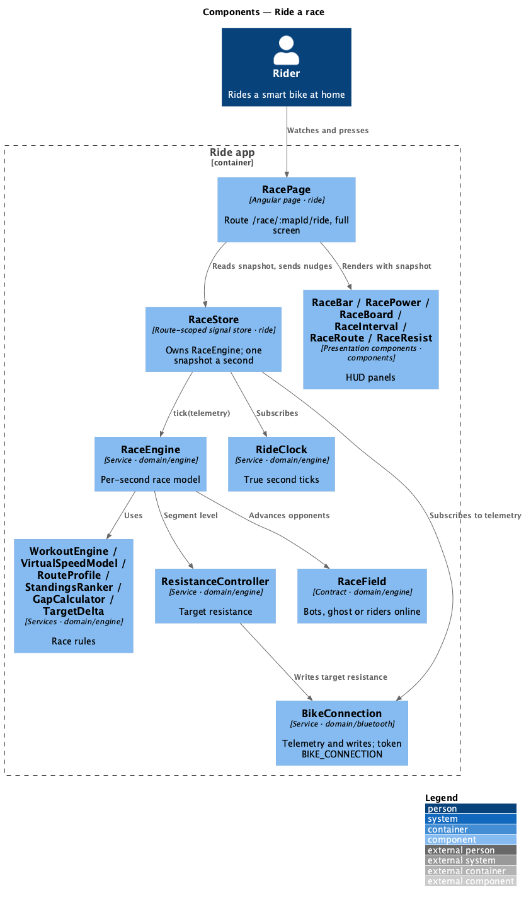
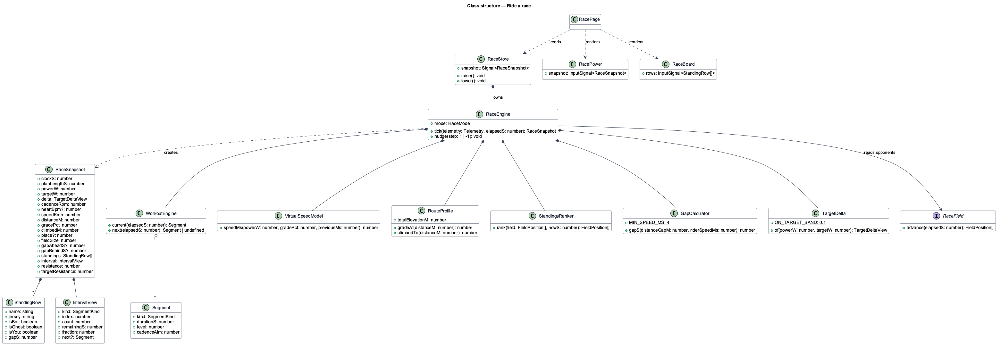
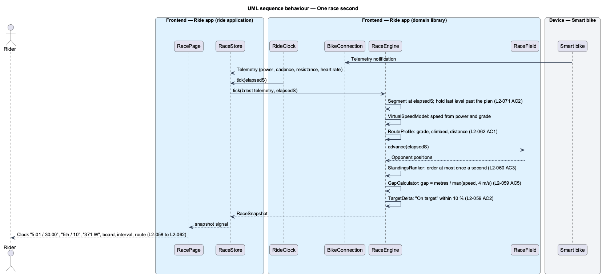
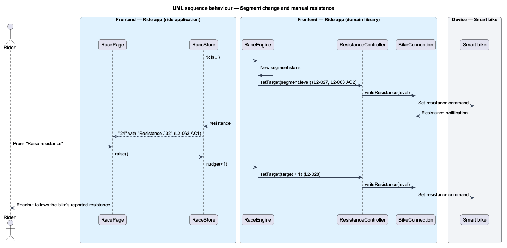

# Ride a race

## Overview

The race screen (`/race/:mapId/ride`) is where a race is ridden. It is full screen with no app
header. The 3D world fills the background (render-the-race-world), and a heads-up display (HUD)
sits over it.

> **HUD** — set of panels drawn over the world: top bar, power and position, standings board, interval panel, route panel and resistance panel

> **race clock** — elapsed race time from Go, shown against the plan's 30:00

> **target power** — power in watts the current segment asks of the rider

> **gap** — time between the rider and another rider, from the distance between them and the rider's speed

> **virtual speed** — speed of the rider along the route, computed from power and grade

Power is the biggest number on the screen, then position. The interval panel says how long is
left in the current effort and what comes next. The route panel shows the grade, climbing and
distance with the rider's place on the elevation profile. The resistance panel shows the
resistance with buttons to nudge it by hand. Each segment of the map's plan sends its level to
the bike when it starts.

The HUD adapts to the width. A phone shows the world, power and interval only. The route panel
joins at sm, the board at md and the resistance panel at lg, where the HUD is three columns.
Every control pressed mid-race on a phone is at least 48 × 48 px.

This feature owns the HUD and the per-second race state. Opponents come from
race-the-ghost-and-bots (bots and ghost) or from the multiplayer subsystem (riders online).
Telemetry and resistance come from the bike subsystem.

## Description

**Slices.** Slice 7.3 builds the race for the rider alone: the top bar (lockup, map and route
line, bike status, clock), power and position, the interval panel, the route panel, the
resistance panel and the layout. Until the opponents join (slice 7.4) the field is the rider
alone, so position reads "1st / 1" with no gaps, and the standings board, `StandingsRanker` and
`GapCalculator` are built with them. Leave, Pause, End and the plan running out before the line
came with slice 7.5 (finish-a-race, pause-leave-or-lose-the-bike-in-a-race), and the mocks'
development-only Finish is not built; the renderer tag and the drawn world with
journey 8, and until then the scene is the map's photo, as the mock draws it, one image described
as "The Old Town Criterium world: a cobbled European old town on race day"; Full screen with
slice 24.2; riders online with journey 15. In a riders-online race (slice 15.3) the board and the
world's riders come from the service's standings (multiplayer/share-progress-and-standings): its
places, and each gap the rider's gap to the leader less the row's.

**Names in the code.** `RaceEngine`'s second is `RaceStore`'s tick (`ride/src/app/race`): it
rides the rider's distance, advances the `RaceField` and ranks the standings. `StandingsRanker`
and `GapCalculator` are `rankStandings` and `formatGap` in `domain/engine/standings.ts` (slice
7.4), and `TargetDelta` is `RaceStore.delta` on `PowerModel.onTarget`.

**The plan and the route, from `main`.** Each map's 30:00 plan and its world's terrain travel in
the catalogue (ADR 0029): `MapDto.plan` (segments, as a class's) and `MapDto.terrain` (the grade
for each segment kind and the rolling grade laid over it, copied from `main`'s `worlds.ts`).
`RouteProfile` is `main`'s `route-profile.ts`, kept as `main` has it: second by second along the
plan, the road eases towards the world's grade for the segment (`targetGrade`) at the segment's
expected speed, which gives the elevation, the grade and the metres climbed; the route panel
reads them at the race clock's second, and draws the profile with the rider's place.
`VirtualSpeedModel` is `main`'s expected-speed formula on the rider's power,
10 × ∛(max(W, 1) ÷ 20) km/h, which gives the spec's 26.5 km/h at 371 W; the distance ridden is
its sum, second by second, and a rider without power (stopped, or cadence gone quiet) rides no further. The grade's
colour follows how the road reads: below −1 % downhill, from 3 % a climb, from 8 % steep, flat between (the design
system's examples, −2.1, +0.5, +4.8 and +9.2). Resistance follows the plan's level (`L2-063` AC2), and the grade
follows the plan too, so the climbs fall on the efforts.

**Ride app**

- **`RacePage`** (`ride`, selector `wz-race-page`, block `race`) — routed page at
  `/race/:mapId/ride`, loaded with `loadComponent`, outside the app shell so it has no app
  header. Its stylesheet holds the HUD layout per breakpoint (L2-072, L2-058 AC4, L2-060 AC5,
  L2-062 AC3, L2-063 AC3).
- **`RaceStore`** (`ride`, provided on the race route) — owns one `RaceEngine` for the race.
  It subscribes to the bike's telemetry through `BIKE_CONNECTION`, ticks with `RideClock`, and
  exposes one `RaceSnapshot` signal per second. All subscriptions and the clock stop on
  destroy.
- **`RaceEngine`** (`domain/engine`) — per-second race model. Each tick it advances
  `WorkoutEngine` along the map's plan, computes virtual speed from `VirtualSpeedModel`,
  advances the rider's distance, moves the opponents of the active `RaceField`, ranks the field
  with `StandingsRanker` and builds gaps with `GapCalculator`. When the plan runs out before
  the line it holds the last segment's level (L2-071 AC2).
- **`WorkoutEngine`**, **`Plan`**, **`Segment`** (`domain/engine`) — the timed segments of the
  map's 30:00 plan; shared with classes and custom workouts.
- **`VirtualSpeedModel`** (`domain/engine`) — power and grade to speed. Its model and constants
  (rider and bike mass, drag area, rolling resistance) are `<TO SUPPLY>` (L2.md open question 2).
- **`RouteProfile`** (`domain/engine`) — distance to grade, metres climbed and the profile's
  total elevation, from the map's elevation profile.
- **`GapCalculator`** (`domain/engine`) — gap in seconds = distance gap in metres ÷ the rider's
  speed in m/s, with the speed taken as at least 4 m/s (L2-059 AC5).
- **`StandingsRanker`** (`domain/engine`) — orders the field by distance, then by finish time
  once finished; it emits a new order at most once a second (L2-060 AC3).
- **`TargetDelta`** (`domain/engine`) — compares power with the segment's target power and
  returns "On target" within 10 % (L2-059 AC2). How a segment's target power in watts is
  derived from its level and cadence aim is `<TO SUPPLY>`.
- **`ResistanceController`** (`domain/engine`, designed by bike/control-resistance) — sends
  each segment's level (L2-027) and applies "Lower resistance" and "Raise resistance" (L2-028).
- **`RaceBar`** (`components`, block `race-bar`) — lockup, map name, route line ("Cathedral
  Circuit · vs Bots, medium", "· vs your best" or "· Live race"), the renderer tag, the bike
  status, the clock (`role="timer"`, "5:01 / 30:00"), and Leave (`aria-label="Leave race"`)
  or, for a solo race, Pause and End (`aria-label="End ride"`), plus Full screen. On a phone
  the buttons are icons only and "/ 30:00" is hidden; the map and route text shows at md or
  wider and the bike status at lg or wider. A "Finish" shortcut exists only when `isDevMode()`
  is true and is removed from production builds (L2-058 AC3).
- **`RacePower`** (`components`, block `race-power`) — "5th / 10" (or "Ahead"/"Behind" with
  "Best +0:01" solo), the gaps "Ahead +0:02" and "Behind −0:01", "371 W", "Target 418 W" with
  "-47 W" or "On target", and Cadence, Heart ("—" without a reading) and Speed.
- **`RaceBoard`** (`components`, block `race-board`) — "Standings · 10 riders" or, solo, "You
  vs your best" with two rows. Each row has a jersey dot, name, bot icon and gap; the rider's
  row has `aria-current="true"`. Rows slide over 150 ms, not under reduced motion.
- **`RaceInterval`** (`components`, block `race-interval`) — "Work", "1 of 8", "0:29"; the round shows for an effort only, and the timer's name says the segment ("2 minutes 59 seconds left in this recovery")
  (`aria-label="29 seconds left in this effort"`), a bar that fills smoothly over the segment,
  and "Next: Recover · 3:00 at level 6".
- **`RaceRoute`** (`components`, block `race-route`) — "+0.5 %", "10 m climbed", "1.62 km" and
  the profile as `role="img"` ("Route profile, 43 m of elevation") with the rider's place.
- **`RaceResist`** (`components`, block `race-resist`) — "Lower resistance", the readout "24"
  with "Resistance / 32", and "Raise resistance".
- **`BikeStatus`** (`components`, designed by bike/keep-the-bike-connected) — the `ble` state.

## Requirements

The feature realizes the following level-2 (L2) requirements. Each L2 requirement refines a
level-1 (L1) requirement, cited by identifier.

| L2 ID | Refines (L1) | Requirement |
|-------|--------------|-------------|
| `L2-058` | `L1-012` | The race (`/race/:mapId/ride`) shall be full screen with no app header. Its top bar shall hold the lockup and "Old Town Criterium" with "Cathedral Circuit · vs Bots, medium", the renderer tag (L2-065), the bike status, the clock (`role="timer"`, "5:01 / 30:00"), Leave (`aria-label="Leave race"`) and Full screen. A solo race shall read "· vs your best" with Pause and End (`aria-label="End ride"`) in place of Leave; riders online shall read "· Live race". A production build shall have no "Finish" shortcut. On a phone the buttons shall be icons only and "/ 30:00" hidden; the map and route text shall show at md or wider and the bike status at lg or wider. |
| `L2-059` | `L1-012` | At 5th of 10 the panel shall read "5th / 10", "Ahead +0:02" and "Behind −0:01", "371 W", and "Target 418 W" with "-47 W" styled under target; within 10 % of target the delta shall read "On target". The stats shall read Cadence "87 rpm", Heart "140 bpm" (or "—", L2-030) and Speed "26.5 km/h". A solo race shall show "Ahead" or "Behind" with "Best +0:01" instead of a place. A gap in seconds shall be the distance gap in metres ÷ the rider's speed in m/s, the speed taken as at least 4 m/s. |
| `L2-060` | `L1-012` | The board shall read "Standings · 10 riders" and list every rider by position with a jersey colour, a name, a bot icon for bots and the gap ("+0:07", "−0:05"). The rider's row shall be highlighted with `aria-current="true"`. It shall reorder at most once a second, rows sliding over 150 ms (no slide with reduced motion). A solo race shall read "You vs your best" with the rows "Your best" (the gold ghost) and You. The board shall be visible at md or wider and hidden on a phone. |
| `L2-061` | `L1-012` | For the first work effort of eight, one second in, the interval panel shall read "Work", "1 of 8" and "0:29" (`aria-label="29 seconds left in this effort"`) with its bar 1/30 full, and "Next: Recover · 3:00 at level 6". Each second the countdown shall drop by one and the bar shall fill smoothly over the segment. |
| `L2-062` | `L1-012` | The route panel shall read the grade ("+0.5 %"), metres climbed ("10 m climbed") and distance ridden ("1.62 km"). The profile shall be an image (`role="img"`, "Route profile, 43 m of elevation") with the rider's place marked. The panel shall be visible at sm or wider and hidden on a phone. |
| `L2-063` | `L1-012` | The resistance panel shall hold "Lower resistance", the readout "24" with "Resistance / 32", and "Raise resistance" (L2-028). Each segment's level shall be sent when it starts (L2-027). At lg or wider the panel shall be visible and the HUD three columns (interval, route, resistance); below lg the panel shall be hidden. |
| `L2-072` | `L1-012` | On a phone the world, power panel and interval panel shall be visible and the route, board and resistance panels hidden. At lg or wider every panel shall be visible and none shall cover another. Every control pressed mid-race on a phone shall measure at least 48 × 48 px. |

## Diagrams

### System context

The rider rides a race in Telo Ride on a smart bike. Telo Ride reads the bike's telemetry and
sets its resistance; riders online share standings through Telo Ride.

### Containers

The Ride app runs the race: it talks to the bike over Web Bluetooth and, for a riders-online
race only, to the ride hub in the Telo Ride API.

### Components

`RaceStore` drives `RaceEngine` once a second from the bike's telemetry. The engine composes
the plan, speed, route, ranking and gap rules; the HUD components render its snapshot.

### Class structure

`RaceEngine` composes `WorkoutEngine`, `VirtualSpeedModel`, `RouteProfile`, `StandingsRanker`,
`GapCalculator` and `TargetDelta`, and reads opponents from a `RaceField`. Each tick yields a
`RaceSnapshot` that the HUD components take as input.

### Behaviour — one race second

Each second the engine reads the latest telemetry, advances the plan and the rider, moves the
field, and the HUD re-renders from the new snapshot.

### Behaviour — segment change and manual resistance

At each segment start the level goes to the bike as the target resistance. "Raise resistance"
and "Lower resistance" nudge it by hand between segment starts.

## Open questions

- **Grade and speed.** `L2-064` AC2 computes virtual speed from power and grade; `main`'s model,
  which the mock's numbers follow, uses power alone. The race uses `main`'s until the model and
  its constants (L2.md open question 2) are settled.
- **The route's length.** The profile follows the plan's expected speed, so Old Town's is about
  9.5 km against its 14.2 km. Slice 7.5 settled the line at the map's distance (`L2-071`); the
  profile stays drawn on the plan's time, so past the plan's end it holds its last second, the
  marker at its end, until the rider reaches the line. Drawing the profile on distance waits for
  the speed model (above).
- **The plans.** Every map rides one 30:00 plan for now, the HIIT shape of the mock: a 5:00
  warm-up at level 8 and 80 rpm, eight 0:30 efforts at level 24 and 98 rpm (418 W) with
  recoveries from 3:00 down to 1:30 at level 6, and a 6:00 cool-down at level 6 and 70 rpm, the
  plan `main`'s Old Town mock is drawn from, so the profile reads its 43 m. Each
  map's own plan replaces it in the catalogue, with no change to code.
- **The grade at 5:01.** `main`'s profile reads +2.2 % at 5:01 on Old Town, where the road starts up the first
  effort; `L2-062` AC1 and the mock read the warm-up's +0.5 %, as `main`'s own spec notes of its mock. The mock's
  climbed (10 m) and elevation (43 m) agree.
- **Vice City's terrain.** `main`'s world table has no Vice City; its terrain is South Beach's
  (Ocean Drive) until the world slices (journey 8) bring its world.
- **Heart rate.** The power panel reads the bike's own heart rate, "—" on an Echelon; the strap
  (`HeartRateSource`, `L2-031`) joins it when the app binds `HEART_RATE_STRAP`.
- **Speed in the stats.** The power panel's Speed is the virtual speed, not the Echelon's
  cadence speed (`L2-022`).
