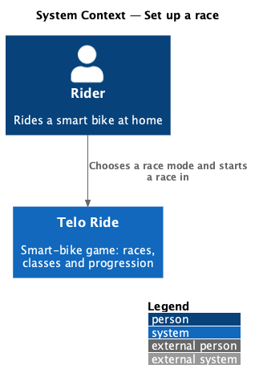
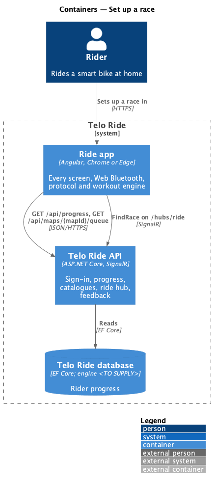
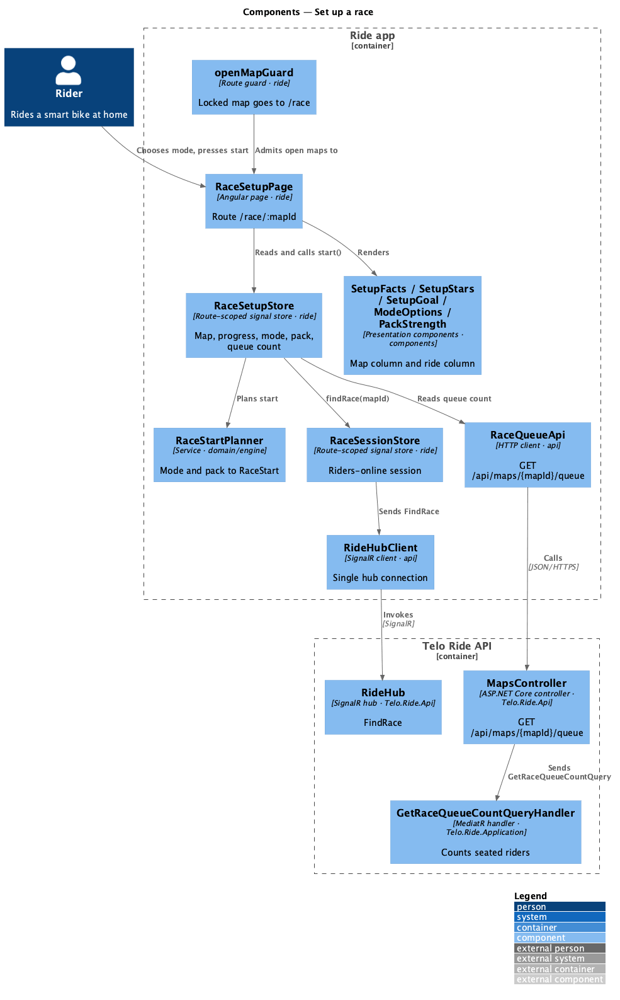
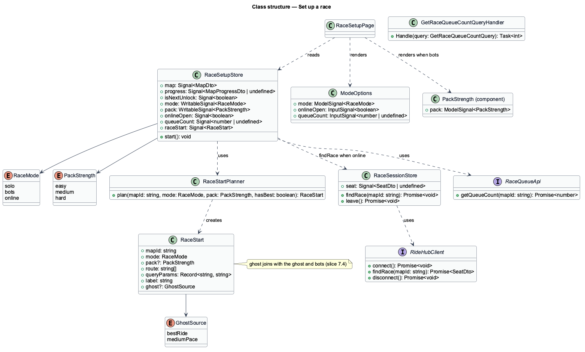
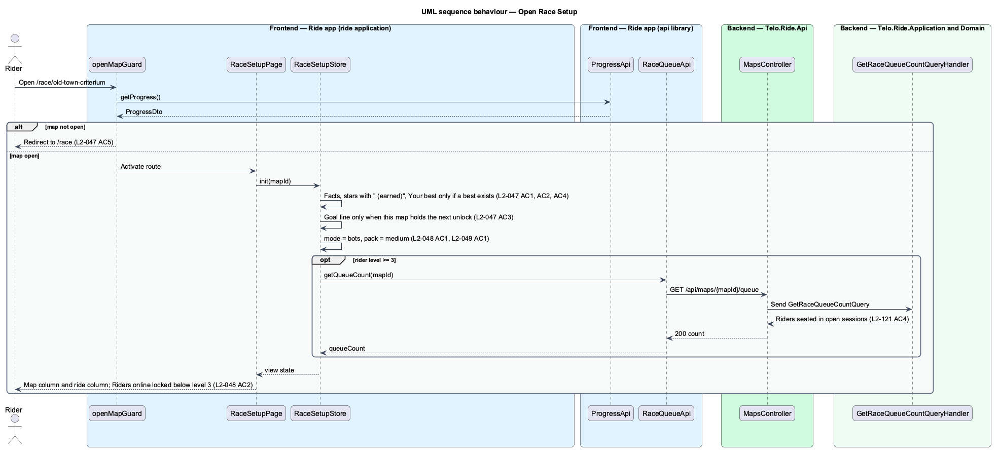
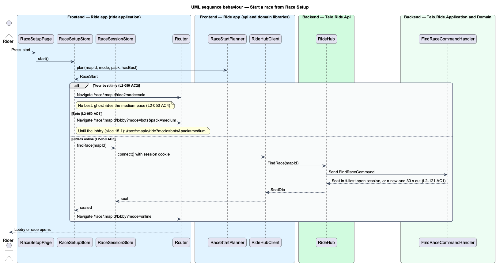

# Set up a race

## Overview

Race Setup (`/race/:mapId`) is the screen between choosing a map and riding it. It shows the
map's facts and stars, and it lets the rider choose whom to race before starting.

> **race mode** — choice of opponent for one race: "Your best time", "Bots" or "Riders online"

> **ghost** — replay of the rider's fastest finished ride on a map, used as the opponent in a solo race

> **pack strength** — target pace of a bots race: easy (about 130 W), medium (about 190 W) or hard (about 250 W)

> **queue count** — number of riders seated in open riders-online sessions for one map

The three modes lead to three different starts. "Your best time" is solo: it opens the race at
once, with the ghost setting the pace. Bots opens the lobby with nine computer riders. Riders
online asks the multiplayer service for a seat, then opens the lobby. Riders online opens at
rider level 3; below that the option is disabled and says so.

Race Setup sits in the race subsystem after Map Select (browse-maps) and before the lobby
(wait-in-the-race-lobby) or the race itself (ride-a-race). Stars, bests and the next unlock come
from the progression subsystem through the rider's progress.

## Description

**Slices.** Slice 7.2 builds Race Setup for the progress `PROGRESS_API` gives, which until the
backend keeps progress (journey 10) is a new rider's (`NewRiderProgress`): no best and no star on
any map, Cliffside Coast the next unlock, so the goal line shows on Prairie Paceline, and rider
level 1, so "Riders online" is always disabled with "Opens at level 3." `SetupFacts` and
`SetupStars` already draw a best and earned stars. The queue count, "Find a race",
`RaceSessionStore`, `RideHubClient`, `RaceQueueApi` and `GET /api/maps/{mapId}/queue` come with
live races (journey 15), the first time a rider can reach level 3. The race lobby is slice 15.1;
until it is built, "Go to the start line" opens the race at once
(`/race/:mapId/ride?mode=bots&pack=medium`), as "Start ride" does (`?mode=solo`), and the race
itself is slice 7.3. The ghost's pace on a map with no best (`L2-050` AC4) comes with the ghost
(slice 7.4), and Full screen in the header with slice 24.2.

The map comes from the catalogue (`MAPS_API`, browse-maps), which carries `photoUrl`, the 21:9
photo Race Setup shows, and `unlockMapId`, the map a goal is earned on, so the store can tell
whether this map holds the rider's next unlock.

**Ride app**

- **`openMapGuard`** (`ride`, functional `CanActivateFn` on `/race/:mapId`) — reads the
  rider's progress and returns a `UrlTree` to `/race` when the map is not open (L2-047 AC5).
- **`RaceSetupPage`** (`ride`, selector `wz-race-setup-page`) — routed page, loaded with
  `loadComponent`. It reads `RaceSetupStore` and renders the map column and the ride column.
  At lg or wider it is two columns, the ride panel 420 px wide, with Start pinned to the bottom.
- **`RaceSetupStore`** (`ride`, provided on the page, so it goes when the rider leaves) — signal
  store holding the map, its progress, the rider level, `mode` (a `RaceMode`, default `bots`),
  `pack` (a `PackStrengthId`, default `medium`), the `modes` it offers and `raceStart`, which
  `RaceStartPlanner` derives: the label ("Start ride", "Go to the start line" or "Find a race")
  and the route. It exposes `start()`. `RaceMode` and `PackStrengthId` are types in `api`. The
  queue count joins it with journey 15.
- **`SetupHeader`**, **`SetupMap`**, **`SetupFacts`** (`components`, blocks `setup-header`,
  `setup-map`, `setup-facts`/`setup-fact`) — the small lockup with the page's back link "Maps"
  (`BackLink`, as on Class Start) in the header, and the photo, name, route line, and
  Distance, Climbing, Rated and "Your best". "Your best" is absent when the map has no best.
- **`SetupStars`** (`components`, block `setup-stars`) — "Stars here" with the three rules;
  an earned rule is struck through and carries the hidden text " (earned)".
- **`SetupGoal`** (`components`, block `setup-goal`) — the unlock goal line, rendered only when
  this map holds the next unlock: "**Finish top 3 vs Bots on Old Town Criterium** to open Neon
  Docklands."
- **`ModeOptions`** (`components`, blocks `mode-options`/`mode-option`) — a WAI-ARIA radio group
  labelled "Race mode" of buttons with `role="radio"`, as the mock draws it and as `RideChoice`
  does on Class Start: the chosen option is the one in the tab order and the arrow keys move the
  choice (L2-048 AC4), through `radioStep` (`components`), which `RideChoice` and `PackStrength`
  share. Riders online is `aria-disabled` with a lock and "Opens at level 3." below
  level 3, and the arrow keys pass over it.
- **`PackStrength`** (`components`, block `pack`) — easy, medium and hard as a radio group of
  `role="radio"` buttons, moved by the arrow keys, with the note for the chosen strength;
  rendered only when the mode is Bots.
- **`RaceStartPlanner`** (`domain/engine`) — pure helper that turns `(mapId, mode, pack)` into a
  `RaceStart`: the route to open, its query parameters and the start button's label. The
  opponent set it plans with the rider's best ride (a solo race with no best uses the medium
  pace for the ghost, L2-050 AC4) joins it with the ghost and bots (slice 7.4).
- **`RaceSessionStore`** (`ride`, provided on the `/race/:mapId` parent route, so it lives
  through setup, lobby and ride and is released when the rider leaves them) — owns the
  riders-online session. Its `findRace(mapId)` opens the hub connection through
  `RideHubClient` and sends `FindRace` (L2-121).
- **`RideHubClient`** (`api`, token `RIDE_HUB_CLIENT`) — the single SignalR client; designed by
  the multiplayer subsystem (connect-to-the-ride-hub).
- **`RaceQueueApi`** (`api`, token `RACE_QUEUE_API`, implementation `HttpRaceQueueApi`) —
  `riders(mapId)` over `GET /api/maps/{mapId}/queue`. An HTTP read keeps the hub closed
  while no multiplayer ride is joined (L2-120 AC4). This endpoint is introduced here and is
  served by the multiplayer subsystem's session registry. From level 3, `RaceSetupStore` asks
  at once and every 10 seconds while Race Setup is open; while the endpoint cannot be reached,
  "Riders online" reads "Riders online can’t be reached right now." and stays disabled.

**Telo Ride API**

- **`MapsController.GetQueueCount`** (`Telo.Ride.Api`) — `GET /api/maps/{mapId}/queue`; sends
  `GetRaceQueueCountQuery`.
- **`GetRaceQueueCountQueryHandler`** (`Telo.Ride.Application`) — counts riders seated in open
  `RaceSession`s for the map (L2-121 AC4).

The chosen mode and pack travel as query parameters (`?mode=bots&pack=medium`), so the lobby
and race can be reloaded and "Leave" can return to Race Setup with the same mode (L2-057).

## Requirements

The feature realizes the following level-2 (L2) requirements. Each L2 requirement refines a
level-1 (L1) requirement, cited by identifier.

| L2 ID | Refines (L1) | Requirement |
|-------|--------------|-------------|
| `L2-047` | `L1-010` | Race Setup (`/race/:mapId`) shall show the back link "Maps", the map's photo, its name and route line ("Cathedral Circuit · A cobbled European old town on race day"), and Distance "14.2 km", Climbing "140 m", Rated "Easy" and Your best "27:10"; Your best shall be absent when the map has no best. "Stars here" shall list the three rules, earned ones struck through with the hidden text " (earned)". When the map holds the next unlock the ride column shall read "**Finish top 3 vs Bots on Old Town Criterium** to open Neon Docklands."; on any other map there shall be no goal line. A locked map's address shall open Map Select instead. At lg or wider Race Setup shall be two columns (map, then a 420 px ride panel) with Start pinned to the bottom. |
| `L2-048` | `L1-010` | "Race against" shall be a radio group "Race mode" with "Your best time" ("Solo. A ghost of your fastest ride sets the pace."), "Bots" chosen by default ("9 computer riders. Starts the moment you're ready.") and "Riders online" ("{n} riders queuing now. 8–10 per race, empty seats go to bots."). Below level 3, "Riders online" shall be disabled with a lock and "Opens at level 3." {n} shall be the live count of riders in the service's queue for the map. The arrow keys shall move the choice. |
| `L2-049` | `L1-010` | When Bots is chosen, "Pack strength" shall offer easy, medium (default) and hard as a radio group, and shall be absent for other modes. Medium shall read "Around 190 W. A top 3 here earns the second star.", hard "Around 250 W. Expect to hurt." and easy "Around 130 W. Good for learning the course." The bots' pace shall follow the chosen strength (L2-067). |
| `L2-050` | `L1-010` | With Bots the start button shall read "Go to the start line" and open the lobby with nine bots. With "Your best time" it shall read "Start ride" and open the race at once, with no lobby. With Riders online it shall read "Find a race", ask the service for a seat (L2-121) and then open the lobby. A solo race on a map with no best shall have the ghost ride the map's medium pace. |

## Diagrams

### System context

The rider sets up a race in Telo Ride. No external system takes part in this slice.

### Containers

The Ride app reads the map and progress over HTTPS, reads the queue count over HTTPS, and opens
the SignalR ride hub only when the rider chooses "Find a race".

### Components

`RaceSetupPage` reads `RaceSetupStore`, which plans the start with `RaceStartPlanner`. A
riders-online start goes through `RaceSessionStore` and `RideHubClient` to `RideHub`.

### Class structure

`RaceSetupStore` holds a `RaceMode` and a `PackStrength` and asks `RaceStartPlanner` for a
`RaceStart`, which names the route to open and the opponents.

### Behaviour — open Race Setup

The guard sends a locked map's address back to Map Select. For an open map the store composes
facts, stars, the goal line and, at level 3 or higher, the queue count.

### Behaviour — start a race

The start depends on the mode: solo opens the race at once, Bots opens the lobby, and Riders
online asks the hub for a seat before opening the lobby.

## Open questions

- **Bots before the lobby.** `L2-050` AC1 opens the lobby with nine bots, but the lobby is slice
  15.1, after the race (7.3 to 7.5). Until then "Go to the start line" opens the race at once
  with the bots on the line, so a bots race can be ridden in journey 7; slice 15.1 puts the
  lobby between them.
- **Riders online (slice 15.1).** From level 3, "Riders online" reads "{n} riders queuing now.
  8–10 per race, empty seats go to bots." and "Find a race" opens the lobby at
  `/race/:mapId/lobby?mode=online`, which asks the hub for the seat (`L2-050` AC3); Race Setup
  itself holds no hub connection. A Race Setup address with `?mode=online` opens with Riders
  online chosen, which is where the lobby's Leave returns. The queue refreshes every 10 seconds,
  the interval the design left to supply.
- **The photo.** Each map's 21:9 photo is cropped from the mocks' world picture
  (`docs/mocks/assets/images/worlds/`) and served by the app as `maps/<mapId>-photo.jpg`; the
  rendered world replaces it with journey 8.
