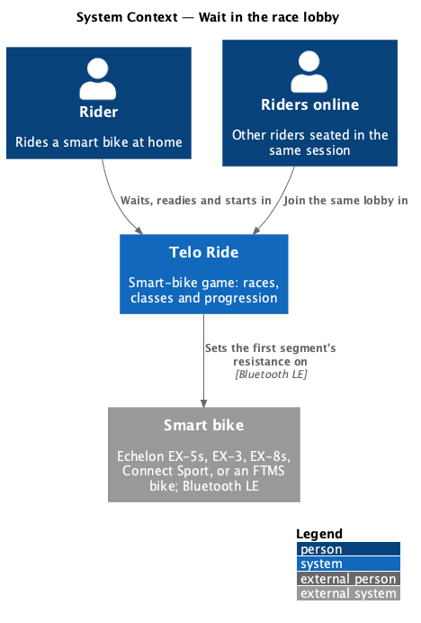
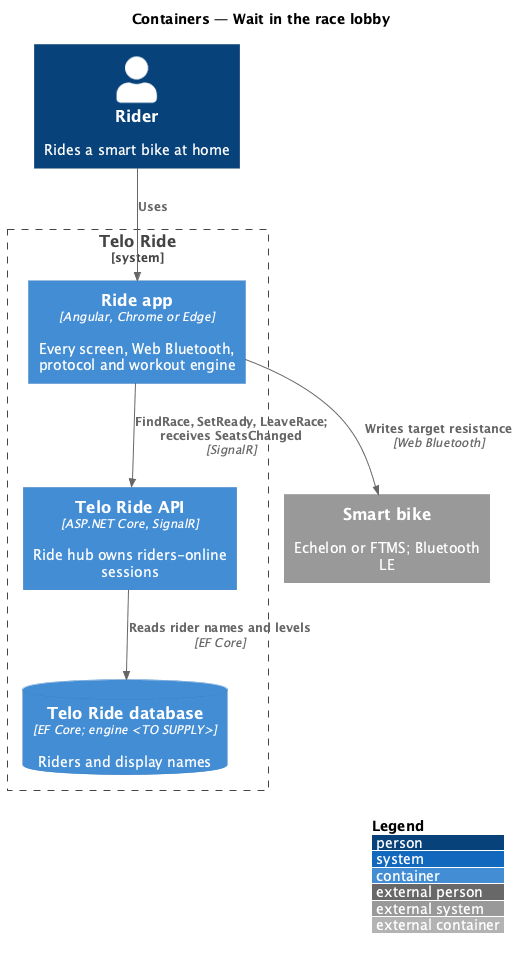
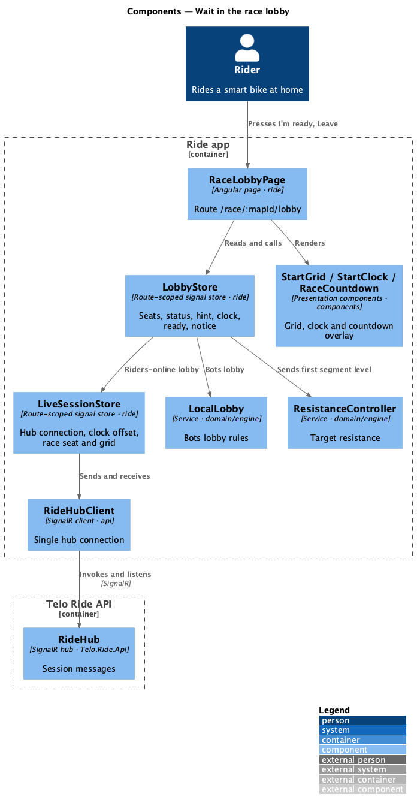
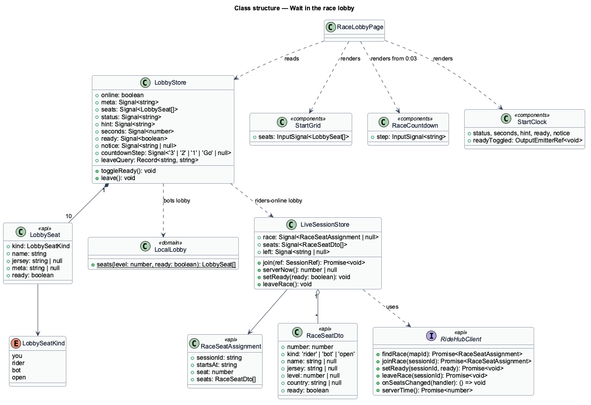
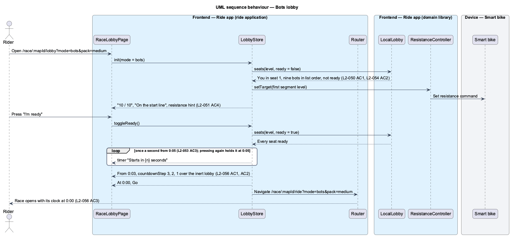
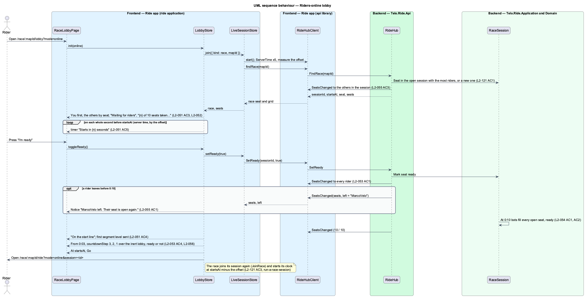
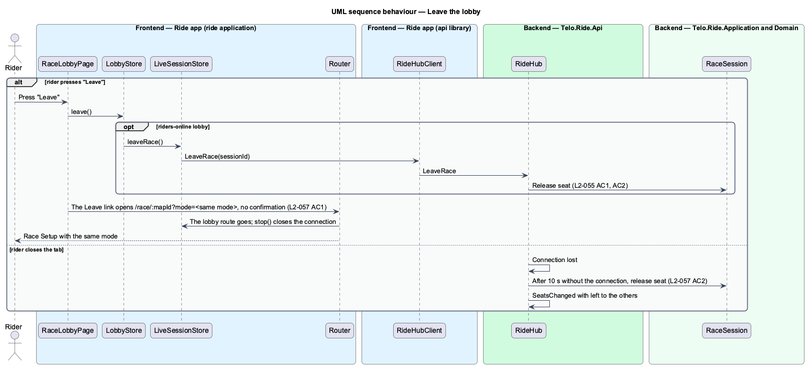

# Wait in the race lobby

## Overview

A race against bots or riders online starts from a lobby (`/race/:mapId/lobby`). The lobby
gathers the field, shows who is on the start grid, runs a ready check, and starts every rider
together with a shared countdown. A solo race against the rider's ghost has no lobby.

> **lobby** — pre-race screen that seats the field and counts down to a shared start

> **start grid** — ten ordered seats for one race; seat 1 is always the rider ("You")

> **open seat** — seat not yet taken by a rider or a bot

> **start clock** — countdown to the race start, shown as a timer with a status line and a hint

> **ready check** — toggle by which a seated rider tells the field they are ready

> **shared start** — race start sent by the multiplayer service as a server time, at which every client's race clock begins

A bots lobby runs entirely in the browser. It seats nine bots at once, none ready, and holds
the clock at 0:05; when the rider presses "I'm ready", every bot is ready and the clock runs
from 0:05, and pressing again holds it at 0:05 once more. A riders-online lobby mirrors a
session run by the multiplayer service: riders join and leave, bots take every open seat at
0:10, and the race starts at 0:03 whether or not every rider is ready. In both, the countdown
covers the screen for 3, 2, 1 and Go, and the race opens at Go with its clock at 0:00.

The lobby sits between Race Setup (set-up-a-race) and the race (ride-a-race). The session rules
themselves (seating, bot fill, start time) are designed by the multiplayer subsystem
(run-a-race-session); this feature is the rider-facing side of them.

## Description

**Ride app**

- **`RaceLobbyPage`** (`ride`, selector `wz-race-lobby-page`, block `race-lobby`) — routed page
  at `/race/:mapId/lobby`, loaded with `loadComponent`. It renders the header ("Old Town
  Criterium · 14.2 km · Riders online" or "· Bots, medium"), "Leave", Full screen, the hidden
  heading "Race lobby, Old Town Criterium", the start clock and the grid. At lg or wider the
  clock sits beside the grid; at sm or wider the grid is two columns.
- **`LobbyStore`** (`ride`, provided by the page) — signal store exposing `meta`, `seats`,
  `status` ("Waiting for riders" or "On the start line"), `hint`, `seconds`, `ready`,
  `notice`, `countdownStep` ("3", "2", "1" from 0:03, "Go" at 0:00, otherwise `null`) and
  `leaveQuery`. It drives a bots lobby through `LocalLobby` and a riders-online
  lobby through `LiveSessionStore`. Online, it counts the whole seconds to the session's
  `startsAt` on server time (the device clock plus the measured offset), waking on the seconds
  before it, and at Go opens the race in its session
  (`/race/:mapId/ride?mode=online&session=<id>`), where the race joins it again and starts its
  clock on the same server time. It clears its timer on destroy.
- **`LocalLobby`** (`domain/engine`) — pure rules of a bots lobby: `seats(level, ready)` puts
  You in seat 1 at "Lv {level}" and the bots in list order in seats 2 to 10 (Pacer Nova, Rook,
  Juno, Atlas, Kite, Vale, Moss, Flint, Echo), ready when the rider is; `BOTS_LOBBY_SECONDS`
  is 5 (L2-053 AC3).
- **`LiveSessionStore`** (`ride`, provided by the page, as in a group class) — opens the ride
  hub connection, measures the clock offset from five `ServerTime` calls, then sends
  `FindRace(mapId)`. It holds the race seat (`race`: session, start, seat number), the grid
  (`seats`, replaced by each `SeatsChanged` of its session) and the last leaver (`left`). It
  sends `SetReady` and `LeaveRace`, finds the race again after a reconnect, and closes the
  connection when the lobby goes.
- **`StartGrid`** (`components`, block `start-grid`) — "Start grid" with "{n} / 10" and ten
  seats. A rider online shows name, jersey colour, country and level ("DE · Lv 4"); a bot shows
  its name, a bot icon and "Bot"; an empty seat reads "Open seat"; a ready seat carries a check
  with `aria-label="Ready"`.
- **`StartClock`** (`components`, elements of `race-lobby`) — status line, the timer
  (`role="timer"`, `aria-label` "Starts in {n} seconds"), the hint and the "I'm ready" toggle.
  The toggle is a button with `aria-pressed`; pressed it reads "You're ready" with a check.
- **`RaceCountdown`** (`components`, block `race-countdown`) — full-screen overlay
  (`role="timer"`, `aria-live="assertive"`, "Race starts in 3") showing 3, 2, 1 and Go, one a
  second. Each step fades and scales in over 200 ms; under `prefers-reduced-motion` it only
  fades. Each step is a new numeral, so its animation runs again. While it shows, the lobby's
  scroll area behind it carries `inert` and `aria-hidden`; the header keeps Leave and Full
  screen, as the mock draws.
- **`ResistanceController`** (`domain/engine`, designed by bike/control-resistance) — sends
  the first segment's level as the target resistance once the rider is "On the start line"
  (L2-051 AC4).

**Telo Ride API** (designed by multiplayer/run-a-race-session)

- **`RideHub`** — `FindRace(mapId)` answers the session, its `startsAt`, the rider's seat and
  the grid; `SetReady(sessionId, ready)` and `LeaveRace(sessionId)`; pushes `SeatsChanged`
  (the grid, with `left` naming a rider whose seat is open again) to the session's group.
- **`GET /api/maps/{mapId}/queue`** — the riders seated in the map's open sessions, for Race
  Setup's "Riders online" line, polled every 10 seconds from level 3.
- **`RaceSession`** (`Telo.Ride.Domain`) — seats at most 10, fills open seats with bots at 10 s,
  releases a seat whose connection is gone for 10 s in the lobby (L2-057 AC2).

## Requirements

The feature realizes the following level-2 (L2) requirements. Each L2 requirement refines a
level-1 (L1) requirement, cited by identifier.

| L2 ID | Refines (L1) | Requirement |
|-------|--------------|-------------|
| `L2-051` | `L1-011` | The lobby (`/race/:mapId/lobby`) header shall read "Old Town Criterium · 14.2 km · Riders online" (or "· Bots, medium") with "Leave" and Full screen, under the hidden heading "Race lobby, Old Town Criterium". The start clock shall have a status line, a clock (`role="timer"`, `aria-label` "Starts in {n} seconds"), a hint and the "I'm ready" toggle. With open seats online, the status shall read "Waiting for riders" and the hint "{n} of 10 seats taken. At 0:10 bots fill the rest so the race starts full." With every seat taken, the status shall read "On the start line", the hint "Keep pedalling easy. Resistance is set for the first stretch.", and the first segment's level shall be sent to the bike. Online, the clock shall show the session's time to start, counting down once a second from at most 0:30. At lg or wider the clock shall sit beside the grid; at sm or wider the grid shall be two columns. |
| `L2-052` | `L1-011` | The start grid shall read "Start grid" with "{n} / 10" and list 10 seats in order, seat 1 always "You" with the rider's level. A rider online shall show name, jersey colour, country and level ("DE · Lv 4"); a bot its name, a bot icon and "Bot"; an empty seat "Open seat". A ready rider's seat shall carry a check (`aria-label="Ready"`). |
| `L2-053` | `L1-011` | Pressing "I'm ready" shall make it "You're ready" with a check and `aria-pressed="true"`, and the seat shall show ready for every rider in the session; pressing again shall return it to "I'm ready". In a bots lobby, "I'm ready" shall start the clock from 0:05 and make every bot ready. Online, the race shall start at 0:03 whether or not every rider is ready. |
| `L2-054` | `L1-011` | Online with open seats, at 0:10 bots shall take every open seat, the status shall become "On the start line" and the count "10 / 10". Seated bots shall be ready, with names from the bot list in order. A race shall always start with 10 riders. |
| `L2-055` | `L1-011` | When MarcoVelo leaves a riders-online lobby before 0:10, a notice (`role="status"`) shall read "MarcoVelo left. Their seat is open again.", MarcoVelo's seat shall read "Open seat" and the count shall drop by one. A rider who leaves after 0:10 shall be replaced by a bot at once. A joining rider shall take the first open seat within one second for every rider in the session. |
| `L2-056` | `L1-011` | At 0:03 the countdown shall cover the screen (`role="timer"`, `aria-live="assertive"`, "Race starts in 3") with the page behind inert. It shall show 3, 2, 1 and Go, one a second, each step fading and scaling in over 200 ms, and only fading with reduced motion. At Go the race shall open with its clock at 0:00. Every rider's race clock in one session shall start within 250 ms of the others' (L2-121). |
| `L2-057` | `L1-011` | Pressing "Leave" shall open Race Setup with the same mode, without a confirmation, and release the rider's seat. When the rider closes the tab in a riders-online lobby, the seat shall be released as in L2-055 once the service has lost the connection for 10 seconds. |

## Diagrams

### System context

The rider waits with other riders in a Telo Ride lobby. Other riders online are themselves
riders of the same system.

### Containers

A bots lobby stays inside the Ride app. A riders-online lobby keeps one SignalR connection to
the Telo Ride API, whose ride hub owns the session. The app sends the first segment's level to
the smart bike once the field is full.

### Components

`RaceLobbyPage` reads `LobbyStore`. The store uses `LocalLobby` for a bots lobby and
`LiveSessionStore` for the online session, and renders through `StartGrid` and `StartClock`.

### Class structure

`LobbyStore` holds ten `LobbySeat` values. `LocalLobby` produces them for a bots lobby; for an
online one the store maps them from the `RaceSeatDto` grid `LiveSessionStore` holds, You
first and the others by seat.

### Behaviour — bots lobby

Nine bots are seated at once. "I'm ready" readies them and starts the clock from 0:05; from 0:03
the countdown covers the lobby, and at Go the race opens.

### Behaviour — riders-online lobby

The lobby asks the hub for a seat and draws the grid it answers; then seats follow each
`SeatsChanged`. At 0:10 the service fills open seats with bots. From 0:03 the countdown covers
the lobby, ready or not; at Go the race opens in its session and starts its clock at the
session's server-time start.

### Behaviour — leave the lobby

"Leave" releases the seat without a confirmation and returns to Race Setup with the same mode.
A closed tab releases the seat after the service has lost the connection for 10 seconds.

## Open questions

1. **As built in slice 15.1.** `LobbyClock` was not built: the components library cannot
   import `domain`, and the store's countdown is a few lines. `RaceSessionStore` became the
   group classes' `LiveSessionStore`, which already held the connection and the clock offset.
   `RiderLeft` became the `left` field of `SeatsChanged`, so a leave is one message.
   `LeaveSession` became `LeaveRace`, and the hub's `FindRace` gives the seat.
2. **Where seat 1 is.** L2-052 puts "You" in seat 1, but the service seats riders in the
   order they come. The lobby draws You first and the others in seat order, so a seat's number
   on screen is its place in that list, not the service's seat number.
3. **Who may find a race.** The service does not yet check that the rider is level 3 or more
   or that the map is open to them; Race Setup does. A later slice may refuse `FindRace` with
   a code.
4. **Countries.** The service knows no rider's country, so a rider's seat reads "Lv 4" alone
   (L2-052 AC2); see the requirements' open question 16.
5. **Leaving during the countdown (slice 15.2).** The countdown makes the lobby's grid and
   "I'm ready" inert from 0:03, so "You're ready" can be pressed again only before then
   (L2-053 AC2 and L2-056 AC1 together). The header's Leave stays live, as in the mock.
6. **Go before the race loads.** "Go" shows while the race's code loads; the race's clock does
   not depend on it, since an online race counts from the session's start and a bots race starts
   when it opens.
