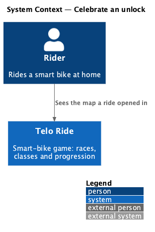
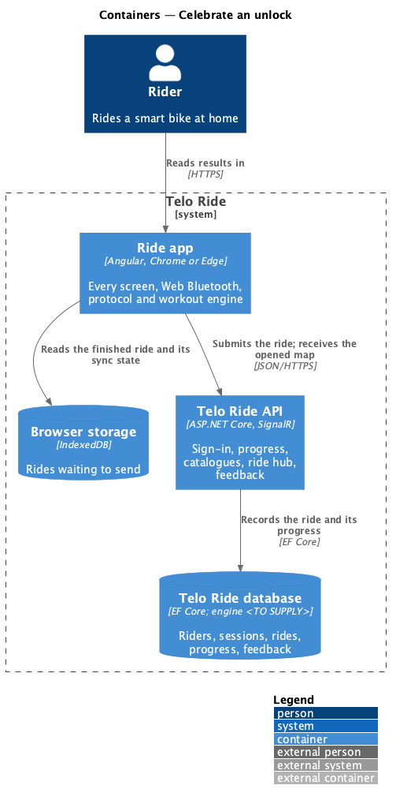
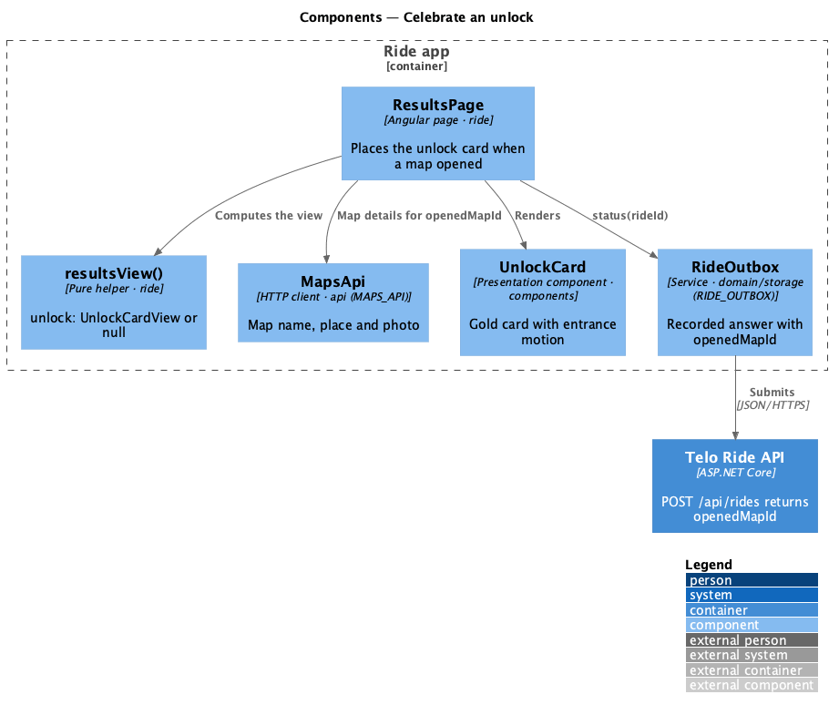
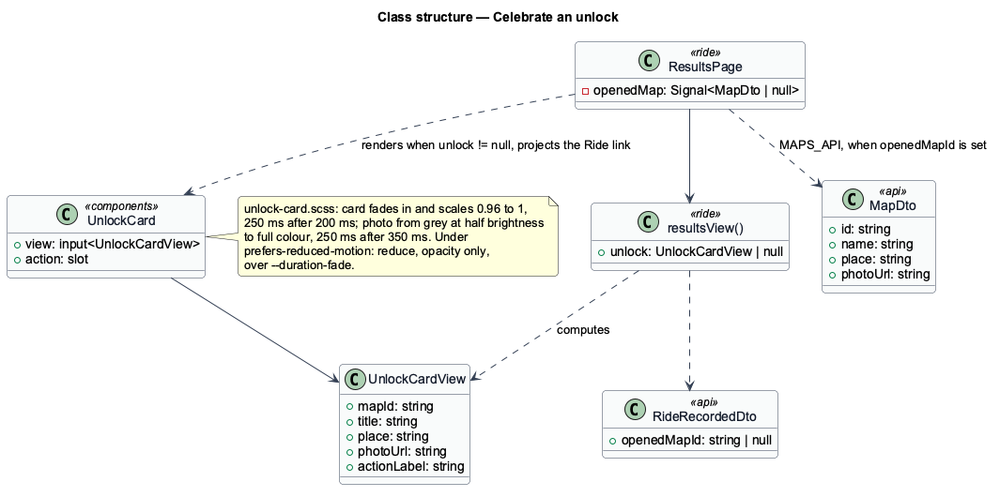
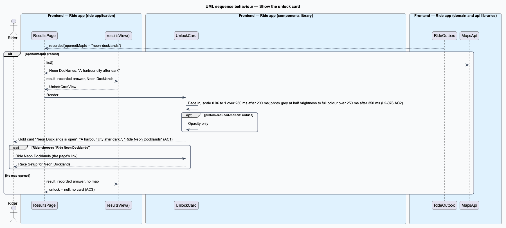

# Celebrate an unlock

## Overview

Opening a new map is the biggest reward in Telo Ride's progression. It is also the one moment the
app celebrates with motion (L1-013). When a ride meets a locked map's goal, Results shows a gold
card that names the map and offers to race it.

- **unlock** — opening of a locked map when the rider meets its goal
  (`progression/earn-stars-and-unlock-maps`)
- **unlock card** — gold card on Results that announces the opened map
- **reduced motion** — rider's operating-system preference, exposed as the
  `prefers-reduced-motion: reduce` media feature, for less movement on screen

The backend decides whether a ride opened a map and names it in its answer (L2-040 AC5). Results
shows the card only then. The same unlock also drives the banner on Home
(`home/choose-the-next-ride`, L2-036).

## Description

- **`SubmitRideCommandHandler`** — names the map a ride opened as `openedMapId` in its answer,
  from `UnlockRules` (see `progression/earn-stars-and-unlock-maps`), and keeps it on the recorded
  ride, so a repeat answers the same. A ride that opens nothing answers `null`.
- **`ResultsPage`** — when the outbox's sync state becomes `recorded` with an `openedMapId`, it
  reads the map catalogue through `MAPS_API`, only then, and passes the map to `resultsView()`
  (see `show-results`), which sets `unlock` to an `UnlockCardView`; otherwise, or when the map is
  not in the catalogue, `unlock` stays `null`.
- **`UnlockCardView`** — the map id, the title "{map} is open", the place line ("A harbour city
  after dark.", from `MapDto.place`), the photo (`MapDto.photoUrl`) and the action label
  "Ride {map}".
- **`UnlockCard`** — presentation component (`wz-unlock-card`, block `unlock-card`). It renders
  the card and projects its action, a link the page provides. Its stylesheet defines the entrance:
  - the card fades in and scales from 0.96 to 1 over 250 ms, starting after 200 ms;
  - the photo fades from grey at half brightness to full colour over 250 ms, starting after
    350 ms;
  - under `prefers-reduced-motion: reduce`, only opacity changes, over `--duration-fade`, the
    one duration reduced motion keeps (L2-142 AC2 excepts opacity fades).

  Durations and easing come from the design-system motion tokens; the photo's 350 ms is
  `--duration-base` plus `--duration-fast`. The animation is CSS only, so it holds no timer to
  release.
- **`ResultsPage`** — renders the card at the top of "What you earned" when `unlock` is set,
  with a gold "Ride {map}" link to Race Setup for that map.

## Requirements

| L2 ID | Refines (L1) | Requirement |
|-------|--------------|-------------|
| `L2-076` | `L1-013` | When a ride opened Neon Docklands, Results shall show a gold card reading "Neon Docklands is open" and "A harbour city after dark.", with "Ride Neon Docklands" (to Race Setup for it). |
| `L2-076` (AC2) | `L1-013` | The card shall fade in and scale from 0.96 to 1 over 250 ms after 200 ms, then its photo shall fade from grey at half brightness to full colour over 250 ms after 350 ms; with reduced motion, only opacity shall change. |
| `L2-076` (AC3) | `L1-013` | When no map opened, Results shall show no unlock card. |

## Diagrams

### System context

The rider sees in Telo Ride the map a ride opened. No external system takes part.

### Containers

The Telo Ride API names the opened map in its answer to the ride's submission; the Ride app shows
the card.

### Components

`ResultsPage` reads the opened map from the outbox's recorded answer and its details from
`MapsApi`, and renders `UnlockCard`.

### Class structure

`resultsView()` computes an `UnlockCardView` from `RideRecordedDto.openedMapId` and the `MapDto`.
The note records the motion the stylesheet applies.

### Behaviour — show the unlock card

With an opened map, the card enters with the timed fade, scale and colour change, or opacity only
under reduced motion (L2-076 AC2). With none, no card shows (AC3).

## Open questions

- **Race Setup for a map just opened.** Resolved in slice 12.1: Race Setup's guard reads the
  rider's open maps from the backend (`HttpProgressApi`), so "Ride Neon Docklands" opens Race
  Setup for it.
- **The action's height.** The mock draws "Ride {map}" 44 px tall; the gold link uses the
  button's default 40 px height, whose touch area is 44 px, rather than a size for one button.
