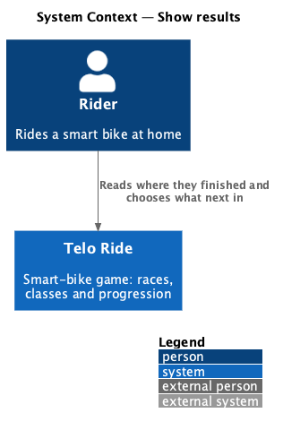
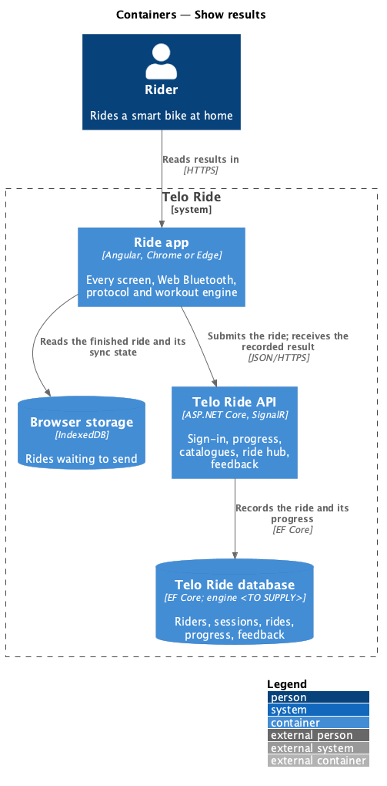
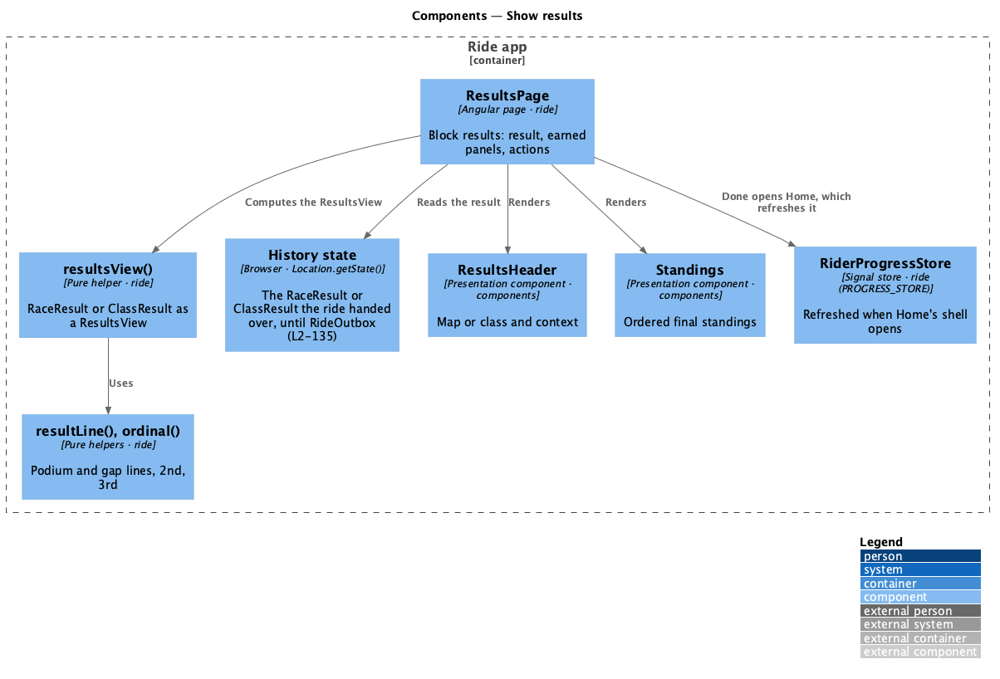
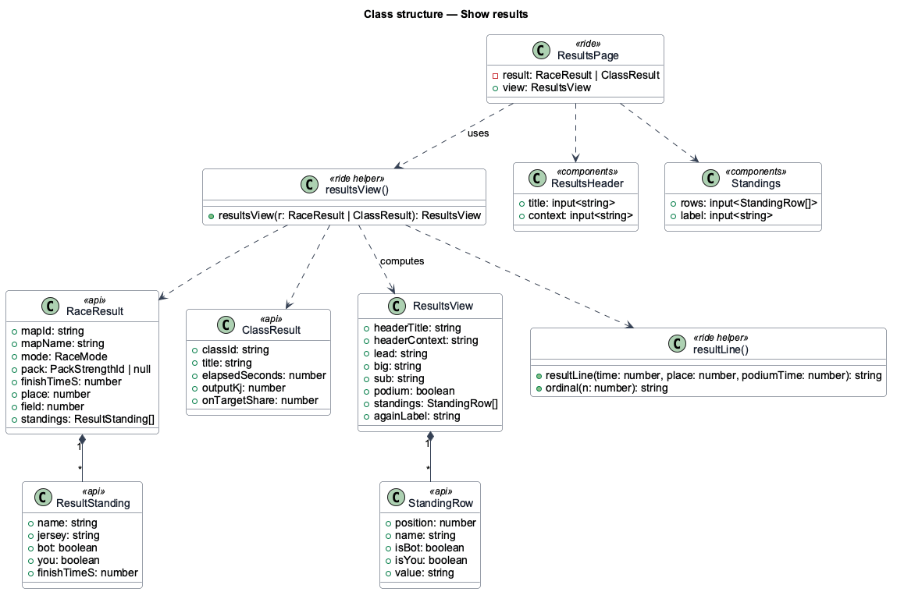
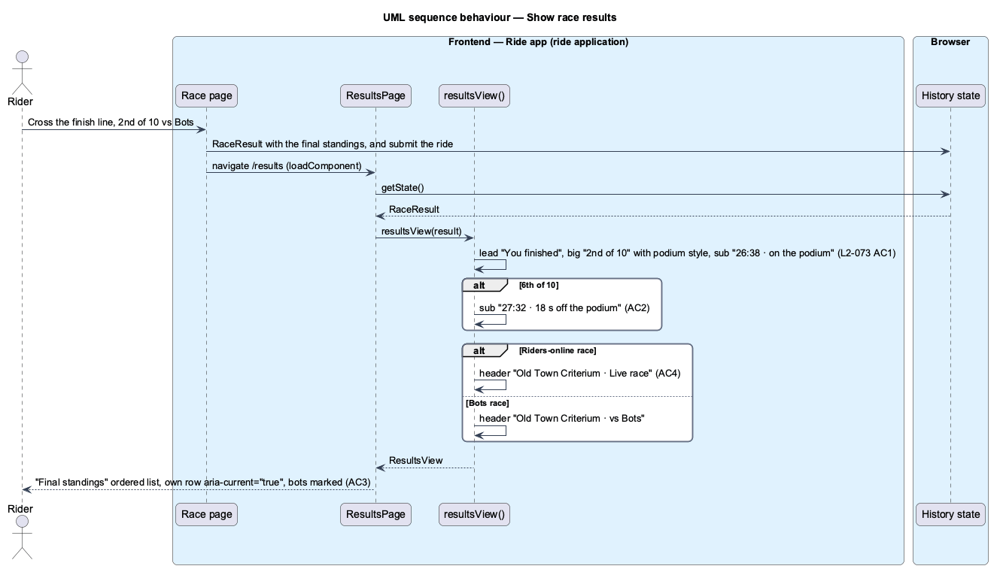
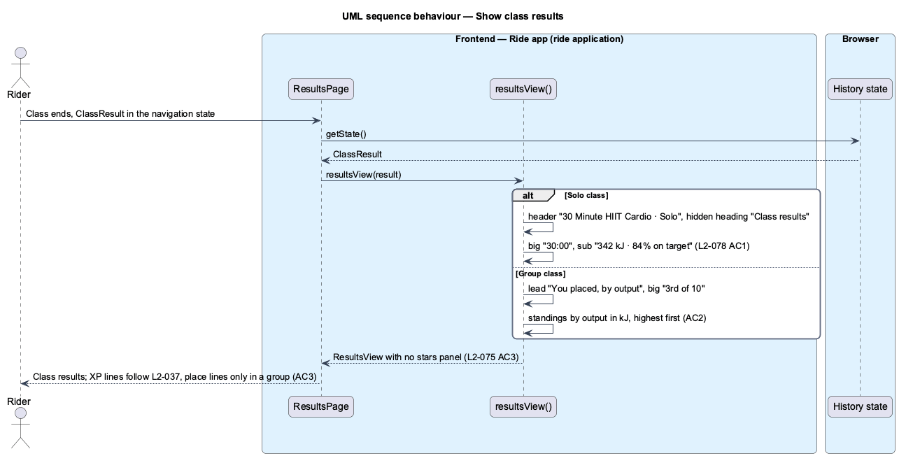
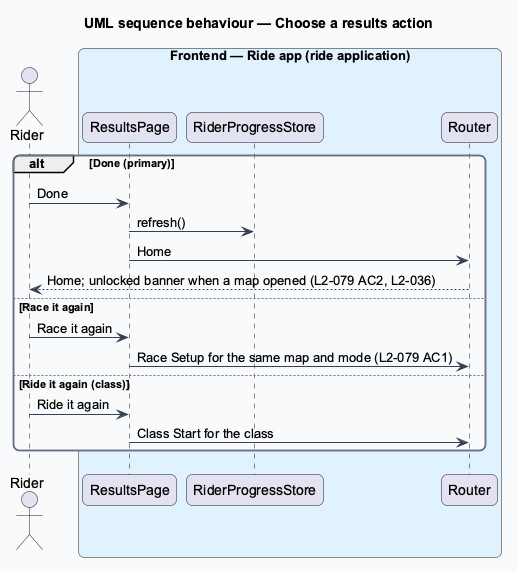

# Show results

## Overview

Results is the screen a rider lands on when a race or a class ends. It answers, in order, where
the rider finished, who finished around them, what the ride earned, and what to do next (L1-013).
The earned panels (XP, stars, personal best) and the unlock card are separate features in this
subsystem; this feature covers the result itself, the final standings and the actions.

- **result** — rider's finishing place or time, stated in one line such as "2nd of 10"
- **podium** — places 1 to 3
- **final standings** — ordered list of every rider in the ride with a finish time (race) or
  output in kilojoules (group class)
- **field** — number of riders, people and bots, in the ride
- **output** — work done over the ride, in kJ

A race is against the rider's ghost (solo), bots, or riders online. A class is solo or with a
group. Results draws the result from the finished ride kept on the device, so it shows at once
even when the network is down; the XP and stars wait for the backend
(`show-xp-stars-and-personal-best`).

## Description

- **`ResultsPage`** — routed page in the `ride` application (`wz-results-page`, block `results`)
  at `/results`, loaded with `loadComponent`. It renders the header, the result
  (`results__lead`, `results__big`, `results__sub`), the standings, the earned panels and the
  actions. At lg (≥ 1024 px) or wider it is two columns, result then what was earned, with the
  actions pinned to the bottom (`results__actions`).
- **Where the result comes from** — until `RideOutbox` (contract and `RIDE_OUTBOX` token in
  `api`, owned by `performance/ride-without-a-network`, L2-135) keeps finished rides on the
  device, the race or class page hands its result to Results in the navigation's history state:
  a `RaceResult` or a `ClassResult`. The browser keeps that state with the history entry, so a
  reload of Results shows the same ride; an address with no result in its state sends the rider
  Home. When the outbox lands, Results moves to `/results/:rideId` and reads it from there.
- **`resultsView()`** — pure helper in `ride` with unit tests. It turns a `RaceResult` or
  `ClassResult` into one `ResultsView`: the header context, the hidden heading, the lead, the big
  value and its "of 10", the line under it, the standings rows and the again action. Nothing is
  loaded, so no store is needed.
- **`RaceResult`** and **`ClassResult`** — what the page hands over when the ride ends. A race:
  the map, its name, the mode and pack, the finish time, the place, the field and the final
  standings, each rider with a finish time: the second a rider ahead crossed the line, and for a
  rider still riding when the rider crossed, the rider's time plus that rider's gap behind. A
  class: its id, title, length, output in kJ and on-target share. A riders-online race or group
  class takes its standings from the multiplayer service's final standings
  (`multiplayer/record-results-nobody-can-change`) with the slices that build them.
- **`resultLine()`** and **`ordinal()`** — pure helpers in `ride` with unit tests. On the podium
  the line reads "{time} · on the podium"; off it, "{time} · {n} s off the podium". `ordinal()`
  returns "1st", "2nd", "3rd", "4th" and so on. Every ride's lead reads "You finished" until a
  personal best replaces it (`show-xp-stars-and-personal-best`). A bots race shows the place, the
  podium line and the standings; a solo race (vs your best) shows the time alone; a solo class
  shows the time and "342 kJ · 84% on target".
- **`ResultsHeader`** — presentation component (`wz-results-header`, block `results-header`) with
  the title and the context: "· vs Bots", "· vs your best", "· Live race" or "· Solo".
- **`Standings`** — presentation component (`wz-standings`, block `standings`). It renders an
  ordered list labelled "Final standings"; the rider's row carries `aria-current="true"` and bots
  carry a marker that is text as well as colour. All names render as text.
- **Actions** — "Done" (primary) goes to Home, whose shell refreshes `PROGRESS_STORE` on entry
  and which shows the unlocked banner when a map opened (L2-036, slice 11.3). "Race it again"
  goes to Race Setup for the same map with the mode and pack in its query (`?mode=bots&pack=hard`),
  which Race Setup preselects; for a class, "Ride it again" goes to Class Start.
- **Slice 11.1** builds the result, the standings and the actions for a bots race, a solo race and
  a solo class. The earned panels are slice 11.2, the unlock card 11.3, "· Live race" and the group
  class board come with the multiplayer slices, and Full screen with slice 24.2.

The two contradictions between mocks and requirements that touch this screen are recorded as open
questions 5 and 7 in `docs/specs/L2.md`: the third star on a personal best, and the order of the
class-group board. The design follows the requirements: the group board ranks by output, highest
first.

## Requirements

| L2 ID | Refines (L1) | Requirement |
|-------|--------------|-------------|
| `L2-073` | `L1-013` | For 2nd of 10 against bots on Old Town Criterium, the header shall read "Old Town Criterium · vs Bots" and the result shall read "You finished", "2nd of 10" styled as a podium place, and "26:38 · on the podium". |
| `L2-073` (AC2–AC3) | `L1-013` | For 6th of 10 the result shall read "27:32 · 18 s off the podium"; the final standings shall be an ordered list ("Final standings") with every rider's finish time, the rider's row carrying `aria-current="true"` and bots marked. |
| `L2-073` (AC4–AC5) | `L1-013` | For a riders-online race the header shall read "· Live race"; at lg or wider Results shall be two columns (result, then what was earned) with the actions pinned to the bottom. |
| `L2-078` | `L1-013` | For a solo class the header shall read "30 Minute HIIT Cardio · Solo" with the hidden heading "Class results", and the result shall read "30:00" and "342 kJ · 84% on target". |
| `L2-078` (AC2–AC3) | `L1-013` | For a group class the result shall read "You placed, by output" and "3rd of 10" with the standings listing every rider's output in kJ, highest first; "XP earned" shall follow L2-037 with place and podium lines only in a group. |
| `L2-079` | `L1-013` | Results shall offer "Done" (primary, to Home) and "Race it again" (to Race Setup for the same map and mode) or, for a class, "Ride it again" (to Class Start). |
| `L2-079` (AC2) | `L1-013` | When a map opened and the rider presses Done, Home shall show the unlocked banner (L2-036). |

## Diagrams

### System context

The rider reads where they finished and chooses what to ride next in Telo Ride. No external
system takes part.

### Containers

The Ride app reads the finished ride from browser storage and shows it at once; the ride's
submission to the Telo Ride API runs alongside.

### Components

`ResultsStore` reads the finished ride from `RideOutbox` and uses the line helpers to build the
view that `ResultsPage` renders through `ResultsHeader` and `Standings`.

### Class structure

`FinishedRide` holds the standings rows; `ResultsStore` turns it into a `ResultsView` with the
header, the three result lines and the again label.

### Behaviour — show race results

The race page keeps the finished ride and opens Results, which formats the place, the podium line
and the header context (L2-073).

### Behaviour — show class results

A solo class shows time, output and on-target share; a group class shows the place by output and
standings highest first (L2-078).

### Behaviour — choose a results action

Done refreshes progress and goes Home, where any unlocked banner shows; the again actions return
to Race Setup or Class Start (L2-079).

