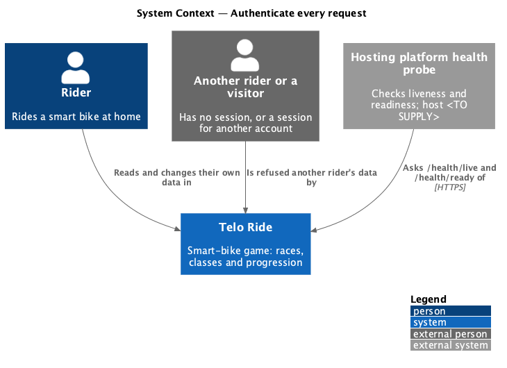
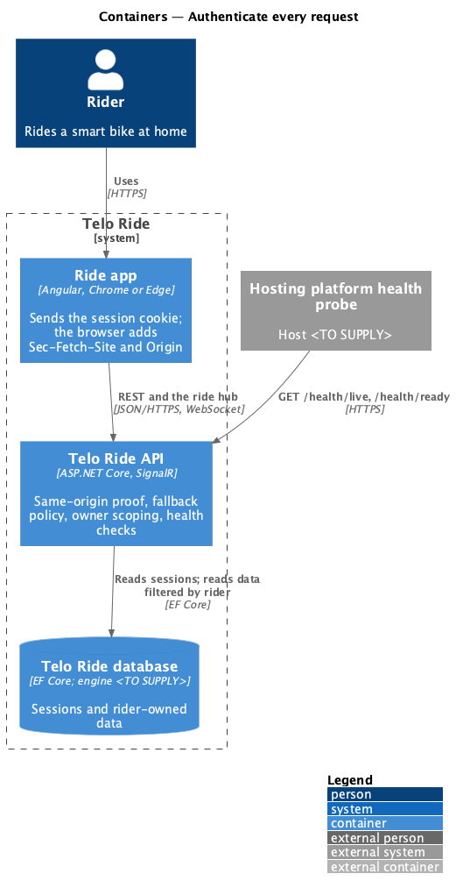
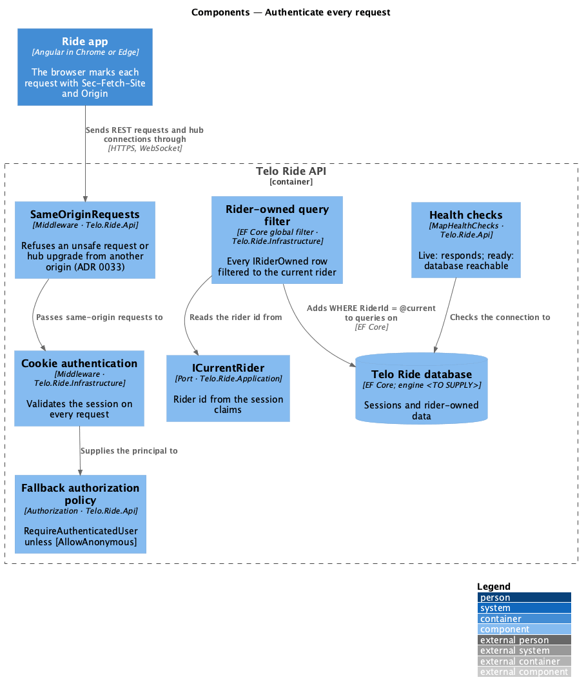
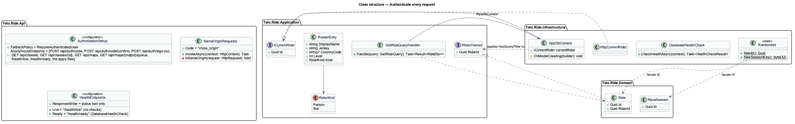
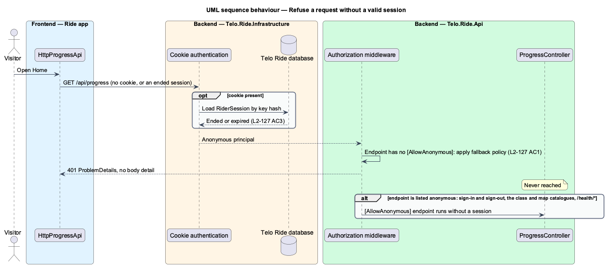
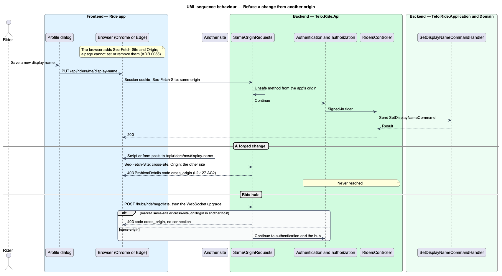
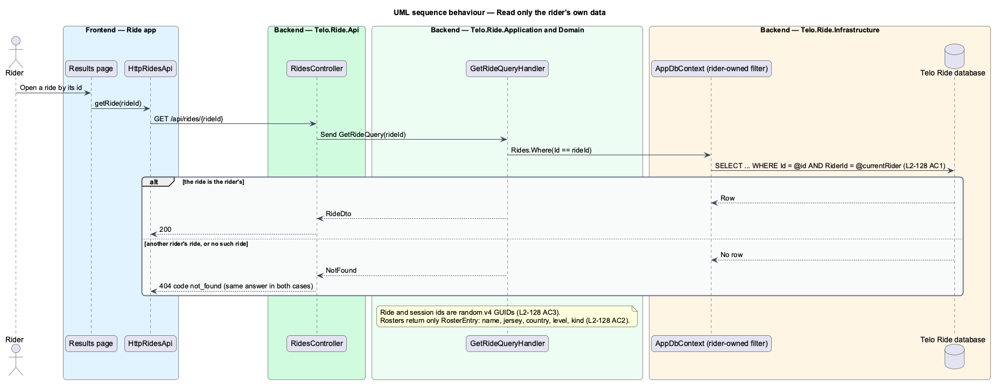
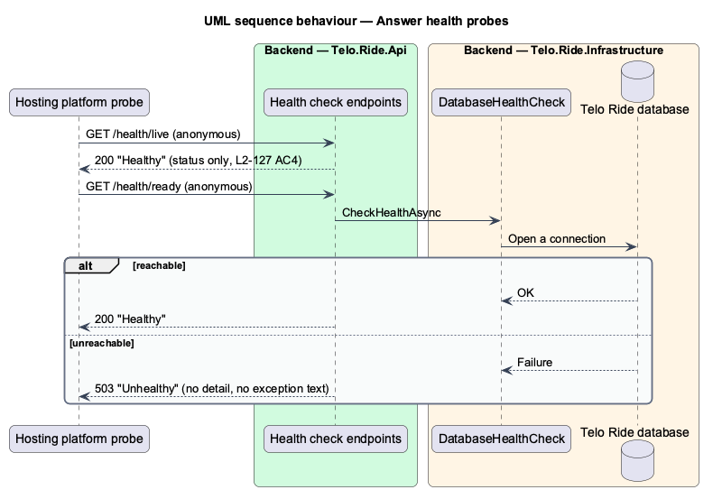

# Authenticate every request

## Overview

The Telo Ride API holds each rider's account, progress and rides, and runs the multiplayer
sessions. Every request to it, apart from the few that start a sign-in or report health, comes
from a signed-in rider and touches only that rider's data. This feature is the set of backend
mechanisms that make that true by default rather than endpoint by endpoint.

- **fallback policy** — authorization policy that ASP.NET Core applies to every endpoint that
  declares no policy of its own; here it requires an authenticated rider
- **anonymous endpoint** — endpoint marked `[AllowAnonymous]` or `.AllowAnonymous()`; the list is
  below and nothing else is anonymous
- **same-origin proof** — the browser's own `Sec-Fetch-Site` or `Origin` header, which a page cannot
  set, showing that a data-changing request came from the Ride app's origin and not from another
  site (ADR 0033)
- **rider-owned data** — rows that belong to one rider (progress, rides, workouts, feedback),
  readable only by that rider
- **liveness** and **readiness** — health answers that say, respectively, that the API responds
  and that it can reach its database

The session itself (cookie, sliding expiry, ending) is described in [Stay signed
in](../../accounts/stay-signed-in/README.md); this feature consumes it. Rate limits are in [Limit
abuse](../limit-abuse/README.md), and validation and error shape in [Validate input and encode
output](../validate-input-and-encode-output/README.md).

## Description

### Authentication and authorization

- **Cookie authentication** (`Telo.Ride.Infrastructure`) — validates the session on every request
  and loads it from the database without caching, so a signed-out session is refused on its next
  use.
- **Fallback authorization policy** (`Telo.Ride.Api`) — `AddAuthorization` sets
  `FallbackPolicy` to `RequireAuthenticatedUser()`. A request without a valid session to any
  endpoint that is not anonymous receives 401 with a ProblemDetails body; there is no redirect.
- **Anonymous endpoints** — exactly these, each marked explicitly where it is mapped, so a new
  endpoint needs a session unless someone marks it:

  | Endpoint | Why it needs no session |
  |---|---|
  | `POST /api/auth/code`, `POST /api/auth/code/confirm` | A visitor asks for and confirms a code before they have a session (L2-001, L2-002). |
  | `POST /api/auth/sign-out` | Without a session there is nothing to end, and it answers 204 (L2-006 AC1). |
  | `GET /api/classes`, `GET /api/classes/{id}` | The class catalogue is public and holds nothing personal (ADR 0028). |
  | `GET /api/maps`, `GET /api/maps/{mapId}/queue` | The map catalogue and its queue count are public and hold nothing personal (ADR 0029). |
  | `GET /health/live`, `GET /health/ready` | The hosting platform's probes (L2-127 AC4). |
  | The app's shell and files | The app loads before the rider signs in (ADR 0026). |

  The ride hub `/hubs/ride` is not anonymous: a connection without a valid session is refused at
  negotiation.

### Same-origin proof

- **`SameOriginRequests`** (`Telo.Ride.Api`, ADR 0033) — middleware ahead of authentication that
  looks at every unsafe request (any method but `GET`, `HEAD`, `OPTIONS` and `TRACE`) and every
  WebSocket upgrade, so the REST API, sign-in and the ride hub share one rule. `Sec-Fetch-Site:
  same-origin` or `none` passes; `same-site` or `cross-site` is refused. Without
  `Sec-Fetch-Site`, an `Origin` passes only when it is the request's own scheme and host. A
  request with neither header comes from a client that is not a browser and passes. A refusal is
  403 with a ProblemDetails body and code `cross_origin`, before any controller or hub runs.
- **The Ride app sends nothing extra** — Chrome and Edge add both headers themselves and a page
  cannot change them, so no token is issued, stored or copied, and a shell served from the
  service worker's cache keeps working. The session cookie's `SameSite=Lax` and `__Host-` prefix
  stay as a second line.

### Owner scoping

- **`ICurrentRider`** (`Telo.Ride.Application`), implemented by `HttpCurrentRider` — exposes the
  signed-in rider's id from the session claims.
- **`IRiderOwned`** — marker interface with `RiderId`, implemented by every rider-owned entity
  (`Ride`, `MapProgress`, `Streak`, `CustomWorkout` if stored, `FeedbackReport`).
- **Rider-owned query filter** — `AppDbContext.OnModelCreating` applies `HasQueryFilter(e =>
  e.RiderId == currentRider.Id)` to each `IRiderOwned` entity. A handler that looks up another
  rider's row by id finds nothing and returns `NotFound`, which the API answers as 404 with code
  `not_found`: the same answer as for an id that does not exist. Handlers also scope queries by
  rider explicitly where they read a single owner, so the filter is a second line rather than the
  only one.
- **`RosterEntry`** — the only shape in which a session roster leaves the API: `DisplayName`,
  `Jersey`, `CountryCode`, `Level` and `Kind` (`Person` or `Bot`), as for the rider card of
  [Choose a display name](../../accounts/choose-a-display-name/README.md).
- **`RandomIds`** — issues ride, session and feedback ids as version 4 GUIDs from the
  cryptographic random generator (122 random bits) and session keys as 32 random bytes, so ids
  cannot be guessed or enumerated.

### Health

- **Health check endpoints** — `MapHealthChecks("/health/live")` runs no checks and answers 200
  `Healthy` while the process responds. `MapHealthChecks("/health/ready")` runs
  `DatabaseHealthCheck` and answers 503 `Unhealthy` when the database cannot be reached. The
  response writer writes the status word only: no check names, timings or exception text.

## Requirements

The feature realizes the following level-2 (L2) requirements. Each L2 requirement refines a
level-1 (L1) requirement, cited by identifier.

| L2 ID | Refines (L1) | Requirement |
|-------|--------------|-------------|
| `L2-127` | `L1-021` | A request without a valid session to any endpoint other than the listed anonymous ones shall be refused with 401. A request that changes data, or a connection to the ride hub, that the browser marks as coming from another origin shall be refused with 403. A signed-out session shall be refused at once. A health endpoint shall answer with a status and nothing else: liveness that the API responds, readiness 503 when the database cannot be reached. |
| `L2-128` | `L1-021` | A request for another rider's progress, rides, workouts or feedback shall be refused with 404 without revealing whether it exists. A session roster asked for by another rider shall return only names, jerseys, countries, levels and kinds (`L2-005` AC5). Ride and session ids shall be random and shall not be guessable. |

## Diagrams

### System context

Riders use Telo Ride for their own data; visitors without a session and riders asking for another
account's data are refused. The hosting platform probes the health endpoints.

### Containers

Every request from the Ride app, REST or hub, passes the Telo Ride API's same-origin proof,
authentication and authorization before it reaches data in the Telo Ride database.

### Components

`SameOriginRequests` refuses an unsafe request or hub connection from another origin; cookie
authentication supplies the principal to the fallback policy. The rider-owned query filter reads
`ICurrentRider` and scopes every query; the health checks test the database connection.

### Class structure

`AppDbContext` applies a query filter to each `IRiderOwned` entity using `ICurrentRider`.
`RosterEntry` is the public roster shape, and `RandomIds` issues the ids of rides and sessions.

### Behaviour — refuse a request without a valid session

With no session or an ended one, the principal is anonymous and the fallback policy refuses the
request with 401 before any controller runs (`L2-127` AC1, AC3).

### Behaviour — refuse a change from another origin

The browser marks every request with where it came from. A change or a hub negotiation marked as
coming from another origin is refused with 403 and code `cross_origin` before authentication; one
from the Ride app's origin carries on (`L2-127` AC2).

### Behaviour — read only the rider's own data

The query filter adds the current rider to every query on rider-owned data, so another rider's
ride and a missing ride both return 404 with code `not_found` (`L2-128` AC1).

### Behaviour — answer health probes

Liveness answers without checks; readiness checks the database and answers 503 when it is
unreachable, with the status word only (`L2-127` AC4).

## Open questions

1. **Anti-forgery tokens (resolved, slice 22.1).** The design planned `IAntiforgery` with an
   `XSRF-TOKEN` cookie and `X-XSRF-TOKEN` header, and a separate origin check for the hub. The
   service worker serves the shell from its cache (ADR 0032), so the server could not refresh the
   token, and the first change after a browser restart would fail. ADR 0033 replaces both with one
   same-origin proof from the browser's Fetch Metadata.
2. **The anonymous list (resolved, slice 22.1).** L2-127 named only the health endpoints, send code
   and confirm code. Sign-out (L2-006 AC1) and the class and map catalogues (ADR 0028, ADR 0029)
   were already anonymous; the requirement and this design now list them.
