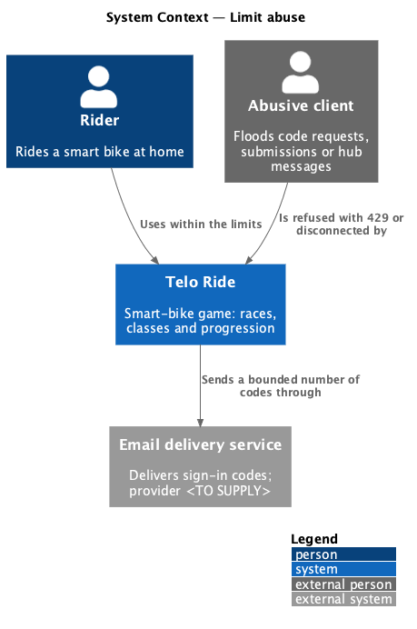
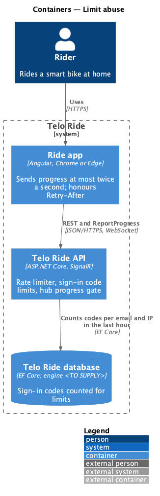
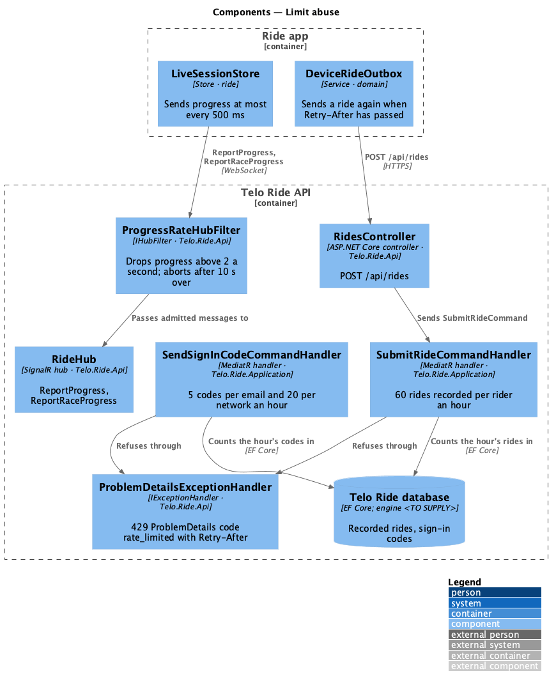
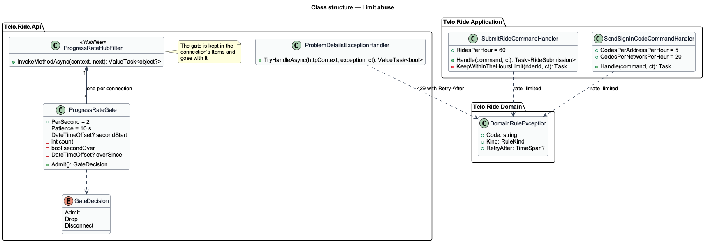
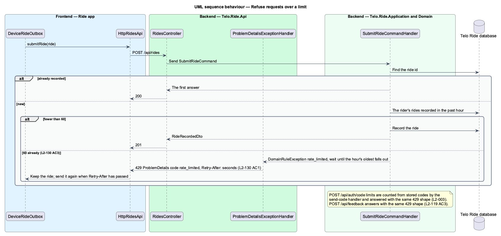
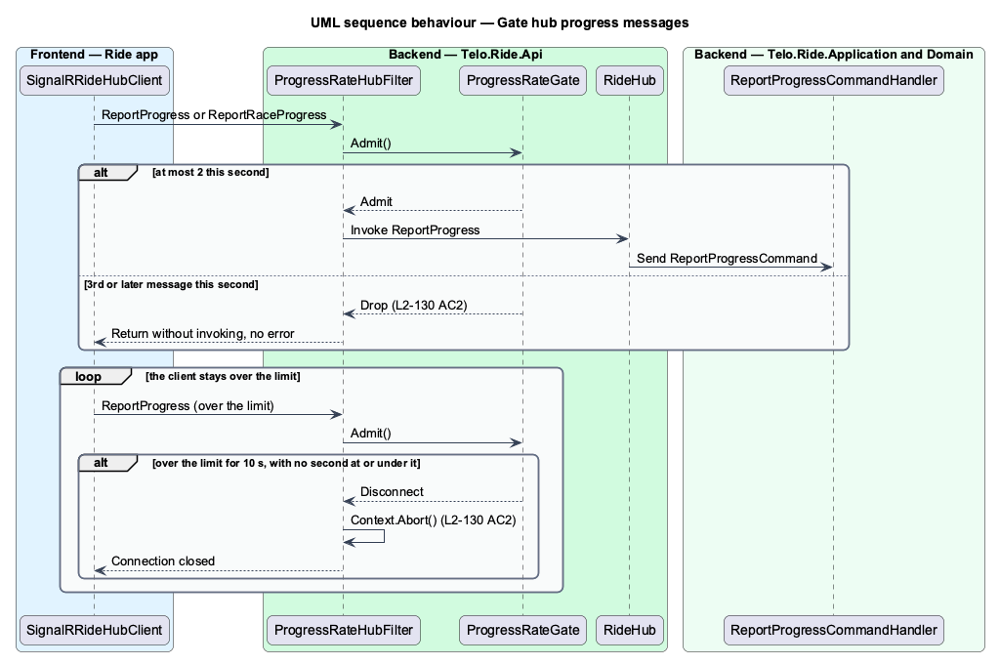

# Limit abuse

## Overview

The Telo Ride API accepts a few kinds of request that cost something when repeated without limit:
sign-in codes cost an email each and invite guessing, ride submissions and feedback reports cost
storage and processing, and hub progress messages cost the multiplayer service a share of every
second. This feature puts a ceiling on each, so one misbehaving or hostile client cannot degrade
Telo Ride for other riders.

- **rate limit** — maximum count of one kind of request from one partition (an email address, an
  IP address or a rider) within a time window
- **sliding window** — window that always covers the most recent hour, rather than a calendar hour
- **progress message** — hub message in which a client reports its rider's distance or output and
  power during a session
- **Retry-After** — HTTP response header that tells the client how many seconds to wait before
  trying again

The limits are:

| Request | Limit | Answer when passed | Source |
|---------|-------|--------------------|--------|
| Sign-in code, per email | 5 an hour | 429 with `Retry-After` | `L2-003` AC4 |
| Sign-in code, per IP address | 20 an hour | 429 with `Retry-After` | `L2-003` AC5 |
| Feedback report, per rider | 10 an hour | 429 with `Retry-After` | `L2-119` AC3 |
| Ride submission, per rider | 60 an hour | 429 with `Retry-After` | `L2-130` AC3 |
| Hub progress message, per connection | 2 a second | extra dropped; disconnected after 10 s over | `L2-130` AC2 |

The Ride app keeps within these limits in normal use: it sends progress at most twice a second
([Share progress and standings](../../multiplayer/share-progress-and-standings/README.md)), and
its ride outbox waits for `Retry-After` before submitting again.

## Description

### Telo Ride API (backend)

- **Ride limit** (`Telo.Ride.Application`) — `SubmitRideCommandHandler` counts the rider's rides recorded in the past
  hour, after it has answered a repeat of a ride already recorded. At `RidesPerHour` (60) it refuses the next with a
  `DomainRuleException` `rate_limited`, `RuleKind.TooManyRequests`, carrying the wait until the oldest of the hour's
  rides falls out of it. `ProblemDetailsExceptionHandler` answers 429 ProblemDetails with code `rate_limited` and
  `Retry-After` in whole seconds, as it answers the sign-in limits. Counting recorded rides rather than requests means
  a repeat of a ride id, which answers its first answer (`L2-125` AC3), and a race result asked for again every
  5 seconds while it is pending (`L2-125` AC1) cost nothing; and the count holds across API instances.
- **Sign-in limits** (`Telo.Ride.Application`) — `SendSignInCodeCommandHandler` of [Sign in with an email
  code](../../accounts/sign-in-with-an-email-code/README.md) counts the stored `SignInCode` rows of the past hour: 5
  per email and 20 per network, whose hash each row holds. A refusal is answered with the same 429 shape and
  `Retry-After`. The limit depends on the request body, so it is counted from the rows rather than in middleware.
- **Feedback limit** — 10 reports an hour per rider (`L2-119` AC3), built with the feedback endpoint as [Receive
  feedback](../../feedback/receive-feedback/README.md) describes, with the same 429 shape and `Retry-After`.
- **`ProgressRateHubFilter`** (`Telo.Ride.Api`) — `IHubFilter` on `RideHub`, added before `ValidationHubFilter`, that
  puts each `ReportProgress` and `ReportRaceProgress` through its connection's `ProgressRateGate`. On `Drop` it returns
  without invoking the hub method and without an error. On `Disconnect` it calls `Context.Abort()`. The gate is kept in
  the connection's `Items`, so it goes with the connection and no state outlives it.
- **`ProgressRateGate`** (`Telo.Ride.Api`) — counts one connection's progress messages, class and race alike, in
  seconds counted from the first message of each. The first two in a second are admitted; the third and later are
  dropped. When the client has been over the limit for 10 seconds, with no second at or under it and no whole second
  without messages in between, the gate answers `Disconnect`. Time comes from `TimeProvider`, so the rule is
  unit-tested with `FakeTimeProvider` and never sleeps.
- **Client address** — behind App Service's front end, the client IP address comes from
  `ForwardedHeaders` middleware reading `X-Forwarded-For` with the default `ForwardLimit` of 1, so
  only the rightmost entry, the one the front end appends, is used and a client cannot forge it.
  The front end has no fixed address to trust by name, so no proxy list is kept (TransportSecurity).
- **Instance count** — every request limit is counted from the database, so it holds across API instances. The
  progress gate is per connection, and a connection lives on one instance.

### Ride app (frontend)

- **`LiveSessionStore`** (`ride`) — drops a progress report less than 500 ms after the last one sent, so the hub hears
  at most two a second (`L2-123` AC1).
- **`DeviceRideOutbox`** (`domain`) — keeps a ride refused with 429 and sends it again when its `Retry-After` has
  passed, in place of the growing delay it uses for a backend out of reach (`L2-135` AC2).
- **`HttpAuthApi`** (`api`) — copies `Retry-After` into `AuthApiError.retryAfterSeconds`; the code screen of
  sign-in says when to try again.

## Requirements

The feature realizes the following level-2 (L2) requirements. Each L2 requirement refines a
level-1 (L1) requirement, cited by identifier.

| L2 ID | Refines (L1) | Requirement |
|-------|--------------|-------------|
| `L2-130` | `L1-021` | Requests past the limits of `L2-003` and `L2-119` shall be refused with 429 and a `Retry-After` header. A hub client that sends more than 2 progress messages a second shall have the extra messages dropped and, after 10 seconds over the limit, shall be disconnected. More than 60 ride submissions from one rider in an hour shall cause the next to be refused with 429. |

## Diagrams

### System context

Riders use Telo Ride within the limits; an abusive client is refused or disconnected, and the
number of code emails sent through the email delivery service stays bounded.

### Containers

The Telo Ride API enforces every limit; the database holds the sign-in codes the code limits are
counted from. The Ride app throttles its own progress messages and honours `Retry-After`.

### Components

The submit-ride and send-code handlers count what the database holds and refuse past the limit;
`ProblemDetailsExceptionHandler` answers 429 with `Retry-After`. `ProgressRateHubFilter` sits between the hub client
and `RideHub`.

### Class structure

`ProgressRateHubFilter` keeps one `ProgressRateGate` per connection, whose `Admit` returns a
`GateDecision`. The handlers hold the request limits and refuse through `DomainRuleException`.

### Behaviour — refuse requests over a limit

A 61st ride recorded within an hour is refused with 429 and `Retry-After` (`L2-130` AC1, AC3); a repeat of a ride
already recorded is still answered. The ride stays in the outbox until the wait has passed.

### Behaviour — gate hub progress messages

The gate admits two progress messages a second and drops the rest. A client that stays over the
limit for 10 seconds is disconnected (`L2-130` AC2).

## Open questions

1. **Request limits in middleware or in handlers (decided).** The design first put the ride and feedback limits in
   ASP.NET Core's rate limiting middleware. Slice 22.3 counts recorded rides in the handler instead, as the sign-in
   limits do: the middleware would count repeats of a ride id and the 5-second retries of a pending race result
   against the rider's hour, and it holds its windows in one instance's memory. `RateLimitPolicies` and
   `RateLimitRejection` are not built; the feedback limit is left to its own slice.
2. **Jitter at the hub (open).** The app sends a report at most every 500 ms by its own clock; with network jitter two
   may land within the same server second as a third, and one is dropped. A dropped report costs nothing, since the
   next carries the same totals, and only 10 seconds over without a break disconnects.
