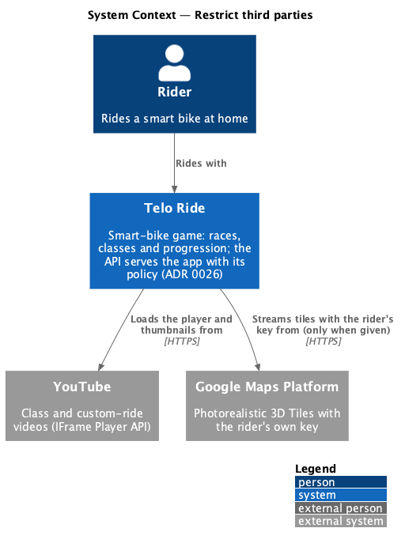
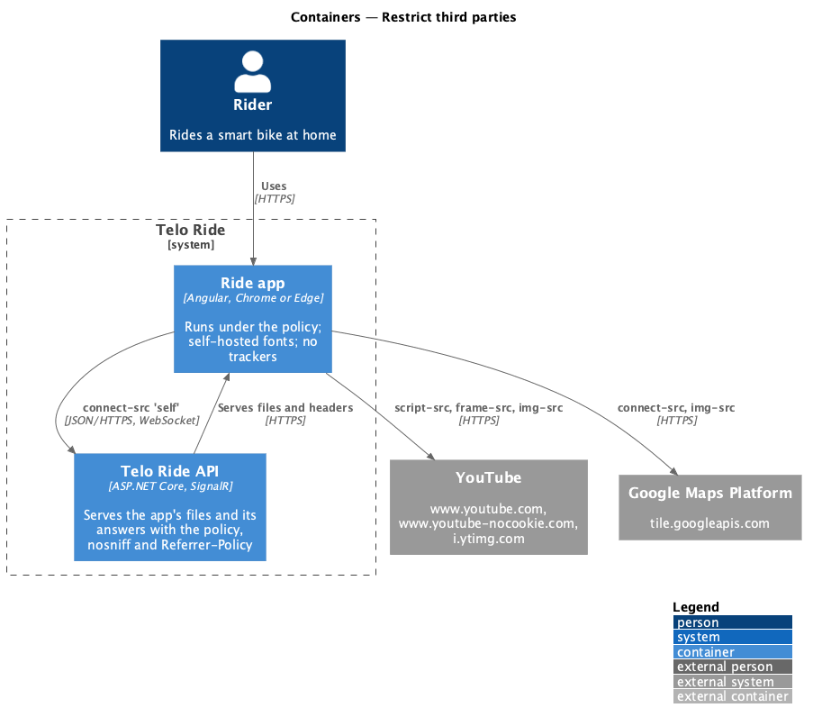
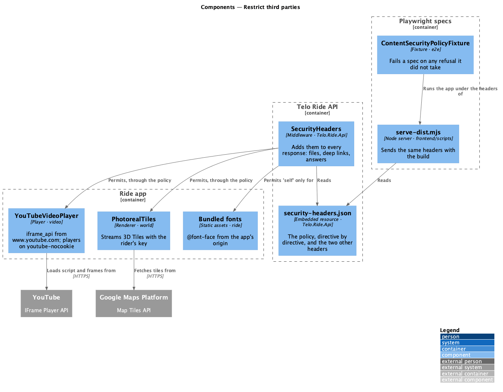
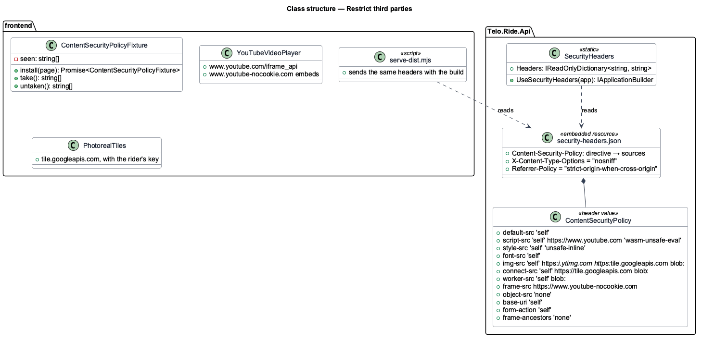
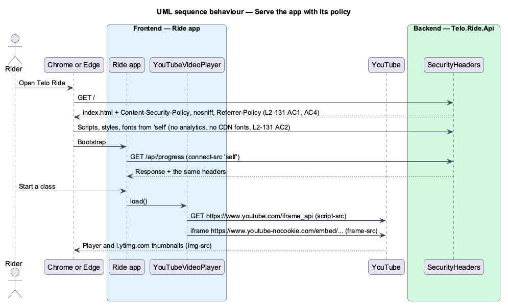
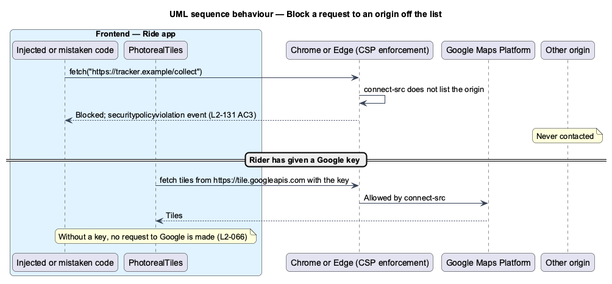

# Restrict third parties

## Overview

Telo Ride runs in the rider's browser for an hour or more at a time, next to a Bluetooth link to
their bike. Every origin the page can load code from or send data to widens what a compromised or
mistaken script could do. This feature fixes the list of foreign origins to two services the
product needs, and has the browser enforce that list.

- **Content Security Policy (CSP)** — response header that tells the browser which origins a page
  may load scripts, styles, frames, images and fonts from and connect to; the browser blocks
  everything else
- **third party** — origin other than Telo Ride's own: here only YouTube (the class and
  custom-ride video player) and Google Maps Platform (photorealistic 3D Tiles, only with the
  rider's own key)
- **app origin** — origin that serves the Ride app's files; the Telo Ride API is reached on the
  same origin under `/api` and `/hubs`

Telo Ride loads no analytics, advertising or tracking script, and its fonts are bundled and
self-hosted ([ADR 0005](../../../adr/0005-bundled-self-hosted-fonts.md)). The Google key never
reaches Telo Ride's backend; it stays in the browser and goes only to Google's Map Tiles API, as
[Render the race world](../../race/render-the-race-world/README.md) describes.

The frontend is static files ([Host and deliver](../../platform/host-and-deliver/README.md)).
[ADR 0018](../../../adr/0018-static-content-security-policy.md) and [ADR
0022](../../../adr/0022-hosted-on-azure-static-web-apps.md) record that a static host sends one
fixed policy and that `frame-ancestors` works only as a header, not in a `<meta>` element. This
design therefore sends the policy as a response header from the static host.

## Description

### Policy and headers

- **`security-headers.json`** (`Telo.Ride.Api`, `Hosting/`) — the one place the headers of `L2-131` are written: the
  Content Security Policy, directive by directive, `X-Content-Type-Options: nosniff` and
  `Referrer-Policy: strict-origin-when-cross-origin`. The API embeds it; nothing else holds a copy.
- **`SecurityHeaders`** (`Telo.Ride.Api`, `Hosting/SecurityHeaders.cs`) — middleware that adds those headers to every
  response as it starts: the app's files, which the API serves (ADR 0026), its deep links, and every backend answer,
  ProblemDetails included.
- **Content Security Policy** directives:

  | Directive | Value |
  |-----------|-------|
  | `default-src` | `'self'` |
  | `script-src` | `'self' https://www.youtube.com 'wasm-unsafe-eval'` |
  | `style-src` | `'self' 'unsafe-inline'` |
  | `font-src` | `'self'` |
  | `img-src` | `'self' https://i.ytimg.com https://tile.googleapis.com blob:` |
  | `connect-src` | `'self' https://tile.googleapis.com blob:` |
  | `worker-src` | `'self' blob:` |
  | `frame-src` | `https://www.youtube-nocookie.com` |
  | `object-src` | `'none'` |
  | `base-uri` | `'self'` |
  | `form-action` | `'self'` |
  | `frame-ancestors` | `'none'` |

  `connect-src 'self'` covers the API and the ride hub's WebSocket because both are on the app's origin.
- **A static policy** — the service worker keeps `index.html` by the hash of its bytes (ADR 0032), so no nonce can be
  written into it per response. Angular injects component styles as `<style>` elements, so `style-src` carries
  `'unsafe-inline'`, as ADR 0018 accepts: an attacker who could insert markup could add a style, but no script, frame,
  connection or font from another origin. Styles Angular sets through bindings go through the CSSOM, which the policy
  does not govern.
- **3D Tiles resources** — settled by slice 8.7. Google's tiles are Draco-compressed glTF:
  Three.js's `DRACOLoader` decodes them in a worker it builds from a `blob:` URL, running the
  decoder's WebAssembly (`worker-src 'self' blob:`, `'wasm-unsafe-eval'` in `script-src`, which
  allows compiling WebAssembly but not `eval` of script). `GLTFLoader` reads a tile's embedded
  textures through `blob:` URLs with `fetch` or an image (`blob:` in `connect-src` and
  `img-src`). A `blob:` URL is made by the page's own code from bytes it already holds, so it
  admits no foreign origin; the decoder's files are served from the app's origin (`/draco/`).

### Ride app (frontend)

- **`YouTubeVideoPlayer`** (`video` library, imported dynamically) — loads `https://www.youtube.com/iframe_api` and
  embeds each video from `https://www.youtube-nocookie.com`. Class covers come from `https://i.ytimg.com`.
- **`PhotorealTiles`** (`world` library) — streams tiles from `https://tile.googleapis.com` only with a key the rider
  entered in Settings ([Render the race world](../../race/render-the-race-world/README.md)).
- **Bundled fonts** — `@font-face` rules in the global foundations stylesheet point at font files in the app's own
  assets. No analytics, advertising or tracking script is loaded.

### Proof

- **`serve-dist.mjs`** (`frontend/scripts/`) — the server the Playwright specs run the app on reads
  `security-headers.json` and sends the same headers, so every spec runs the app under the policy.
- **`ContentSecurityPolicyFixture`** (`frontend/e2e/fixtures/`) — records each `securitypolicyviolation` the page
  reports. The shared fixture fails any spec on a refusal it did not take, beside its failure on a request off
  localhost ([Test without hardware or
  databases](../../platform/test-without-hardware-or-databases/README.md)), so a new foreign origin is caught before
  it ships. `e2e/content-security-policy.spec.ts` checks the headers and that a script and a connection to another
  origin are refused before they leave the page.

## Requirements

The feature realizes the following level-2 (L2) requirements. Each L2 requirement refines a
level-1 (L1) requirement, cited by identifier.

| L2 ID | Refines (L1) | Requirement |
|-------|--------------|-------------|
| `L2-131` | `L1-021` | The app's pages shall be served with a Content Security Policy that allows scripts and styles only from the app's own origin and the YouTube player, frames only from `www.youtube-nocookie.com`, connections only to the app's backend and Google's Map Tiles API, and images only from the app's origin, `i.ytimg.com` and Google's tiles. The app shall load no analytics, advertising or tracking script, and fonts shall be self-hosted. Any request to another origin shall be to YouTube or, with the rider's own key, Google Map Tiles (`L2-066`). Responses shall carry `X-Content-Type-Options: nosniff`, `Referrer-Policy: strict-origin-when-cross-origin` and `frame-ancestors 'none'`. |

## Diagrams

### System context

Telo Ride reaches only two third parties: YouTube for video and, with the rider's own key, Google
Maps Platform for 3D Tiles. The Telo Ride API delivers the app with its policy (ADR 0026).

### Containers

The Ride app runs under the policy the API sends with its files, connects to the API on the same
origin, and reaches YouTube and Google only through the directives that list them.

### Components

`YouTubeVideoPlayer` and `PhotorealTiles` name the only foreign origins; the policy permits exactly
those and `'self'` for fonts. `SecurityHeaders` adds the headers from `security-headers.json`.

### Class structure

`security-headers.json` holds the policy and the two other headers; `SecurityHeaders` sends them and
`serve-dist.mjs` sends the same for the specs, whose fixture fails on a refusal.

### Behaviour — serve the app with its policy

The API sends the policy and headers with the app shell; the app's own files, the API and the
YouTube player all load within it (`L2-131` AC1, AC2, AC4).

### Behaviour — block a request to an origin off the list

The browser blocks any connection to an unlisted origin before it leaves the device. A tile
request goes to Google only when the rider has given a key (`L2-131` AC3).

## Open questions

1. **Style nonce (decided).** The policy stays static with `style-src 'unsafe-inline'` (ADR 0018): the service
   worker checks `index.html` against the hash of its bytes (ADR 0032), so a nonce written per response would make every
   cached shell fail its check.
2. **`ThirdPartyOrigins` (decided).** The design named a constants list in `api` for the foreign origins. It is not
   built: the four origins are written in the code that loads them, and the policy file is the list the browser
   enforces, with every spec failing on a refusal. A constants list would add a name without adding a check.
