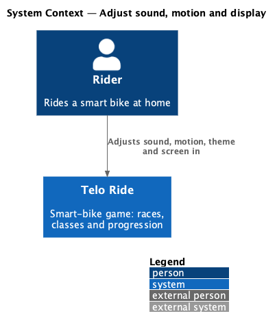
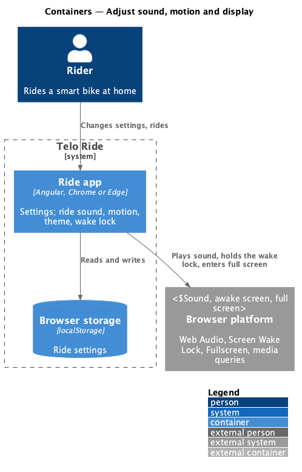
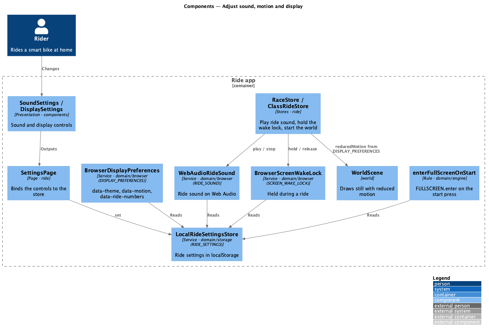
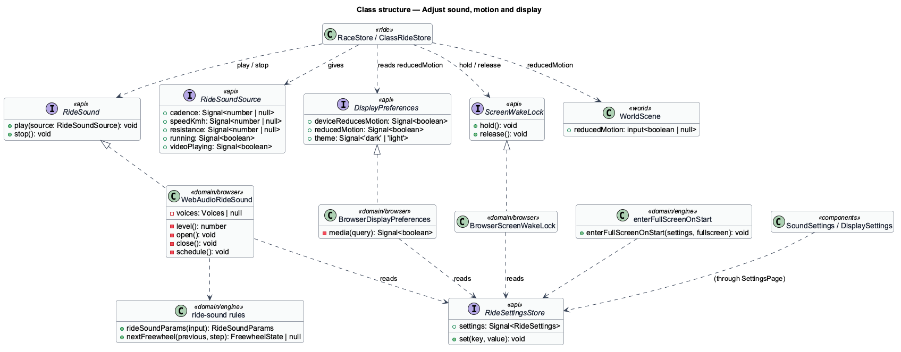
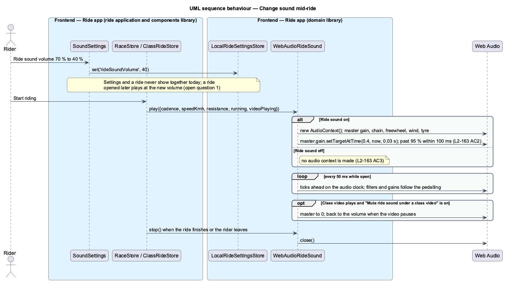
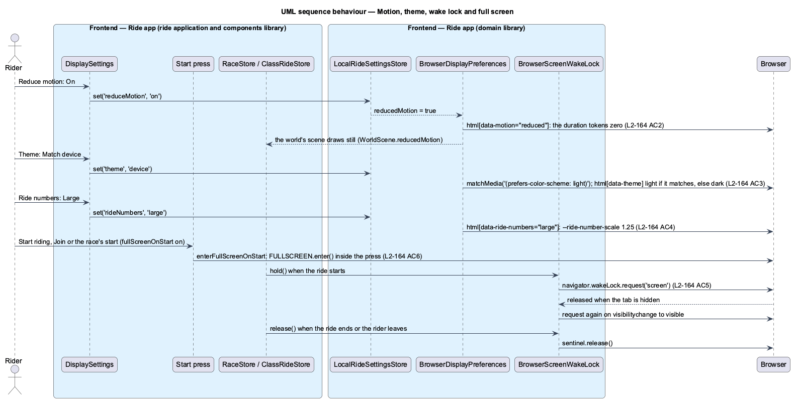

# Adjust sound, motion and display

## Overview

Two sections of Settings make a long ride more pleasant without touching the world's quality.
Sound turns the ride sound and the world music on or off, sets the ride sound's volume and mutes
it under a class video. Motion and display reduces motion, picks the theme, makes the ride
numbers larger, keeps the screen awake and can enter full screen when a ride starts.

> **ride sound** — chain, freewheel, tyre and wind sound made in the browser from the rider's pedalling

> **world music** — background track of each world, played under the ride sound

> **ducking** — muting the ride sound while a class video plays, and restoring it when the video pauses

> **ride numbers** — power, the clock and the target on every ride screen

> **screen wake lock** — browser lock that keeps the screen from dimming or locking

Each choice applies at once through the settings store (`settings/open-and-keep-settings`). The
theme rules are those of `ui/switch-theme-and-full-screen` with the rider's choice added; the
motion rules are those of `ui/support-screen-readers-and-motion` with the rider's choice added.

## Description

**Frontend — `api` library**

- **`RideSettings`** gains `rideSound` (on), `rideSoundVolume` (70), `worldMusic` (on),
  `muteUnderVideo` (on), `reduceMotion` (`device`, `on`, `off`; `device`), `theme` (`device`,
  `dark`, `light`; `device`), `rideNumbers` (`standard`, `large`; `standard`) and
  `fullScreenOnStart` (off), beside slice 20.1's `keepAwake` (on). `LocalRideSettingsStore` reads
  each field on its own: a missing or malformed one, or a volume off the 5 % steps, takes its
  recommended value.
- **`RIDE_SOUND`** (`RideSound`: `play(source)`, `stop()`) and **`RideSoundSource`** (cadence,
  speed, resistance, `running`, `videoPlaying`, each a signal).
- **`DISPLAY_PREFERENCES`** (`DisplayPreferences`: `deviceReducesMotion`, `reducedMotion`,
  `theme`).

**Frontend — `components` library**

- **`SoundSettings`** (`wz-sound-settings`) — "Ride sound", "Ride sound volume" (a native range,
  0 to 100 in steps of 5, its value "70 %" beside the label, "Quiet" and "Loud" under it, changing
  as the rider drags), "World music" and "Mute ride sound under a class video", each with the
  mock's words (`L2-163` AC1).
- **`DisplaySettings`** (`wz-display-settings`) — "Reduce motion" (Match device, On, Off), whose
  hint ends "This device asks for it." or "This device doesn’t ask for it."; "Theme" (Match device,
  Dark, Light); "Ride numbers" (Standard, Large); "Keep the screen awake" (slice 20.1's switch,
  moved here); and "Go full screen when a ride starts" (`L2-164` AC1 to AC6). The choices are
  `wz-segmented` radio groups.
- The readouts scale with the token `--ride-number-scale`: the race's watts, clock and target
  line, and the class ride's stat numbers, power's hint (its target) and clock.

**Frontend — `domain` library**

- **`BrowserDisplayPreferences`** (`browser/`) — reads the settings and the device's
  `prefers-reduced-motion` and `prefers-color-scheme: light` queries, and marks `<html>` with
  `data-motion` (`reduced` or `full`), `data-theme` (`dark` or `light`) and `data-ride-numbers`.
  The route that parents every screen binds it and starts it with an environment initializer, so
  every screen follows a choice at once (`L2-164` AC2 to AC4).
- **`WebAudioRideSound`** (`browser/`), after `main`'s `RideSound` — a chain and a freewheel
  ticking on the audio clock, and wind and tyres as looped noise through filters that follow the
  speed, all into one master gain. It makes its `AudioContext` only while a ride plays and "Ride
  sound" is on, and closes it when either ends (`L2-163` AC3). The master gain is the volume while
  the ride runs, the tab shows and no class video plays over it with "Mute ride sound under a class
  video" on, else 0; it follows each change with `setTargetAtTime` and a 30 ms time constant, past
  95 % within 100 ms with no click (`L2-163` AC2). The voices follow the pedalling with `main`'s
  100 ms constant.
- **ride sound rules** (`engine/ride-sound.ts`) — `main`'s `rideSoundParams` and `nextFreewheel`,
  without cue ducking and world ambience, which Telo Ride does not have.
- **`enterFullScreenOnStart`** (`engine/`) — enters full screen inside a start press when
  `fullScreenOnStart` is on, the browser can and the app is not in full screen (`L2-164` AC6).

**Frontend — `ride` application and `world` library**

- **Settings** binds both components to `RIDE_SETTINGS`, and reads `deviceReducesMotion` for the
  hint.
- **`RaceStore`** and **`ClassRideStore`** call `RIDE_SOUND.play` when the ride starts (the class
  ride's `videoPlaying` is its player's `playing` state) and `stop` when it finishes or the rider
  leaves. Each ride route binds `WebAudioRideSound`.
- **Start riding** and **Ride with the panorama** on World loading, **Join** on Class Start and
  the race's start on Race Setup call `enterFullScreenOnStart`. `FULLSCREEN` moves to the parent
  route, so every screen shares one.
- **`ClassWorldScene`** plays the world's track only with "World music" on (`L2-163` AC1).
- **`WorldScene`** (copied from `main`) gains one input, `reducedMotion`, which the race's and the
  class's world scenes bind to `DISPLAY_PREFERENCES.reducedMotion`; with none it follows the
  device as `main` does. `main`'s renderer then drops or stills the techniques whose
  `reducedMotion` is `off` or `still` (`L2-164` AC2).
- **Tokens** — the durations zero under `html[data-motion="reduced"]`, and under the device's
  `prefers-reduced-motion` only while `<html>` has no `data-motion`; `--ride-number-scale` is 1,
  and 1.25 under `html[data-ride-numbers="large"]`. The race board's row slide reads
  `--duration-fast`, so it follows the rider's choice too.
- **Keep the screen awake** is slice 20.1's `BrowserScreenWakeLock`, unchanged (`L2-164` AC5).

## Requirements

The feature realizes the following level-2 (L2) requirements. Each L2 requirement refines a
level-1 (L1) requirement, cited by identifier.

| L2 ID | Refines (L1) | Requirement |
|-------|--------------|-------------|
| `L2-163` | `L1-026` | The Sound section shall read "Made in the browser as you ride; nothing is downloaded." and offer "Ride sound" (on), "Ride sound volume" 0 % to 100 % in steps of 5 (70 %), "World music" (on) and "Mute ride sound under a class video" (on), each with its text. A change mid-ride shall be heard within 100 ms without a click or gap. With ride sound off, no audio context shall be created for it. |
| `L2-164` | `L1-026` | The Motion and display section shall read "For reading from the saddle and riding for an hour.". "Reduce motion" shall offer "Match device" (default), "On" and "Off"; On shall behave as `prefers-reduced-motion: reduce` and drop or still the world's moving techniques. "Theme" shall offer "Match device" (default), "Dark" and "Light". "Ride numbers" shall offer "Standard" and "Large", and Large shall never make a ride screen scroll sideways or cover the road. "Keep the screen awake" (on) shall hold a screen wake lock during a ride, retake it when the tab returns and release it at the end. "Go full screen when a ride starts" (off) shall enter full screen on the Start riding or Join press. |

## Diagrams

### System context

The rider adjusts sound, motion and display in Telo Ride. No other system takes part.

### Containers

The Ride app keeps the choices in `localStorage` and uses the browser's audio, wake lock and
full-screen interfaces.

### Components

Each consumer reads the settings store: the sound engine and ducking, the motion and theme
controllers, the ride-numbers attribute, the wake lock and the full-screen start.

### Class structure

The consumers are small services over the settings signal; the sound engine and the wake lock
sit behind contracts in `api`.

### Behaviour — change sound mid-ride

The volume ramps within 100 ms. Ride sound off closes the audio context; a playing class video
ducks the ride sound.

### Behaviour — motion, theme, wake lock and full screen

The motion and theme choices set attributes on `<html>` at once. The wake lock is held for the
ride and taken again when the tab returns; full screen starts on the start press.

## Open questions

1. **A sound change mid-ride (`L2-163` AC2).** Settings and a ride never show at the same time:
   Settings opens from Profile, and no ride screen offers it. The engine follows the settings
   signal at once (its unit test proves the 30 ms ramp), so a sound control on a ride screen, or
   the settings following another tab's `storage` event, would meet the criterion. Neither is
   built.
2. **Devices with no colour preference.** Chromium no longer reports `no-preference`: such a
   device reads as light, so Match device shows the light theme there. "Dark unless this device
   asks for light" holds only where the browser tells the two apart.
3. **Ride numbers' scale.** Large is 1.25 times Standard, chosen here; the `large-numbers` mock
   states of the race and the class ride show it. No ride screen scrolls sideways at 390 px, which
   the acceptance tests check; that the numbers never cover the road ahead is checked by eye in
   the mocks only.
4. **Dialog fades.** The profile dialogs' opacity fades follow the device's
   `prefers-reduced-motion`, not the rider's choice; `L2-142` AC2 keeps opacity fades anyway.
5. **World ambience and cue ducking.** `main`'s ride sound has both; Telo Ride's Sound section
   names neither, so the rules leave them out.
