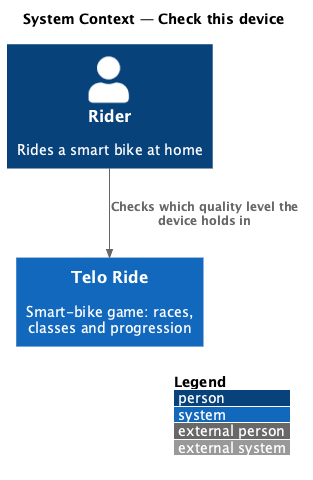
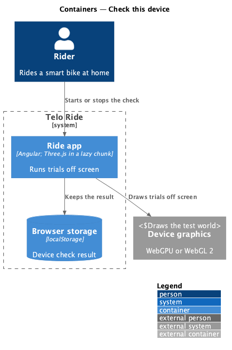
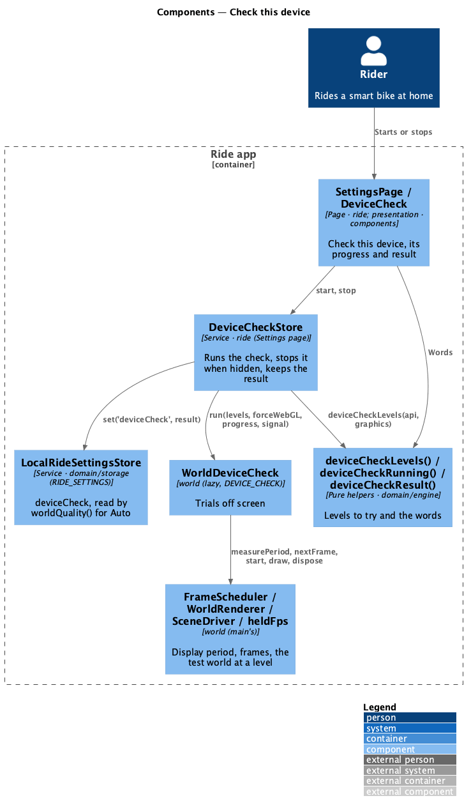
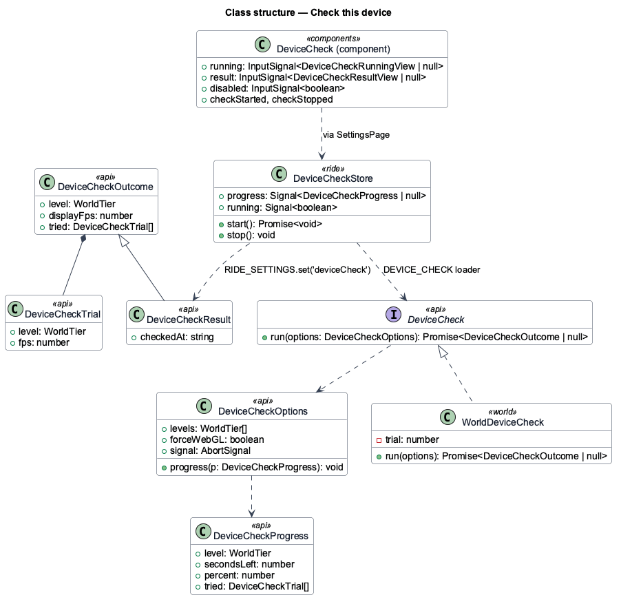
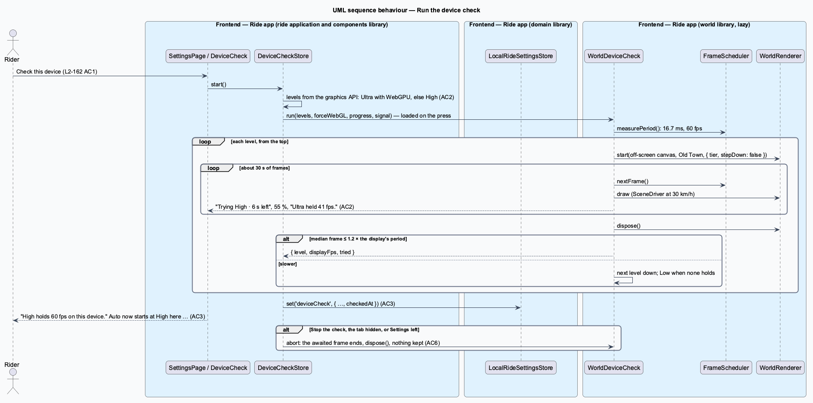

# Check this device

## Overview

Auto starts a world at Low, the drawn look, as `main`'s world does (`L2-065` AC5, `L2-159` AC4),
because a guess from the graphics API can be too high and the first minute of a ride would step
down in front of the rider. On a device that holds more, that start is too cautious. The device
check measures instead: it draws a test world off screen at each level, from the top level the
graphics API allows down, and keeps the first level that holds the display's frame rate. Auto then
starts there on this device.

> **device check** — off-screen measurement that finds the highest quality level this device holds at its display's frame rate

> **test world** — fixed scene bundled with the app for the device check, the same at every level

> **trial** — about 30 seconds of the test world drawn at one level

> **device check result** — level found, the frame rates measured and the time of the check, kept on this device

The check is part of the World section of Settings (`settings/tune-world-quality`). It changes
only where Auto starts; it never changes a fixed choice (`L2-162` AC4). It runs only on Settings,
which no ride is open beside, so it never competes with a ride for the graphics chip (`L2-162` AC5).

## Description

**Frontend — `ride` application**

- **`DeviceCheckStore`** — provided on the Settings page, so it goes when the rider leaves. `start()`
  takes the levels from `deviceCheckLevels()` and loads the check through `DEVICE_CHECK`, which
  imports the world library on the press. It holds `progress` while the check runs, and when it
  finishes keeps the outcome with `checkedAt` through `RIDE_SETTINGS.set('deviceCheck', …)`
  (`L2-162` AC3). `stop()`, a hidden tab and leaving Settings abort it; nothing is kept (AC6).
- **`settingsRoutes`** — Settings is now loaded with `loadChildren`, and binds `GRAPHICS_SUPPORT`
  and `DEVICE_CHECK` in its own chunk.
- **`SettingsPage`** renders `DeviceCheck` after the World controls, disabled where the browser
  can't draw 3D (`L2-161` AC4). Reset to recommended is announced through the page's own polite
  status region rather than CDK's `LiveAnnouncer`, which brought Angular's HTML sanitizer into the
  initial bundle.

**Frontend — `components` library**

- **`DeviceCheck`** (`wz-device-check`, block `device-check`) — three faces:
  - idle: "Check this device" with "Rides 30 seconds of a test world off screen at each level and
    picks the best one that holds 60 fps." (`L2-162` AC1);
  - running: a polite live region with the progress, "Trying High · 6 s left", the percentage and
    "Ultra held 41 fps. Keep this tab open; the check rides off screen.", with "Stop the check"
    (AC2);
  - done: a status, "High holds 60 fps on this device." and "Auto now starts at High here. Ultra
    held 41 fps. Checked today at 7:31 PM.", with "Check again" (AC3).
- **`Progress`** gains an optional `caption` (its head, beside the percentage) and `foot`.

**Frontend — `api`, `domain`**

- **`DeviceCheck`** / `DEVICE_CHECK` — the contract: `run({ levels, forceWebGL, progress, signal })`
  resolves a `DeviceCheckOutcome` (level, display rate, the levels tried and what each held), or
  null when stopped or when no world could be drawn.
- **`RideSettings.deviceCheck`** — the `DeviceCheckResult` (the outcome and `checkedAt`), parsed
  whole or not at all (`L2-158` AC5). Reset to recommended clears it.
- **`worldQuality()`** starts Auto at `deviceCheck.level` when there is one, and a fixed level where
  it is (`L2-159` AC4, `L2-162` AC4).
- **`deviceCheckLevels(api, graphics)`** — Ultra, High, Medium, Low with WebGPU; from High with
  WebGL 2, or with WebGL 2 chosen. **`deviceCheckRunning()`** and **`deviceCheckResult()`** — the
  words, with "today" or the day, and the time as "7:31 PM". Pure, with unit tests.

**Frontend — `world` library (lazy), new on `main`'s code**

- **`WorldDeviceCheck`** — `main` has no off-screen trial, so it is built new on `main`'s
  `FrameScheduler` (`measurePeriod`, `nextFrame`), renderer, `SceneDriver` and the `heldFps` World
  loading uses. It measures the display's period, then for each level starts a renderer on a canvas
  in no document, sized to the display, at that level with step-down off, and rides the test world
  for 30 seconds at 30 km/h. A level holds when the median frame is within 1.2 × the display's
  period, the frame budget's own slow threshold (`L2-159` AC4), so Auto never starts at a level it
  would step down from. It stops at the first that holds; when none does, Low, with what Low held.
  Each trial's renderer is disposed when it ends; an abort ends the awaited frame at once, even in
  a hidden tab where no frame comes (`L2-162` AC6).
- **The test world** is `main`'s Old Town, the race maps' default world.
- A test-only hook, `window.__wzDeviceCheck = { trialSeconds }`, shortens each trial for the
  acceptance tests, as `main`'s probe pins a tier.

## Requirements

The feature realizes the following level-2 (L2) requirements. Each L2 requirement refines a
level-1 (L1) requirement, cited by identifier.

| L2 ID | Refines (L1) | Requirement |
|-------|--------------|-------------|
| `L2-162` | `L1-026` | "Check this device" shall read "Rides 30 seconds of a test world off screen at each level and picks the best one that holds 60 fps.". The check shall draw a test world off screen at each level from the top level the graphics API allows downward, about 30 seconds each, and stop at the first level that holds the display's frame rate, showing the level and time left, the percentage and what the levels tried held, with "Stop the check". When it finishes it shall read "High holds 60 fps on this device." with where Auto now starts and when it was checked, with "Check again", and keep the result on this device. It shall not change a fixed level. It shall be disabled while a ride runs. Stopped or hidden, it shall dispose what it drew with and keep no result. |

## Diagrams

### System context

The rider checks the device in Telo Ride. The check runs on the device's own graphics chip; no
other system takes part.

### Containers

The Ride app runs the check in its lazy world chunk and keeps the result in `localStorage`.

### Components

`DeviceCheckStore` runs `DeviceCheckRunner` and writes the result through the settings store,
which `qualityPolicy()` reads for Auto.

### Class structure

The runner returns a `DeviceCheckResult`; the store holds the running view and the result goes
into the ride settings.

### Behaviour — run the device check

Trials run from the top level down and stop at the first that holds the frame rate. Stopping or
hiding the tab disposes everything and keeps no result.

## Open questions

1. "Disabled while a ride runs" (`L2-162` AC5) has nothing to disable yet: the check runs only on
   Settings, which is not reachable from a running ride. A ride open in a second tab is not
   detected; the mock for a running check beside an open ride is still to be supplied.
2. A world that fails to start during a check ends it with nothing kept and the button back; no
   error state is mocked.
3. When no level holds the display's rate, the result reads what Low held ("Low holds 38 fps on
   this device."); the requirement gives only the case where a level holds.
4. The trial rides `main`'s Old Town at 30 km/h with no other riders. Whether the test world should
   be a scene of its own, built at each level's heaviest, is open.
