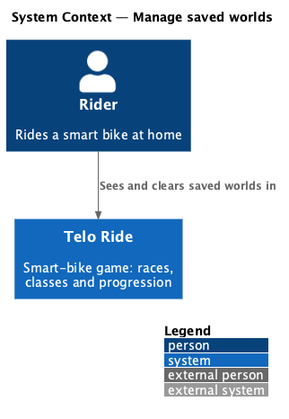
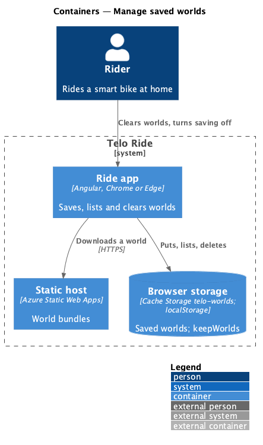
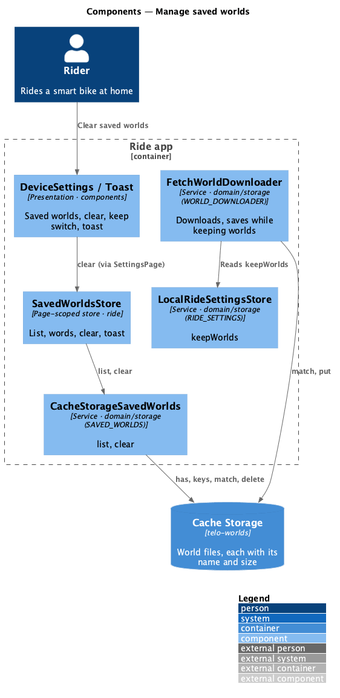
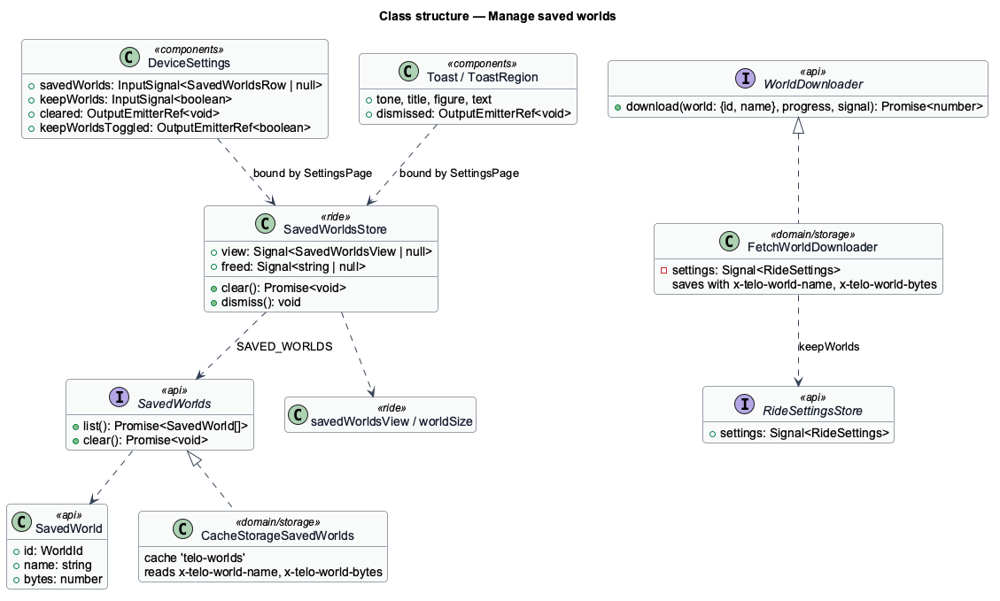
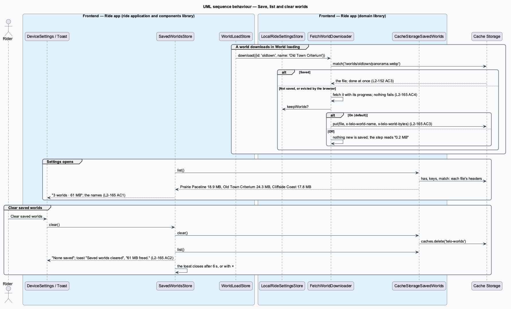

# Manage saved worlds

## Overview

A world bundle is tens of megabytes. Downloading it again before every ride wastes the rider's
time and data, and makes a world class impossible offline. Telo Ride saves each world the rider
rides on the device, so the next World loading skips the download (`classes/load-a-class-world`).
The This device section of Settings shows what is saved, clears it, and turns saving off.

> **saved world** — world bundle kept in the browser's Cache Storage after a ride, so the next load skips the download

> **world cache** — service that saves, lists, sizes and clears saved worlds

> **eviction** — the browser deleting saved data to free space, without asking the app

The section holds "Saved worlds" ("3 worlds · 61 MB", named) with "Clear saved worlds", and
"Keep worlds after a ride". The Bike section beside it holds the bike row of `L2-112`, designed in
`profile/change-settings`. The app shell and the map and class catalogues are cached by the
service worker designed in `performance/ride-without-a-network`; world bundles are kept here,
in a cache of their own, so the rider can see and clear them.

## Description

**Frontend — `components` library**

- **`DeviceSettings`** (`wz-device-settings`) — "Saved worlds" with the count and size
  ("3 worlds · 61 MB"), the names ("Prairie Paceline, Old Town Criterium and Cliffside Coast open
  in seconds, even offline.") and "Clear saved worlds" (`L2-165` AC1). With none saved it reads
  "None saved" and "Each world downloads again the next time you ride it." and has no button
  (`L2-165` AC2). Below it, the "Keep worlds after a ride" switch (`L2-165` AC3). It takes the
  row's words and the switch's state, and emits `cleared` and `keepWorldsToggled`.
- **`Toast`** (`wz-toast`, design-system block `toast`) — a tone, a title, its text projected and
  × ("Dismiss"). Settings shows "Saved worlds cleared" and "61 MB freed. Each world downloads again
  the next time you ride it." in a polite live region; the toast closes on its own after 6 seconds,
  or with ×.

**Frontend — `api` and `domain/storage`**

- **`RideSettings.keepWorlds`** — on by default; Reset to recommended turns it back on.
- **`SavedWorlds`** / `SAVED_WORLDS` (contract in `api`) — `list()` (each saved world's id, name
  and bytes, in the order they were saved) and `clear()`.
- **`CacheStorageSavedWorlds`** (`domain/storage`) — implements the contract on the Cache Storage
  cache `telo-worlds` that slice 16.1's `FetchWorldDownloader` keeps worlds in. Each saved file
  carries its world's name and bytes in its own headers (`x-telo-world-name`,
  `x-telo-world-bytes`), so listing reads no file. `clear()` deletes the cache.
- **`FetchWorldDownloader`** (from `classes/load-a-class-world`) — takes the world's id and name,
  and saves a finished download, with those headers, only while `keepWorlds` is on (`L2-165` AC3).
  A world the browser evicted is not found in the cache, so it downloads again (`L2-165` AC4).

**Frontend — `ride` application**

- **`SavedWorldsStore`** — provided by the Settings page. It loads `list()` when the page opens and
  words the row through `savedWorldsView` ("3 worlds · 61 MB", "0.2 MB" under 10 MB); on "Clear
  saved worlds" it calls `clear()`, lists again and raises the toast with the bytes freed, and
  clears the toast's timer when the page goes.
- **World loading** reads "18.9 MB" for a finished download with `keepWorlds` off, instead of
  "· saved on this device for next time" (`L2-152` AC2).
- **Storage pressure.** The app does not call `navigator.storage.persist()`: worlds are a cache,
  and eviction costs only a download.

## Requirements

The feature realizes the following level-2 (L2) requirements. Each L2 requirement refines a
level-1 (L1) requirement, cited by identifier.

| L2 ID | Refines (L1) | Requirement |
|-------|--------------|-------------|
| `L2-165` | `L1-026` | "Saved worlds" shall read the number and size of the saved worlds and name them, with "Clear saved worlds". Clearing shall delete them, read "None saved" with "Each world downloads again the next time you ride it.", and show the toast "Saved worlds cleared" with the bytes freed. With "Keep worlds after a ride" on (default) a world shall be saved when a ride in it ends; off, nothing new shall be saved. A world the browser evicted shall download again in World loading and nothing shall fail. The Bike section shall hold the bike row of L2-112. |

## Diagrams

### System context

The rider sees and clears the worlds Telo Ride keeps on the device. No other system takes part.

### Containers

World bundles download from the static host and are kept in the browser's Cache Storage; the
setting that allows it is in `localStorage`.

### Components

`SavedWorldsStore` lists and clears through `SAVED_WORLDS`; `FetchWorldDownloader` saves into the
same cache when the rider keeps worlds.

### Class structure

`CacheStorageSavedWorlds` implements the contract over the cache the downloader keeps worlds in,
reading each file's name and size from its headers.

### Behaviour — save, list and clear worlds

A finished download is saved when the rider keeps worlds; an evicted world downloads again. Settings
lists what is saved and clears it with a toast.

## Open questions

1. **Saved when the download finishes.** `L2-165` AC3 saves a world "when a ride in a world ends".
   The downloader saves it when its download finishes, so the world is on the device by the time
   the ride ends, and a ride the rider leaves early still saves it. Saving only at a ride's end
   would hold the file in memory for the whole ride.
2. **Which worlds are saved.** Only a class world's panorama is downloaded today (`main`'s worlds
   are drawn by code); a race does not download its world, so it saves none. The names are the
   worlds' names (Old Town Criterium), which the race maps share.
3. **Files saved before this slice** carry no name or size: This device names them by their world's
   id and sizes them from the file.
4. **Focus after clearing.** "Clear saved worlds" goes once the worlds are cleared, so focus falls
   back to the page; the toast is read by the polite region. Moving focus to the row is not built.
