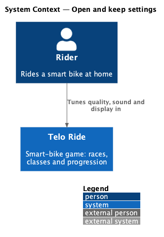
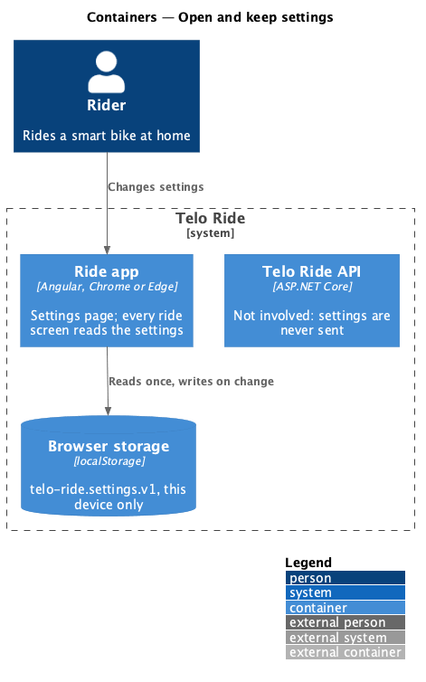
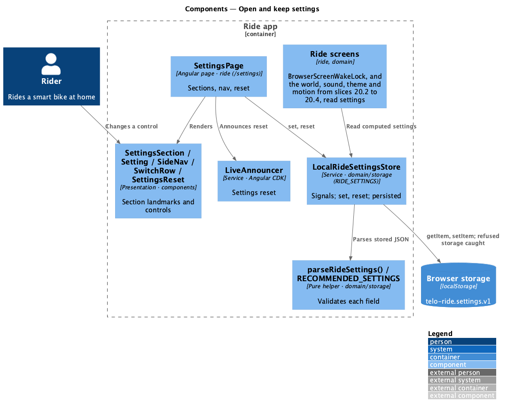
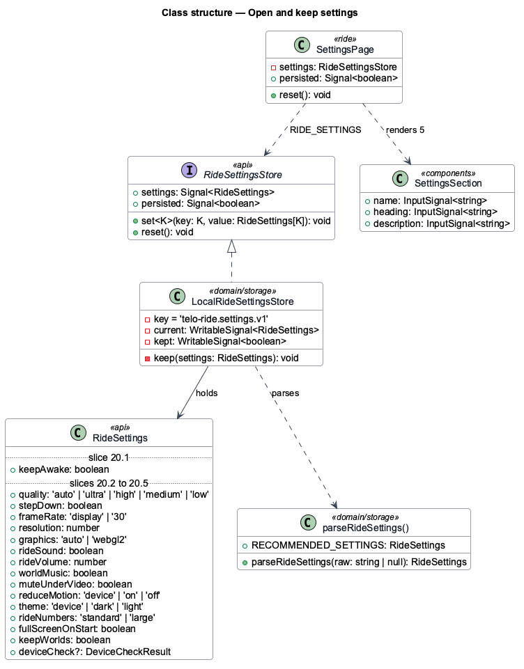
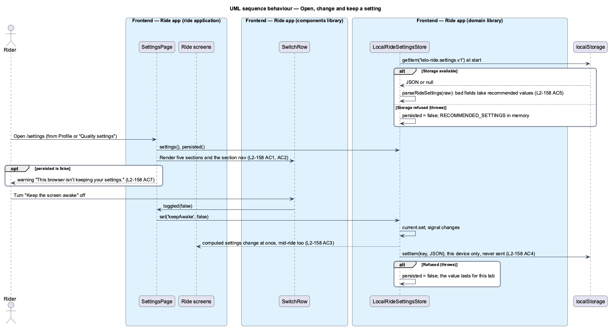
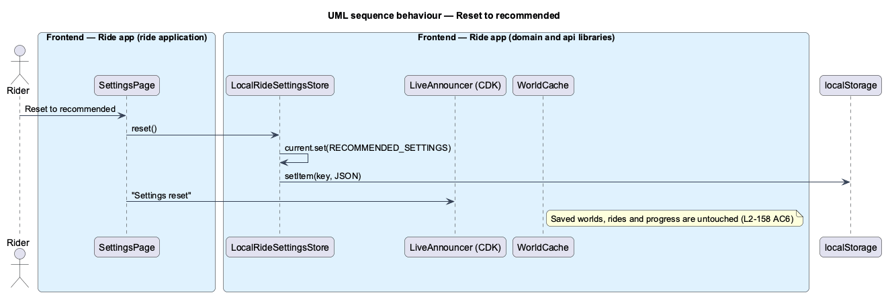

# Open and keep settings

## Overview

Settings is the page where the rider tunes Telo Ride for the smoothest, most pleasant ride their
device can give. It holds the world's quality, sound, motion and display, the bike, and the worlds
kept on the device. This feature is the page itself and the store behind it: how the page is laid
out, how every choice applies at once and is kept, and what happens when the browser refuses to
keep anything. The settings in each section are designed in their own features.

> **ride setting** — one rider choice on Settings, with a recommended value, kept on this device

> **recommended value** — value a ride setting has before the rider changes it, and after "Reset to recommended"

> **settings store** — service that holds the ride settings as signals and keeps them in the browser's `localStorage`

> **refused storage** — state in which the browser throws or offers no `localStorage`, in a private window or with site data blocked

Settings is at `/settings`. It opens from Profile's "Ride settings" row (`profile/change-settings`)
and from World loading's "Quality settings" (`classes/load-a-class-world`), which opens it at the
World section. The settings are device settings: they are never sent to Telo Ride's backend
(`L2-158` AC4). Whether a signed-in rider's settings should follow them to another device is an
open question in `docs/specs/L2.md`.

## Description

**Frontend — `ride` application**

- **`SettingsPage`** (`wz-settings-page`, route `/settings` under the main shell, `loadComponent`)
  — routed page. It renders "← Profile", the heading "Settings", the lead and the section nav, then
  the five sections: World, Sound, Motion and display, Bike (the bike row, as Profile's) and This
  device. Slice 20.1 builds the page and its first control, "Keep the screen awake"; slices 20.2 to
  20.5 fill the sections. It scrolls to the fragment (`#world`) when one is given, on opening and
  from the section nav. It reads and writes settings only through `RIDE_SETTINGS`.
- **Reset** — part of the page. "Reset to recommended" calls `RideSettingsStore.reset()` and
  announces "Settings reset" through the Angular CDK's `LiveAnnouncer`. Rides, progress and saved
  worlds are untouched (`L2-158` AC6).
- **`MainShell`** — the app header marks the item the address falls under; Profile is current on
  `/settings` too (`L2-158` AC1).

**Frontend — `components` library**

- **`SettingsSection`** (`section[wz-settings-section]`, block `settings-section`) — a `section`
  landmark labelled by its `h2`, with a line of context and its settings, each a **`Setting`**
  (`div[wz-setting]`, block `setting`) that draws the hairline above it.
- **`SideNav`** (`nav[wz-side-nav]`, block `side-nav`) and **`SideNavLink`**
  (`a[wz-side-nav-link]`, its icon and label) — "Settings sections": a scrolling row below lg and
  a sticky column from lg (`L2-158` AC2). The page gives each link its fragment.
- **`SwitchRow`** (block `switch-row`) over **`Switch`** (`button[wz-switch]`, `role="switch"`,
  `aria-checked`, its knob's side), and **`SettingsReset`** (block `settings-reset`). The later
  slices add `Segmented` (radio group), `Slider`, `Select` and the selectable `Card`. Each control
  is at least 44 × 44 px, works by touch and keyboard, and carries its state by a radio, a switch
  position, `aria-checked` or words (`L2-158` AC8).
- **`Banner`** — the refused-storage warning: "This browser isn’t keeping your settings." and
  "Changes work until you close this tab. …" (`L2-158` AC7).

**Frontend — `api` and `domain/storage`**

- **`RideSettings`** (`api`) — the type of every ride setting. Each slice adds its own, with its
  recommended value and its parsing: slice 20.1 `keepAwake`; then `quality`, `stepDown`,
  `frameRate`, `resolution`, `graphics`, `rideSound`, `rideVolume`, `worldMusic`,
  `muteUnderVideo`, `reduceMotion`, `theme`, `rideNumbers`, `fullScreenOnStart` and `keepWorlds`.
  The device check's result is kept beside them as `deviceCheck`.
- **`RideSettingsStore`** / `RIDE_SETTINGS` (contract in `api`) — `settings` (signal),
  `persisted` (signal, false under refused storage), `set(key, value)` and `reset()`.
- **`LocalRideSettingsStore`** (`domain/storage`, bound once in the parent route of every screen
  in `ride.routes.ts`, because every ride screen reads it) — reads the key `telo-ride.settings.v1`
  once at start and writes it on each change. A throwing or missing `localStorage` is caught and
  sets `persisted` to false; the settings then live in memory for the tab (`L2-158` AC7).
- **`BrowserScreenWakeLock`** (`domain/browser`) — asks for no screen lock while "Keep the screen
  awake" is off (`L2-164` AC5).
- **`parseRideSettings(raw)`** and **`RECOMMENDED_SETTINGS`** (`domain/storage`, pure, with unit
  tests) — parse the stored JSON field by field. A missing, malformed or out-of-range field takes
  its recommended value; unknown fields are dropped (`L2-158` AC5).

**Applying at once.** Every consumer reads a computed signal over `RIDE_SETTINGS`, so a change
reaches a running ride on the next change detection, with no Save (`L2-158` AC3). The exceptions
are stated where they occur (the graphics API in `settings/tune-world-quality`).

**Privacy.** The store has no HTTP client and no backend contract; nothing in it can send a
setting off the device (`L2-158` AC4).

## Requirements

The feature realizes the following level-2 (L2) requirements. Each L2 requirement refines a
level-1 (L1) requirement, cited by identifier.

| L2 ID | Refines (L1) | Requirement |
|-------|--------------|-------------|
| `L2-158` | `L1-026` | Settings at `/settings` shall show the app header with Profile current, "← Profile", the heading "Settings" and its lead, five section landmarks ("World", "Sound", "Motion and display", "Bike", "This device") and a section nav, a scrolling row below lg and a column from lg. Each change shall apply at once, to a running ride too, and be kept for this device only, with no Save button and never sent to the backend. A missing, malformed or out-of-range stored setting shall read as its recommended value. "Reset to recommended" shall restore every setting and leave rides, progress and saved worlds untouched. Under refused storage a warning shall say settings last until the tab closes, and every control shall still work. Every control shall be at least 44 × 44 px, work by touch and keyboard, and carry its state by more than colour. |

## Diagrams

### System context

The rider changes ride settings in Telo Ride. No other system takes part: settings stay on the
device.

### Containers

The Ride app keeps settings in the browser's `localStorage`. The Telo Ride API is not involved.

### Components

`SettingsPage` renders the sections and writes through `RIDE_SETTINGS`; every ride screen reads
the same store.

### Class structure

`LocalRideSettingsStore` implements the contract with `SafeStorage` and the pure parser, and holds
one `RideSettings` value as a signal.

### Behaviour — open, change and keep a setting

The store parses what is stored, the page renders it, and each change applies and is written at
once, or kept for the tab when storage is refused.

### Behaviour — reset to recommended

Reset writes the recommended values in one step and leaves rides, progress and saved worlds alone.

## Open questions

1. Two open tabs do not yet follow each other's changes: the store reads storage once at start.
   Listening to the window `storage` event would make them agree; no requirement asks for it yet.
2. The switch is named by its label hidden inside it, and the visible label is hidden from
   assistive technology so it is not read twice; the mock names it with `aria-labelledby` on the
   label and description together.
3. The Bike section's row sits in the section's list as one setting, not in Profile's ruled
   `settings__list`, so it has no hairline above and below it.
