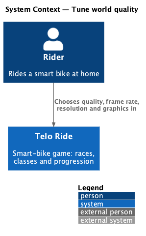
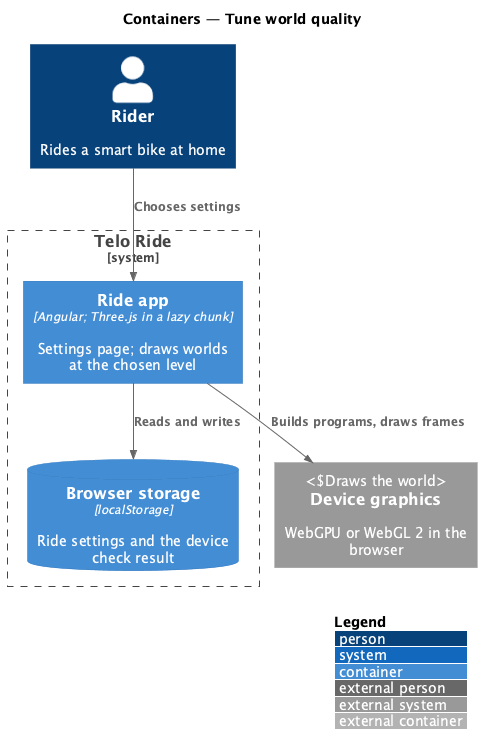
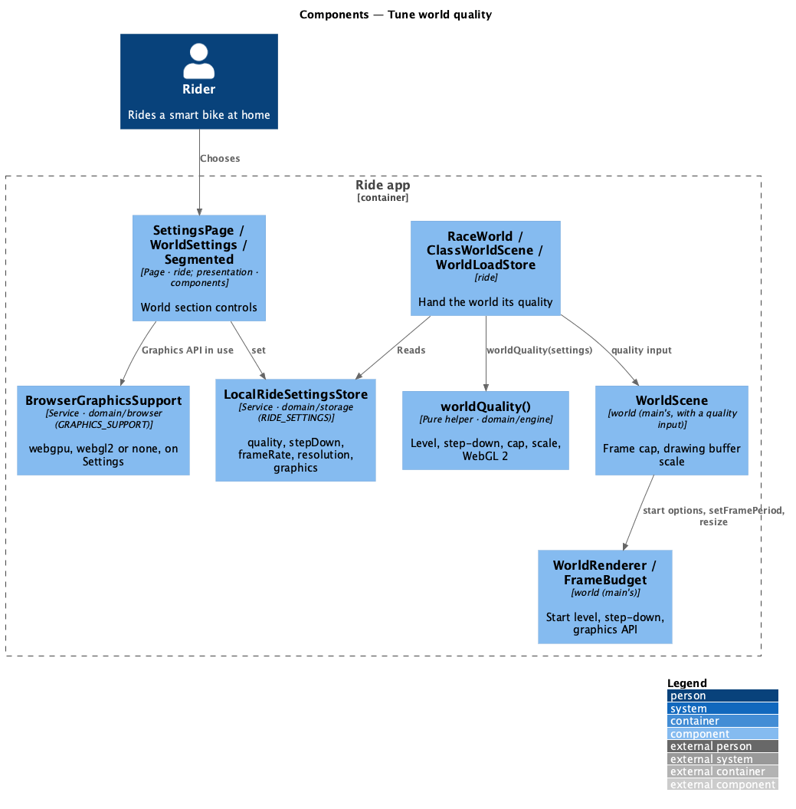
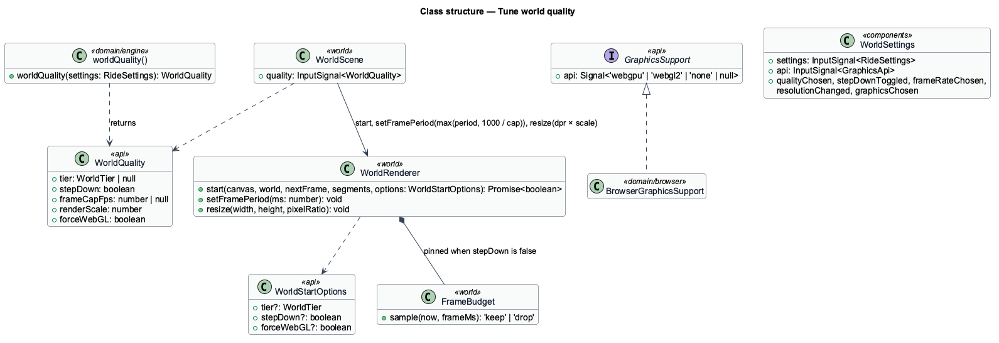
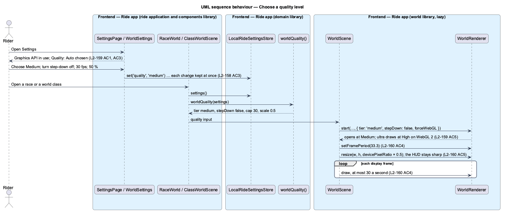
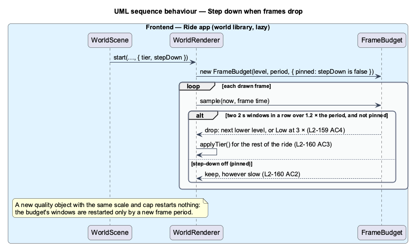

# Tune world quality

## Overview

The 3D world is drawn at one of four quality levels. Higher levels look closer to the real thing
and cost more of the graphics chip; lower levels keep the frame rate on a weak chip or a battery.
Telo Ride puts smoothness first: the power, the clock and the target never wait for the picture.
This feature is the World section of Settings, the rules that turn its choices into how the world
is drawn, and how a change reaches a ride that is already running.

> **quality level** — one of Ultra, High, Medium and Low, each a set of drawing techniques (ADR 0021)

> **Auto** — quality choice that picks the starting level for the device and steps it down when frames drop

> **step-down** — lowering the quality level by one for the rest of a ride after frames run slow

> **slow window** — 2-second window whose median frame time is more than 1.2 × the display's frame period

> **frame cap** — upper limit on frames drawn per second: the display's rate, or 30

> **render scale** — fraction of the canvas's pixels the world draws, from 50 % to 100 %; the HUD always draws at full resolution

> **graphics API** — WebGPU or WebGL 2, the browser interface that draws the world

The section reads "How the 3D world is drawn in races and world classes. Smoothness comes first:
power and the clock never wait for the picture." It offers Quality (five cards), "Step down when
frames drop", "Frame rate", "Resolution", "Graphics" and "Check this device". The device check is
designed in `settings/check-this-device`. The drawing techniques at each level are the table of
ADR 0021. The frame budget measurement is designed in `performance/meet-performance-budgets`;
this feature gives its step-down rule and its inputs.

## Description

**Frontend — `components` library**

- **`WorldSettings`** (`wz-world-settings`) — the World section's controls, presentation only:
  - **Quality** — a `fieldset` of five selectable cards, each a real radio, Auto first and tagged
    "Recommended", each card's text the requirement's (`L2-159` AC2). With WebGL 2 only, Ultra is
    disabled and tagged "Needs WebGPU" (`L2-159` AC6).
  - **Step down when frames drop** — a `SwitchRow`, on and disabled with Auto, the rider's with a
    fixed level, whose name it reads ("Turn it off to keep High …") (`L2-160` AC1, AC2).
  - **Frame rate** — `Segmented`, a WAI-ARIA radio group: "Match display" and "30 fps" (`L2-160`
    AC4).
  - **Resolution** — a native range, 50 to 100 % in steps of 5, its value and scale beside it
    (`L2-160` AC5).
  - **Graphics** — a native select: "Automatic · WebGPU" and "WebGL 2" where WebGPU is there;
    "Automatic · WebGL 2" and a disabled "WebGPU · not available here" where it is not (`L2-161`
    AC1, AC2).

  With neither API, every control is disabled and the step-down switch reads "Comes back when this
  browser can draw 3D worlds." (`L2-161` AC4). Inputs `settings` and `api`; one output per control.
- **`SettingsSection`** gains a `[slot=head]` (the graphics API pill) and a `[slot=notice]` (the
  no-3D banner).

**Frontend — `api`, `domain`**

- **`RideSettings`** gains `quality` (`'auto'` or a level), `stepDown`, `frameRate`, `resolution`
  and `graphics`, each parsed to its recommended value when stored wrong (`L2-158` AC5).
- **`GraphicsSupport`** / `GRAPHICS_SUPPORT` — what this browser draws worlds with: `webgpu`,
  `webgl2` or `none`. **`BrowserGraphicsSupport`** (`domain/browser`) asks for a WebGPU adapter,
  then for a WebGL 2 context, which it lets go at once. Bound on the Settings route only.
- **`worldQuality(settings)`** (`domain/engine`, pure, with unit tests) returns a `WorldQuality`:
  `tier` (null for Auto, which opens at Low as `main`'s world does, `L2-065` AC5), `stepDown`
  (always true with Auto), `frameCapFps` (30 or null), `renderScale` (`resolution / 100`) and
  `forceWebGL`. The device check's level joins Auto in slice 20.3.

**Frontend — `world` library (lazy), `main`'s code with these changes**

- **`WorldRenderer.start`** takes `stepDown` and `forceWebGL` beside `tier` in its options. A fixed
  Ultra draws at High on WebGL 2; with `stepDown` false the `FrameBudget` is pinned, so no window
  lowers the level (`L2-160` AC2); `forceWebGL` asks three's renderer for its WebGL 2 backend.
- **`WorldScene`** takes a `quality` input. It starts the renderer with the level, step-down and
  graphics API; sizes the drawing buffer at `devicePixelRatio × renderScale`, so the HUD over it
  stays sharp (`L2-160` AC5); judges frames against `max(period, 1000 / cap)`; and under a cap
  draws a frame once its share of a second has passed, give or take half a display frame
  (`L2-160` AC4). A new scale or cap applies at once, mid-ride too; a new object with the same
  values does nothing, so the budget's windows are never restarted by a rebind.
- **`readWorldRideProbe`** — the test-only hook may watch a ride opened from the settings (judged,
  with no tier), reporting what is drawn.

**Frontend — `ride` application**

- **`RaceWorld`** and **`ClassWorldScene`** hand their `WorldScene` one `computed`
  `worldQuality(settings)`. **`WorldLoadStore`** starts a class's world at the fixed level, with
  step-down and the graphics API, and its quality fact reads "Quality · Medium" for a fixed level
  ("Auto quality · Low" for Auto).
- **`SettingsPage`** renders the World section's pill ("WebGPU", "WebGL 2" or "Panorama only"),
  the no-3D notice and `WorldSettings`, and writes each change through `RIDE_SETTINGS`.

## Requirements

The feature realizes the following level-2 (L2) requirements. Each L2 requirement refines a
level-1 (L1) requirement, cited by identifier.

| L2 ID | Refines (L1) | Requirement |
|-------|--------------|-------------|
| `L2-159` | `L1-026` | The World section shall read its purpose and the graphics API in use. Quality shall be a radio group of five cards, Auto first and tagged "Recommended", then Ultra, High, Medium and Low, each with its text. Auto shall be chosen by default. Auto shall start at Ultra with WebGPU, High with WebGL 2, or the device check's level, and step down one level after two 2-second windows in a row whose median frame is more than 1.2 × the frame period. A fixed level shall start at that level. With WebGL 2 alone, Ultra shall be disabled and tagged "Needs WebGPU". A level changed mid-ride shall take over once built, without pausing the ride. |
| `L2-160` | `L1-026` | With Auto, "Step down when frames drop" shall be on and disabled; with a fixed level it shall be enabled and on by default, and off shall never lower the level. A level dropped in a ride shall return to the chosen level next ride. "Frame rate" shall offer "Match display" (default) and "30 fps"; at 30 fps the world shall draw at most 30 frames a second, judged against 33.3 ms. "Resolution" shall run 50 % to 100 % in steps of 5, default 100 %, and scale only the world's drawing buffer. |
| `L2-161` | `L1-026` | "Graphics" shall offer "Automatic · WebGPU" (default) and "WebGL 2" with WebGPU; without it, "Automatic · WebGL 2" and a disabled WebGPU option. A change mid-ride shall apply from the next world, with a toast. Without WebGPU and WebGL 2 a notice shall say the browser cannot draw 3D worlds, every World control shall be disabled, and the other sections shall still work. |

## Diagrams

### System context

The rider tunes how Telo Ride draws its worlds. No other system takes part.

### Containers

The Ride app keeps the choices in `localStorage` and draws the world on the device's graphics chip
through WebGPU or WebGL 2.

### Components

`qualityPolicy()` turns the settings, the backend and the device check into one policy; the
bridge hands it to the governor and the renderer of whatever world is running.

### Class structure

The policy is a plain value. The governor, the pacer and the renderer read it; the settings store
is its only source.

### Behaviour — choose a quality level

A world opens at the policy's starting level. A change mid-ride builds the new level ahead and
switches without a pause; a graphics API change waits for the next world.

### Behaviour — step down when frames drop

Two slow windows in a row drop one level for the rest of the ride, unless the rider turned
step-down off for a fixed level.

## Open questions

1. A level or graphics API changed during a ride (`L2-159` AC7, `L2-161` AC3) is not built: Settings
   is not reachable from a running ride, so a change always meets the next world that opens. The
   toast's copy is still to be supplied.
2. Which step-down rule governs a race: this design applies `L2-159` AC4 (two slow 2-second
   windows, never raised mid-ride), as `main`'s `FrameBudget` does; `performance/meet-performance-budgets`
   describes a moving average with a raise.
3. Whether "Graphics: WebGL 2" draws with WebGL 2 is not proven by an acceptance test: the test
   browser offers no WebGPU, and a stand-in adapter cannot draw. The renderer passes the choice to
   three's `forceWebGL`.
4. World loading's quality fact for a fixed level, "Quality · Medium", is not in a mock.
