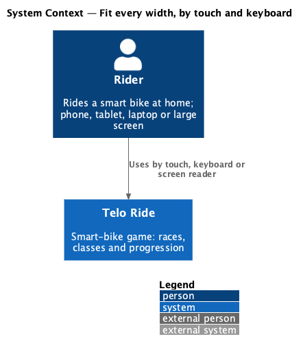
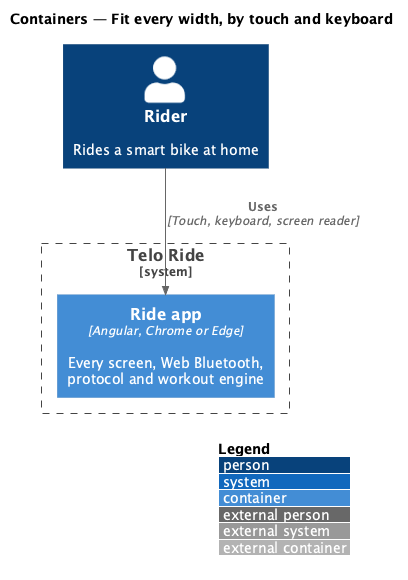
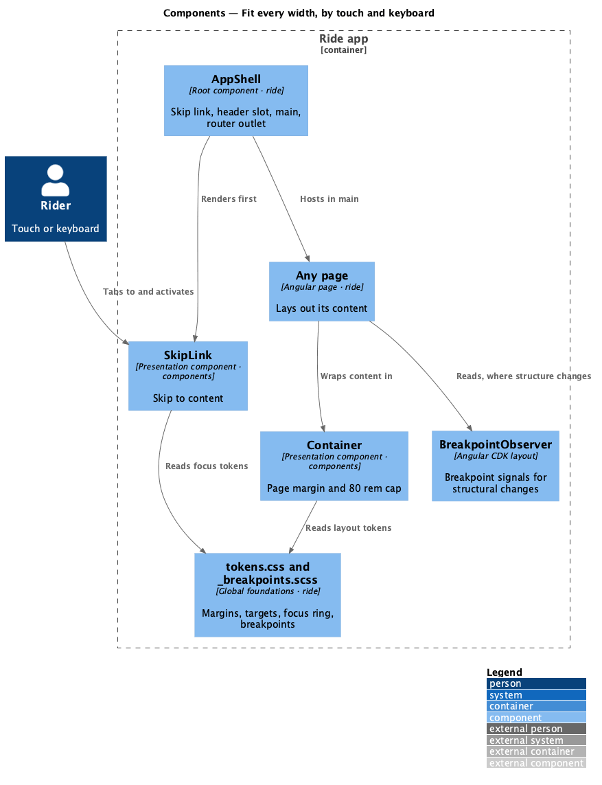
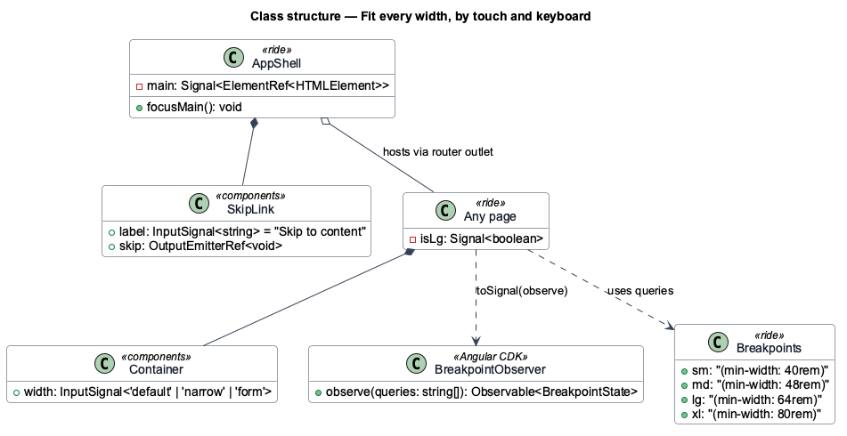
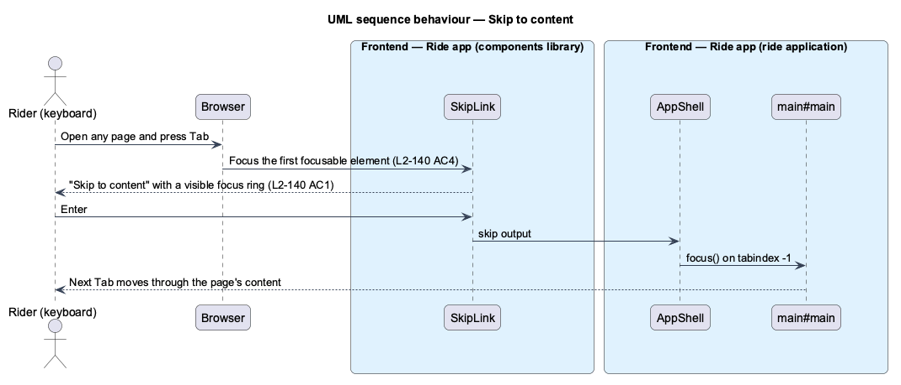
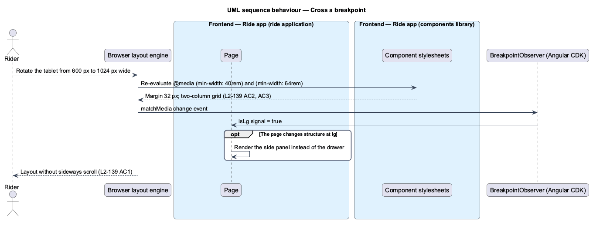

# Fit every width, by touch and keyboard

## Overview

Telo Ride is used on a phone propped on the handlebars, a tablet on a stand, a laptop beside the
bike and a large screen across the room. A rider may tap the screen mid-ride with a sweaty finger,
or use a keyboard at a desk. This feature sets the layout rules that hold at every width from
320 px to 2560 px and the input rules that make every control reachable by touch and by keyboard.

- **breakpoint** — named minimum viewport width at which a layout changes: phone < 640 px, sm ≥ 640 px, md ≥ 768 px, lg ≥ 1024 px, xl ≥ 1280 px
- **page margin** — horizontal space between the viewport edge and page content
- **container** — block that applies the page margin and caps content at 80 rem
- **target** — area that responds to a tap or click
- **focus ring** — visible outline drawn on the control that has keyboard focus
- **skip link** — first focusable link on a page that moves focus to the main content

The feature belongs to the ui subsystem. It is a cross-cutting, frontend-only slice: it defines
the foundations and shared components every screen uses. Each screen's own responsive rules live
in its feature design.

## Description

- **Design tokens** — `tokens.css`, copied from `docs/design-system/tokens/` into the `ride`
  application's global styles. It defines `--layout-margin` (16 px, 24 px from sm, 32 px from lg),
  `--layout-container-max` (80 rem), `--target-min` (24 px), `--target-comfortable` (44 px),
  `--target-ride` (48 px), `--focus-ring-width` and `--shadow-focus`.
- **`_breakpoints.scss`** — Sass partial in the `ride` application and `components` library with
  mixins `sm`, `md`, `lg` and `xl`. Media queries cannot read custom properties, so the mixins
  repeat the token values in rem.
- **`Container`** — presentation component in `components` (`wz-container`). It applies
  `padding-inline: var(--layout-margin)` and `max-width: var(--layout-container-max)`.
- **Component stylesheets** — each component's BEM stylesheet carries its responsive rules with
  the breakpoint mixins and uses intrinsic layout (`minmax`, `flex-wrap`, `min-width: 0`) so no
  content overflows sideways.
- **`BreakpointObserver`** — the Angular CDK layout service, used only where a component's
  structure, not its style, changes at a breakpoint (for example the race layout's panels,
  `race/ride-a-race`). Pages read it as a signal with `toSignal`.
- **`SkipLink`** — presentation component in `components` (`wz-skip-link`, block `skip-link`). It
  renders "Skip to content" as the first focusable element of `AppShell` and, on activation, moves
  focus to `<main id="main" tabindex="-1">`.
- **`AppShell`** — root component of the `ride` application. It renders `SkipLink`, the app header
  slot and `<main id="main">` around the router outlet.
- **Focus styles** — the global `:focus-visible` rule draws `--shadow-focus` on every control.
- **Hover rule** — only `.btn`, `.icon-btn` and links declare `:hover` styles, inside
  `@media (hover: hover)`. No other block declares a hover state.
- **Target sizes** — a control keeps the size the mock draws and takes touches across at least
  `--target-comfortable` (44 px): where it draws smaller, an absolutely placed `::after` (or
  `::before`) overhangs it, `inset-block: min(0px, calc((100% - var(--target-comfortable)) / 2))`,
  as `.btn`, the header links, the icon button, the switch, the segmented option, the side-nav link
  below lg and the custom ride's view tab do. A native range is 44 px tall with negative margins
  that keep a 24 px range's layout; the select is drawn at 44 px. A scroller clips what overhangs
  it, so the side nav's row is padded to make room and the segmented options wrap instead of
  scrolling.
- **Mid-ride targets** — below sm, the race, class ride and custom ride pages set
  `--target-comfortable` to `--target-ride` on their host, so every tap area on them is 48 px; the
  class ride's Pause and Leave are drawn at 48 px, as the mock asks (open question 12 in
  `docs/specs/L2.md`).
- **Focus** — the global `:focus-visible` outline draws the ring on every control; a card that
  clips its cover (the class card) draws the ring on the cover instead. Focus follows the DOM
  order; no `tabindex` above 0.
- **Proof** — `e2e/fit-every-width.spec.ts` opens every screen, from the shared table
  `e2e/fixtures/screens.ts`, at 320 and 2560 px and fails on sideways scroll; it also measures the
  page margin at 320, 640 and 1024 px and the 80 rem container at 2560 px.
- **Proof of touch and keyboard** — `e2e/touch-and-keyboard.spec.ts` opens every screen of the
  same table. At 390 px it taps each edge of a 44 × 44 px square (48 on a ride) centred on every
  control and fails on any tap that misses it (`AppDocument.untappable`); at 1280 px it tabs
  through the page and fails on any stop out of view or without a ring (`AppDocument.tabStops`).
  `e2e/app-shell.spec.ts` proves the skip link.
- **Sweeps** — the responsive sweep (`e2e/sweeps/responsive.sweep.ts`, `npm run sweep:responsive`
  with `playwright.sweeps.config.ts`) opens the same screens at 320, 640, 768, 1024, 1280 and
  2560 px. It runs only when a person asks.
- **Narrow ride header** — the custom ride's clock, Pause and End (`ride-header__end`) wrap at the
  narrowest widths, End under the clock, so 320 px does not scroll sideways.

## Requirements

| L2 ID | Refines (L1) | Requirement |
|-------|--------------|-------------|
| `L2-139` AC1 | `L1-023` | Every screen from 320 to 2560 px wide shall not scroll sideways, and nothing shall overlap or be cut off. |
| `L2-139` AC2 | `L1-023` | The page margin shall be 16 px on a phone, 24 px from sm and 32 px from lg, and content shall be at most 80 rem wide. |
| `L2-139` AC3 | `L1-023` | When the viewport crosses a breakpoint, each screen's layout shall change as its own L2 states. |
| `L2-140` AC1 | `L1-023` | Every interaction shall work by touch on a phone and by keyboard on a desktop, with a visible focus ring on every control. |
| `L2-140` AC2 | `L1-023` | Every target shall be at least 24 × 24 px; primary actions shall be at least 44 × 44 px; anything pressed mid-ride on a phone shall be at least 48 × 48 px. |
| `L2-140` AC3 | `L1-023` | Anything that is not a button or link shall show no hover effect. |
| `L2-140` AC4 | `L1-023` | On every page, a "Skip to content" link shall be the first focusable element and shall move focus to the main content. |

## Diagrams

### System context

The rider reaches Telo Ride by touch or keyboard on any screen size.

### Containers

The Ride app alone carries the layout and input rules.

### Components

`AppShell` places `SkipLink` first and wraps every page in `<main>`. Pages lay out content in
`Container`; tokens and breakpoint mixins feed every component stylesheet.

### Class structure

`AppShell` composes `SkipLink`; pages compose `Container`; a page that changes structure reads
`BreakpointObserver`.

### Behaviour — skip to content

The first Tab press focuses the skip link; activating it moves focus into `<main>`
(`L2-140` AC4).

### Behaviour — cross a breakpoint

Styles change through media queries alone; a component whose structure changes reads the CDK
breakpoint signal (`L2-139` AC3).

## Open questions

1. **The level bars (decided in slice 23.2).** The custom ride's 32 level bars draw about 8 px
   wide and cannot take 24 px each. The resistance stepper beside them sets the same levels with
   48 px buttons, so the bars are exempt as an equivalent control (WCAG 2.5.8); they stay in the
   tab order.
2. **Hover on anything but a button or link (`L2-140` AC3)** is not proved yet; no behaviour spec
   checks it.
3. **The app header's focus order on a phone.** Below sm the nav links draw on a second row
   (`order: 99`) but come before the level and Full screen in the DOM, so Tab reaches them first.
4. **The side nav from lg** draws its links 24 px tall in a column, where a desktop pointer uses
   it; only below lg, in a row, do they take touches across 44 px.
