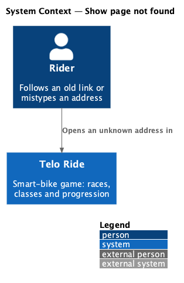
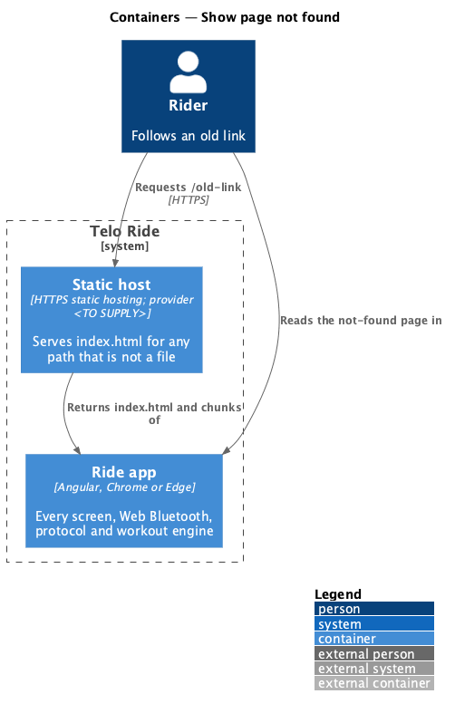
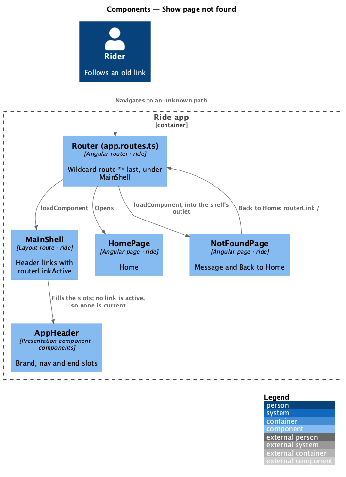
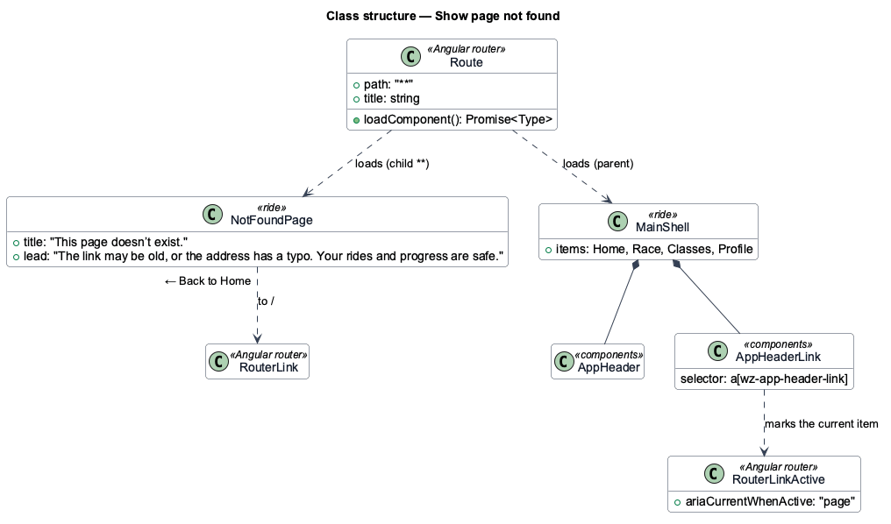
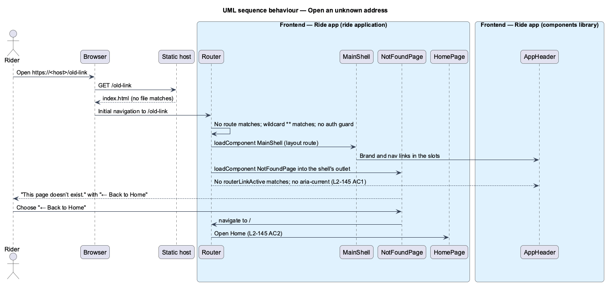

# Show page not found

## Overview

A rider may follow an old link or mistype an address. The host serves the app for any address
(`platform/host-and-deliver`), so the app itself decides that no screen matches. This feature shows
a calm page that says so, reassures the rider that rides and progress are safe, and leads back to
Home.

- **wildcard route** — Angular route with path `**` that matches any address no other route matches
- **current item** — header navigation link marked with `aria-current="page"` for the screen shown

The feature belongs to the ui subsystem. It is frontend-only and needs no sign-in: the
authentication guard of `accounts/sign-in-with-an-email-code` exempts it.

## Description

- **Wildcard route** — the last child of the `MainShell` layout route in `ride`'s `app.routes.ts`:
  `{ path: '**', title: 'Page not found · Telo Ride', loadComponent: () => import('./not-found/not-found-page') }`.
  No authentication guard applies.
- **`MainShell`** — the layout route of the home screens (`home/show-the-app-header`). It renders
  the app header over the scrolling page and puts its router links in the header's slots, each
  with `routerLinkActive` and `ariaCurrentWhenActive="page"`. Home matches exactly and the other
  items by prefix, so an unknown address marks no item.
- **`NotFoundPage`** — page in the `ride` application (`wz-not-found-page`, block `not-found`). It
  renders `<main id="main" class="container page not-found">` with the `h1` "This page doesn’t exist.", the lead "The link may be old, or the
  address has a typo. Your rides and progress are safe." and the primary button link
  "← Back to Home" (`<a wz-button variant="primary" size="lg" routerLink="/">`), as in
  `docs/mocks/pages/not-found/default.html`.
- **`AppHeader`** — presentation component in `components` (`wz-app-header`). It lays out the
  brand, nav and end slots and knows no route; with no active link, no item carries
  `aria-current`.
- **Mock classes** — the page keeps the mock's BEM classes (`page__title`, `page__lead`,
  `not-found__action`, `btn btn--primary btn--lg`) so e2e page objects can use them.
- **Arrow** — the "←" is an inline SVG icon with `aria-hidden="true"`; the link's accessible name
  is "Back to Home".

## Requirements

| L2 ID | Refines (L1) | Requirement |
|-------|--------------|-------------|
| `L2-145` AC1 | `L1-023` | For an address that matches no screen, the app header shall show with no current item, and the page shall read "This page doesn’t exist." and "The link may be old, or the address has a typo. Your rides and progress are safe.", with "← Back to Home". |
| `L2-145` AC2 | `L1-023` | Choosing "← Back to Home" shall open Home. |

## Diagrams

### System context

The rider opens an address that Telo Ride does not know.

### Containers

The host returns the app for the unknown address; the Ride app's router shows the page.

### Components

The router loads `MainShell` and, into its outlet, `NotFoundPage`; no header link is active, so
`AppHeader` shows no current item.

### Class structure

`MainShell` composes `AppHeader` and its links; `NotFoundPage` links to Home through the router.

### Behaviour — open an unknown address

The router falls through to the wildcard route under `MainShell`, no header link is active, and
"← Back to Home" opens Home (`L2-145` AC1, AC2).

