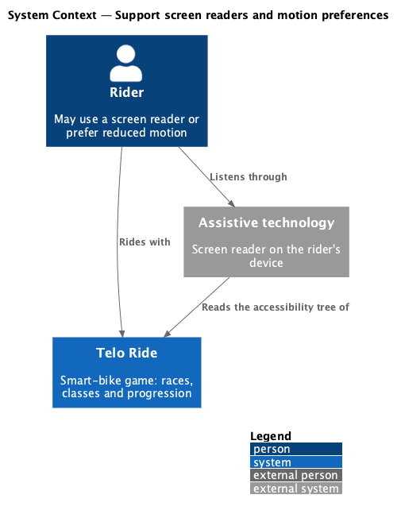
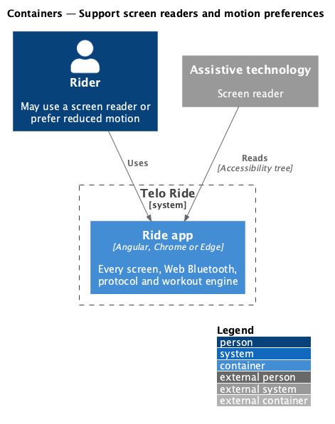
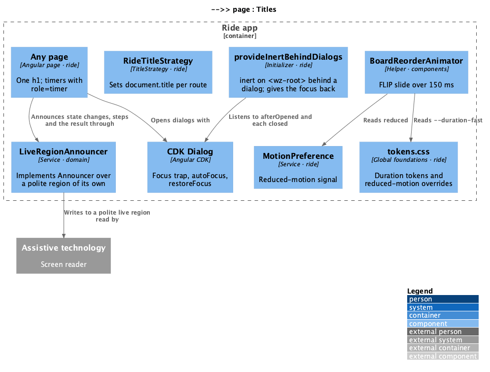
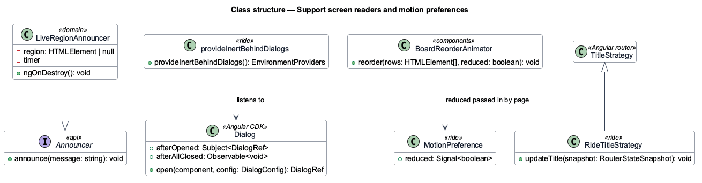
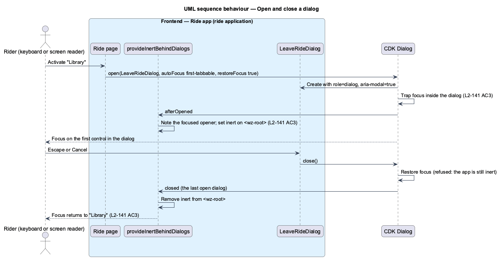
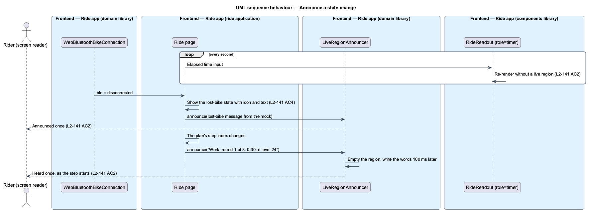
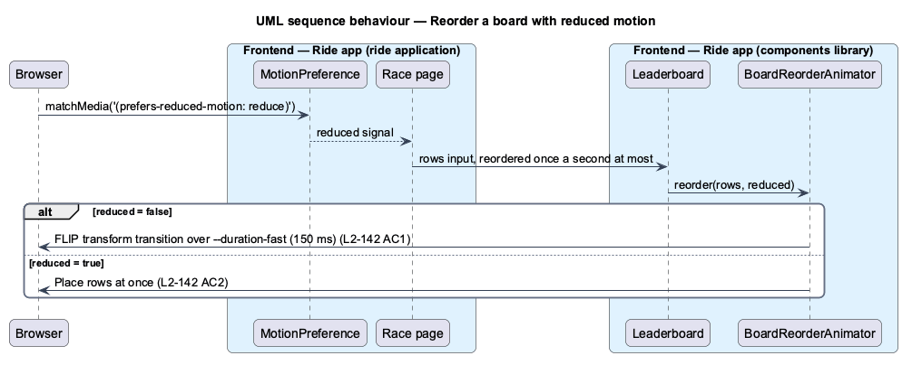

# Support screen readers and motion preferences

## Overview

Some riders use a screen reader; some are made unwell by motion; some cannot tell colours apart.
A ride screen changes every second, which makes it easy to build a page that a screen reader
announces without pause, or that moves more than a rider can bear. This feature sets the rules
that keep every screen usable with assistive technology and with reduced motion, to WCAG 2.2 AA.

- **live region** — element whose changes a screen reader announces without the rider moving to it
- **state change** — event that alters what the rider can do, such as lost bike, paused, unlocked or sent
- **inert** — HTML attribute that removes an element and its subtree from focus and from assistive technology
- **reduced motion** — the `prefers-reduced-motion: reduce` user preference
- **duration token** — named motion duration in `tokens.css`, such as `--duration-fast` (150 ms)

The feature belongs to the ui subsystem and is frontend-only. It applies to every screen.

## Description

- **Page headings** — each page template holds one `h1`. On race, lobby, results, class ride and
  custom ride the `h1` carries the global `visually-hidden` utility class.
- **`RideTitleStrategy`** — subclass of Angular's `TitleStrategy` in the `ride` application. It sets
  `document.title` from each route's `title`.
- **Timers** — the countdown and clock readouts render with `role="timer"` and no `aria-live`.
  Per-second readouts carry no live region.
- **`Announcer`** — contract in `api` (token `ANNOUNCER`) with `announce(message)`, always polite.
  `LiveRegionAnnouncer` in `domain` (`browser/`) implements it over one visually hidden region of
  its own (`aria-live="polite"`, `aria-atomic="true"`, class `live-announcer`), added on first use:
  it empties the region and writes the message 100 ms later, so a repeat is heard as a change, and
  removes the region and its timer on destroy. The ride's parent route binds it. It is called only
  for state changes: lost bike, paused, unlocked, sent, a ride's step as it starts and the result.
- **Step and result** — `CustomRideStore` and `ClassRideStore` announce each step once as its
  index changes, in the card's words (`rides/step-announcement.ts`): "Work, round 1 of 8: 0:30 at
  level 24" on the custom ride, "Work, 0:30" on the class ride. Results announces
  `ResultsView.announcement`, "Race results: You finished 2nd of 10. +442 XP earned.", as it opens
  and again once the XP is recorded.
- **Dialogs** — every dialog opens through the CDK `Dialog` with `autoFocus: 'first-tabbable'` and
  `restoreFocus: true`. The CDK focus trap keeps focus inside.
- **`provideInertBehindDialogs`** — an environment initializer in the `ride` application
  (`dialogs/`), provided by each route whose pages open a dialog (Profile, the custom ride), so
  the CDK dialog's code stays out of every other chunk. On the CDK `Dialog`'s `afterOpened` it
  notes what has the focus, then sets `inert` on `<wz-root>`; when the last open dialog's `closed`
  emits it removes `inert` and, if the focus was lost, gives it back to that control. The CDK
  restores the focus while the app is still inert, which the browser refuses. The subscriptions
  end through `takeUntilDestroyed`.
- **State indicators** — every state (on target, locked, earned, ready, connected) renders an icon
  and a text label as well as a colour, through components such as `Badge`, `Chip` and `Stars`.
- **Contrast** — colour pairs come only from role tokens whose contrast is recorded in
  `docs/design-system/tokens/contrast-pairs.json` for both themes.
- **Duration tokens** — `--duration-fast` (150 ms, hovers and board slides), `--duration-base`
  (200 ms, panels), `--duration-slow` (250 ms, the unlock) and `--duration-deliberate` (1000 ms, a
  countdown step).
- **Reduced motion in CSS** — under `prefers-reduced-motion: reduce`, or the rider's Reduce motion
  On (`data-motion="reduced"`), `tokens.css` sets the moving durations to 0 ms, including
  `--duration-countdown`, so the interval, segment and race bars jump to their place. Opacity fades named in `L2-056` and `L2-076` keep their durations. The
  countdown step is a timer, so it keeps `--duration-deliberate`.
- **`MotionPreference`** — service in the `ride` application exposing `reduced` as a signal from
  `matchMedia('(prefers-reduced-motion: reduce)')`. Script-driven motion reads it; the media
  query listener is removed on destroy.
- **`BoardReorderAnimator`** — helper in `components` that slides board rows to their new places
  with the FLIP technique over `--duration-fast`, or places them at once when `reduced` is true.
- **Full-screen motion** — only the race countdown (`race/wait-in-the-race-lobby`) animates across
  the whole screen.
- **Accessibility sweep** — `e2e/sweeps/accessibility.spec.ts` runs axe-core on every screen in
  both themes. It runs only when a person asks.

## Requirements

| L2 ID | Refines (L1) | Requirement |
|-------|--------------|-------------|
| `L2-141` AC1 | `L1-023` | Every screen shall have one `h1`, visually hidden where the design shows no heading (race, lobby, results, class ride, custom ride). |
| `L2-141` AC2 | `L1-023` | Values that change every second shall not be announced every second; timers shall use `role="timer"` without a live region, and only state changes (lost bike, paused, unlocked, sent) shall be announced. |
| `L2-141` AC3 | `L1-023` | When a dialog opens, focus shall move into it and be trapped there, the page behind shall be inert, and closing shall return focus to what opened it. |
| `L2-141` AC4 | `L1-023` | A state (on target, locked, earned, ready, connected) shall never be carried by colour alone. |
| `L2-141` AC5 | `L1-023` | In either theme, text shall have contrast of at least 4.5 : 1 (3 : 1 for large numerals) and control boundaries at least 3 : 1. |
| `L2-142` AC1 | `L1-023` | Hovers and board slides shall take 150 ms, panels 200 ms, the unlock 250 ms and a countdown step 1000 ms. |
| `L2-142` AC2 | `L1-023` | Under `prefers-reduced-motion: reduce`, any animation shall end at once, except the opacity fades stated in `L2-056` and `L2-076`. |
| `L2-142` AC3 | `L1-023` | The race countdown shall be the only full-screen motion. |

## Diagrams

### System context

The rider uses Telo Ride with or without a screen reader, and with or without a reduced-motion
preference.

### Containers

The Ride app alone carries the rules.

### Components

Pages announce state changes through `Announcer`; dialogs open through the CDK `Dialog`, and
`InertBackground` makes the page behind inert; `MotionPreference` and the duration tokens govern
every animation.

### Class structure

`CdkLiveAnnouncerAdapter` implements the `Announcer` contract; `InertBackground` depends on the CDK
`Dialog`; `BoardReorderAnimator` reads `MotionPreference`.

### Behaviour — open and close a dialog

Focus moves into the dialog and stays there; the page behind is inert; closing restores focus
(`L2-141` AC3).

### Behaviour — announce a state change

A per-second readout updates silently; losing the bike is announced once (`L2-141` AC2).

### Behaviour — reorder a board with reduced motion

Board rows slide over 150 ms, or move at once when the rider prefers reduced motion
(`L2-142` AC1, AC2).

## Open questions

1. CDK's `LiveAnnouncer` injects Angular's `DomSanitizer`, and any use of it, even from a lazy
   chunk, puts the HTML sanitizer in the initial bundle (3.3 kB; found in slice 20.3, which took it
   off Settings). The `Announcer` should be built on a polite status region of its own unless that
   cost is accepted in an ADR.
   Decided in slice 23.3: the `Announcer` is built on a region of its own.
2. **The accessibility sweep** (`e2e/sweeps/accessibility.spec.ts`, axe-core in both themes) is
   not written yet: it needs `@axe-core/playwright`, and contrast (`L2-141` AC5) is not this
   slice's.
3. **What proves this slice.** `e2e/screen-readers-and-motion.spec.ts`: a custom ride's and a class
   ride's step, and Results, each heard once; the custom ride's countdown a timer with no live
   region; the leave dialog taking and keeping the focus with `<wz-root>` inert and giving the
   focus back on Escape; and every screen of `e2e/fixtures/screens.ts` with nothing moving but an
   opacity fade under `prefers-reduced-motion: reduce` (`AppDocument.moving`).
