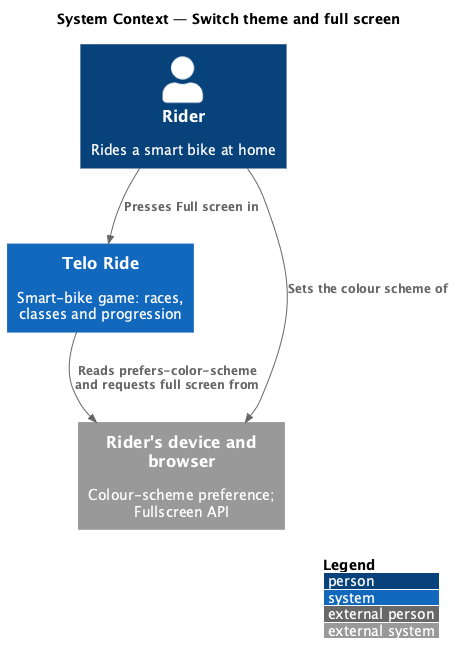
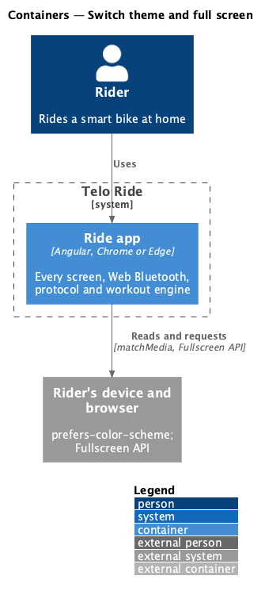
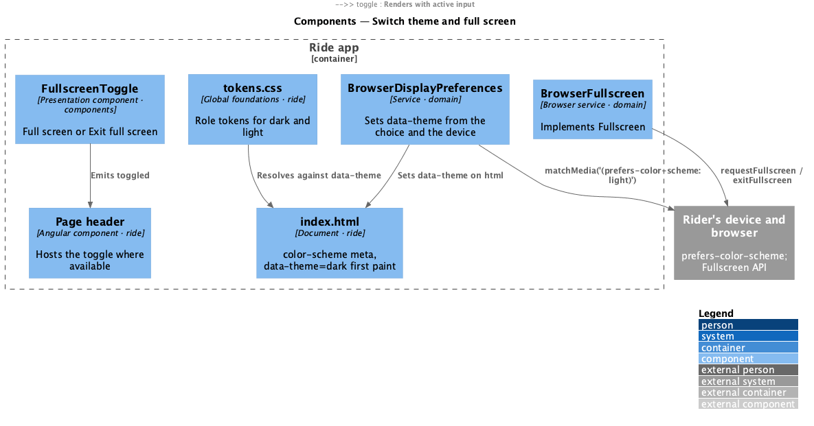
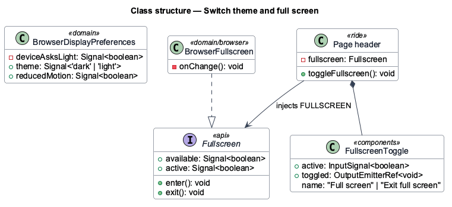
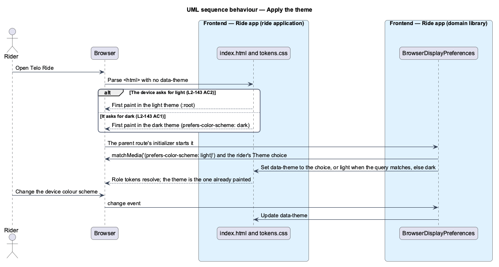
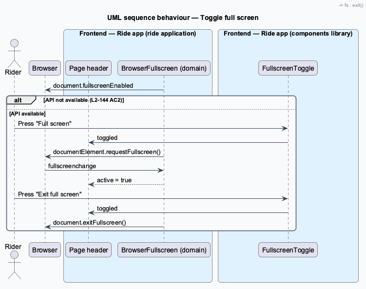

# Switch theme and full screen

## Overview

Telo Ride is dark by default: a dark screen beside the bike is easy to read in a dim room and
keeps the rider's attention on the numbers. A rider whose device asks for a light colour scheme
gets a light theme that meets the same contrast rules. A rider who mounts a tablet or casts a
laptop to a screen can also fill the whole display with the app.

- **theme** — set of colour values applied to the role tokens; Telo Ride has dark and light
- **role token** — colour custom property named for its use (ink, panel, raised, line, fg, muted, faint, volt, rest, heart, warn, gold)
- **colour-scheme preference** — the device setting exposed through the `prefers-color-scheme` media query
- **Fullscreen API** — browser API (`requestFullscreen`, `exitFullscreen`, `fullscreenchange`) that shows one element across the whole display

The feature belongs to the ui subsystem and is frontend-only. The theme follows the device unless
the rider chooses Dark or Light in Settings (`L2-164` AC3, `ui/change-sound-motion-and-display`). The page header that hosts the full-screen button is designed in
`home/show-the-app-header` and the ride screens' own headers.

## Description

### Theme

- **`tokens.css`** — global foundation in the `ride` application, copied from the design system's.
  It declares the role tokens for light on `:root, [data-theme="light"]` and for dark on
  `[data-theme="dark"]`, and repeats the dark values under `@media (prefers-color-scheme: dark)`
  for a root with no `data-theme`. Every text role (fg, muted, faint and each `-fg` accent)
  contrasts at 4.5:1 or more on ink, panel and raised in both themes: dark `--color-volt-fg` is
  `--palette-signal-bright` (#ff5233, 4.76:1 on raised; the signal itself gives 4.48) and
  `--palette-green-deep` is #04704f (5.0:1 on light raised; #047857 gave 4.48).
- **`index.html`** — carries `<meta name="color-scheme" content="dark light">` and no `data-theme`,
  so the first paint, before scripts run, follows `prefers-color-scheme`: dark on a device that asks
  for dark, light on one that asks for light (`L2-143` AC1, AC2).
- **`BrowserDisplayPreferences`** — the `DisplayPreferences` implementation in `domain`'s
  `browser/` (slice 20.4), bound with an environment initializer on the app's parent route. It
  reads the rider's Theme choice and `matchMedia('(prefers-color-scheme: light)')`, follows the
  query's `change` events, and sets `data-theme` on `<html>`: the choice when it is Dark or Light,
  otherwise `light` when the query matches and `dark` when it does not or cannot be read.
- **Raw colours** — no stylesheet, template or script outside `tokens.css` and the copied world
  code holds a raw colour; the components read role tokens (`L2-143` AC3). Use of `--color-gold`
  outside XP, stars and unlock components is checked in review.

The `prefers-color-scheme` query has no "no preference" value: Chromium reports a device that
expresses no choice as `light`. `L2-143` AC1 now reads "asks for dark, or the browser cannot
tell", and a `light` report counts as asking for light (decided in slice 24.1).

### Full screen

- **`Fullscreen`** — contract in `api` (token `FULLSCREEN`) with `available`, `active` (signals),
  `enter()` and `exit()`.
- **`BrowserFullscreen`** — implementation in `domain`'s `browser/` folder, beside
  `BrowserScreenWakeLock`. It reads
  `document.fullscreenEnabled`, calls `document.documentElement.requestFullscreen()` and
  `document.exitFullscreen()`, and updates `active` from `fullscreenchange`. It removes the
  listener on destroy. Each route whose header shows the toggle binds it (the main shell's
  route first, in slice 13.1).
- **`FullscreenToggle`** — presentation component in `components` (`wz-fullscreen-toggle`). Inputs
  `active`; output `toggled`. It draws the design system's edge icon button (`icon-btn
  icon-btn--edge`, 36 px, taking touches across 44 px). Its accessible name is "Full screen" or
  "Exit full screen", and its icon changes from the expand corners to the minimize corners with
  it (`docs/mocks/pages/home/full-screen.html`). It sets no `aria-pressed`: a toggle whose
  name also changes would be announced twice ("Exit full screen, pressed"). The name change is
  what `L2-144` AC1 asks for.
- **Headers** — each page header renders `FullscreenToggle` inside `@if (fullscreen.available())`,
  so the button is absent where the API is missing.

## Requirements

| L2 ID | Refines (L1) | Requirement |
|-------|--------------|-------------|
| `L2-143` AC1 | `L1-023` | When the device asks for a dark colour scheme, or the browser cannot tell, the app shall open in the dark theme from its first paint. |
| `L2-143` AC2 | `L1-023` | When the device asks for a light colour scheme, the app shall open in the light theme from its first paint, with every text role at 4.5:1 or more on every surface (`L2-141` AC5). |
| `L2-143` AC3 | `L1-023` | Every colour shall come from a role token (ink, panel, raised, line, fg, muted, faint, volt, rest, heart, warn, gold) and never a raw value; gold shall be used only for XP, stars and unlocks. |
| `L2-144` AC1 | `L1-023` | Where the Fullscreen API is available, a page header shall offer "Full screen", which enters full screen; in full screen it shall read "Exit full screen" and leave it. |
| `L2-144` AC2 | `L1-023` | Where the Fullscreen API is not available, the button shall be absent. |

## Diagrams

### System context

The rider's device supplies a colour-scheme preference and the display that full screen fills.

### Containers

The Ride app alone applies the theme and drives full screen.

### Components

`BrowserDisplayPreferences` sets `data-theme` from the rider's choice and the colour-scheme query;
`tokens.css` resolves the role tokens. Headers host `FullscreenToggle`, which calls the `Fullscreen` contract.

### Class structure

`BrowserFullscreen` implements `Fullscreen`; `FullscreenToggle` depends on nothing but its inputs
and output.

### Behaviour — apply the theme

The first paint follows the device through the tokens' media query; once the app runs,
`BrowserDisplayPreferences` marks the theme and follows later changes (`L2-143` AC1, AC2).

### Behaviour — toggle full screen

The header shows the button only where the API exists; pressing it enters full screen and the
label changes (`L2-144` AC1, AC2).

