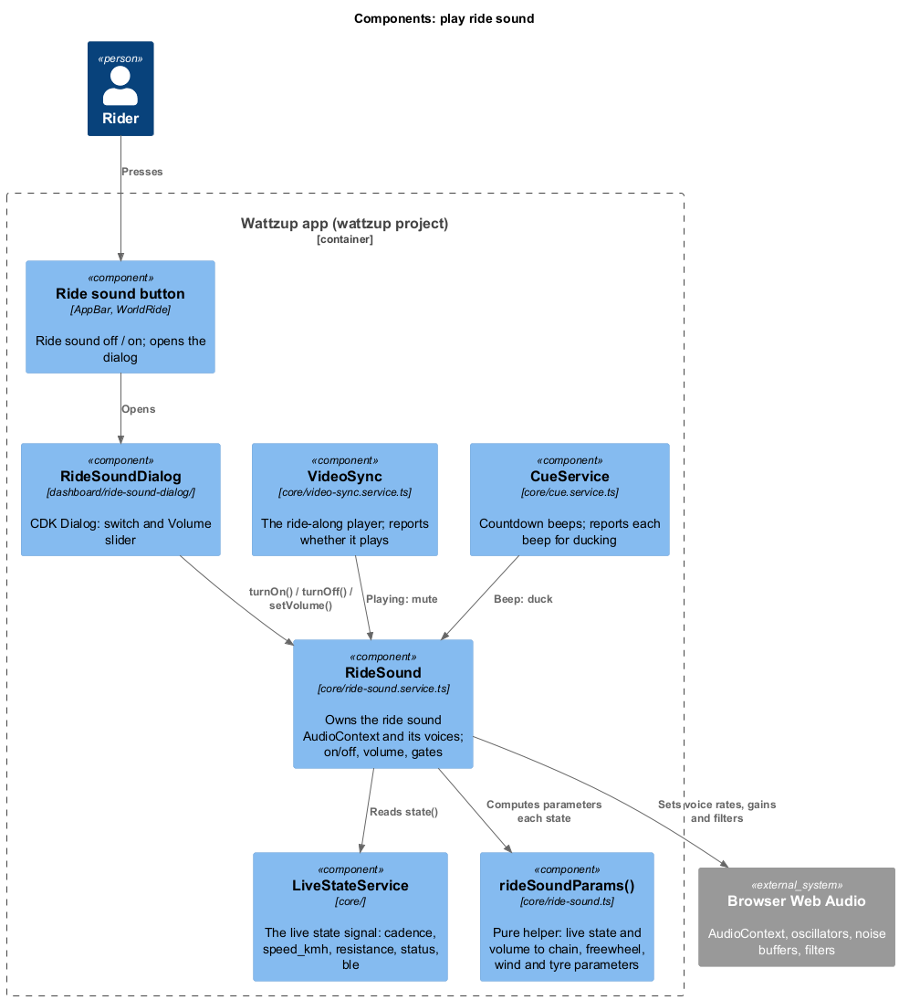
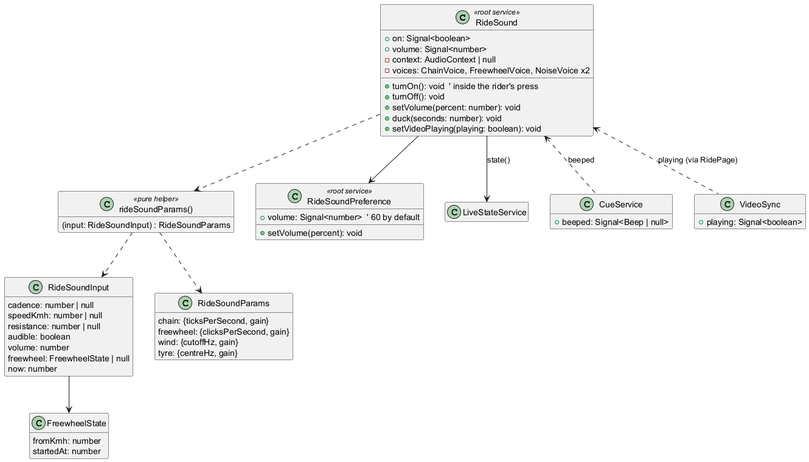
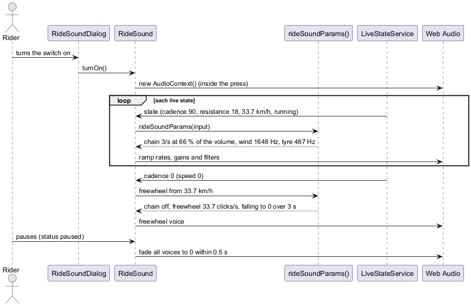

# Play ride sound

## Overview

A rider looking at the road, or at the floor in a hard effort, still hears the bike. Ride sound adds what a real road would add. A chain ticks with each pedal stroke, a freewheel clicks when the pedals stop, and wind and tyre noise rise with the speed. Each one follows the live state, so the sound reinforces the live metrics without a glance at the screen. It is generated with the Web Audio API: there is no audio file and nothing is requested (L2-097). It is off on every page load, because browsers block sound until the rider presses something, and because not every rider wants it (L2-129).

**ride sound**: the four generated voices: chain, freewheel, wind and tyre

**chain**: a short filtered-noise tick, once per pedal stroke

**freewheel**: a ratchet click that slows and fades as the flywheel spins down

**ambience**: a quiet generated bed that makes a World Ride world sound like its place: `coast`, `alpine`, `city` or `park` (criterion 12)

**ducking**: dropping ride sound to 30 % of its level while a cue beep plays (L2-027)

The bike reports no speed of its own: `speed_kmh` is `cadence × 0.375` (L2-007). So "cadence 0 while still moving" never happens in the live state. The freewheel therefore starts when the cadence falls to 0 and runs from the last speed above 0, as the flywheel would spin down (L2-129 criterion 5).

## Description

Pure helper in `frontend/projects/wattzup/src/app/core/`, with unit tests:

- **`rideSoundParams(input)`** (`ride-sound.ts`) turns one moment into the voices' parameters. Its input is `{cadence, speedKmh, resistance, audible, volume, freewheel, ducked, now}`:
  - `volume` is 0 to 1;
  - `audible` is false while any gate of criterion 9 is closed, or a video plays (criterion 8);
  - `freewheel` is `{fromKmh, startedAt}` or `null`;
  - `ducked` is true while a cue beep plays and 0.15 s after it (criterion 7).

  It returns `{chain: {ticksPerSecond, gain}, freewheel: {clicksPerSecond, gain}, wind: {cutoffHz, gain}, tyre: {centreHz, gain}}`, by the table below.

| Voice | Rule | Example |
|---|---|---|
| chain | `ticksPerSecond` = _c_ × 2 ÷ 60 while _c_ > 0, else 0 | 90 rpm → 3, 60 rpm → 2, 0 → 0 |
| chain | `gain` = volume × (0.25 + 0.75 × (_r_ − 1) ÷ 31); 0.25 × volume while _r_ is `null` | level 1 → 25 %, 18 → 66 %, 32 → 100 % |
| freewheel | while 0 ≤ _t_ < 3 s after it started: `clicksPerSecond` = _from_ × (1 − _t_ ÷ 3), `gain` = 0.5 × volume × (1 − _t_ ÷ 3) | from 33.7 km/h: 33.7 at 0 s, 16.9 at 1.5 s, 0 at 3 s |
| wind | `cutoffHz` = 300 + 40 × _s_; `gain` = 0.6 × volume × min(_s_ ÷ 50, 1) | 0 km/h → silent, 33.7 km/h → 1,648 Hz |
| tyre | `centreHz` = 150 + 10 × _s_; `gain` = 0.3 × volume × min(_s_ ÷ 40, 1) | 33.7 km/h → 487 Hz |
| ambience | by preset: filter, frequency, swell rate and depth, share of the volume (table below); no ambience while `ambience` is `null` | coast: low-pass 500 Hz swelling every 12 s at 20 % |
| all | every gain × 0.3 while `ducked` | under a countdown beep |
| all | every gain is 0 while `audible` is false | paused, hidden, bike lost, video playing |

- **Ambience presets** (`AMBIENCE` in `ride-sound.ts`), each a noise bed whose gain is swelled by a slow sine:

| Preset | Filter | Frequency | Swell | Swell depth | Share of the volume |
|---|---|---|---|---|---|
| `coast` | low-pass | 500 Hz | 1 ÷ 12 Hz | 0.8 | 20 % |
| `alpine` | band-pass | 800 Hz | 1 ÷ 20 Hz | 0.5 | 12 % |
| `city` | low-pass | 250 Hz | 1 ÷ 5 Hz | 0.2 | 15 % |
| `park` | band-pass | 3,000 Hz | 1 ÷ 3 Hz | 0.4 | 10 % |

  `rideSoundParams` takes `ambience` (a preset or `null`) and returns `ambience` as the preset's row with its `gain`, or `null`.
- **`ambienceOf(worldId)`** (`core/world-ambience.ts`) reads the table of worlds that declare a preset; any other world declares none.

- **`nextFreewheel(previous, {previousCadence, cadence, lastKmh, now})`** (`ride-sound.ts`) returns the freewheel state:
  - when `cadence` falls from above 0 to 0 with a last speed above 0, `{fromKmh: lastKmh, startedAt: now}`;
  - while cadence stays 0, `previous`, which runs out after 3 s;
  - when cadence rises above 0 again, `null` (criterion 5).

Services and components:

- **`RideSoundPreference`** (`core/ride-sound-preference.ts`, root-provided) keeps the volume in `SafeStorage` under `wattzup.rideSound.volume`. It is 60 by default and stored as a whole number from 0 to 100 (criterion 3). On or off is not kept.
- **`RideSound`** (`core/ride-sound.service.ts`, root-provided) owns its own `AudioContext`, separate from `CueService`'s.
  - `on` is a signal, `false` at page load.
  - `turnOn()` runs inside the switch's change handler, so the browser allows audio. It creates the context and builds the voices:
    - a looped white-noise buffer through a low-pass filter for wind;
    - the same buffer through a band-pass filter for tyre;
    - the chain and freewheel ticks, short noise bursts scheduled ahead on the context clock at the current rate, like the countdown's tones.
  - `turnOff()` closes the context.
  - An `effect` on `LiveStateService.state()`, the volume, `document.visibilityState`, the duck and the video flag calls `rideSoundParams`. It ramps each gain and filter with `setTargetAtTime`, with a 0.1 s time constant, so a change never clicks. A closed gate ramps to 0 within 0.5 s (criterion 9). The state's `workout.status` must be `running` and `ble` must be connected.
  - `duck(seconds)` sets `ducked` for `seconds` + 0.15 s (criterion 7). An `effect` on `CueService.beeped` calls it.
  - `volume` reads `RideSoundPreference`; `setVolume(percent)` keeps it.
  - `setVideoPlaying(playing)` sets the video flag (criterion 8).
  - `setAmbience(preset)` sets the world's ambience, or `null`. `WorldRidePage` sets it from `ambienceOf(world.id)` and clears it when the page is destroyed. While sound is on and a preset is set, the service builds the bed: the looped noise through the preset's filter, into a gain swelled by an `OscillatorNode`, into the ambience gain. A new preset replaces the bed (criterion 12).
- **`CueService`** gains `beeped`, a signal set to `{seconds}` each time `beep` plays a tone. `RideSound` reads it to duck. `CueService` does not depend on ride sound.
- **`VideoSync`** gains `playing`, a computed that is true while the player reports `playing`. `RidePage`, which provides `VideoSync`, passes it to `RideSound.setVideoPlaying` in an `effect`, and clears it when the page is destroyed.
- **The `Ride sound` button** sits before the beeps toggle in the ride dashboard's `AppBar`, and before Music in the `WorldRide` bar, where it shows the label `Sound` when there is room.
  - Its accessible name is `Ride sound off` or `Ride sound on`, and `aria-pressed` is bound to `on`. It has `aria-haspopup="dialog"`.
  - It opens the dialog through `DialogLauncher.openRideSound()`. In World Ride, the presentation component `WorldRide` takes `soundOn` and emits `soundPressed`; `WorldRidePage` wires them.
- **`RideSoundDialog`** (`dashboard/ride-sound-dialog/`, opened with the CDK `Dialog`, never hand-rolled; AGENTS.md "No inline forms") renders the mock `dialogs/ride-sound/*`:
  - the `Ride sound` switch (`role="switch"`), with `On` or `Off` beside its label;
  - the `Volume` range input, 0 to 100 in steps of 5, with `aria-valuetext` such as `60 percent` and an `output` showing the value. It is the `Slider` component (block `level-slider`) with its range, suffix, scale and value text set;
  - the notice `Muted while the video plays` while the video flag is set;
  - Done, which takes focus. Escape and Close also close the dialog.

  Every control works by touch and keyboard, and each target is at least 44 × 44 px.

With `prefers-reduced-motion: reduce`, nothing changes: ride sound has no animation. Sound is a separate choice, made in the dialog.

### Acceptance tests

Playwright (`frontend/e2e/`), with the fake `navigator.bluetooth` fixture driving the bike. Sound is checked through the `audio` fixture (`e2e/fixtures/fake-audio.ts`). It wraps the page's real `AudioContext` with `page.addInitScript` and counts the contexts made, whether one runs, the sounds started and the looping sources. A voice whose gain is 0 schedules no ticks, so silence reads as no new starts.

- `e2e/pages/ride-sound.dialog.ts` is the dialog's page object. The ride and World Ride page objects own the button.
- `e2e/ride-sound.spec.ts`:
  - `starts off and creates no audio until the rider turns it on` (AC1, AC2)
  - `opens the dialog from the app bar, by keyboard too, and closes with Escape and Done` (AC2)
  - `keeps the volume across reloads, but not on or off` (AC3)
  - `ticks the chain at the live cadence and louder with resistance` (AC4)
  - `freewheels from the last speed when the cadence falls to 0` (AC5)
  - `raises wind and tyre noise with speed` (AC6)
  - `ducks under a countdown beep` (AC7)
  - `is silent while the ride-along video plays, and says so` (AC8)
  - `fades out when paused, hidden or the bike is lost` (AC9)
  - `world-ride.spec.ts`: `plays the coast ambience in South Beach Sunrise, and none in Old Town` (AC12)
  - `requests nothing and plays with the simulated bike` (AC10, AC11)

Unit tests: `ride-sound.spec.ts` covers one case per table row, every gate of `audible`, and `nextFreewheel` falling, holding, running out and rising again. `ride-sound-preference.spec.ts` covers the default, a kept value, and a clamp to 0 to 100 in steps of 5. Time-driven rules use the `now` passed in, never a sleep.

## Requirements

| L2 ID | Refines (L1) | Requirement |
|-------|--------------|-------------|
| `L2-129` | `L1-019` | Ride sound. An optional chain, freewheel, wind and tyre sound generated from the live cadence, resistance and speed. It starts off, has its own kept volume, ducks under cue beeps, is muted by a playing video, and is silent while paused, hidden or the bike is lost. |
| `L2-027` | `L1-007` | Segment-change and countdown cues. The beeps that ride sound ducks under. |
| `L2-097` | `L1-009` | Security and privacy. Ride sound requests nothing and ships no asset. |

## Diagrams

### Components

`RideSound` reads the live state and turns it, through the pure `rideSoundParams()`, into Web Audio parameters. `CueService` and `VideoSync` only tell it when to duck or mute.

### Class structure

The rules are a pure helper; the service owns the audio graph and the gates.

### Behaviour: turn on, ride, stop pedalling, pause

The rider turns ride sound on. The chain follows 90 rpm at level 18. When the pedals stop, the freewheel runs down from 33.7 km/h. When the rider pauses, everything fades out.

