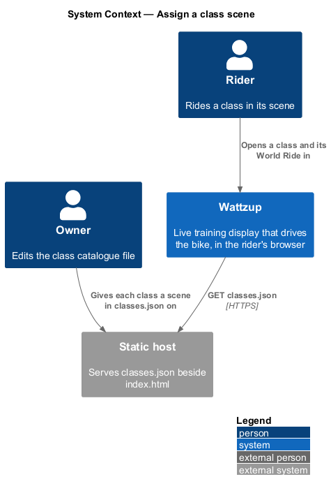
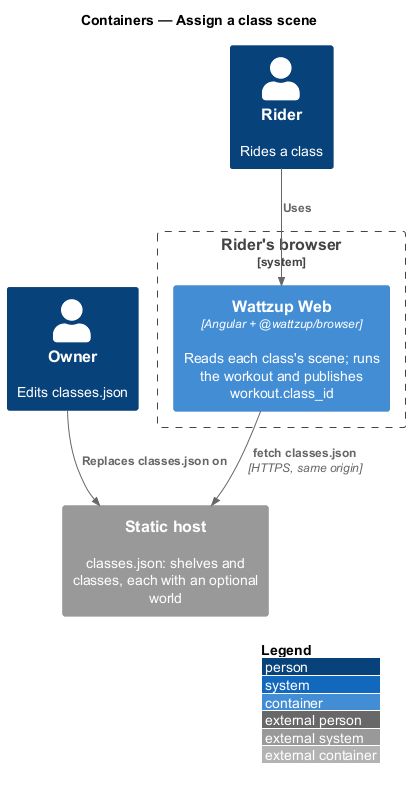
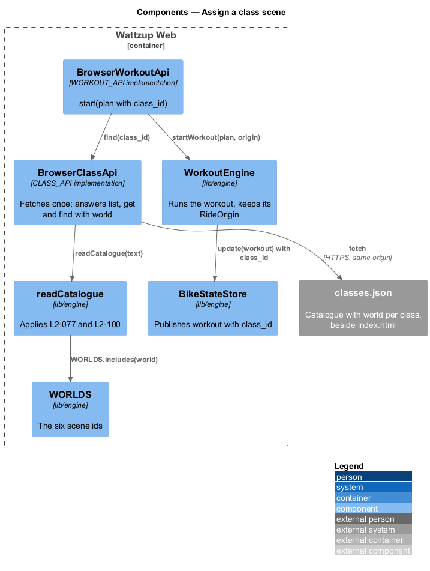
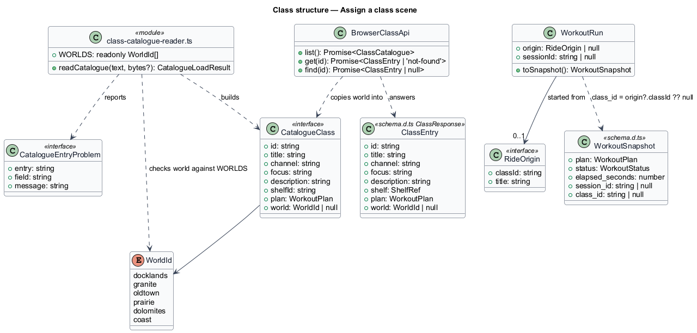
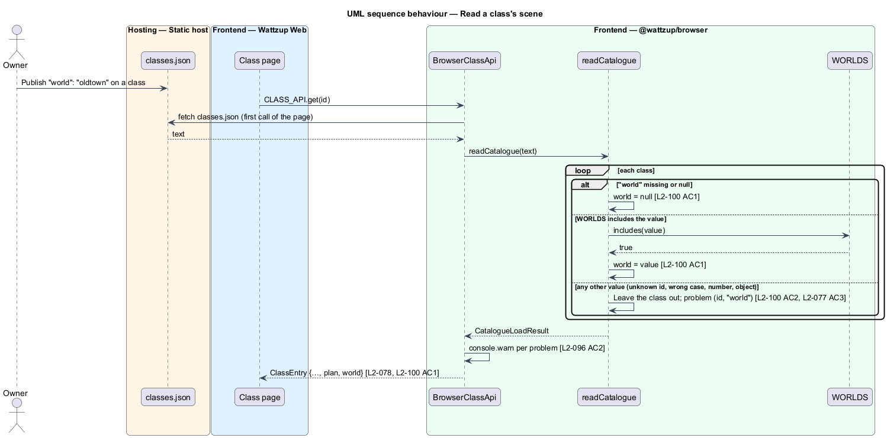
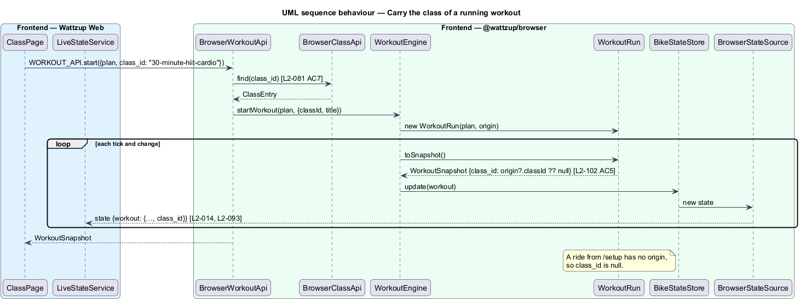

# Assign a class scene

## Overview

World Ride (L1-017) is a way to ride a class inside a 3D world built for that class. This feature is the catalogue and contract half of that link. Each class in the catalogue names its scene, `CLASS_API` answers each class with its scene, and the live state carries the class a running workout came from (L2-100, L2-102 criterion 5).

**scene** — one of the six worlds built into the app (L2-101), named by its id: `docklands`, `granite`, `oldtown`, `prairie`, `dolomites` or `coast`

**class scene** — the scene a class names in the catalogue file through its optional `world` field, or `null` when it names none

**ride origin** — the class a workout was started from, kept by the workout engine as `RideOrigin` (`history/record-session`)

The scene is catalogue data, not code (ADR 0014). The owner gives a class a scene by replacing `classes.json` on the static host, with no rebuild; the page reads the replaced file on its next load (L2-077 criterion 7, L2-096). The catalogue reader knows the six ids, so it can reject a misspelt one. It knows nothing else about a scene: the look, the road gradients and the effort names live in the app (`world-ride/draw-class-scene`).

The shipped `classes.json` gives each of the six classes of the mocks a different scene, so every mock class rides in a world of its own. Every other class, including the GCN Training classes, has no `world` and has no World Ride (L2-100 criterion 4).

The feature changes two contract types in `frontend/projects/api/src/contract/schema.d.ts`:
- `ClassResponse`, the class `CLASS_API.list()` and `CLASS_API.get(id)` answer, gains `world` (L2-078, L2-100 criterion 5);
- `WorkoutSnapshot`, the live state's `workout`, gains `class_id` (L2-014, L2-102 criterion 5), so World Ride can tell which class is running.

Both fields are always written, never omitted (L2-014).

## Description

### Catalogue and engine (`frontend/projects/browser/src/lib/`)

**`engine/class-catalogue-reader.ts`** (changed)
- **`WORLDS`** (new): the six scene ids in the order of L2-101, typed `readonly WorldId[]`. It holds no other fact about a scene.
- **`CatalogueClass`** gains `world: WorldId | null` after `plan`.
- **`check`** reads `world` last, after the plan is validated. A missing `world` or a JSON `null` gives `world` `null`. A string in `WORLDS` is kept; the match is exact, so `OldTown` is not `oldtown`. Any other value (an unknown id, the wrong case, an empty string, a number, an object) returns the problem `{entry: <class id>, field: 'world', message: 'A world is one of docklands, granite, oldtown, prairie, dolomites or coast.'}`. The class is then left out, and the others are kept, as L2-077 criterion 3 states (L2-100 criteria 1 and 2). Two classes may name the same scene: the reader does not check `world` for repeats (criterion 3).

**`contracts/browser-class-api.ts`** (changed): `entry(c, shelf)` copies `world` into the `ClassEntry` it answers, so `list()`, `get(id)` and `find(id)` carry it. A class left out for its `world` is logged with `console.warn` as `classes.json: <id> left out, world: <message>`, as every other problem is (L2-096 criterion 2).

**`engine/workout-engine.ts`** (changed): `WorkoutRun.toSnapshot()` sets `class_id` from `origin?.classId`, or `null` with no origin. `BrowserWorkoutApi.start` already gives a ride its `RideOrigin` when the plan carries a known `class_id`, and refuses an unknown one with `invalid_workout` (L2-081 criterion 7); it does not change. A ride from `/setup` has no origin, so `class_id` is `null` (L2-102 criterion 5). The run keeps its origin after the ride ends or stops, so `class_id` stays in the snapshot, as `session_id` does.

**`frontend/public/classes.json`** (changed): the six classes gain `world` as L2-100 criterion 4 lists. No other class changes. The build copies the file beside `index.html` (L2-096 criterion 1).

| Class id | `world` |
|---|---|
| `20-minute-power-intervals` | `docklands` |
| `20-min-threshold-builder` | `granite` |
| `30-minute-hiit-cardio` | `oldtown` |
| `30-min-tempo-paceline` | `prairie` |
| `60-min-dolomites-endurance` | `dolomites` |
| `60-min-coastal-endurance-surges` | `coast` |

### Contract (`frontend/projects/api/`)

- **`src/contract/schema.d.ts`**, kept by hand (L2-014): `ClassResponse.world` is `null | 'docklands' | 'granite' | 'oldtown' | 'prairie' | 'dolomites' | 'coast'`. `WorkoutSnapshot.class_id` is `null | string`.
- **`src/lib/api-types.ts`**: `WorldId` is `NonNullable<ClassEntry['world']>`, the scene id type the reader and the app use. No other file declares it.

### Acceptance tests

Unit tests in `@wattzup/browser`, one case per value of `world`:
- `class-catalogue-reader.spec.ts`:
  - `a class keeps its world <id> (World Ride)`, once for each of the six ids (L2-100 AC1)
  - `a class with world <value> has no world`, for a missing field and `null` (L2-100 AC1)
  - `a class with world <value> is left out, naming the world field`, for `atlantis`, `OldTown`, `''`, `3` and `{id: 'oldtown'}` (L2-100 AC2)
  - `two classes may share a world` (L2-100 AC3)
- `browser-class-api.spec.ts`: `answers each class with its world, null when it names none (World Ride)` (L2-100 AC1).
- `workout-engine.spec.ts`: `carries the class a ride was started from as class_id, null without one (World Ride)` (L2-102 AC5).

Playwright (`frontend/e2e/world-ride.spec.ts`, Chromium only, against the shipped `classes.json` and the fake `navigator.bluetooth`):
- `shows Ride in Old Town Criterium on a class with a world, and not on one without` proves `30-minute-hiit-cardio` has `oldtown` and `calorie-burning-workout` has none (L2-100 AC4).
- `starts the class ride on the bike and opens World Ride` proves the running workout carries the class's `class_id`: World Ride shows the ride only when it does (L2-102 AC3, AC5).

The types are checked by the TypeScript build; no test reads `schema.d.ts` (L2-100 AC5).

### Open questions

- **Scene ids in three places.** The six ids are in `schema.d.ts` (the `WorldId` type), in the reader's `WORLDS` so it can reject a misspelt one (L2-100 criterion 2), and in the app's `core/worlds.ts`, which holds each scene. Adding a seventh scene changes all three.

## Requirements

| L2 ID | Refines (L1) | Requirement |
|-------|--------------|-------------|
| `L2-100` | `L1-017` | Class scene in the catalogue. Each class may name the scene it is ridden in through the optional `world` field of `classes.json`: `null`, or one of `docklands`, `granite`, `oldtown`, `prairie`, `dolomites`, `coast`. An unknown value leaves the class out with a warning. The shipped catalogue gives the six mock classes six different scenes. |
| `L2-102` | `L1-017` | Opening World Ride. Criterion 5: the live state's `workout.class_id` carries the `class_id` the workout was started with, or `null` (L2-014). |
| `L2-077` | `L1-014` | Class catalogue. A class that breaks a field rule is left out, the others are kept, and a warning names the class and the field. |
| `L2-078` | `L1-005` | Class contract. `CLASS_API` answers a class as `{id, title, channel, focus, description, shelf, plan}`, now with `world`. |
| `L2-096` | `L1-014` | Loading the class catalogue. The page reads `classes.json` beside `index.html`, validates it by L2-077's rules and names each entry left out in the console. |
| `L2-014` | `L1-005` | State model contract. Field names are snake_case, nulls are written, never omitted, and the types are kept in `schema.d.ts`. |

## Diagrams

### System context

The owner publishes `classes.json` on the static host, and the rider's browser reads it. No other system takes part.

### Containers

The static host serves `classes.json` beside `index.html`. Wattzup Web, in the rider's browser, fetches it, reads each class's scene, and runs the workout whose `class_id` it publishes in the live state.

### Components

`BrowserClassApi` fetches the file and hands it to `readCatalogue`, which checks `world` against `WORLDS`. `BrowserWorkoutApi` gives a class ride its `RideOrigin`, and the `WorkoutEngine` copies the origin's class id into the `WorkoutSnapshot` that `BikeStateStore` publishes.

### Class structure

`CatalogueClass` and `ClassEntry` each gain `world`, and `WorkoutSnapshot` gains `class_id`, taken from the run's `RideOrigin`.

### Behaviour — read a class's scene

The reader keeps a known scene id, keeps `null` for a missing field, and leaves out a class with any other value (L2-100 criteria 1 and 2).

### Behaviour — carry the class of a running workout

A workout started with `class_id` keeps its origin, and every state the engine publishes carries `workout.class_id` (L2-102 criterion 5).

