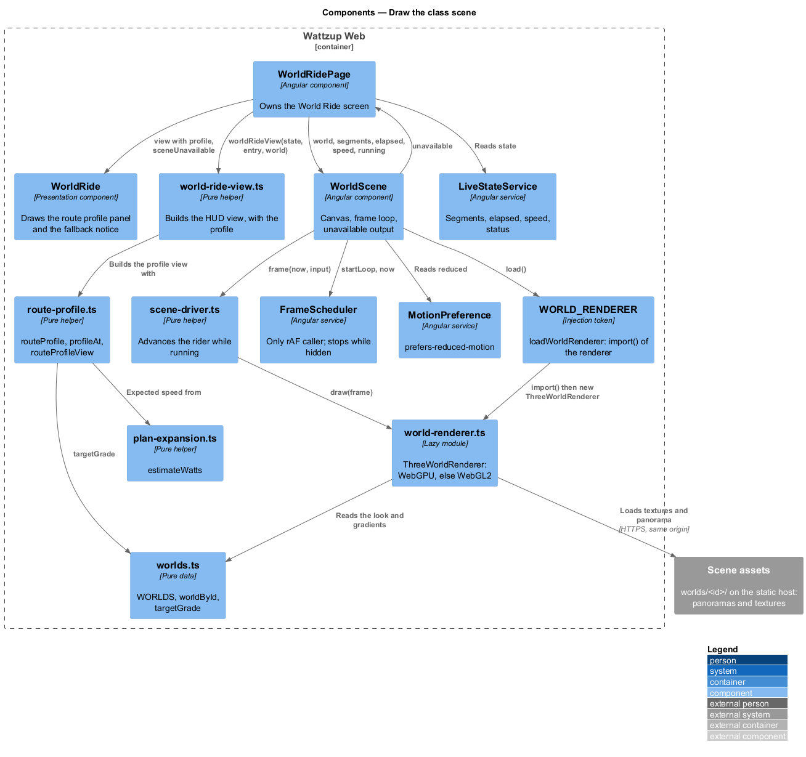

# Draw the class scene

## Overview

World Ride (L1-017) puts a class ride inside a 3D world built for that class. This feature draws the world: the six built-in scenes, the road whose gradient follows the plan, the route profile panel, and the fallback when the browser cannot draw 3D (L2-101, L2-106, L2-110). The screen and the HUD that sit on top belong to `world-ride/ride-in-a-world`.

**scene** — one of the six built-in worlds (`docklands`, `granite`, `oldtown`, `prairie`, `dolomites`, `coast`): a place with its own sky, light, ground, road surface, roadside objects and photographed distance

**target gradient** — road gradient, in percent, that a scene asks for at a point on the route: the scene's gradient for the segment kind plus a rolling term (L2-101 criterion 2)

**route profile** — elevation of the whole class, computed second by second from the plan before the ride starts (L2-101 criterion 3)

**climbed** — sum of the profile's rises above 0 up to a moment of the ride

**effort arch** — arch over the road ahead, labelled with the scene's effort name before the next `work` segment, or `Finish` before the end

The road follows the class, not the other way round. Efforts are where the road kicks up and recoveries are where it eases off, so the road on screen matches the resistance the workout engine sets. The scene never changes the bike's resistance. It reads the plan's segments, `elapsed_seconds`, `speed_kmh` and `status` from the live state that the in-browser workout engine publishes (L2-093), and draws them.

A scene is code and bundled assets, not catalogue data. The catalogue only names which scene a class uses (`world-ride/assign-class-scene`). All scene assets ship with the app's static files and load from the same origin (L2-101 criterion 4, L1-009, L2-097). The 3D renderer and the assets load only when World Ride opens (L2-102 criterion 8).

## Description

### Contracts

None. The scene reads only the live state `LiveStateService` holds, and makes no contract call.

### Frontend (`frontend/projects/wattzup/src/app/`, with presentation components in `frontend/projects/components/`)

**Scene data (`core/worlds.ts`, new, with `worlds.spec.ts`).**
- **`World`**: `id`, `name`, `route`, `effortName` and `description`, as in the table of L2-101. `grade: Record<SegmentKind, number>` holds the gradient for `warmup`, `work`, `rest`, `cooldown` and `steady`. `roll` is the rolling gradient. `look: WorldLook` holds how the scene is drawn.
- **`WorldLook`**: the sky gradient, fog, sun, ground colours, road colours and centre line, snow line, lateral curve, hill height, sea, and the roadside props (towers, houses, pines, lamps, posts, bales, turbines, rocks). It also holds the paths of the photographed panorama and the surface textures. The values come from the Magic Patterns OS file `shared/worlds.ts`.
- **`WORLDS: readonly World[]`** in the order of L2-101, and `worldById(id: WorldId): World`.
- **`targetGrade(world, kind, s)`** returns `grade[kind] + roll × sin(s ÷ 310) × cos(s ÷ 870 + 1)` (L2-101 criterion 2). There is one unit test per scene.

**Route profile (`core/route-profile.ts`, new, with `route-profile.spec.ts`).**
- **`expectedSpeed(segment)`** returns `10 × ∛(max(estimateWatts(cadence, level), 1) ÷ 20) ÷ 3.6` m/s. `estimateWatts` is the existing helper in `core/plan-expansion.ts` (L2-049).
- **`routeProfile(world, segments)`** walks the plan one second at a time and returns `{ elevation: number[], grade: number[], climbed: number[], metres: number }`, one entry per second (L2-101 criterion 3):
  - the gradient *g* starts at `grade` of the first segment's kind;
  - each second it moves 0.12 of the way towards `targetGrade` at the current *s*;
  - the elevation rises by `g ÷ 100 × v`, and *s* by `v`;
  - `climbed` adds each rise above 0.
- **`profileAt(profile, t)`** returns `{ grade, climbed }` at whole second *t*, clamped to the plan.
- **`routeProfileView(profile, segments, t)`** returns the `RouteProfileView` the HUD draws:
  - `gradeText`, with a sign and one decimal (`+0.5%`);
  - `climbedText` (`10 m climbed`);
  - the profile area path, and the width ridden so far;
  - one strip rectangle per segment, with its tone (`work`, `rest` or `easy`, from `profileTone` in `core/ride-preview.ts`);
  - the playhead position;
  - the label `Route profile, <n> m of elevation`, where n is the highest point minus the lowest, rounded (L2-106 criteria 1 to 3).

  The distance text (`1.61 km`) is `formatDistance(distance_km)` from the live state. It is not taken from the profile.

**Route profile panel.** It is the `world-ride__profile` element of `WorldRide` (`world-ride/ride-in-a-world`). It draws `RouteProfileView` as one SVG with `role="img"` and the view's label. The ridden part is shaded (`is-done`), work, recover and easy tones mark the strip, and a line marks the playhead. Because the page computes the view from `elapsed_seconds`, the gradient, climbed and playhead stop moving while the ride is not running (L2-106 criterion 4).

**Scene component (`dashboard/world-scene/`, new).**
- **`WorldScene`** (`wz-world-scene`): an app component, because it injects `FrameScheduler` and `MotionPreference`. Its inputs are `world`, `segments`, `elapsed`, `speedKmh` and `running`. Its output is `unavailable`, emitted once when the renderer cannot start. It renders one `<canvas>`, labelled by the text alternative `A cyclist on <route> in <world name>` (L2-110 criterion 3).
- On first render it calls the `WORLD_RENDERER` loader, `loadWorldRenderer` (`core/world-renderer-loader.ts`), which imports `core/world-renderer.ts` with a dynamic `import()`, so the renderer and its 3D library stay in the World Ride chunk (L2-102 criterion 8).
- It draws through `FrameScheduler.startLoop()` and `requestDraw()`. `FrameScheduler` is the app's only `requestAnimationFrame` caller, and it requests no frame while the tab is hidden, so the scene stops and starts with the tab (L2-110 criterion 5).
- On each frame `SceneDriver` (`core/scene-driver.ts`) advances the rider along the route by `speedKmh` ÷ 3.6 × the frame's seconds, only while `running`, with each step capped. The loop runs only while the ride runs, so a paused world holds still (L2-109 criterion 1).

**Renderer (`core/world-renderer.ts`, new; Three.js, ADRs 0020 and 0021).**
- **`WorldRenderer`** (`core/world-renderer-port.ts`): `start(canvas, world): Promise<boolean>`, `resize(width, height, pixelRatio)`, `draw(frame: SceneFrame)` and `dispose()`. `start` resolves `false` when neither WebGPU nor WebGL2 starts (L2-110 criterion 4, L2-111 criterion 1). `ThreeWorldRenderer` implements it. The `WORLD_RENDERER` token holds the loader, and the composition root `app.config.ts` binds it to `loadWorldRenderer`.
- **`SceneFrame`**: `{ s, crank, segments, elapsed, speedKmh, reducedMotion }`.
- It lays the road ahead of the rider from the plan. For each 2 m step ahead it finds the segment the rider will be in, from the time that distance takes at the current speed. It then eases the gradient towards `targetGrade` for that segment, so a ramp is in view before its effort starts (L2-110 criterion 1).
- Terrain, props, the panorama and the sea follow the camera, which sits just behind and above the rider's bike.
- The effort arch stands where the rider will be when the next segment starts. It reads the scene's effort name before a `work` segment, and `Finish` before the end (L2-110 criterion 2).
- With `reducedMotion`, the camera does not sway and the pedals do not turn. The world still moves as the rider rides (L2-110 criterion 6).

**Fallback.** When `WorldScene` emits `unavailable`, `WorldRidePage` sets `sceneUnavailable`. `WorldRide` then draws no scene and shows the `world-ride__source` status notice `This screen can't draw 3D worlds` / `The ride still runs on the numbers.` Every panel keeps working (L2-110 criterion 4). With no scene, the HUD sits on `--color-bg-app`, as in `pages/world-ride/renderer-unavailable`.

**Assets (`frontend/public/worlds/<id>/`, new).** Each scene's panorama and its ground and road textures are bundled as `.webp` files and copied into the build. They are served from the same origin (L2-101 criterion 4). The design references them on the Magic Patterns CDN. The CDN copies are never loaded.

**Readability.** The HUD panels use `--color-bg-hud` with a backdrop blur over every scene, in both themes (L2-110 criterion 7). The contrast pairs are checked in `docs/design-system/tokens/contrast-pairs.json`.

### Screen states

| Mock | State |
|---|---|
| `pages/world-ride/docklands` | Neon Docklands at 4:50, warm-up, `+0.5%`, `10 m climbed`, next `Bridge ramp` |
| `pages/world-ride/granite` | Col du Granit at 5:20, work 1 of 4, `+3.0%`, `67 m climbed` |
| `pages/world-ride/oldtown` | Old Town Criterium at 4:50, warm-up, next `Cobbled sprint` |
| `pages/world-ride/prairie` | Prairie Paceline at 4:10, work 1 of 4, `+0.0%`, `4 m climbed` |
| `pages/world-ride/dolomites` | Dolomites at 15:00, `Steady`, `+0.8%`, `57 m climbed`, `Last stretch to the finish arch` |
| `pages/world-ride/coast` | Cliffside Coast at 4:50, warm-up, next `Headland surge` |
| `pages/world-ride/renderer-unavailable` | No scene, the notice, and the HUD on the app background |
| `pages/class-worlds/default` | The six scenes side by side with their descriptions (design canvas, not a product screen) |

### Acceptance tests

This feature has no contract part, so it has no contract test.

Playwright (`frontend/e2e/`, Chromium only), in `e2e/world-ride.spec.ts` with the page object `e2e/pages/world-ride.page.ts`. Each test starts the class ride on the fake `navigator.bluetooth` and fast-forwards Playwright's page clock to the moment it checks:
- `draws the scene of the class's world with its text alternative` (L2-110 AC3), in the `World Ride scene` group, the only tests that draw the scene
- `shows the grade, climbed and distance, and names the profile by its elevation` (L2-106 AC1, AC3)
- `holds the grade and distance still while paused` (L2-106 AC4)
- `shows This screen can't draw 3D worlds when WebGL is off, and the HUD still works` (L2-110 AC4). The `webgl` fixture (`fake-webgl.ts`) hides `navigator.gpu` and makes `getContext('webgl' | 'webgl2')` return `null`.
- No spec loads a scene asset from another origin (L2-101 AC4, L2-097): the shared fixture fails every spec that makes a request off localhost.

Unit tests:
- `worlds.spec.ts`: one `targetGrade` case per scene, at *s* 0 and at a point where the rolling term is not 0 (L2-101 AC2).
- `route-profile.spec.ts`: the profile of a `hiit`, an `intervals` and a `flat` plan. Each checks the elevation, the climbed total and the metres at chosen seconds, and the `routeProfileView` text and label (L2-101 AC3, L2-106 AC1 to AC3).
- `scene-driver.spec.ts`: the rider does not advance while not running, and a frame's step is capped. `WorldScene` itself has no TestBed test: the loop's start and stop while running, the text alternative and `unavailable` (the notice) are proven through Playwright in `e2e/world-ride.spec.ts`, which switches WebGPU and WebGL off with the `webgl` fixture (L2-110 AC1, AC4 to AC6).

That no two scenes look the same (L2-101 AC1) and that the HUD stays readable over each scene (L2-110 AC7) are visual. The visual sweep covers them, and runs only when a person asks.

### Open questions

- **3D library.** Closed by ADR 0020 (Three.js, pinned, in its own lazy chunk behind `WorldRenderer`), amended by ADR 0021 (its WebGPU renderer, falling back to WebGL2).
- **Scene detail.** L2-101 fixes the gradients, names and descriptions. The exact look of each scene (prop spacing, colours, fog) follows `shared/worlds.ts` and the mocks' stills. It has no acceptance criterion beyond L2-101 criterion 1.
- **Speed for the road ahead.** The renderer lays the road ahead at the current `speed_kmh`. The profile panel uses each segment's expected speed. When the rider rides much faster or slower than expected, the two differ in distance, but not in which segment a ramp belongs to.
- **Asset size.** The size budget for the World Ride chunk and its assets is <TO SUPPLY>. Only the initial bundle has a budget (300 KB gzipped).

## Requirements

| L2 ID | Refines (L1) | Requirement |
|-------|--------------|-------------|
| `L2-101` | `L1-017` | The six scenes. Each scene has a name, a route, an effort name, a description and a road gradient per segment kind, with a rolling gradient laid over it. Each draws its own place; the target gradient and the route profile follow the stated formulas; assets are bundled and served from the same origin. |
| `L2-106` | `L1-017` | World Ride route profile. The panel shows the gradient, the metres climbed and the distance, draws the whole class as terrain with the ridden part shaded, and stops while the ride is not running. |
| `L2-110` | `L1-017` | World Ride scene rendering. The scene is a WebGL view from behind the rider's bike. The road follows the plan, with an effort arch ahead. It falls back to a notice when WebGL is unavailable, stops when the tab is hidden, respects reduced motion, and keeps the HUD readable at every width. |
| `L2-049` | `L1-002` | Power and ride-total estimates. The expected speed of a segment uses the estimate `max(0, round(cadence × (0.55 + level × 0.155)))`. |
| `L2-102` | `L1-017` | Opening World Ride. Criterion 8: the scene loads only on World Ride, and the initial bundle stays within 300 KB gzipped. |

## Diagrams

### System context

The rider watches the class's world in Wattzup. The scene uses no outside system: every asset ships with Wattzup.

### Containers

Wattzup Web, in the rider's browser, draws the scene from the live state its in-browser engine publishes. The scene assets come from the static host, the same origin as the app.

### Components

`WorldScene` loads `WorldRenderer` on demand and draws on each frame from `FrameScheduler`. `route-profile.ts` and `worlds.ts` are pure, and give the HUD its profile view.

### Class structure

`World` holds a scene's facts and look. `routeProfile` turns a world and a plan into a `RouteProfile`, and `routeProfileView` turns that into what the panel draws. `WorldRenderer` takes a `SceneFrame` per frame.

### Behaviour — draw the scene each frame

The scene starts its renderer, or reports that it cannot. While the ride runs, each frame advances the rider and lays the road ahead from the plan. A hidden tab requests no frames (L2-110 criteria 1, 4 and 5).

### Behaviour — show the route profile

On each new state, `worldRideView` computes the profile from the plan, reads it at `elapsed_seconds` and passes the view to the HUD (L2-106).

