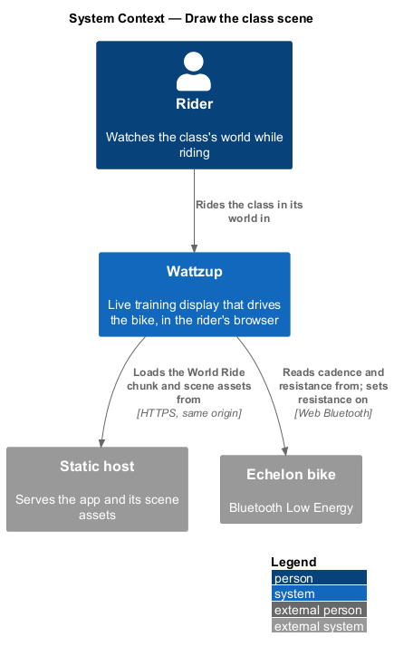
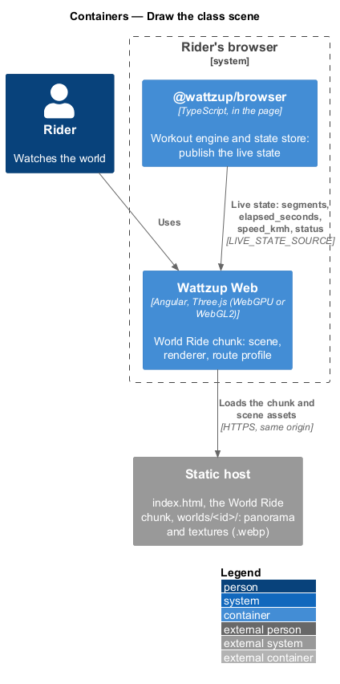
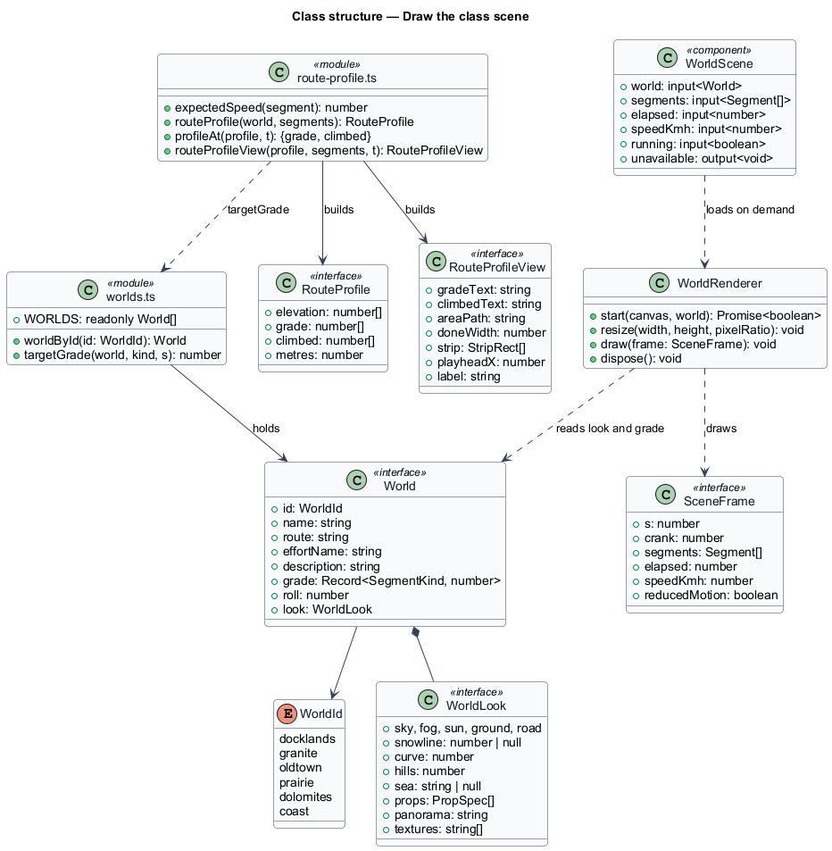
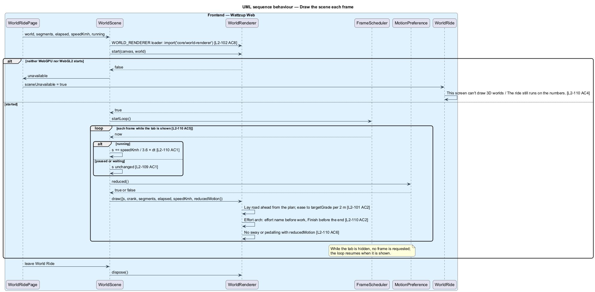
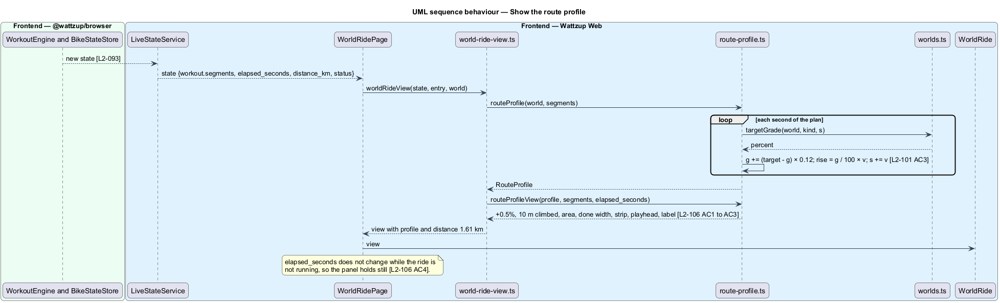

# Draw the class scene

## Overview

World Ride (L1-017) puts a class ride inside a 3D world built for that class. This feature draws the world: the six built-in scenes, the road whose gradient follows the plan and which bends and rises in every scene, the route profile panel, and the fallback when the browser cannot draw 3D (L2-101, L2-106, L2-110). The screen and the HUD that sit on top belong to `world-ride/ride-in-a-world`.

**scene** — one of the built-in worlds (`docklands`, `granite`, `oldtown`, `prairie`, `dolomites`, `coast`, `caribana`, `westminster`, `centralpark`, `southbeach`, `ghent`, `blackpool`, `suburbia`, `nottinghill`, `knicks`, `vegas`, `route66`, `venice`, `amsterdam`, `giza`, `daytona`, `koppenberg`, `ventoux`, `chicago`, `goldengate`, `havana`, `seapoint`, `montreal`, `stanleypark`, `stelvio`, `edinburgh`, `northshore`, `campolongo`, `marinabay`, `serpentine`, `champs`, `tulips`, `tourmalet`, `napa`, `glastonbury`, `pikeplace`, `hardknott`, `alpe`, `saguaro`, `trollstigen`, `poggio`, `montmartre`, `brickyard`, `chichen`, `bonneville`, `como`, `yosemite`, `etna`, `timessquare`, `tremola`, `teide`, `monaco`, `tempelhof`, `paine`, `ibiza`, `skye`, `toronto`, `prospect`, `calobra`, `strade`, `wicklow`, `haleakala`, `dubai`, `austin`, `winnats`, `redoute`, `angliru`, `velodrome`, `cinqueterre`, `angels`, `coney`, `winterlude`, `letras`, `santamonica`, `antwerp`, `tahoe`, `deathvalley`, `atacama`, `angkor`, `jouvert`, `sambadrome`, `lisbon`, `cornwall`, `copacabana`, `bondi`, `kilauea`, `shibuya`, `muertos`, `pamplona`, `greatocean`, `sfhills`, `mardigras`, `victoria`, `jaipur`, `overseas`, `isleofman`, `artmuseum`, `lakelouise`, `bealach`, `gardena`, `hanriver`, `oktoberfest`, `brooklyn`, `strasbourg`, `kyoto`, `bathsheba`, `machupicchu`, `outback`, `telaviv`, `silverstone`, `murdehuy`, `arenberg`, `lakefront`, `diwali`, `sella`, `kona`, `sevensisters`, `brighton`, `iceland`, `sydneyharbour`, `zoncolan`, `valais`, `loire`, `copenhagen`, `surfers`, `moab`, `glasgow`, `mountwashington`, `grandcanyon`, `stampede`, `merce`, `stpatricks`, `bigsur`, `songkran`, `playground`, `hoover`, `aguascalientes`, `atlanticroad`, `fishhill`, `junkanoo`, `quebec`, `fuji`, `bund`, `comuna13`, `adelaide`, `sellaronda`, `marrakech`, `tamalpais`, `independence`, `fens`, `vienna`, `bluemountains`, `aubisque`, `rome`, `stbernard`, `nuevedejulio`, `okinawa`, `algarve`, `mulholland`, `provence`, `cherryblossom`, `kwaremont`, `oregon`, `cypress`, `iten`, `palouse`, `prague`, `penllech`, `pueblos`, `steppe`, `teotihuacan`, `furka`, `beachroad`, `blueridge`, `verona`, `valparaiso`, `maunakea`, `montroyal`, `utrecht`, `galibier`, `joshuatree`, `cabot`, `veleta`, `bayofislands`, `dales`, `engadin`, `miami`): a place with its own sky, light, ground, road surface, roadside objects and photographed distance

**target gradient** — road gradient, in percent, that a scene asks for at a point on the route: the scene's gradient for the segment kind plus a rolling term (L2-101 criterion 2)

**route profile** — elevation of the whole class, computed second by second from the plan before the ride starts (L2-101 criterion 3)

**climbed** — sum of the profile's rises above 0 up to a moment of the ride

**bend** — the road turning left or right ahead of the rider, by the scene's `bend` angle over its `bend length` (L2-101 criterion 6). A bend is scenery only

**effort arch** — arch over the road ahead, labelled with the scene's effort name before the next `work` segment, or `Finish` before the end

The road follows the class, not the other way round. Efforts are where the road kicks up and recoveries are where it eases off, so the road on screen matches the resistance the workout engine sets. The scene never changes the bike's resistance. It reads the plan's segments, `elapsed_seconds`, `speed_kmh` and `status` from the live state, and draws them.

A scene is code and bundled assets, not catalogue data. The catalogue only names which scene a class uses (`world-ride/assign-class-scene`). All scene assets ship with the frontend and load from the same origin (L2-101 criterion 4, L1-009). The 3D renderer and the assets load only when World Ride opens (L2-102 criterion 8).

## Description

### Backend

None.

### Frontend (`frontend/projects/wattzup/src/app/`, with presentation components in `frontend/projects/components/`)

**Scene data (`core/worlds.ts`, new, with `worlds.spec.ts`).**
- **`World`**: `id`, `name`, `route`, `effortName` and `description`, as in the table of L2-101. `grade: Record<SegmentKind, number>` holds the gradient for `warmup`, `work`, `rest`, `cooldown` and `steady`. `roll` is the rolling gradient. `look: WorldLook` holds how the scene is drawn.
- **`WorldLook`**: the sky gradient, fog, sun, ground colours, road colours and centre line, snow line, lateral curve, hill height, sea, and the roadside props (towers, houses, pines, lamps, posts, bales, turbines, rocks). It also holds the paths of the photographed panorama and the surface textures. The values come from the Magic Patterns OS file `shared/worlds.ts`.
- **`WORLDS: readonly World[]`** in the order of L2-101, and `worldById(id: WorldId): World`.
- **`targetGrade(world, kind, s)`** returns `grade[kind] + roll × sin(s ÷ 310) × cos(s ÷ 870 + 1)` (L2-101 criterion 2). There is one unit test per scene.

**Route profile (`core/route-profile.ts`, new, with `route-profile.spec.ts`).**
- **`expectedSpeed(segment)`** returns `10 × ∛(max(estimateWatts(cadence, level), 1) ÷ 20) ÷ 3.6` m/s. `estimateWatts` is the existing helper in `core/plan-expansion.ts` (L2-049).
- **`routeProfile(world, segments)`** walks the plan one second at a time and returns `{ elevation: number[], grade: number[], climbed: number[], metres: number }`, one entry per second (L2-101 criterion 3):
  - the gradient *g* starts at `grade` of the first segment's kind;
  - each second it moves 0.12 of the way towards `targetGrade` at the current *s*;
  - the elevation rises by `g ÷ 100 × v`, and *s* by `v`;
  - `climbed` adds each rise above 0.
- **`profileAt(profile, t)`** returns `{ grade, climbed }` at whole second *t*, clamped to the plan.
- **`routeProfileView(profile, segments, t)`** returns the `RouteProfileView` the HUD draws:
  - `gradeText`, with a sign and one decimal (`+0.5%`);
  - `climbedText` (`10 m climbed`);
  - the profile area path, and the width ridden so far;
  - one strip rectangle per segment, with its tone (`work`, `rest` or `easy`, from `profileTone` in `core/ride-preview.ts`);
  - the playhead position;
  - the label `Route profile, <n> m of elevation`, where n is the highest point minus the lowest, rounded (L2-106 criteria 1 to 3).

  The distance text (`1.61 km`) is `formatDistance(distance_km)` from the live state. It is not taken from the profile.

**Route profile panel.** It is the `world-ride__profile` element of `WorldRide` (`world-ride/ride-in-a-world`). It draws `RouteProfileView` as one SVG with `role="img"` and the view's label. The ridden part is shaded (`is-done`), work, recover and easy tones mark the strip, and a line marks the playhead. Because the page computes the view from `elapsed_seconds`, the gradient, climbed and playhead stop moving while the ride is not running (L2-106 criterion 4).

**Scene component (`dashboard/world-scene/`, new).**
- **`WorldScene`** (`wz-world-scene`): an app component, because it injects `FrameScheduler` and `MotionPreference`. Its inputs are `world`, `segments`, `elapsed`, `speedKmh` and `running`. Its output is `unavailable`, emitted once when the renderer cannot start. It renders one `<canvas>`, labelled by the text alternative `A cyclist on <route> in <world name>` (L2-110 criterion 3).
- On first render it imports `core/world-renderer.ts` with a dynamic `import()`, so the renderer and its 3D library stay in the World Ride chunk (L2-102 criterion 8).
- It draws through `FrameScheduler.startLoop()` and `requestDraw()`. `FrameScheduler` is the app's only `requestAnimationFrame` caller, and it requests no frame while the tab is hidden, so the scene stops and starts with the tab (L2-110 criterion 5).
- On each frame it advances the rider along the route by `speedKmh` ÷ 3.6 × the frame's seconds, only while `running`. Paused, the world holds still (L2-109 criterion 1).

**Renderer (`core/world-renderer.ts`, new; WebGL through a 3D library, see Open questions).**
- **`WorldRenderer`**: `start(canvas, world): Promise<boolean>`, `resize(width, height, pixelRatio)`, `draw(frame: SceneFrame)`, `setFramePeriod(ms)`, `pauseBudget()` and `dispose()`; the frame period and the paused budget are those of `world-ride/render-scene-quality` (L2-111 criterion 9). `start` resolves `false` when neither WebGPU nor WebGL2 starts (L2-110 criterion 4, L2-111 criterion 1). The `WORLD_RENDERER` token holds the loader; both composition roots, `app.config.ts` and `app.config.browser.ts`, bind it to the same dynamic import, so the browser edition draws the scene too (L2-102 criterion 9).
- **`SceneFrame`**: `{ s, crank, segments, elapsed, speedKmh, reducedMotion }`.
- It lays the road ahead of the rider from the plan. For each 2 m step ahead it finds the segment the rider will be in, from the time that distance takes at the current speed. It then eases the gradient towards `targetGrade` for that segment, so a ramp is in view before its effort starts (L2-110 criterion 1).
- Terrain, props, the panorama and the sea follow the camera, which sits just behind and above the rider's bike.
- The effort arch stands where the rider will be when the next segment starts. It reads the scene's effort name before a `work` segment, and `Finish` before the end (L2-110 criterion 2).
- With `reducedMotion`, the camera does not sway and the pedals do not turn. The world still moves as the rider rides (L2-110 criterion 6).

**The bending road (`core/scene-bend.ts`, new, with `scene-bend.spec.ts`; the vertex stage in `core/world-bend.ts`, new; ADR 0023).** Every scene's road bends left and right as well as rising and falling (L2-101 criteria 6 and 7, L2-110 criterion 9). The street modules keep laying their road, kerbs, props, crowds and terrain along a straight road, `x` across it and `-metres` along it, as they always have. The bend is laid afterwards, on every vertex of the scene, so no street module is rewritten by hand.
- **`bend`** — the word for the idea throughout. `World` gains `bend: { angle, length }`, the `bend` and `bend length` columns of L2-101.
- **`heading(world, s)`** returns `angle × sin(s ÷ length) × cos(s ÷ (2.7 × length) + 1)` degrees, positive to the rider's right (L2-101 criterion 6). Its curvature is never more than `angle in radians × (1 + 1 ÷ 2.7) ÷ length`, so the tightest bend of each row has a radius of at least 25 m.
- **`bendAhead(world, s)`** samples the road from 40 m behind the rider to 468 m ahead, one sample every 4 m (128 samples). Each sample is `(x, z, φ, k)`: the centre of the road, its heading φ turned from the heading under the rider (`heading(s + m) − heading(s)`), and its curvature k. The centre line is integrated from the rider outwards by the midpoint rule, so the rider is always at `(0, 0)` and the road under the bike always points down `−z`. Past the end of the road strip (300 m) the heading eases to 0 by the last sample, so the photographed distance and far props beyond it are only shifted, never swung round.
- **`bendPoint(samples, x, z)`** maps a point of the straight road to the bending one, and is the specification the vertex stage follows line for line:
  - the metres along the road are `m = −z`; the two samples around `m` are mixed linearly; outside the sampled run the point carries on along the end sample's heading;
  - the point is moved to the sample's centre plus `x` along the sample's right-hand normal, so a building 6 m right of the kerb stays 6 m right of it round the bend;
  - on the inside of a bend, `x` is kept as it is out to half the bend's radius, then eased towards 0.85 of the radius and never past it, `from + room × (1 − e^(−(x − from) ÷ room))`; the curvature used is the tightest within 8 m. Because nothing reaches the bend's centre, ground and props on the inside never fold back over the road, which a unit test proves per scene for every point within 400 m;
  - the height is never touched: it comes from the gradient as before.
- **`BendNode` (`core/world-bend.ts`).** A TSL `positionNode` that takes the vertex's world position (`modelWorldMatrix × positionLocal`, after instancing), applies `bendPoint` against a `uniformArray` of the 128 samples, and returns it to local space with `modelWorldMatrixInverse`. Sprites take the same rule on their centre. The renderer (`RoadBend.apply`) sets it on every material of the scene after `start`, on materials it makes later (the arch label) and, every 120 frames, on any a street module made since, except the sky and the panorama, which stay where they are. Three's shadow pass uses the same `positionNode`, so shadows fall on the bent road. The node also sets `positionPrevious` to the bent position, so the velocity that motion blur and TRAA read stays that of the camera and the props, not the bend's offset. Bent meshes are drawn with `frustumCulled = false`, because their bounding spheres are those of the straight road.
- **What follows the bend.** Everything laid along the road, because it is all in the scene's vertices: the road surface and ground strips, Old Town's and the kit's `Ribbons` (kerbs, pavements, barriers), `Crowd`, mist curtains, terrain cells, the props each module recycles in `place(s, heightAt)`, the pacers, You and the arch. `sink` keeps lowering the ground under a bridge and a module's `loopMetres` keeps recycling its props, because both work in straight coordinates before the bend is applied. The renderer's point lights (street lamps) are not vertices, so `placeRoadside` puts them through `bendPoint` on the CPU.
- **The camera.** Its eye (5.5 m behind, 2.1 m up) and the point it looks at (24 m ahead, at the road's height) both go through `bendPoint` each frame. Both depend only on _s_, so the camera turns with the road as the rider moves and holds still when they stop; reduced motion removes the sway as before, and adds nothing (L2-110 criterion 6). Its yaw rate is the curvature times the speed, at most about 17° a second at 30 km/h on the tightest hairpin, with no further smoothing needed because the heading is continuous.
- **Lighting.** Normals are not turned with the bend: a facade on a 40° bend is shaded as it would be on the straight road. The road's own normal points up, so the road is shaded correctly everywhere. Turning normals in the vertex stage would override each material's normal map; it is left out on purpose.
- **Frame cost (L2-111 criterion 8).** One `Float32Array` of 512 values is filled on the CPU and uploaded each frame. Each vertex pays two array reads, a mix, one `exp`, a `sin` and a `cos`. No pass, texture or draw call is added; turning off frustum culling adds the draws of meshes outside the view, which in these scenes are only those behind the camera. The tiers of L2-111 absorb the rest: a screen that cannot hold a tier drops one as before.
- **What does not change.** `targetGrade`, the route profile's formula, the speed, the distance, the HUD, the pacers' gaps and the session record and its shape (`schema.d.ts`) are untouched: the bend is drawn, never recorded (L2-110 criterion 10).

- **Riders (`core/world-cyclist.ts`).** `CyclistKit` shares the geometry and materials of every rider in the scene. `make(jersey, number, frame?)` builds a `Cyclist`: a road bike with spokes, chainring and bottle, and a rider in the jersey's colour with a race number, a vented helmet and socks. The legs follow the crank through two-bone IK, and `pose(angle)` also rocks the bike with each stroke. The rider is You; the simulated pacers ride beside them (`show-simulated-pacers`). No blob lies under the bike: a generic oval shadow is never drawn (#933, #937). The rider and bike cast their own shape through the shadow map (technique 12, from `medium`), which technique 37 softens with a wider PCF filter from `high`; Caribana's dancers likewise lost the three nested discs under their feet.
- **Old Town's street (`core/world-oldtown.ts`).** For `oldtown`, the renderer builds `OldTownStreet` in place of the generic roadside props. Its parts are:
  - procedural houses from seeded palettes, with shop or home ground floors, trades, roofs, gables, dormers, balconies, signs and flags. Each house draws its details from its own seeded sequence, so adding a detail reshuffles no other house, and its parts are merged into one mesh per material;
  - granite kerbs, flagstone pavements and race barriers, laid as ribbons over the road's points with textures fixed to the street;
  - lamps, a crowd (instanced), bunting, cloth banners, road paint and the TV motorbike;
  - a cathedral and a belfry, hazed by hand and closing the street.

  `lay(points, s)` and `place(s, heightAt)` recycle all of it along a 420 m loop at the road's height. The road is cobbled (`cobbleTextures()`), with a normal map of the setts from the tier that has technique 3. Every texture is drawn on a canvas, so the street loads no assets beyond the panorama.

- **Smooth motion (L2-110 criterion 11, #897).** The engine counts `elapsed_seconds` in whole seconds, and moving parts placed by it jumped once a second. `SceneDriver` therefore keeps a scene time, `SceneFrame.time`: it starts at `elapsed`, advances by each frame's own time while the ride runs, and is held within `[elapsed, elapsed + 1]`, so it never drifts from the engine. `setTime` and the pacers take it; the rules that follow the plan (which segment is under the rider, the arch, the bridge ramps) keep `elapsed`. The kit's `loopFade(metres, every, behind)` scales a looping part down over the last 40 m before the far end of its loop, where it wraps, and `wrapFade` does the same at both ends of any span (Route 66's tumbleweeds across the road, Knicks' tape as it lands); the near end wraps behind the camera. `bob(phase)`, sin², replaces |sin| for steps and bounces. Westminster's, Las Vegas's and Route 66's lanes, and Tulip Fields' two directions, each move at one speed.
- **Kit-built streets (`core/world-kit.ts`, `core/world-streets.ts`).** A scene listed in `STREETS` has a street module built on the shared kit: the `SceneStreet` contract (`build`, `lay`, `place`, `setTime` and an optional `sink` that drops the ground under a bridge), `Ribbons` laid along the road, seeded detail, canvas textures and the figures' limbs. The renderer builds it in place of the panorama and the generic posts, on the pattern of Old Town's street.
- **Caribana's parade (`core/world-caribana.ts`).** For `caribana`: Its parts are:
  - concrete pavements, steel crowd barricades, lakeshore grass, armour stone and Lake Ontario on the right, laid as ribbons over the road's points;
  - an instanced crowd behind the barricades (legs, torso, head), a fan in five waving a Caribbean flag;
  - mas bands on both aprons: instanced masqueraders in sequinned bodysuits with feathered backpieces and headdresses, chipping on the parade's clock and still for reduced motion;
  - music trucks with speaker walls and band banners, lamp standards flying flag banners, lakeshore maples and sailboats;
  - downtown Toronto ahead: glass towers, the dome and the CN Tower, hazed by hand.

  `lay`, `place` and `setTime` recycle it along a 360 m loop. Every texture is drawn on a canvas, so the scene loads no assets.

- **Westminster Bridge (`core/world-westminster.ts`).** For `westminster`:
  - the bridge deck: the rider's lane on the left, a red bus lane beside it and the oncoming carriageway on the right, York-stone pavements, green cast-iron balustrades with stone copings, and the Thames 7.5 m below (the ground is sunk under it);
  - rush-hour traffic on the ride's clock: red double-deckers and black cabs racing the rider in the bus lane and streaming towards them, lamps lit;
  - green triple-lantern standards on both parapets and commuters walking both pavements;
  - the Palace of Westminster ahead on the right bank, floodlit gold, with Elizabeth Tower's four lit dials and gilded spire, the Victoria Tower and lit Portland-stone blocks on both banks, hazed by hand.
- **Central Park (`core/world-centralpark.ts`).** For `centralpark`:
  - Park Drive: the rider's cyclists' lane between a runners' lane on the left and a horse lane on the right, lawns, and on the left the Reservoir's cinder track, granite wall, iron fence and water;
  - American elms arching over the drive, cast-iron lamps and green slatted benches;
  - joggers running both ways in the runners' lane (`Figures`, the kit's instanced people) and horse carriages trotting along the horse lane, all on the ride's clock;
  - Bethesda Terrace once a lap on the right, its fountain topped by the Angel of the Waters;
  - Midtown's towers over the trees ahead and Fifth Avenue across the Reservoir, hazed by hand.

- **South Beach's drive (`core/world-southbeach.ts`).** For `southbeach`:
  - pale pavements, race barriers hung with the race's banners, a coral-stone wall, the palm lawn, the sand, the surf line and the Atlantic out to the horizon on the right;
  - pastel art deco hotels on the left, two to five storeys, with eyebrow ledges over ribbon windows, stepped parapets, neon bands and a neon fin carrying each hotel's name; curved corner towers wrapped by their eyebrows, ziggurat finials with masts and frontages set back by up to 1.5 m, with a side street opening between some of them;
  - café terraces under striped umbrellas, royal palms, painted lifeguard towers on the sand, lamp posts flying pennants, cloth banners across the drive, the race lane's pink edge lines, and the fans' writing on the tarmac every 25 m beside the riders' line, so some is always close enough to read;
  - the shared crowd behind the barriers, one deep and in clusters on the beach side so the sand, the lifeguard towers and the sea show between them, joggers on the lawn path running towards the rider, beachgoers on the sand and at the surf line under striped beach umbrellas (the kit's `Figures`), and brown pelicans gliding along the shore on the street's clock;
  - the stepped deco tower at the end of the drive, 170 m high, with neon fins up each stage, its setbacks ringed in neon, a neon crown and a beacon on its spire. Its faces catch the dawn glow against the sunrise behind it, and it is hazed by hand.

  `lay`, `place` and `setTime` recycle it along a 400 m loop. Every texture is drawn on a canvas, so the scene loads no assets. The shared kit (`core/world-kit.ts`) also holds the crowd behind the barriers, the painted road writing and the race's cloth and barrier banners, which Old Town, Caribana and South Beach draw from it, and the palms (`Palms`: a curved ringed trunk under eleven drooping fronds, made once and shared) that South Beach and Ibiza plant, and the painted rows (`paintedRows`: a row of two names in staggered lanes every few metres, every third a slogan right across, one material per name) that Bonneville and Ibiza lay. The crowd takes an optional `armsUp` share of flagless fans who dance with both arms up, drawn from a seed of its own so a crowd that leaves it out stands as before, and its wardrobe optional `robes`, colours worn shoulder to hem by a share of the crowd (Dubai Marina's white kandura and black abaya), drawn from a seed of their own too. The kit also holds the alpine meadow and the Dolomite rock (`meadowTexture`, `dolomiteTexture`) that Campolongo and Passo Gardena lay, the heightfield (`heightfield`: terrain raised and coloured by a pair of functions) that Death Valley's ranges and Passo Gardena's slope are built from, the salt crust (`saltCrustTexture`: white, cracked into a jittered hexagonal net) that Bonneville and Death Valley lay, the lifeguard towers (`LifeguardTowers`: a painted hut on white stilts with its deck, ramp, pyramid roof and red flag, in five pairs of colours) that South Beach and Santa Monica stand on the sand, the superyachts (`Yachts`) that Monaco and Dubai Marina moor, and the bunting (`buntingGeometry`: pennants every 0.55 m along sagging strings, one merged geometry with vertex colours) that Notting Hill and Dubai Marina string across the street.
- **The Kuipke (`core/world-ghent.ts`).** For `ghent`, the first indoor scene:
  - the home straight's pine boards over the road, with the measurement, sprinters' and stayers' lines, the côte d'azur inside them and the banking sweeping up on the right to the sponsors' boards; the back straight mirrored across the infield;
  - steep tiers behind both bankings packed with a standing crowd (`Figures`) bouncing on the ride's clock, and more fans on the infield;
  - the infield's riders' cabins, its rail and bar, and a lap board that counts the rider's laps of the 166 m track (`floor(s ÷ 166) + 1`);
  - a closed roof: tie beams and lattice every 8 m, rows of floodlights and the six-day's banners. The physical sky is hidden by the ceiling.

  The straight repeats once a lap (166 m).
- **Blackpool Illuminations (`core/world-blackpool.ts`).** For `blackpool`, the promenade at dusk:
  - festoons of bulbs swung across the road between green promenade lamps every 15 m, lit arches every 90 m and illuminated tableaux (seaside motifs in neon tube) along the sea wall; the bulbs chase colour by colour on the ride's clock, held still under reduced motion;
  - on the left the tramway's two tracks with double-deck balloon trams that run and halt at the glass tram stops, and the Golden Mile's lit frontages (guest houses, arcades, chip shops and rock shops with neon signs);
  - on the right the paved promenade, the sea wall's green railings, the beach and the sea below (the ground sinks to the beach), with the North Pier running out once a lap to its domed pavilion;
  - holidaymakers strolling both pavements (`Figures`) and the Tower ahead, a red lattice ringed with light over the Tower Buildings.
- **Suburban Sunrise (`core/world-suburbia.ts`).** For `suburbia`, Maple Avenue at dawn:
  - kerbs, tree lawns with sugar maples, concrete sidewalks and front lawns either side;
  - a lot every 24 m each side: a clapboard house (one or two storeys) with a gable roof, chimney, lit and dark sash windows, a porch with posts and steps, a garage and driveway, a front walk, a mailbox by the kerb with its flag, and on some a white picket fence;
  - sprinklers ticking round their arcs, the morning paper arcing from the road onto each driveway, and neighbours waving from their porches, all on the ride's clock;
  - joggers and walkers on the sidewalks (`Figures`), backyard trees over the rooftops and the town's water tower ahead.
- **Notting Hill Carnival (`core/world-nottinghill.ts`).** For `nottinghill`, Ladbroke Grove on carnival Monday:
  - kerbs and grey flagged pavements up to four-storey pastel stucco terraces either side (sash windows, first-floor balconies, bays, steps and front doors);
  - steel crowd barriers along both kerbs and the crowd packed behind them (`Figures`), jumping to the music;
  - bunting in the islands' colours zigzagging across the road every 12 m;
  - sound systems at the kerb (speaker stacks whose cones pulse on the beat, a gazebo and the system's banner) and jerk chicken stalls with their smoke rising, all on the ride's clock;
  - three mas bands dancing up the road in feathered backpieces, slower than the rider;
  - the Westway crossing overhead once a lap and Trellick Tower on the skyline ahead.
- **The Canyon of Heroes (`core/world-knicks.ts`).** For `knicks`, lower Broadway on a Knicks championship parade morning:
  - a wide street: the race lane in the middle and an outer lane each side behind dashed lane lines, scattered with fallen ticker tape, the fans' writing every 25 m, granite kerbs and grey sidewalk slabs;
  - towers of limestone, granite, brick and glass on both sides, six to thirteen storeys at the base with a shopfront at the foot and a cornice over it, many with a tower set back above under a copper roof or a mast, wooden water tanks on the roofs, and cross streets opening between some of them; every other tower hangs the parade's drapes (`KNICKS`, `CHAMPS`, `NY`) down its front;
  - blue-railed barricades hung with the parade's banners, packed behind with the shared crowd in orange and blue waving orange, blue and white flags; street lamps carrying banner pairs, banners slung across the canyon on wires and strings of orange, blue and white pennants;
  - six parade floats rolling up the outer lanes at 2.2 m/s, so the riders reel them in one after another: a blue tractor unit pulling a flatbed skirted in the parade's colours, carrying a giant basketball, a gold trophy or a champions' board, with balloons tied above and five players (`Figures`) jumping on the deck;
  - ticker tape (2,800 scraps) and streamers (320) falling, fluttering and tumbling through the canyon on the street's clock, held still under reduced motion;
  - the canyon running on into the haze past the loop, and the Woolworth Building closing it 600 m ahead, about 300 m to the tip: its cream terra-cotta base, the tower stepping back with Gothic pinnacles at every corner, and its verdigris copper pyramid crown with a lantern and spire, lifted so it reads green against the sky, hazed lightly by hand.

  `lay`, `place` and `setTime` recycle it along a 480 m loop. Its far landmark is hazed with the kit's `hazedMaterial`, and its fronts are tiled with the kit's `scaleFaceUv`, both shared with South Beach.
- **Las Vegas Strip (`core/world-vegas.ts`).** For `vegas`, the boulevard after midnight:
  - the rider's kerb lane, the carriageway's other lanes, a gravel median planted with uplit date palms, the far carriageway and sidewalks both sides;
  - casinos both sides, each a lit front with its name in neon, a marquee pylon of chasing bulbs by the kerb and a hotel tower lit floor by floor with its name at the top;
  - a lake once a lap on the right where rows of fountains dance, before a curved hotel;
  - a junction every 160 m with a crossing and a mast arm whose signals cycle green, amber and red on the ride's clock;
  - cars in both directions with head- and tail-lights, people on the sidewalks (`Figures`), the Welcome sign on the median and the observation tower ahead.
- **Route 66 Desert (`core/world-route66.ts`).** For `route66`, the Mother Road across northern Arizona on a golden afternoon:
  - the oncoming lane with its double yellow line and sealed cracks, gravel shoulders, and red sand rising gently away either side, scattered with sagebrush, rocks and saguaros;
  - a telegraph line of timber poles and sagging wires on the right;
  - Route 66 shields every 160 m, a painted billboard, and a run of five little red rhyming signs to sprint for;
  - a chrome diner with its DINER sign and gas pumps under a canopy once a lap on the right, and a motel with its MOTEL and flickering VACANCY neon on the left;
  - classic cars with tail fins and a big rig coming the other way, tumbleweeds rolling across, all on the ride's clock;
  - red mesas with banded cliffs and talus slopes standing round the horizon, keeping their distance.
- **Ocean Front Walk (`core/world-venice.ts`).** For `venice`, the bike path beside Venice Beach's boardwalk at golden hour, the sun low over the ocean on the rider's left throwing long shadows across the path and a warm gold haze over the pier and the mountains ahead:
  - the path's dashed yellow centre line and white edges with the fans' writing every 25 m, race barriers hung with the race's banners on both sides, feather flags along them, cloth banners across the path and Venice's sign, VENICE in white letters on a steel frame, once a loop;
  - on the right the boardwalk's pale concrete, vendors' stalls under pop-up canopies and low stucco shops of one to three storeys in bright paint, each with a shopfront, a sign board and a striped awning, murals on some upper fronts and on the end walls facing the rider, and alleys between them. Every fifth is a beach hotel of four or five storeys with HOTEL lit on its roof, upper storeys have railed balconies, some parapets step up in the middle and the roofs carry water tanks and air conditioners, with a second row of taller apartment blocks behind;
  - tall Mexican fan palms in rows on both sides, each a thin ringed trunk, a skirt of dead fronds and a crown of fans;
  - on the left the sand out to the surf and the Pacific, with Muscle Beach's fenced outdoor gym, its sign over the entrance facing the riders 165 m into the loop, two basketball courts with a game on, the skate park's bowls and fun box, and LA County's pale blue lifeguard towers;
  - the shared crowd behind the barriers, in loose knots on the boardwalk so its life shows between them and one deep in clusters on the beach side; skaters on their boards rolling the boardwalk both ways, street performers dancing and juggling in rings of watchers (the first just ahead as the warm-up rolls out), lifters at Muscle Beach, players on the courts and people on the sand and at the surf line (the kit's `Figures`);
  - the Santa Monica Pier 440 m ahead, its deck on piles coming ashore across the path under a SANTA MONICA PIER sign and running out into the bay, a pavilion, a coaster's loop and the red Ferris wheel turning on the street's clock just left of the vanishing point, ringed with gold lights, with the Santa Monica Mountains along the horizon behind, all hazed by hand.

  `lay`, `place` and `setTime` recycle it along a 500 m loop.
- **Amsterdam Canals (`core/world-amsterdam.ts`).** For `amsterdam`, the Herengracht on a May morning, the low sun behind the rider; the lap starts in view of the first bridge:
  - a brick street of herringbone clinkers with granite kerbs and gutters drifted with elm seed, a pavement of grey tiles before the houses, warm grey-brown clinker quays, and the canal 1.5 m below: algae-stained brick walls and translucent olive water over a mirrored sky, far houses, elms and walls;
  - canal houses on both sides as blocks: a gable front (step, bell, neck, spout, or a stone-faced mansion's cornice) leaning forward over a body and a tiled pitched roof with chimneys and dormers, fronts drawn brick by brick with sash windows, ornament, gable stones and shutters, stone sills, lintels, door surrounds and finials in the round, 3D hoist beams (some rigged), downpipes, stoops with railings, and some settled sideways; corner flanks with windows; a cross street with its own houses at every bridge; and the canal's bend closing the view under the Westertoren and Westerkerk;
  - the houses dressed as lived in: façade gardens, geranium window boxes, wisteria, flags, lanterns, house numbers, pots on stoops, benches, leaning bikes, open sashes, TE KOOP boards, a scaffold, a brown café with its terrace, an antiques shop, and a removal lift and a café terrace across the water;
  - elms with arching limbs, lit leaf sprays, seed clusters, ivy and iron-guarded beds; cast-iron lamps (with bikes locked to them) at every bridge end and along the quays; Amsterdammertjes along the kerb; bikes in racks with crates; parked cars with yellow plates and a taxi; scooters, a krul, litter bins, waste inlets, utility cabinets, traffic signs, a flower stall, benches and a parking meter;
  - humpback brick bridges every 120 m with stone voussoirs, iron railings, geranium planters and arch bulbs, people crossing them;
  - arks and converted barges with their quay landings, tour boats, sloepen, canal bikes and a saloon boat with their wakes, swans, ducks, coots, a heron by an angler, gulls and pigeons;
  - commuters seated on their own bikes (some bakfietsen, passengers, child seats, couriers) both ways on both quays, walkers with dogs, joggers, a family, a walking tour, neighbours talking and people on benches and stoops, all on the ride's clock;
  - cumulus and cirrus over the gracht.
- **Giza Plateau (`core/world-giza.ts`).** For `giza`, the desert road round the pyramids at sunrise:
  - limestone kerbs, sand drifted over the road's edges and dunes rising away on both sides;
  - limestone blocks and rubble scattered over the sand, and low mastaba tombs along the road;
  - the Sphinx once a lap on the right, crouched in its cut hollow, its nemes headdress striped;
  - a camel caravan on the left verge, each camel with a rider (`Figures`), plodding on the ride's clock;
  - clumps of date palms out on the sand;
  - Khufu, Khafre (its casing cap still on), Menkaure and the queens' pyramids on the left, and Cairo's blocks, domes and minarets in the haze on the right, all keeping their bearing round the plateau.
- **Daytona Beach Sand (`core/world-daytona.ts`).** For `daytona`, the beach where stock cars once raced, on a bright morning:
  - packed sand with tyre tracks for the riders, wet sand at the tide line, the surf rolling in on the ride's clock and the ocean beyond on the left, and soft dry sand rising on the right;
  - striped umbrellas and towels, lifeguard towers with their flags, and a sea-oat dune ridge;
  - pastel beachside hotels with balconies behind the dunes;
  - the Main Street Pier crossing the beach on its pilings once a lap, its span over the riders' line left clear;
  - a drag strip's start once a lap: a start line, a start tree whose ambers and green count down on the ride's clock, a timing board on its gantry, and vintage stock cars with their numbers;
  - beachgoers strolling along the water and the sand (`Figures`).
- **Koppenberg Cobbles (`core/world-koppenberg.ts`).** For `koppenberg`, a Flemish farm lane on a misty spring morning that tips up into the Koppenberg:
  - the lane ridden on Old Town's cobbles (`cobbleTextures`, chosen in `world-renderer.ts` for the cobbled scenes), wet and slick, with the fans' writing every 25 m, muddy edges and low barriers hung with the race's banners (KOPPENBERG, VLAANDEREN, KASSEIEN);
  - grass banks rising from the barriers, packed with the shared crowd in Flanders' yellow and black, a third waving the lion flag, more lion flags on tall poles stuck in the banks, and a red-edged 22% warning sign and a red inflatable KOPPENBERG arch once a loop;
  - hawthorn hedges along the fields, rows of Lombardy poplars, pollard willows and blossom by the lane, and fields in strips of young wheat, ploughed earth, pasture and rapeseed;
  - farms in the fields: long whitewashed or brick houses with shuttered windows, steep red-tile or slate roofs and chimneys, brick barns with tarred roofs across their yards, black-and-white cows grazing and a tractor by a gate, and a hamlet of two-storey brick, whitewashed and cream houses lining the lane, fronts to the cobbles, where the hedges stop;
  - ahead, the wooded hill the cobbles climb, and Melden's church on its knoll 400 m ahead just left of the cobbles: a grey stone nave under slate and, facing the riders, a buttressed tower with louvred belfry openings, a clock and a tall slate spire with a gilt cross, hazed lightly by hand;
  - the spring mist, drawn by the street since the physical sky takes no fog: soft curtains across the horizon (one behind the hill veiling the lower sky, one between the hill and the church so the church stands out against it, and a thin one in front) and banks of mist lying low over the fields, drifting on the street's clock.

  `lay`, `place` and `setTime` recycle it along a 480 m loop.
- **Mont Ventoux (`core/world-ventoux.ts`).** For `ventoux`, the bare upper slopes above Chalet Reynard in the mistral:
  - white limestone scree rising on the right and falling away on the left behind a low dry-stone wall, with loose blocks littering both slopes;
  - red-capped bornes with the distance to the summit every 100 m, and fans' words painted across the road;
  - stunted cedars and box shrubs bent by the wind;
  - the Simpson memorial once a lap, a granite stele on its steps with bidons at its foot;
  - fans at the roadside, some with flags the mistral snaps on the ride's clock;
  - fellow climbers rocking out of the saddle and descenders sweeping down (`Figures` on a shared road bike);
  - the summit's white cone and its red-and-white weather tower ahead, and Provence's hills far below in the haze, all keeping their bearing as the road climbs.
- **Chicago Loop Crit (`core/world-chicago.ts`).** For `chicago`, a downtown criterium on Wabash Avenue beneath the L:
  - concrete kerbs and pavements, and towers of terracotta, limestone and glass walling both sides, each with a storefront at its foot;
  - the L overhead: a deck of riveted green girders on columns with knee braces at both kerbs (its underside listed from smaller x to greater, so it faces down);
  - L trains of four steel cars running both ways on the deck on the ride's clock;
  - crowd barriers along both kerbs hung with the crit's boards, turned to face the riders;
  - the prime sprint's banner hung from the L over a chequered line once a lap;
  - fans leaning on the barriers, cheering (`Figures`).
- **Golden Gate Park (`core/world-goldengate.ts`).** For `goldengate`, John F. Kennedy Drive through San Francisco's park on a foggy summer morning, closed to cars for the race:
  - the drive between low kerbs with the fans' writing every 25 m, race barriers hung with the race's banners (GOLDEN GATE PARK, JFK DRIVE, OCEAN BEACH, FOG CITY), the kit's feather flags every 14 m along both barriers (SPRINT, GOLDEN GATE, GO, FOG CITY, WATTZUP), cloth banners across it and the park's green lamp standards;
  - lawns either side, then groves on a floor of fallen leaves: tall eucalyptus with pale peeling trunks and hanging blue-green crowns, wind-flattened Monterey cypress and Monterey pines, each crown a dark core inside foliage cards (three crossed upright planes and a level one) cut out by their leaves so the sky shows through: drooping strands for the eucalyptus, dense clumps for the cypress, needle tufts for the pine;
  - on the left, from 70 to 230 m into the loop, the bison paddock: a dry meadow behind a post-and-rail fence 8.6 m off the centre line with its sign at the gate, a feed shed and a herd of twelve bunched toward its near end by the fence (woolly dark forequarters under a high hump, a leaner paler rump, a low bearded head with short curved horns, slim legs and a tail; most graze head down, every third looks up, and a few are tawny calves), the crowd and the lamps standing back so the herd shows;
  - on the right, 150 m into the loop, Spreckels Lake with model yachts tacking across it, and the park path where roller skaters and joggers go both ways (the kit's `Figures`);
  - the shared crowd in knots along the barriers, the lawns showing between them;
  - 420 m ahead, just right of the drive and drawn at 1.9 times its size so it carries at the vanishing point, the Dutch Windmill above Ocean Beach, its octagonal shingled tower, gallery and domed cap, its four lattice sails turning on the street's clock, tulip beds at its foot and the dunes and the Pacific behind, hazed by hand;
  - the fog rolling in off the ocean: scene fog closing in from 20 to 380 m so each row of the groves fades behind the last, and the kit's `Mist` with four curtains across the drive from 260 to 1200 m ahead and fourteen banks drifting low over the lawns.

  `lay`, `place` and `setTime` recycle it along a 500 m loop.
- **Havana Malecón (`core/world-havana.ts`).** For `havana`, the seafront boulevard in the late afternoon:
  - the oncoming lanes with their lines, the promenade, the seawall (its face, broad top and sea face) and the sea below it, with the ground sunk beneath the water;
  - spray thrown over the wall in surges here and there, each climbing, hanging and falling on the ride's clock, then still till the next;
  - pastel façades on the right, three and four storeys with colonnades, shuttered windows, balconies and peeling plaster, and royal palms on the pavement;
  - classic American cars, two-tone with tail fins, chrome bumpers and whitewalls, cruising the lanes;
  - couples strolling the promenade and fishermen sitting on the wall (`Figures`);
  - El Morro's castle and lighthouse across the harbour mouth ahead.
- **Sea Point, Cape Town (`core/world-seapoint.ts`).** For `seapoint`, the promenade on a clear morning:
  - the promenade's paving, a lawn and a low wall on the sea side, granite rocks running down to the surf (its white water rolling in on the ride's clock) and the Atlantic beyond, with the ground sunk below the sea;
  - dark boulders heaped along the shore with kelp lying in the swell;
  - a lawn with palms on the land side, Beach Road, and white apartment blocks balconied towards the sea;
  - benches facing the sea and slim lamps along the promenade;
  - the Green Point lighthouse's diagonal red and white stripes on the shore once a lap;
  - joggers, walkers and their dogs both ways (`Figures`);
  - Lion's Head over the blocks, Signal Hill's shoulder, and Table Mountain's flat top and cliffs beyond.
- **Montreal Jazz Fest (`core/world-montreal.ts`).** For `montreal`, Rue Sainte-Catherine through the Quartier des Spectacles on a summer evening:
  - granite pavements with the quarter's red dots, and glass and old stone fronts with their windows lit at dusk;
  - festoons of warm bulbs strung across the street, shimmering on the ride's clock, and lamp posts hung with festival banners;
  - food kiosks with striped awnings and glowing counters;
  - the main stage on the left once a lap and a smaller stage on the right: decks, truss, speaker stacks, a screen cycling the show's colours and lamps throwing coloured beams on the beat;
  - crowds packed along both pavements, thickest before the stages, and the bands on the decks, all bouncing on the beat (`Figures`).
- **Stanley Park Seawall (`core/world-stanleypark.ts`).** For `stanleypark`, the seawall path around Vancouver's Stanley Park on a clear morning, closed for the ride:
  - the path between low kerbs, marked as the seawall's cycle lane with a yellow dashed centre line (the kit's `dashTexture`), white edge lines and a white bicycle-and-arrow stencil in each lane every 30 m pointing the way it rides, the fans' writing every 25 m, race barriers hung with the ride's banners (STANLEY PARK, SEAWALL, VANCOUVER, ENGLISH BAY, LIONS GATE), the kit's feather flags every 16 m along both and cloth banners across it;
  - on the left a concrete walkway where twenty-six walkers and joggers go both ways (the kit's `Figures`), half of them in the stretch the rider first sees, then the seawall's granite face dropping to English Bay, sailboats tacking on it; `sink` drops the ground below the water;
  - on the right a grass verge, a mossy rock bank rising 7 m and the forest on and above it: western red cedars with drooping tiers on fluted reddish trunks and tall dark Douglas firs;
  - once a lap, 140 m into the loop and so in the opening view, the totem poles of Brockton Point on their lawn 6.2 m off the centre line, the crowd and the trees standing back from them: carved cedar poles of four stacked figures painted black, red and blue-green, each turned so its faces and beaks look out over the path toward the oncoming riders, some with wings outstretched;
  - the ride's village on the grass behind the right-hand crowd, either side of the totem poles' lawn: the kit's `PopupTents`, 3 m pop-up tents in the ride's colours peaked over white legs, each named on a printed valance (WATER, SEAWALL RIDE, WATTZUP, BIKE REPAIR, VANCOUVER, FIRST AID), with a trestle table of water bottles under each;
  - the shared crowd in knots along the barriers, flocks of Canada geese grazing on the verge, and a white floatplane with red stripes on its floats banking in a slow arc low over the bay ahead and to the left, coming in to Coal Harbour;
  - 480 m ahead the Lions Gate Bridge leaving the park's headland 70 m right of the path and crossing the narrows, turned half a radian away so its towers' legs stand apart and its deck and cables run off into the distance: green towers with portal struts and X-bracing in each bay, sagging main cables with hangers and the high deck, freighters at anchor in the bay, North Vancouver's waterfront behind the bridge (white, cream and glass apartment towers with bands of balconies and lower blocks between them, along a wooded shore), forested foothills rising in folds behind it, and the North Shore mountains about 4 km off, forested ridges with snow on their tops, each layer hazed by hand a little more than the one in front.

  `lay`, `place` and `setTime` recycle it along a 500 m loop.
- **Stelvio Pass (`core/world-stelvio.ts`).** For `stelvio`, the eastern ramp's hairpins on a crisp morning:
  - a grey cliff rising on the right and a stone parapet on the left, meadows above and falling away below it to the valley, with the ground sunk far below;
  - red-and-white posts along the parapet and Tornante signs counting the hairpins down to the pass;
  - larches below the parapet and patches of old snow on the slopes;
  - fellow climbers rocking up and descenders sweeping down (`Figures` on a shared road bike);
  - the wall ahead with the hairpins zigzagging up its face to the pass, its snowfields, and the Ortler's peaks above, all keeping their bearing as the road climbs.
- **Edinburgh Fringe (`core/world-edinburgh.ts`).** For `edinburgh`, the Royal Mile in August:
  - granite setts across the street and flagstone pavements both sides;
  - tenements of six and seven storeys in dark rubble with sash windows, shopfronts with painted fascias, slate roofs and chimney stacks;
  - poster columns and A-boards plastered with the Fringe's shows;
  - bunting strung across the Mile and Saltires flying from the tenements on the ride's clock;
  - St Giles' Cathedral on the left once a lap with its crown spire;
  - jugglers in rings of spectators, flyerers at the kerbs and a crowd walking both ways (`Figures`);
  - the Castle on its rock at the top of the Mile, keeping its bearing as the street climbs.
- **North Shore, Oahu (`core/world-northshore.ts`).** For `northshore`, the Kamehameha Highway when the big swell runs:
  - the two-lane highway with its double yellow line, sandy verges and ironwoods;
  - the golden beach running down to the surf, and big waves standing up and breaking white in sets on the ride's clock, surfers riding their faces;
  - a lifeguard tower once a lap with boards stuck in the sand;
  - shrimp trucks in red-dirt lots with awnings, picnic tables, umbrellas and hand-painted boards;
  - surf shacks and plantation cottages with tin roofs, lanais and racked boards, among leaning coconut palms;
  - beachgoers, diners at the trucks and walkers on the verge (`Figures`);
  - the Ko'olau's green fluted ridges inland, keeping their bearing as the road runs; the ground sinks below the sea.
- **Passo Campolongo (`core/world-campolongo.ts`).** For `campolongo`, the climb from Corvara in Alta Badia:
  - the hillside rising on the right and falling away on the left behind a split-rail Ladin fence;
  - spruce and larch forest thick on both slopes, opened by a ski piste under the lift;
  - a chairlift crossing the road once a lap, its pylons on the two slopes and its red chairs riding the cable on the ride's clock;
  - brown signs counting the kilometres to the pass at 1875 m;
  - climbers grinding up and others sweeping down to Corvara (`Figures`);
  - ahead the forest opening onto the pass's grassy saddle with its hay barns and rifugio, the Sella's pale layered walls and the Sassongher's spire, keeping their bearing as the road climbs; the ground sinks below the valley.
- **Marina Bay Night (`core/world-marinabay.ts`).** For `marinabay`, Singapore's bayfront at night:
  - the boulevard between a granite promenade with a glass railing over the bay and a pavement before the dark gardens;
  - black water streaked with the skyline's reflections, drifting on the ride's clock;
  - the Supertrees of Gardens by the Bay with lattice canopies glowing and changing colour slowly, and the lit skyway between the tallest;
  - warm lamps and palms along both kerbs, strollers on the promenade (`Figures`), and the Merlion spouting into the bay once a lap;
  - across the bay the city's towers lit window by window, Marina Bay Sands' towers and SkyPark, the ArtScience Museum's lotus and the Singapore Flyer turning, keeping their bearing; the ground sinks below the bay.
- **Serpentine, Hyde Park (`core/world-serpentine.ts`).** For `serpentine`, the road along the north bank of the Serpentine in Hyde Park early on a summer morning, the sun low behind the rider's left shoulder raking warm light and long shadows across the lawns, closed for the ride:
  - the road between low kerbs with a white centre line in short dashes, and short of the boathouse, in the opening view, a zebra crossing: black-and-white stripes, a broken give-way line either side, white zig-zags along both kerbs and the centre on each approach, and a Belisha beacon at each kerb, its amber globe on a black-and-white pole;
  - the fans' writing every 25 m, race barriers hung with the ride's banners (HYDE PARK, SERPENTINE, LONDON, LAKESIDE, WATTZUP, KENSINGTON), the kit's feather flags every 16 m along both and cloth banners across it;
  - on the left a buff gravel footpath with black cast-iron lamp posts every 30 m and a green park bench between each pair facing the water, the lake's stone edge, and the lake 0.6 m below the road out to its far bank 130 m off, where more plane trees stand; `sink` drops the ground below the water;
  - once a lap, 150 m into the loop and so in the opening view, the boathouse on its timber jetty: a white weatherboarded hut under a green hipped roof, a BOATS FOR HIRE sign over the footpath, blue rowing boats and yellow and blue pedalos moored beside it;
  - on the right the lawns under London plane trees in loose rows, their bark mottled cream, olive and grey and their crowns broad and rounded, green-and-white striped deckchairs in twos and threes facing the lake with someone in nearly half of them, and a gravel path 16 m off where joggers and walkers go both ways (the kit's `Figures`);
  - the ride's village on the lawn behind the right-hand crowd, the first three in the opening view: the kit's `PopupTents` (WATER, LAKESIDE RIDE, ICE CREAMS, WATTZUP, BIKE REPAIR, FIRST AID), each a 3 m canopy in its own colour over white legs with a printed valance and a table of water bottles, the deckchairs set back behind them;
  - the morning mist (the kit's `Mist`): banks lying just over the water, drifting along the lake, and two soft curtains beyond the bridge veiling the gardens and the town;
  - the shared crowd in knots along the barriers, thinner on the lake side so the water shows between them, rowing boats pulled along the lake with their oars sweeping, half of them out on the water in the stretch the rider first sees, and mute swans drifting off the bank there in small groups;
  - 175 m ahead the Serpentine Bridge across the lake, the road passing under the last of its five shallow arches: Portland stone with a proud ring of voussoirs to each arch, pilasters up the piers, cutwaters, a cornice and a balustrade with black lamp standards along both parapets every 15 m, and a grassed embankment carrying the road on to it; beyond it, 240 m ahead and further, Kensington Gardens' trees, the Albert Memorial's gilded Gothic spire rising over them, and to the left Knightsbridge over the far bank's trees: mansion blocks in red brick and Portland stone, six to nine storeys under slate mansards with chimney stacks, the turreted red-brick hotel by the park with its green copper cupolas, and the barracks tower, all hazed by hand. Trees, deckchairs and banners on the lawns are hidden past the bridge so none stands in front of its arches.

  `lay`, `place` and `setTime` recycle it along a 500 m loop.
- **Champs-Élysées Finale (`core/world-champs.ts`).** For `champs`, the avenue on the last day of the great Tour:
  - the avenue's cobbles (the renderer's cobbled road) between wide pavements of stone flags and gravel;
  - double rows of clipped plane trees and Haussmann's cream ashlar façades with shopfront awnings, iron balconies and zinc mansards with dormers;
  - barriers hung with the race's banners, and the crowd packed several deep behind them, bouncing on their toes (`Figures`);
  - lamp posts flying tricolours that stir on the ride's clock, and the 1 km kite on its gantry once a lap;
  - the Arc de Triomphe at the top of the avenue with a great tricolour beneath its vault, keeping its bearing.
- **Dutch Tulip Fields (`core/world-tulips.ts`).** For `tulips`, the bulb country near Lisse in April:
  - a brick-red cycle road across the polder, its grass verges and reed-edged ditches with the odd willow;
  - the bulb fields running flat to the horizon both sides in long stripes of red, yellow, pink, white and purple;
  - a windmill by the road once a lap and more across the fields, their sails turning on the ride's clock;
  - farmhouses with bulb barns behind rows of poplars;
  - fellow cyclists on upright Dutch bikes both ways (`Figures`); the mills and farms keep their bearing.
- **Col du Tourmalet (`core/world-tourmalet.ts`).** For `tourmalet`, the col's last ramps on race day:
  - a grassy bank on the right, a low stone wall on the left above pasture falling to the valley, and ridges across it;
  - the fans' words painted across the tarmac;
  - camper vans on the bank with awnings and Basque, French, Spanish and polka-dot flags flying on the ride's clock;
  - sheep grazing, climbers grinding up and fans lining both verges, bouncing as the riders pass (`Figures`);
  - the costumed devil in red with horns and trident, running a few metres ahead on the right, surging and dropping back, legs and arms swinging on the ride's clock;
  - ahead the mountainside with the switchbacks past La Mongie to the col, and the Pic du Midi's observatory beyond, keeping their bearing; the ground sinks below the valley.
- **Napa Vineyards (`core/world-napa.ts`).** For `napa`, a valley road through the Napa Valley on a warm Californian afternoon, the sun low behind the rider's left shoulder raking golden light and long shadows across the vine rows, closed for the ride:
  - the road between low kerbs with California's double yellow centre line and white edge lines, the fans' writing every 25 m, race barriers hung with the ride's banners (NAPA VALLEY, VINEYARD RIDE, CALIFORNIA, HARVEST, WATTZUP, SILVERADO), the kit's feather flags every 16 m along both and cloth banners across it;
  - dusty shoulders out to 8 m and a headland track 4 m wide along the rows' ends, then on both sides blocks of trellised vine rows running out from the road every 2.5 m and climbing the valley's side at 1 in 20 to 108 m: a hedge of leaves with dark grape clusters on its cordon over a line of gnarled trunks, a post at the road end, warm soil and straw between the rows;
  - beyond the vines the golden hills, climbing steeply, dotted with valley oaks singly and in clumps, their crowns broad, flat and olive;
  - three stone wineries beside the road, the first 45 m ahead on the right in the opening view: a long fieldstone hall under a terracotta gable, arched doors and windows on its face to the road, a flagstone tasting terrace in front with tables under white umbrellas, spreading oaks either end and, at two of them, oak barrels stacked by the door; their vine blocks are left out;
  - a farmstead on the left 70 m ahead, in place of its vine block: a red barn of white-trimmed boards under a grey metal gambrel roof, a sliding door crossed in white and a hay-loft door to the road; a white clapboard farmhouse nearer the road under a dark gable with a chimney, a deep porch on posts and two storeys of windows; a lattice farm windmill behind the barn with its eighteen-bladed fan and tail vane; a water tank on stilts; and oaks round them;
  - the shared crowd in knots along the barriers with open stretches between them, so the vine rows show, and gaps in front of each winery's terrace and each harvest crew;
  - the harvest: crews of pickers in straw sun hats (the kit's `Figures`) stooping and straightening in the gaps between the rows with yellow lug boxes of grapes at their feet, two more carrying full lugs along the headland, a narrow green vineyard tractor on the headland hauling a red gondola heaped with dark grapes, and full lugs stacked at the row ends;
  - guests standing in twos and threes round the terrace tables (the kit's `Figures`);
  - the afternoon's dusty golden haze (the kit's `Mist`): a veil 420 m ahead between the knoll and the hills and a thicker one 1100 m ahead before the Mayacamas, so the distance steps back in layers;
  - the ride's village on the headland track, the first on the right before the near winery's terrace in the opening view: the kit's `PopupTents` (WINE TASTING, WATER, GRAPE JUICE, WATTZUP, BIKE REPAIR, FIRST AID), each a 3 m canopy in its own colour over white legs with a printed valance and a table of water bottles;
  - five hot-air balloons over the valley, the nearest 190 m ahead, teardrop envelopes in bright striped gores with a wicker basket on its ropes under each, drifting slowly up the valley and rising and sinking a little;
  - 190 m ahead, to the right of the road, a knoll striped with vines and on it the mission-style winery: a cream stucco hall under red tiles with an arcade of nine arches along its front, its bell tower with an open belfry, a bronze bell and a tiled pyramid roof under a cross, cypresses lining the drive up from the road and oaks round its foot; 300 m ahead and further, rounded golden hills either side and two blue ridges of the Mayacamas beyond, all hazed by hand. Vines, oaks and wineries on the right are hidden from 125 m, the knoll's foot, so none stands in front of it.

  `lay`, `place` and `setTime` recycle it along a 500 m loop.
- **Glastonbury Fields (`core/world-glastonbury.ts`).** For `glastonbury`, Worthy Farm in festival week:
  - the metal trackway across trampled grass, the campsites' fields rising gently both sides;
  - dome and tunnel tents packed close in every colour, merged by colour into tiles that recycle;
  - tall poles flying festival flags in six designs that stir on the ride's clock;
  - food stalls and the cider bus once a lap with lit signs;
  - festival-goers wandering the trackway's edges and groups standing, swaying (`Figures`);
  - ahead the Pyramid Stage's frame with beams and screens sweeping through the colours on the ride's clock, the Ribbon Tower, and Glastonbury Tor with St Michael's tower, keeping their bearing.
- **Pike Place at Dawn (`core/world-pikeplace.ts`).** For `pikeplace`, Seattle's market opening at sunrise:
  - the brick street with paved pavements, the market's brick and timber fronts on the left with lit shop windows and an arcade roof on posts;
  - stalls under the arcade with fish on crushed ice, flowers, fruit and vegetables, and a salmon thrown back and forth over the fish counter on the ride's clock;
  - the red PUBLIC MARKET CENTER sign glowing over the corner with the clock beside it;
  - coffee carts on the right whose steam rises and thins on the ride's clock, the early crowd strolling and stopping (`Figures`);
  - the railing and lamps at the bluff's edge, the ground sinking to the waterfront;
  - Elliott Bay below with a ferry crossing on the ride's clock, the Olympic Mountains lit pink beyond, and downtown's towers and the Space Needle ahead, keeping their bearing.
- **Hardknott Pass (`core/world-hardknott.ts`).** For `hardknott`, England's steepest road on a grey Lake District day:
  - the narrow lane between dry-stone walls, bracken climbing the fell on the right, the ground falling left to Hardknott Gill and scree rising beyond;
  - the 30% warning sign and its plate at the foot of the ramp, and a cattle grid across the lane once a lap;
  - lichened boulders and Herdwick sheep with grey fleeces and white faces on the fellside;
  - walkers in bright waterproofs plodding up the verges (`Figures`);
  - ahead the lane's hairpins up the head of the pass, low cloud dragging over the crags on the ride's clock, the Scafells beyond, ridges both sides and the Roman fort's ruined walls on the shoulder, keeping their bearing; the ground sinks into the gill.
- **Alpe d'Huez (`core/world-alpe.ts`).** For `alpe`, the climb of the twenty-one hairpins above Bourg-d'Oisans on a blazing July afternoon, closed for the ride:
  - the road between low kerbs with broken white edge lines, the tarmac covered in painted names and cries, a row every 6 m of two names in staggered lanes in white, yellow, orange, lime, red and blue (ALLEZ MAYA, HUP JONAS, VAS-Y, GO KENJI, FORZA ANA, HUP HOLLAND and more), every third row a cry painted big right across the road (ALLEZ, WATTZUP, 21 VIRAGES, HUP HUP HUP), race barriers hung with the ride's banners (ALPE D'HUEZ, 21 VIRAGES, OISANS, ISÈRE, WATTZUP, GRANDES ROUSSES), the kit's feather flags every 16 m along both and cloth banners across it, VIRAGE DES HOLLANDAIS over Dutch Corner;
  - on the right a grassy verge packed nose to tail with camper vans, white and cream coachbuilt bodies with a coloured stripe, striped awnings out towards the road with chairs under them and national flags on poles, then the mountainside rising at 1 in 2 in alpine meadow with a band of grey rock, larches and spruces dotted up it;
  - on the left a strip of verge, a low dry-stone wall, and past it the slope falling away to the valley floor far below, spruces down it;
  - fans packed behind the barriers at every bend (the shared crowd), thinning only between bends, and at Dutch Corner, in the opening view, a second shared crowd all in orange with orange and red-white-blue flags, eight fans among them holding burning flares aloft, each pouring a column of orange or red smoke that rises about 11 m, swelling and thinning as it drifts away from the road (`setTime` moves it, so it holds still for reduced motion);
  - at every bend, 125 m apart, a white VIRAGE sign with a blue border on the mountain side, counting down from bend 7 at Dutch Corner, with its altitude;
  - the church of Huez on the outside of Dutch Corner, below the wall: a stone nave under a steep slate roof, a square bell tower with louvred openings under a slate spire and its cross, and a low graveyard wall; round it the village of Huez, eleven houses of grey stone or ochre and cream render stepping down the valley side on stone undercrofts and up the mountain side, each under a steep slate gable with a chimney, shuttered windows on every floor and a timber balcony facing the road;
  - 280 m ahead, at the road's end, the mountainside rising at 22°, its meadows and rock bands crossed by fourteen hairpin legs stacked one above another with low walls on their outer edges, firs between them; at the top the ski station's blocks and chalets, white and timber with rows of balconies; behind it the Grandes Rousses about 1,500 m above the station in two jagged ridgelines, the near one dark rock with snowfields draped down from its crests and glacier tongues reaching down the gullies under its cols, the far one paler in the haze; to the left the valley's far side, all hazed by hand. Everything along the road is hidden past the face's foot.

  `lay`, `place` and `setTime` recycle it along a 500 m loop.
- **Saguaro Desert (`core/world-saguaro.ts`).** For `saguaro`, the Sonoran desert outside Tucson at sunrise:
  - the park road with yellow edge lines, gravel shoulders, and the bajada's sand and rock rising gently away both sides;
  - the saguaro forest, six merged many-armed shapes scattered thick out to 140 metres, among ocotillo with red tips, prickly pear with fruit, cholla, palo verde and boulders;
  - the park's carved sign on its stone base once a lap, and hikers on the shoulders (`Figures`);
  - a roadrunner dashing across the road and back on the ride's clock;
  - the Rincon and Tucson Mountains glowing warm above violet shadow, and hot-air balloons rising and drifting on the ride's clock, keeping their bearing.
- **Trollstigen (`core/world-trollstigen.ts`).** For `trollstigen`, the Troll’s Ladder in Romsdal on a summer morning:
  - the cliff rising sheer on the right in wet granite, the turf verge, and on the left the drop past granite guard stones into Isterdalen with its meadows, river and far walls; the ground sinks into the valley;
  - white waterfalls leaning down the cliff face, their water scrolling on the ride's clock;
  - the red-bordered troll warning sign once a lap, fallen boulders at the cliff's foot, and visitors stopped at the guard stones (`Figures`);
  - ahead the headwall with the ladder's hairpins beside Stigfossen, the snow-streaked peaks above and mist drifting along the ledges on the ride's clock, keeping their bearing.
- **The Poggio (`core/world-poggio.ts`).** For `poggio`, the last climb of the Riviera on a spring afternoon:
  - on the right the hillside rising in eight stone-walled terraces with green treads, the flower growers' glasshouses, olive trees, cypresses and pastel villas with terracotta roofs on them;
  - on the left a low wall with palms over the maquis falling to the Mediterranean, its glitter shifting on the ride's clock; the ground sinks to the sea;
  - tifosi at the roadside bouncing as the riders pass, flags waving on the ride's clock (`Figures`), and a banner arch counting down to San Remo once a lap;
  - ahead the Poggio's village and church tower on its hill, San Remo along the shore, yachts at anchor and the green Ligurian Alps behind, keeping their bearing.
- **Montmartre (`core/world-montmartre.ts`).** For `montmartre`, Paris cobbles winding up the butte on a golden afternoon, closed for the ride:
  - Old Town's cobbles (the renderer's cobbled worlds), granite kerbs and grey pavements to the house fronts, race barriers hung with the ride's banners (MONTMARTRE, PARIS 18e, SACRÉ-CŒUR, WATTZUP, LA BUTTE, RUE LEPIC), the kit's feather flags every 18 m along both, cloth banners across the street (MONTMARTRE · LA BUTTE, SACRÉ-CŒUR · 500 m), tricolour pennants strung across between the upper floors every 24 m, and names chalked on the cobbles every 22 m;
  - houses shoulder to shoulder either side, their fronts 7.2 to 8.6 m off the road's centre so each stands a little forward or back of its neighbours, built from fourteen looks and merged by material: lime-rendered fronts in cream, ivory, pale ochre, the pink of La Maison Rose, pale grey, sage and blue-grey, two to six floors over the ground floor so low houses stand beside tall ones with string courses and a cornice, tall French windows with green, grey or blue shutters folded back, wrought-iron balconies along the second and top floors or at single windows, a café on the ground floor (CAFÉ DES ARTISTES, LE CONSULAT, BOULANGERIE, CRÊPERIE and more) with its name in gold over the window and a striped awning over the pavement, a wall lantern, and a zinc mansard with dormers or a pitched roof of red tiles, chimney stacks with their pots on the party walls; every 70 m on the left a stair passage between the houses, flights of stone steps climbing away from the street to a landing and on, an iron handrail up the middle and Paris lanterns on cast-iron posts either side at the foot and the landing;
  - fans on both pavements behind the barriers (the shared crowd), in gaps every 60 m, standing back on the right where the square opens and for 14 m short of it so the painters show;
  - the Place du Tertre opening on the right 33 m ahead in the opening view, its far houses 30 m back across it: plane trees in two rows, red café umbrellas over tables and white chairs, and along its front on the pavement seven painters (the kit's figures) at their easels, their canvases of rooftops and domes, 1.4 m wide, turned to the street;
  - 250 m ahead, where the street ends, rooftops at the foot of the butte, the green hill with its trees and the white stairs climbing its face, and on its crown Sacré-Cœur in white travertine, drawn twice life size so it reads from the street: the portico's carved face (three deep round arches over bronze doors between paired columns, a small arched window over each, an arcaded cornice along its top) with a cupola and a bronze horseman on either corner, the nave, the transepts' faces with rose windows over rows of arched windows, the tall drum with its windows and the ribbed ogive dome with its lantern, four smaller ribbed domes round it and the campanile behind, all hazed by hand. Everything along the street is hidden past its end.

  `lay`, `place` and `setTime` recycle it along a 500 m loop.
- **Indianapolis Brickyard (`core/world-brickyard.ts`).** For `brickyard`, the oval on race day in May:
  - the front straight with the white SAFER barrier, the catch fence and the walkway on the right, and the grandstands climbing tier on tier of crowd under their roof with flags along the top waving on the ride's clock;
  - on the left the apron, the pit wall, the pit lane with garages in team colours, crews at work (`Figures`) and the pace car with its lit light bar, and the infield's mown grass;
  - once a lap the yard of bricks and the start-finish line, the starter's stand with the chequered flag waving on the ride's clock, and the scoring pylon;
  - the glass pagoda over the infield, the grandstands round turn one far ahead and across the oval, and the city's towers beyond, keeping their bearing.
- **Chichén Itzá (`core/world-chichen.ts`).** For `chichen`, the Yucatán jungle on a golden afternoon:
  - the white sacbé's limestone kerbs, red earth and undergrowth, and the canopy rising in a green wall both sides;
  - broad-leaved trees with hanging vines, palms, shrubs and the odd great ceiba at the forest's edge;
  - carved stelae and the tumbled platforms and columns of lesser temples, and vendors' frames hung with bright textiles;
  - visitors walking the causeway's edges (`Figures`), and scarlet and green parrots wheeling over the canopy, wings beating, on the ride's clock;
  - ahead the Great Plaza's grass and El Castillo in nine terraces with its four stairways, the temple on top and the serpents' heads at its foot, the canopy rolling away beyond with ceibas standing over it, keeping their bearing.
- **Bonneville Salt Flats (`core/world-bonneville.ts`).** For `bonneville`, the speedway course across the endless white salt of Utah under a blazing summer sky, closed for a team time trial during Speed Week:
  - the course is the salt itself, packed smooth and scored with tyre tracks, its black line down the middle; either side the white crust of the flats, cracked into polygons, out to the horizon; race barriers hung with the ride's banners (BONNEVILLE, SALT FLATS, TEAM TIME TRIAL, WATTZUP, SPEED WEEK, UTAH), the kit's feather flags every 20 m along both, and names and cries painted all over the salt in dark red, blue and black, a row every 7 m of two names in staggered lanes either side of the line (GO MAYA, HOLD THE WHEEL, NO GAPS, 200 MPH and more), every third row a slogan painted big right across the course (BONNEVILLE, TEAM TIME TRIAL, WATTZUP, SPEED WEEK);
  - fans in clumps along the barriers in bright shirts and sun hats (the shared crowd), with open salt between;
  - on the left, 17 to 31 m out, the pits every 16 to 24 m: race teams' haulers (an articulated cab and a 16 m box trailer 4 m high, the team's livery and name down both sides: SALT DEMONS RACING, 200 MPH CLUB, WATTZUP SPEED and more), motorhomes, box trucks with their trailers, and streamliners on open trailers in their liveries, each built with the kit's box builder; pop-up canopies (the kit's) with the teams' names beside every other one, the Stars and Stripes on tall poles, and thirty crew (the kit's figures) among them;
  - on the right, 11 m out on the open salt, every 125 m a black mile board with its number in orange and a pair of timing lights;
  - the timing tower on the right, 15 m out and 90 m ahead in the opening view: a three-level steel scaffold with stairs zigzagging up it, the glazed booth on top under a red roof, SCTA TIMING round its rail and the Stars and Stripes over it;
  - Speed Week's run, 30 m out on the right: a streamliner (the pits' model, off its trailer on its own small wheels) tearing down its own course, marked by a black line on the salt, toward the rider at 70 m a second, round again when it passes; a rooster tail of salt spray, twenty-two white puffs, streams back behind it, rising and spreading to about 13 m high and boiling as it goes (`setTime` moves it, so it holds still for reduced motion), and shows over the crowd;
  - a timing gantry over the course 55 m ahead in the opening view: black truss towers, the beam with BONNEVILLE · TEAM TIME TRIAL, and the race clock above it;
  - 300 m ahead the horizon, where the Silver Island Mountains rise in two rugged ridges, the near one brown 2.6 km off and up to 520 m high, the far one bluer and up to 760 m behind it, with Pilot Peak's range to the right and lower hills to the left, all floating on the bright, streaked band of a mirage with their reflections inverted faintly beneath, all hazed by hand. Everything along the course is hidden past it.

  `lay`, `place` and `setTime` recycle it along a 500 m loop.
- **Lake Como (`core/world-como.ts`).** For `como`, the western shore road on an early-summer morning:
  - on the left the paved promenade with a white stone balustrade and iron lamps above the still green water, its ripples drifting on the ride's clock; the ground sinks under the lake;
  - on the right a stone retaining wall holding up terraced gardens of flowering azaleas, cypresses and magnolias, ochre and rose villas with loggias and terracotta roofs, and the wooded mountainside climbing steeply above;
  - strollers on the promenade and at the balustrade (`Figures`);
  - white ferries and varnished launches with their wakes crossing the lake on the ride's clock, the wooded mountains falling into the water opposite with villages and campaniles at their feet, and Bellagio's point ahead, keeping their bearing.
- **Yosemite Valley (`core/world-yosemite.ts`).** For `yosemite`, the valley floor on a bright late-spring morning:
  - on the left the Merced's sandy banks and clear green water, running on the ride's clock, with granite boulders in the stream;
  - meadows of long grass, lupins and poppies, a split-rail fence, ponderosa pines, incense cedars and black oaks, and black-tailed deer grazing, heads lifting and lowering;
  - hikers walking the verge (`Figures`);
  - El Capitan's sheer granite face over the left, the north wall on the right with Yosemite Falls' upper and lower falls pouring on the ride's clock into their spray, the south wall's cliffs, talus and pine woods at the walls' feet, and Half Dome's cut face closing the valley ahead, keeping their bearing.
- **Mount Etna (`core/world-etna.ts`).** For `etna`, the volcano's south face on a clear, windy afternoon:
  - black cinder verges and the lava fields rising to the right and falling away towards the sea on the left; the ground sinks below them;
  - old flows heaped in jagged black blocks with snow in the hollows, yellow broom and stunted birches, and a house half-swallowed by a flow;
  - the rust-red Silvestri craters beside the road, white 4x4 buses grinding up and down it, and walkers on the verges (`Figures`);
  - ahead the upper slopes streaked with snow, the summit cone with its plume of steam and ash rising and drifting on the ride's clock, lesser cones on its flanks, and the Ionian Sea far below, keeping their bearing.
- **Times Square New Year's Eve (`core/world-timessquare.ts`).** For `timessquare`, Broadway through Times Square on the last night of the year, closed for the ride:
  - Broadway's asphalt strewn with fallen confetti, names and cries chalked on it every 16 m (HAPPY NEW YEAR, 2027, 10 9 8 7 and more); kerbs, and dark paved plazas out to the tower fronts;
  - blue police barriers hung with the ride's banners (TIMES SQUARE, NEW YEAR'S EVE, 2027, WATTZUP, COUNTDOWN, NYC), the kit's feather flags every 16 m along both, and two banners over the street (HAPPY NEW YEAR · 2027 and TIMES SQUARE · COUNTDOWN), set where they leave One Times Square in view from the opening shot;
  - the party packed solid in the plazas behind the barriers in winter coats and New Year's colours, a third waving flags (the shared crowd), the cross streets kept clear;
  - towers block after block either side, 11 m off the road's centre, 50 to 160 m tall and 18 to 34 m wide, a cross street every 80 m: their upper floors lit window by window, their lower floors wrapped in glowing billboards (HAPPY NEW YEAR, BROADWAY, COUNTDOWN, THE GREAT WHITE WAY, MIDNIGHT and more, as bursts, big digits, marquees and stripes) stacked along their fronts and round their corners toward the rider, about one in five of the corner boards a countdown screen;
  - the light the screens throw: under every tower a pool of one of six screen colours (magenta, blue, gold, violet, aqua, orange), added onto the plaza, the crowd and the street, brightest at the tower's front and fading out at the crown, so Broadway glows in patches of colour; every screen face stands 0.4 m clear of its frame, so the two never fight for depth even at One Times Square;
  - confetti, nine hundred flakes of every colour, drifting down and spinning around the rider (`setTime` moves it, so it holds still for reduced motion);
  - the party's balloons in gold, silver, purple, pink, blue, red and lime: bunches of five held up on strings 3 to 4 m over the crowd every 7 m along both sides (none over the cross streets), bobbing, and 140 more let go, rising slowly and swaying into the night over the street ahead up to 74 m (`setTime` moves them, so they hold still for reduced motion);
  - 260 m ahead, where Broadway meets Seventh Avenue, One Times Square: its narrow tower stacked with six screens up its front, the middle one a countdown screen, 2027 in gold lights on its roof and the crystal ball on its pole above, its facets in five colours sparkling; lit towers either side of it and behind, hazed by hand. Everything along the street is hidden past it;
  - every countdown screen shows one shared clock: COUNTDOWN TO 2027 over the seconds left in the current minute in big red figures (1:00 down to 0:01) and a gold bar running out under them, redrawn by `setTime` only when the second changes, so it holds at 1:00 for reduced motion.

  `lay`, `place` and `setTime` recycle it along a 500 m loop.
- **Tremola, Gotthard Pass (`core/world-tremola.ts`).** For `tremola`, the old pass road on a bright, cool summer morning:
  - granite setts laid in fans across the road, a granite kerb, and squat guard stones along the drop on the left, where the slope falls to the valley; the ground sinks below it;
  - the alpine pasture climbing on the right, with boulders, larches and brown cows grazing with their bells, heads lifting and lowering;
  - the yellow Gotthard post coach drawn by four horses climbing at a walk, legs swinging, and walkers (`Figures`);
  - ahead the mountainside with the hairpins stacked up it, each on its stone wall, the grey peaks streaked with snow and clouds hung round them, keeping their bearing.
- **Mount Teide (`core/world-teide.ts`).** For `teide`, Tenerife's volcano on a cloudless high-altitude morning:
  - pale pumice verges and black lava, the caldera's cliffs rising in bands of ochre, rust and cream on the right, and the slope falling on the left to the sea of clouds; the ground sinks below it;
  - blocks of black lava and red scoria, round retama bushes, the red spires of tajinaste and Canary pines;
  - the Roques de García with the Cinchado on its narrow neck, and visitors walking and looking out (`Figures`);
  - ahead Teide's cone with its pale summit and Pico Viejo's dark shoulder, the cable car's cabins climbing on the ride's clock, the caldera's walls, and the sea of clouds drifting with La Palma's peaks breaking through it, keeping their bearing.
- **Monaco Street Circuit (`core/world-monaco.ts`).** For `monaco`, the harbour straight of the street circuit on race weekend, closed for the ride:
  - the track's dark asphalt edged by red and white kerbs painted in metre blocks, fans' names and cries painted on it every 17 m (MONACO, ALLEZ MAYA, FLAT OUT and more); race barriers hung with the ride's banners (MONACO, STREET CIRCUIT, WATTZUP, PORT HERCULE, SPRINT, MONTE-CARLO), tall steel-mesh catch fences behind them leaning in at the top on posts every 5 m, the kit's feather flags every 18 m along both, and two banners over the track (MONACO · STREET CIRCUIT, WATTZUP · NON-STOP SPRINTING);
  - fans along both barriers in summer shirts and team colours, a fifth waving flags (the shared crowd), packed deep on the right and a single loose row on the quay;
  - on the left the quay's pale limestone flags out to its edge 11 m off the crown, the flags of Monaco, red over white, on tall poles every 24 m, and the harbour's deep blue water glittering out to the horizon; superyachts moored side-on along the quay in three rows (alongside it, then 24 m and 52 m out), 30 to 66 m long: hulls in white, navy or graphite with a square stern and the sheer rising to a raked bow, two to four white decks stepping back above them with sloping fronts and bands of dark glass, the hardtop, mast and radar dome; the fans on the quay stand in a single loose row so the yachts show between them;
  - on the right two grandstands, 70 m long, the first from 20 to 90 m ahead in the opening view and the second half a loop on, nine tiers of red seats rising behind the fence, packed with nine hundred fans (the kit's figures) bouncing as the riders pass, under a white roof with MONACO · STREET CIRCUIT · WATTZUP along its fascia; behind them, 24 m off the crown, the town: pastel blocks of five to ten floors in ochre, pink, cream and apricot, shuttered windows and balconies up their fronts under terracotta roofs, and a second row up the hill behind;
  - 280 m ahead the town climbing its green hill in terraces of pastel blocks, the Casino of Monte-Carlo on top, 140 m wide and some 100 m tall with its towers, filling the vanishing point, the blocks kept clear in front of and behind it, hazed only lightly so its cream and copper stay warm: its cream front of tall arched windows between columns, two square towers under copper caps and lanterns, the clock and its copper dome in the middle, its gardens falling away in front; the bare limestone mountains behind, all hazed by hand. Everything along the track is hidden past it.

  `lay`, `place` and `setTime` recycle it along a 500 m loop.
- **Tempelhof Field (`core/world-tempelhof.ts`).** For `tempelhof`, Berlin's old airport on a breezy summer evening:
  - the runway's concrete across the ride and its shoulders, with its slabs, tyre marks, centre-line dashes and side stripes, the old edge lights and the taxiway's yellow signs;
  - low fences around the skylarks' meadows of long grass, the community gardens' raised beds and bright sheds, and the beer garden's parasols and benches;
  - skaters, joggers, walkers and picnickers (`Figures`), and kites in every colour dipping and swinging on the wind on the ride's clock;
  - around the field the curved limestone terminal, the radar tower, the trees and roofs at the edges, and the Fernsehturm far across the city, keeping their bearing.
- **Torres del Paine (`core/world-paine.ts`).** For `paine`, the Patagonian park on a bright, wild afternoon:
  - the gravel road's loose stones and ruts across its width, the steppe rolling up on the right, and the bank falling to the lake's shingle shore on the left; the ground sinks below the lake;
  - golden tussocks streaming in the wind on the ride's clock, calafate bushes, boulders and lenga trees bent flat by the wind, and guanacos grazing, heads lifting and lowering;
  - trekkers leaning into the wind (`Figures`);
  - ahead Lago Pehoé's turquoise water whipped into white crests on the ride's clock, the Cuernos' granite horns capped in black slate, the three Torres, Paine Grande's glaciers, lenticular clouds stacked over the summits, and a condor wheeling, keeping their bearing.
- **Ibiza Sunset Strip (`core/world-ibiza.ts`).** For `ibiza`, the waterfront strip of Sant Antoni as the sun goes down, closed for the ride:
  - the strip's asphalt painted all over with the crowd's names and cries in bright pink, gold, aqua, lime and white, a row every 7 m of two names either side of the crown (DROP IT, 128 BPM, GO MAYA, BASS and more), every third row a slogan painted big right across it (IBIZA, DROP THE BASS, WATTZUP, SUNSET STRIP), laid by the kit's painted rows; barriers hung with the ride's banners (IBIZA, SUNSET STRIP, WATTZUP, SANT ANTONI, DROP THE BASS, 128 BPM) under a white rail, the kit's feather flags every 18 m along both, two banners 2 m deep over the strip in the opening view, 23 m and 120 m ahead (IBIZA · SUNSET STRIP, WATTZUP · INTERVALS TO THE BEAT), lit from within like a festival's light boxes so they read against the sun behind them, and festoons of warm bulbs strung across it every 36 m, each bulb, and each bulb strung under the clubs' pergolas, wrapped in a soft additive halo that faces the rider so the strings shine in the dusk;
  - the sunset crowd in white linen, beachwear and neon (the shared crowd), packed in front of the clubs and a single loose row on the promenade so the sea shows between them, two in five without a flag dancing with both arms thrown up in a V that swings wider and narrower on the beat (the crowd's `armsUp` share);
  - on the left the promenade's pale paving out to a low white seawall 9 m off the crown, the kit's palms every 13 m, the limestone rocks below and the sea, violet blue with gold and pink glinting on it, out to the horizon;
  - on the right, 10 m off the crown, the beach clubs: whitewashed cubes of one to three floors with arched openings and blue doors, a parapet round the roof terrace, a pergola terrace in front strung with warm bulbs, each club's neon name on its roof turned a little toward the rider (SOL Y MAR, LA PUESTA, OCASO, CALA BEAT, MAR BLAU, ATARDECER, WATTZUP CLUB, BLUE BAY), palms between them and a second row of whitewashed blocks behind;
  - the DJ terrace 55 m ahead on the right in the opening view: a stage raised 3.4 m over the crowd's heads under a white sail canopy 15 m up, the DJ at the decks between two tall stacks of speakers, a screen behind them turned toward the rider with SUNSET SESSIONS and WATTZUP · 128 BPM over a pulse of colour and the beat's waveform, and five coloured beams sweeping up into the dusk on the beat (`setTime` moves them, so they hold still for reduced motion);
  - ahead and left the sunset: the sky's own sun low over the sea with its glare on the water, a path of gold across the water from under it toward the shore, the island of Conillera long and dark against the glow, an extruded ridge 720 m long whose crest rolls in an uneven swell of humps and saddles from cliffs at either end, with its lit lighthouse on the crest and its islets off the tip, and the headland of the bay ahead and right with its whitewashed town, all hazed by hand. Everything along the strip is hidden past 280 m.

  `lay`, `place` and `setTime` recycle it along a 500 m loop.
- **Isle of Skye Fog (`core/world-skye.ts`).** For `skye`, Glen Brittle on a soft, grey morning with the mist down:
  - the single-track road wet and shining between grass verges, its white diamond passing-place signs, and the moor rolling away in heather, rust-brown bracken and grey boulders, with black peat banks cut in steps and stacks drying;
  - a burn tumbling over its rocks in little falls on the ride's clock to a still lochan, and a white croft and its byre with peat smoke rising from the chimney;
  - blackface sheep grazing, heads lifting and lowering, a shaggy Highland cow, and walkers in bright waterproofs (`Figures`);
  - the moorland hills and the Cuillin's black jagged ridge, fading in and out behind mist banks drifting across the glen on the ride's clock, keeping their bearing.
- **Toronto Waterfront Trail (`core/world-toronto.ts`).** For `toronto`, Queens Quay on a bright summer morning:
  - on the left the granite kerb, the wooden boardwalk and the dock's edge above Lake Ontario, with Sugar Beach's pink umbrellas and HTO Park's yellow ones on their sand; the ground sinks below the lake;
  - on the right the granite promenade under rows of maples, the streetcar's grassy track and overhead wire with the red streetcar gliding along it, the quay's road, and glass condo towers on their podiums;
  - runners, cyclists, strollers and people watching the boats (`Figures`);
  - the lake rippling on the ride's clock, the island ferry and sailboats crossing it, the Toronto Islands' wooded shore, and ahead the CN Tower with its pod and mast, the Rogers Centre's dome and the downtown towers, keeping their bearing.
- **Prospect Park (`core/world-prospect.ts`).** For `prospect`, the park drive on a golden early-autumn weekend morning:
  - the drive's runners' and cyclists' lanes, its footpaths, and the lawns either side, the Long Meadow rolling away on the right;
  - great oaks and planes just turning gold and russet over the drive, cast-iron lamps and green benches;
  - the weekend market's white tents and striped awnings at the meadow's edge, picnic blankets, and dogs racing after balls on the ride's clock;
  - runners, cyclists and strollers (`Figures`);
  - the Lake on the left with swans gliding on the ride's clock, the white Boathouse and a rustic shelter on its banks, and ahead Grand Army Plaza's arch, brownstone rooftops and the borough's towers, keeping their bearing.
- **Sa Calobra, Mallorca (`core/world-calobra.ts`).** For `calobra`, the climb up from the cove on a hot, clear spring morning of training-camp season:
  - the narrow road with its white edge lines, the low drystone parapet along the drop, and the ground sinking with the ravine to the sea on the left;
  - fluted grey and ochre limestone crags and boulders on the right, holm oaks and Aleppo pines, and wild goats browsing on the ride's clock;
  - a team car on the verge with spare bikes on its roof, and fans and riders stopped at the parapet (`Figures`);
  - ahead the knotted hairpins stacked up the mountainside on their walls and the Nus de sa Corbata looping under its own bridge, the Tramuntana's peaks behind, and far below the deep blue Mediterranean rippling on the ride's clock, the cove's turquoise shallows, a headland and boats crossing, keeping their bearing.
- **Strade Bianche (`core/world-strade.ts`).** For `strade`, a white gravel road of the Crete Senesi on race day, closed for the ride:
  - the white gravel laid over the road, its two compacted wheel tracks a shade darker and pebbles everywhere, painted with the tifosi's names and cries in dark paint every 8 m (FORZA, VAI ANA, DAI DAI and more), every third row a slogan right across it (STRADE BIANCHE, FORZA, WATTZUP, SETTORE 8), laid by the kit's painted rows; barriers hung with the race's banners (STRADE BIANCHE, SIENA, WATTZUP, TOSCANA, SETTORE 8, FORZA!) under a white rail, the kit's feather flags every 18 m along both, and two banners over the road in the opening view (SETTORE 8 · MONTE SANTE MARIE ★★★★★, STRADE BIANCHE · WATTZUP);
  - the tifosi (the shared crowd) in club jerseys, Giro pink and summer shirts, in knots along the barriers with gaps so the banks show between them, some with the tricolore's colours and Siena's black and white on flags, some with their arms up;
  - either side the dusty verge out to 8 m, a grass bank with poppies rising to the Tuscan cypresses on its top 12.5 m off the crown every 9 m in avenues of 75 m with open stretches between where the hills show (tall dark spindles widest a third of the way up), and the golden and green fields beyond, rising gently to the hills;
  - olive groves in loose rows on the fields, and stone farmhouses (casali) of two floors under low terracotta roofs with green shutters and a square dovecote tower, a short avenue of cypresses up the track to each, one of them close to the road on the left in the opening view, 25 m off the crown, its dovecote tower over the tifosi's heads, and no olive grove on a farmhouse's plot;
  - late afternoon light: the sun low and golden ahead and right (12° up, 60° round), throwing the cypresses' and the riders' long shadows across the gravel, dust from the race drifting low over the fields and hazing the distance (the kit's mist), and clouds of pale dust hanging over the gravel up the road where the riders ahead have just passed, from 40 m on: soft billows of seven puffs each, a few metres high, that swell and drift a little on the street's clock (so they hold still for reduced motion);
  - ahead the Crete Senesi folding away in layers of rolling ridges 80 to 190 m high, each sloping down into the fields over its last 120 m rather than ending in a sheer wall, golden and green near and paling to blue-grey far off, lines of cypresses along their crests, and Siena on its ridge at the end of the road: the brick town packed along the crest under terracotta roofs, the Palazzo Pubblico with its crenellations and the slender Torre del Mangia rising over it to its white stone crown, and the Duomo's dome beside its black-and-white striped campanile, all hazed by hand. Everything along the road is hidden past 280 m.

  `lay`, `place` and `setTime` recycle it along a 480 m loop.
- **Wicklow Gap (`core/world-wicklow.ts`).** For `wicklow`, race day on the mountain road on a bright, blustery spring afternoon:
  - the tarmac with riders' names chalked across it, its grass verges, and the blanket bog either side, the ground sinking with the valley on the left;
  - heather and ling, bog cotton, gorse in flower, granite boulders and peat banks with the turf stacked to dry;
  - the pass's yellow warning signs and its name board in Irish and English, and the Wicklow Way's waymarker posts;
  - fans' flags (most of them the tricolour) waving on the ride's clock, fans' cars on the verge, a marshal's motorbike, and marshals, fans and walkers (`Figures`);
  - mountain sheep with their owners' paint marks, grazing on the ride's clock;
  - Glendalough's dark lough far below under its conifers, the rounded granite mountains rolling up to Tonelagee, and clouds racing over them on the ride's clock, keeping their bearing.
- **Haleakalā (`core/world-haleakala.ts`).** For `haleakala`, the last switchbacks of the summit road in the clear early morning, high above the clouds:
  - the road with its double yellow centre line and white reflector posts, cinder shoulders, and rust, ochre and charcoal ash slopes, the ground sinking below the slope falling to the clouds on the left;
  - lava rubble and cinder mounds, and silverswords' spiky silver globes, some with their flowering spikes;
  - a nēnē crossing sign and Hawaiian geese on the verge, grazing on the ride's clock;
  - pull-outs with parked cars, and visitors (`Figures`) looking out over the clouds;
  - the summit massif and crater rim's cinder cones, and the observatories' white domes;
  - the sea of clouds to the horizon with billows drifting on the ride's clock, and the Big Island's Mauna Kea, snow on its summit, and Mauna Loa above it, keeping their bearing.
- **Dubai Marina (`core/world-dubai.ts`).** For `dubai`, the marina walk at dusk, closed for the ride:
  - the walk paved kerb to kerb in sandstone: long pavers in running bond in two warm tones with a band of darker ones down each side, laid over the road, painted with names and cries in navy, red, teal and black every 7 m (SPRINT, YALLA, GO MAYA and more), every third row a slogan right across it (DUBAI MARINA, SPRINT, WATTZUP, YALLA YALLA), laid by the kit's painted rows; barriers hung with the race's banners (DUBAI MARINA, MARINA SPRINT, WATTZUP, DUBAI, SPRINT, MARINA WALK) under a white rail, the kit's feather flags every 18 m along both, two lit banners over the road (DUBAI MARINA SPRINT, WATTZUP · SPRINT INTO THE EFFORT), and the kit's bunting in the UAE's green, white, black and red strung across the walk every 14 m from the palms to the awnings, two sagging strings to each crossing, none within 8 m of a banner;
  - the evening crowd (the shared crowd) in white kandura and black abaya, worn shoulder to hem in one colour by nearly half of them (the wardrobe's robes), among bright summer colours, packed along the podium side and in small knots along the quay with the marina open between them, some with flags in the UAE's green, white, black and red, some with their arms up;
  - on the left the pale stone paving of the walk out to the quay's edge 10 m off the crown, its glass rail with a steel cap, the kit's palms in round stone planters, the marina's dark water a pontoon's step (0.75 m) below the walk with the dusk glinting orange and gold in it, superyachts (the kit's yachts, shared with Monaco) afloat on it in two rows off the quay beside their pontoons, open berths between those of the first row, and across the water the far side's towers, their glass alight;
  - on the right the podium: two floors of shops and cafés with lit fronts under awnings, and a glass tower rising from each block, set back, 60 to 210 m tall, its windows coming alight, a spire on every third;
  - ahead the marina's skyline: the Cayan Tower on the line of the walk at its end, 315 m tall and twisting a quarter turn from foot to crown, its white floor slabs and the white columns at its corners and across its faces spiralling up its blue glass, every floor's windows lit warm in its own pattern, the towers about it kept clear so its silhouette shows, among towers of every height, some with spires and some with flared crowns, all hazed by hand. Everything along the road is hidden past 280 m.

  `lay`, `place` and `setTime` recycle it along a 500 m loop, and `sink` drops the ground under the water.
- **Sixth Street, Austin (`core/world-austin.ts`).** For `austin`, the historic entertainment block at dusk on a festival night, closed to traffic:
  - the worn asphalt and the brick-banded sidewalks;
  - the old two- and three-storey limestone and brick fronts with iron balconies and cornices, upstairs windows and doorways lit, bar names in neon and blade signs flickering on the ride's clock, and Texas flags stirring from the balconies;
  - string lights zigzagging across the street, twinkling on the ride's clock;
  - a corner stage under the festival banner with its lights, amps and drums and the band playing, pedicabs at the kerb and a taco truck with its queue;
  - the crowd (`Figures`) on the sidewalks and spilling into the street, some dancing outside the bars;
  - ahead, downtown's towers with their windows lit and the Capitol's dome over the street, keeping their bearing.
- **Winnats Pass (`core/world-winnats.ts`).** For `winnats`, the limestone gorge on a bright, breezy summer morning:
  - the narrow road with its white edge lines, its verges, and the gorge's steep grassy walls rising either side;
  - grey limestone crags and pinnacles with fans of pale scree, and loose rocks on the verges;
  - a drystone wall along the foot of the left-hand slope with its five-bar field gate, and wind-bent hawthorns;
  - the 20% gradient sign and a cattle grid across the road;
  - sheep grazing the slopes on the ride's clock, a few on the road, and walkers with their packs (`Figures`);
  - the moorland skyline at the gorge head and clouds sailing over the rim on the ride's clock, keeping their bearing.
- **La Redoute (`core/world-redoute.ts`).** For `redoute`, Liège-Bastogne-Liège's wall above Remouchamps on race day in April:
  - the steep tarmac painted with the fans' names and slogans, read riding up, its verges and the leaf-littered wooded banks;
  - beech and oak woods just coming into leaf, and grey stone outcrops in the right-hand bank;
  - crowd barriers with sponsors' banners, camper vans with their awnings on the verges, and a frites stand in a lay-by;
  - Belgian tricolours and Wallonia's red-rooster flags waving on the ride's clock over the fans (`Figures`), who bounce and lean in;
  - ahead the slate-roofed stone farmhouse at the top, the E25's concrete viaduct across the valley and the wooded hills beyond, keeping their bearing.
- **Angliru (`core/world-angliru.ts`).** For `angliru`, the Vuelta's ramps in the Sierra del Aramo with the cloud down on the mountain:
  - the narrow road's grooved concrete slabs with names painted for the riders, its verges, the bank above and the pastures falling away below;
  - the crowd pressing in from both sides to leave a corridor, jumping and leaning in (`Figures`), a few fans running alongside, and Asturian and Spanish flags waving in the riders' faces on the ride's clock;
  - drystone walls, chestnut trees over the road, and brown Asturian cows grazing on the ride's clock;
  - a farm with its hórreo on stone stilts, and kilometre markers giving the gradient;
  - the green ridges and the summit ahead, and banks of low cloud drifting up the mountain on the ride's clock, keeping their bearing.
- **Lee Valley Velodrome (`core/world-velodrome.ts`).** For `velodrome`, London's Olympic track indoors under the arena lights:
  - the home straight's pale Siberian pine boards laid along the track, flat where the riders ride and rising 1 m to the fence 8 m off the crown, the black measurement line, the red sprinters' line and the blue stayers' line underfoot, the blue côte d'azur and the safety zone inside them, names and sponsors painted on the boards every 9 m (GO MAYA, SPIN, LONDON and more), every third row a slogan right across (LEE VALLEY, SPIN TO WIN, WATTZUP), laid by the kit's painted rows;
  - the fence along the top of the banking hung with the event's boards (LEE VALLEY VELOPARK, SPIN TO WIN, WATTZUP, LONDON, TRACK CYCLING, GB) under a white rail, the fans' flags draped over it from the rail on the track's side every 7 to 13 m along both straights and round the bend (the Union flag, England's cross, and hand-made banners: GO MAYA!, COME ON GB, ALLEZ JONAS), and banners hung from the roof over the infield (LEE VALLEY VELOPARK, SPIN TO WIN · WATTZUP, LONDON 2012 · TRACK);
  - the stands above the fence: fourteen stepped rows of dark seats, a spectator (the kit's figures) in nearly every one in GB red, white and blue and club colours, facing the boards;
  - the infield: the teams' pens on blue floor behind a low rail, bikes and spare wheels, the staff, and the kit's feather flags in the teams' colours, and across it the back straight's banked boards, its fence and its own packed stands;
  - the hall: the curved timber roof sagging over the infield and rising to the side walls, its slats glowing warm, and the arena's lights under it: a steel gantry across the hall every 25 m with a bright lamp every 5 m, each with its halo (the kit's `haloTexture`, moved from Ibiza) and every other one over the track and infield a faint beam falling through the haze, the walls behind the stands with the concourse's glazed band, slid along as the rider rides;
  - ahead, 110 m off and closing the hall, the bend: the boards sweeping round to the left and up from 1 m on the straight to 10 m at the apex, near the real track's 42°, the blue band and the three lines round its foot, the fence and its boards round its top, twenty-two rows of packed stands rising behind it to the roof, and the scoreboard hung high over the track's inner edge where the bend begins, at the end of the straight. Everything along the track is hidden past 130 m.

  `lay`, `place` and `setTime` recycle it along a 250 m loop, the track's own length.
- **Cinque Terre (`core/world-cinqueterre.ts`).** For `cinqueterre`, the corniche above the Ligurian Sea on a warm afternoon at the grape harvest:
  - the narrow road cut into the cliff, its verges, the cliff falling to the sea on the left, and the ground sunk below the water (`sink`);
  - vineyard terraces on drystone walls stepping up the hillside, rows of vines with grapes, the harvest's monorail, and bougainvillea on the bank;
  - the stone parapet along the drop, umbrella pines and agaves on the cliff edge, and walkers on the coastal path (`Figures`);
  - the deep blue sea rippling on the ride's clock and fishing boats riding at anchor;
  - the pastel villages stacked on their rock spurs down to the sea, green-shuttered, with their bell towers, and the headlands beyond, keeping their bearing.
- **Els Àngels, Girona (`core/world-angels.ts`).** For `angels`, the pros' training climb above Girona on a crisp winter morning:
  - the smooth road with its edge lines, its verges, the wooded slope above and the hillside falling to the plain on the left (`sink`);
  - cork oaks stripped to their red trunks, holm oaks and stone pines either side;
  - drystone walls, the white bend posts and painted kilometre stones, and a masia with the senyera stirring on the ride's clock;
  - a few locals watching from the bends, turning and clapping (`Figures`);
  - Girona's old town on the plain below, its coloured houses and the cathedral's façade and bell tower, the Gavarres hills and the snowy Pyrenees, and the Santuari dels Àngels on the summit ahead, keeping their bearing.
- **Coney Island Boardwalk (`core/world-coney.ts`).** For `coney`, the Riegelmann Boardwalk on the Brooklyn shore on a summer afternoon:
  - the weathered planks laid in chevrons from the railing to the shopfronts, grey-brown with sun and salt, names chalked on them every 8 m (GO MAYA, BROOKLYN, SPIN and more) and every third row a slogan right across (CONEY ISLAND, SPIN TO WIN, WATTZUP), laid by the kit's painted rows;
  - the event's barriers (CONEY ISLAND, BROOKLYN, WATTZUP, BOARDWALK, SPIN TO WIN, NYC), the kit's feather flags along them, two banners across the boardwalk (CONEY ISLAND · SPIN TO WIN, WATTZUP · BROOKLYN), and iron lamp posts with white globes every 16 m on both sides, the kit's stars-and-stripes bunting strung between each pair;
  - on the left the green iron railing, the crowd in knots along it so the beach shows, and below it the packed summer beach: twenty-six umbrellas every 40 m, crowded thickest under the railing and thinning toward the water, towels, bathers standing and strolling (the kit's figures), gulls wheeling over the sand, a white lifeguard chair every 80 m, the surf 62 m out with bathers wading waist deep in it, and the Atlantic beyond;
  - on the right the crowd packed in front of the arcades and clam bars (CLAM BAR, ARCADE, HOT DOGS, ICE CREAM and more): one- and two-storey fronts in bright paint, each with its sign along the fascia, a striped awning on white posts over its counter, a white cornice and a false front stepped up twice over its roofline, the two-storey ones (every third) with a row of white-framed windows upstairs and a sign framed up on the roof, and a timber water tank on legs on every fourth roof;
  - ahead, on the right, the Wonder Wheel turning slowly over the amusement park, its white rims, spokes and coloured cars on A-frame legs, the Cyclone beside the boardwalk in front of it, broadside to the rider: its dark track sloping in curves over its lift hill and hills on an open white lattice of bents and cross-braces, and at the end of the beach the red Parachute Jump, its tapering lattice tower and ring of arms. Everything along the boardwalk is hidden past 208 m.

  `lay`, `place` and `setTime` recycle it along a 480 m loop.
- **Winterlude, Ottawa (`core/world-winterlude.ts`).** For `winterlude`, the festival on a bright, bitterly cold February afternoon:
  - the ploughed driveway with its snowbanks, the snowy park, and the frozen Rideau Canal below its embankment, the ground sunk under the ice (`sink`);
  - skaters gliding both ways on the ice, swaying on their blades, and walkers in the park (`Figures`);
  - the festival's snow sculptures on their plinths: a polar bear, a castle, a giant snowflake and an inukshuk;
  - warming huts and a BeaverTails stand on the ice, maple-leaf flags waving and lantern strings glowing on the ride's clock, and bare elms and snowy spruces;
  - Parliament's Peace Tower, the Château Laurier, the city's towers and the snowy Gatineau Hills ahead, keeping their bearing.
- **Alto de Letras (`core/world-letras.ts`).** For `letras`, the climb through coffee country on a warm, bright morning:
  - the road with its yellow centre line and the riders' names painted on it, the coffee slope above and the forested drop to the valley on the left (`sink`);
  - rows of glossy coffee bushes with red cherries on the steep slope, banana plants shading them and tall wax palms, their fronds stirring on the ride's clock;
  - a tienda with its fruit and the flag painted on its wall, yellow kilometre posts and the guard rail along the drop;
  - a painted chiva grinding up the climb on the ride's clock, and fans waving the riders up (`Figures`);
  - the sea of cloud drifting in the valley, ridge after blue ridge and the páramo's bare ridge ahead, keeping their bearing.
- **Santa Monica Pier (`core/world-santamonica.ts`).** For `santamonica`, the beach bike path on a late summer afternoon:
  - the path's pale concrete with its dashed yellow centre line, names chalked on it every 8 m (GO MAYA, SURF UP, CARDIO and more) and every third row a slogan right across (SANTA MONICA, TO THE PIER, WATTZUP), laid by the kit's painted rows;
  - the event's barriers (SANTA MONICA, PIER RIDE, WATTZUP, CALIFORNIA, LOSE WEIGHT FAST, LA), the kit's feather flags along them, two banners across the path (SANTA MONICA · PIER RIDE, WATTZUP · CARDIO 20), and the crowd on the sand: long files along the palms, and on the beach side short knots 60 m apart so the beach shows between them;
  - on the left the beach down to the surf 34 m out: umbrellas and towels, bathers (the kit's figures), a painted lifeguard tower every 60 m (the kit's lifeguard towers, moved from South Beach), the wet sand and three lines of foam, three breakers to every 60 m rolling in (a green-blue face under a white crest), the surfers on their boards, a third standing to ride a breaker's face and the rest sitting astride beyond, and the Pacific, the ground plane sunk 3 m (`sink`) so the sea shows beyond the surf;
  - on the right a line of palms beside the path, a taller line before the front, and the front's beach houses and low hotels in white stucco and faded pastels, two to five storeys, with rows of windows, balconies on the taller ones, a striped awning over each ground floor's café or shop, a red-tiled roof on every third, a glazed penthouse stepped back on the other tall ones, and every fifth a six-storey deco hotel in turquoise with white fins up its face to a stepped crown;
  - ahead, the pier across the path: its deck on rows of timber pilings from the front out over the surf, its white rail and lamps, the neon arch over its entrance (a navy board with a curved crown and white border, SANTA MONICA, YACHT HARBOR and SPORT FISHING · BOATING · CAFES glowing white) on two posts, the Looff Hippodrome seaward of it (the carousel's cream house, its row of arched windows, its pale green hipped roof under a cupola), the arcades' roofs, the Pacific Park Ferris wheel turning on its A-frames left of the path with its lights already lit round the rim and along every third spoke, the coaster's red track looping on yellow supports beside it, and the Santa Monica Mountains across the bay beyond the pier and on toward Malibu, two jagged ridgelines 900 m and 1300 m back, each one flat silhouette hazed blue-grey by its distance and falling toward the coast. Everything along the path is hidden past 208 m.

  `lay`, `place` and `setTime` recycle it along a 480 m loop.
- **Antwerp Port Sprint (`core/world-antwerp.ts`).** For `antwerp`, the port on a bright, breezy spring afternoon:
  - the dead-straight quay road, the concrete quay with its bollards and rail tracks, and the dock's water rippling on the ride's clock, the ground sunk below it (`sink`);
  - barges and a container ship moored in the dock, containers stacked high beyond the terminal fence, and blue and red gantry cranes;
  - the finish: barriers with their banners, the flamme rouge, the finish gantry, Antwerp's flags waving on the ride's clock and the crowd jumping behind the boards (`Figures`);
  - the Port House's glass diamond, the cathedral's spire over the roofs and wind turbines turning on the ride's clock along the Scheldt, keeping their bearing.
- **Lake Tahoe (`core/world-tahoe.ts`).** For `tahoe`, the east shore on a clear, still summer morning:
  - the shore road with its double yellow line, the granite slope on the right, and the beach shelving into turquoise shallows rippling on the ride's clock, the ground sunk below the lake (`sink`);
  - rounded granite boulders piled on the shore and standing out of the water, and tall Jeffrey pines with red-brown bark;
  - a timber pier with a varnished wooden runabout moored at it;
  - paddleboarders gliding over the shallows on their boards and walkers on the shoulder (`Figures`);
  - the deep blue lake, the far shore's forests, Fannette Island and the snow-streaked Sierra peaks, keeping their bearing.
- **Death Valley (`core/world-deathvalley.ts`).** For `deathvalley`, Badwater Road on the valley floor at midday, 282 feet below sea level:
  - the sun-bleached asphalt with its sealed cracks, white edge lines and double yellow centre line, names chalked on it every 8 m (GO MAYA, HYDRATE, SUFFER and more) and every third row a slogan right across (DEATH VALLEY, -282 FT, SUFFERFEST), laid by the kit's painted rows, and gravel shoulders;
  - the event's barriers (DEATH VALLEY, SUFFERFEST, WATTZUP, BADWATER, -282 FT, FEEL THE HEAT), the kit's feather flags along them, two banners across the road (SUFFERFEST · DEATH VALLEY, WATTZUP · BADWATER -282 FT), and fans in white, khaki and hi-vis braving the heat, packed along the barriers with a gap every 40 m, a quarter of them with arms up or a flag, under white, orange and yellow sun umbrellas;
  - on the left the white salt crust of Badwater Basin cracked into polygons (the kit's salt crust, moved from Bonneville), glaring in the overhead sun out across the valley with the ground plane sunk 2 m below it (`sink`), the aid tents (the kit's pop-up tents: WATER, ICE, SUFFERFEST, WATTZUP) every 120 m, and the park's brown sign, BADWATER BASIN · ELEVATION −282 FEET;
  - on the right the gravel fans climbing toward the mountains, scattered with creosote bushes, and the giant thermometer, a white pillar 12 m tall reading 120°F;
  - beyond, hazed by hand: the Black Mountains along the right as a heightfield (a steep front climbing from the fans to ridges near 1,000 m, cut by canyons, its rock banded by height in charcoal, rust, ochre and the odd green), a paler wall behind them, the Panamint Range as a heightfield across the salt on the left (fans rising to a long crest, Telescope Peak lifted above it, white above 1,480 m), the golden dunes rising ahead, transverse ridges up to 100 m tall, each a long sunlit windward slope to a knife-edge crest and a steep slip face in shade (vertex-coloured), heaped into great mounds, and a mirage wavering on the road before them. Eight ravens wheel in slow circles 14 to 30 m over the road ahead, beating their wings now and then. Everything along the road is hidden past 218 m.

  `lay`, `place` and `setTime` recycle it along a 480 m loop.
- **Atacama Desert (`core/world-atacama.ts`).** For `atacama`, the Salar de Atacama late on a cloudless afternoon:
  - the dead-straight road across the salt crust cracked into white polygons, jagged salt boulders, and the rust-red ridges of the Valle de la Luna rising on the right;
  - the still lagoon mirroring the sky on the left, the ground sunk below it (`sink`), and Andean flamingos wading and dipping their heads to feed on the ride's clock;
  - a wooden boardwalk out to the lagoon with visitors on it (`Figures`), and vicuñas grazing the scrub;
  - a white tour truck crossing the flat on the ride's clock with its plume of dust;
  - Licancabur's snow-tipped cone, the line of volcanoes and the Cordillera de Sal, keeping their bearing.
- **Angkor Temples (`core/world-angkor.ts`).** For `angkor`, the temple park at dawn:
  - the red laterite road through the jungle, tall pale-trunked dipterocarps, sugar palms and undergrowth;
  - the still moat on the left, the ground sunk below it (`sink`), with lotus pads and pink flowers, and mist drifting over the water on the ride's clock;
  - ruined sandstone gateways crowned with a carved face, fallen mossy blocks, and a strangler fig's roots poured over one;
  - tuk-tuks waiting on the verge, and monks in saffron robes walking it (`Figures`);
  - Angkor Wat's terraces and five lotus-bud towers dark against the sunrise across the water, keeping their bearing.
- **Passo Gardena (`core/world-gardena.ts`).** For `gardena`, the road from Selva climbing to the pass on a summer morning, closed to cars for the Sellaronda Bike Day:
  - the dark mountain asphalt with its patches and white edge lines, names painted on it every 8 m (FORZA MAYA, HOPP JONAS, DAI DAI and more) and every third row a slogan right across (SELLARONDA, GARDENA, 2121 M), laid by the kit's painted rows;
  - the event's barriers (SELLARONDA, BIKE DAY, PASSO GARDENA, WATTZUP, GRÖDNERJOCH, 2121 M), the kit's feather flags along them, two banners across the road (SELLARONDA BIKE DAY · PASSO GARDENA, WATTZUP · GRÖDNERJOCH 2121 M), and fans in kit and fleeces waving the Ladin and Tyrolean colours;
  - on the right the meadow (the kit's meadow, moved from Campolongo) climbing steeply, grazed by cows with brass bells in knots of four every 120 m, 22 to 42 m out where the meadow rises clear of the crowd's heads, hikers (the kit's figures) filing up the meadow path in twos and threes, and the brown kilometre signs counting down to the pass; seven paragliders drift in wide, slow, banking circles 45 to 115 m over the meadows below the pass, their canopies red, yellow, cyan, orange, violet, green and white; on the left the meadow falling away behind a wooden fence; larches and spruces on both;
  - ahead, as a heightfield (the kit's, moved from Death Valley): the green slope climbing 260 m to the saddle, steepening toward the top so the saddle faces the rider, with the road's hairpins painted up it, spruce groves dotted over it, the pass's hotels (white walls, dark timber storeys, steep roofs) on the saddle, the Sella's four sheer towers on the right, its layered plateau standing behind them, and the Cir's comb of spires on the left, in the kit's Dolomite rock (moved from Campolongo), each tower fluted by buttresses and gullies, stepped back at a ledge band partway up and broken into ragged teeth at its crown, scree fanning from their feet, and far peaks behind with snow in their gullies. Everything along the road is hidden past 218 m.

  `lay`, `place` and `setTime` recycle it along a 480 m loop.
- **Mauna Kea (`core/world-maunakea.ts`).** For `maunakea`, the summit road late in the afternoon, far above the clouds:
  - the steep road with snow poles at its edge, the rust-red cinder slopes climbing on the right and the flank falling away on the left, the ground sunk below the cloud sea (`sink`);
  - red and black cinder cones with their craters and old snow, and lava blocks strewn on the scree;
  - stargazers with telescopes waiting by the road (`Figures`), and a support truck with its amber beacon grinding up behind the riders on the ride's clock;
  - the sea of cloud drifting on the ride's clock, Mauna Loa's broad shield rising out of it, and the observatories' white and silver domes on the summit ridge, keeping their bearing.
- **Col du Galibier (`core/world-galibier.ts`).** For `galibier`, the last kilometres to the pass early in the summer:
  - the narrow road between ploughed banks of old snow, riders' names painted on the tarmac and red-and-white kilometre posts at its edge;
  - the black slate scree climbing on the right with snowfields lying on it, and the slope falling to the valley on the left, the ground sunk below it (`sink`);
  - fans in team jerseys on the snow banks (`Figures`), their flags waving on the ride's clock;
  - the stone monument to Henri Desgrange with its bronze plaque;
  - the pass's shattered ridge ahead and La Meije's glaciers across the valley, keeping their bearing.

- **Hoover Dam (`core/world-hoover.ts`).** For `hoover`, the road over the dam's crest in the blazing desert sun (#940):
  - the crest road with its double yellow line between raised sidewalks and the dam's cream art deco parapets, bronze lamp standards every 24 m;
  - Lake Mead on the right, plain deep blue below the upstream face, with the white mineral "bathtub ring" banded on the canyon wall above it; kept narrow, since on the inside of a bend a wide ribbon folds;
  - the four fluted intake towers standing in the lake, the Nevada pair with clock faces turned to the road;
  - on the left the dam's face falling 200 m into the Black Canyon to the green Colorado, the ground sunk below it (`sink`), and the canyon's dark volcanic wall beyond;
  - the Winged Figures of the Republic on their black diorite base and flagpole, on a terrazzo plaza built out over the face;
  - visitors leaning on both parapets (`Figures`), still; nothing on the crest moves on its own;
  - downstream, the bypass bridge's concrete arch on its columns leaping the canyon, and jagged volcanic peaks closing the canyon in, keeping their bearing ahead.

- **Miami Neon Nights (`core/world-miami.ts`).** For `miami`, Ocean Drive on a Miami night, the road wet from a shower that is still drizzling. Its 100 iterations are recorded in `docs/screenshots/miami/README.md`.
  - The road: wet asphalt with aggregate, seams, puddles and a manhole, white edge lines and a worn double yellow centre line, a green bike lane on the promenade side, painted OCEAN DR, SLOW and BIKE, a rainbow crossing, the neon, lamps and tail lights mirrored in it as streaks, raindrop ripples, steam from manholes, and two side streets with zebras and mast-arm signals cycling on the ride's clock.
  - The hotel side: pastel art deco hotels (invented names: Azure, Flamingo, Coral Moon, Palmetto, Seabreeze, Starlite) with fluted pilasters, accent trim, eyebrows, shutters, streamline balconies with guests, corner drums, stepped crowns, glass-block stair towers, rooftop clutter and roof name signs; lit rooms; lobbies, clubs with lasers and queues, cocktail bars; blade signs with bulbs and sunbursts, neon script names, neon figures, VACANCY signs and chalkboards, all pulsing or chasing on the ride's clock; sidewalk cafés with diners, candles and bulb strings; hexagonal pavers, planters of bougainvillea with plastic flamingos, kerbside meters, hydrants, news boxes and trolley stops; parked convertibles, wedge sports cars, taxis and a patrol car; murals on the end walls; Collins Avenue's towers a block behind.
  - The street: deco lamps flying district banners, uplit palms that sway, with coconuts and fairy lights, festoons across the road, the OCEAN DRIVE gateway with its bulbs and a cheering crowd, oncoming traffic with drivers and a trolley, strollers with arms, hair and dogs, chatting groups, skaters and town cyclists (`Figures` and instanced limbs).
  - The beach side: a wave-paved promenade with benches, bike-share docks, scooters, vendor carts, a DJ party, a street clock and wall sitters; a neon-lit sea wall; a dune of sea grape and leaning palms with MIAMI BEACH letters, tiki bars, lifeguard towers and furled umbrellas; surf, swell, puddles of moonlight, a pier, yachts, a causeway, sea mist and a cruise ship on the Atlantic (`sink`).
  - The sky and the bay: towers in two ranks with setbacks, crowns and blinking beacons; a cratered moon in a halo with a silver-lined cloud, its glittering path on the sea; stars and shooting stars, city-lit clouds, searchlights, fireworks, a departing storm, a helicopter, a banner plane and a blimp, keeping their bearing ahead.
- **Placeholder worlds (no street module).** `jouvert`, `sambadrome`, `lisbon`, `cornwall`, `copacabana`, `bondi`, `kilauea`, `shibuya`, `muertos`, `pamplona`, `greatocean`, `sfhills`, `mardigras`, `victoria`, `jaipur`, `overseas`, `isleofman`, `artmuseum`, `lakelouise`, `bealach`, `gardena`, `hanriver`, `oktoberfest`, `brooklyn`, `strasbourg`, `kyoto`, `bathsheba`, `machupicchu`, `outback`, `telaviv`, `silverstone`, `murdehuy`, `arenberg`, `lakefront`, `diwali`, `sella`, `kona`, `sevensisters`, `brighton`, `iceland`, `sydneyharbour`, `zoncolan`, `valais`, `loire`, `copenhagen`, `surfers`, `moab`, `glasgow`, `mountwashington`, `grandcanyon`, `stampede`, `merce`, `stpatricks`, `bigsur`, `songkran`, `playground`, `aguascalientes`, `atlanticroad`, `fishhill`, `junkanoo`, `quebec`, `fuji`, `bund`, `comuna13`, `adelaide`, `sellaronda`, `marrakech`, `tamalpais`, `independence`, `fens`, `vienna`, `bluemountains`, `aubisque`, `rome`, `stbernard`, `nuevedejulio`, `okinawa`, `algarve`, `mulholland`, `provence`, `cherryblossom`, `kwaremont`, `oregon`, `cypress`, `iten`, `palouse`, `prague`, `penllech`, `pueblos`, `steppe`, `teotihuacan`, `furka`, `beachroad`, `blueridge`, `verona`, `valparaiso`, `maunakea`, `montroyal`, `utrecht`, `galibier`, `joshuatree`, `cabot`, `veleta`, `bayofislands`, `dales`, `engadin` have no module in `STREETS` yet. Each is drawn from its own entry in `LOOKS`: its sky, fog and fog range, sun or moon, light colour, ground and road, wet or dry, with the renderer's generic reflective posts. Its panorama is loaded from `/worlds/<id>/panorama.webp`; while none is bundled, the load fails and the panorama is hidden. Like `granite`, `prairie`, `dolomites` and `coast`, each later gets its own street module.

**Fallback.** When `WorldScene` emits `unavailable`, `WorldRidePage` sets `sceneUnavailable`. `WorldRide` then draws no scene and shows the `world-ride__source` status notice `This screen can't draw 3D worlds` / `The ride still runs on the numbers.` Every panel keeps working (L2-110 criterion 4). With no scene, the HUD sits on `--color-bg-app`, as in `pages/world-ride/renderer-unavailable`.

**Assets (`frontend/public/worlds/<id>/`, new).** Each scene's panorama and its ground and road textures are bundled as `.webp` files and copied into the build. They are served from the same origin (L2-101 criterion 4). The design references them on the Magic Patterns CDN. The CDN copies are never loaded.

**Readability.** The HUD panels use `--color-bg-hud` with a backdrop blur over every scene, in both themes (L2-110 criterion 7). The contrast pairs are checked in `docs/design-system/tokens/contrast-pairs.json`.

### Screen states

| Mock | State |
|---|---|
| `pages/world-ride/docklands` | Neon Docklands at 4:50, warm-up, `+0.5%`, `10 m climbed`, next `Bridge ramp` |
| `pages/world-ride/granite` | Col du Granit at 5:20, work 1 of 4, `+3.0%`, `67 m climbed` |
| `pages/world-ride/oldtown` | Old Town Criterium at 4:50, warm-up, next `Cobbled sprint` |
| `pages/world-ride/prairie` | Prairie Paceline at 4:10, work 1 of 4, `+0.0%`, `4 m climbed` |
| `pages/world-ride/dolomites` | Dolomites at 15:00, `Steady`, `+0.8%`, `57 m climbed`, `Last stretch to the finish arch` |
| `pages/world-ride/coast` | Cliffside Coast at 4:50, warm-up, next `Headland surge` |
| `pages/world-ride/caribana` | Caribana Parade at 4:50, warm-up, next `Mas band surge` |
| `pages/world-ride/westminster` | Westminster Rush Hour at 4:50, warm-up, next `Chime sprint` |
| `pages/world-ride/centralpark` | Central Park Loop at 4:50, warm-up, next `Harlem Hill surge` |
| `pages/world-ride/southbeach` | South Beach Sunrise at 2:53, warm-up, next `Sunrise chase` |
| `pages/world-ride/ghent` | Ghent Six-Day at 4:50, warm-up, next `Bell-lap sprint` |
| `pages/world-ride/blackpool` | Blackpool Illuminations at 4:50, warm-up, next `Tower sprint` |
| `pages/world-ride/suburbia` | Suburban Sunrise at 4:50, warm-up, next `Cul-de-sac kick` |
| `pages/world-ride/nottinghill` | Notting Hill Carnival at 4:50, warm-up, next `Sound system surge` |
| `pages/world-ride/knicks` | Knicks Championship Parade at 1:53, warm-up, next `Float sprint` |
| `pages/world-ride/vegas` | Las Vegas Strip at 4:50, warm-up, next `Green-light sprint` |
| `pages/world-ride/route66` | Route 66 Desert at 4:50, warm-up, next `Signpost sprint` |
| `pages/world-ride/venice` | Venice Beach Boardwalk at 1:53, warm-up, next `Palm sprint` |
| `pages/world-ride/amsterdam` | Amsterdam Canals at 4:50, warm-up, next `Bridge-hop push` |
| `pages/world-ride/giza` | Giza Plateau at 4:50, warm-up, next `Pyramid step` |
| `pages/world-ride/daytona` | Daytona Beach Sand at 4:50, warm-up, next `Quarter-mile drag` |
| `pages/world-ride/koppenberg` | Koppenberg Cobbles at 0:53, warm-up, next `Cobbled climb` |
| `pages/world-ride/ventoux` | Mont Ventoux at 4:50, warm-up, next `Out of the saddle` |
| `pages/world-ride/chicago` | Chicago Loop Crit at 4:50, warm-up, next `Corner sprint` |
| `pages/world-ride/goldengate` | Golden Gate Park at 1:53, warm-up, next `Paddock sprint` |
| `pages/world-ride/havana` | Havana Malecón at 4:50, warm-up, next `Surge` |
| `pages/world-ride/seapoint` | Sea Point, Cape Town at 4:50, warm-up, next `20-second burst` |
| `pages/world-ride/montreal` | Montreal Jazz Fest at 4:50, warm-up, next `Encore` |
| `pages/world-ride/stanleypark` | Stanley Park Seawall at 1:53, warm-up, next `Seawall push` |
| `pages/world-ride/stelvio` | Stelvio Pass at 4:50, warm-up, next `Hairpin grind` |
| `pages/world-ride/edinburgh` | Edinburgh Fringe at 4:50, warm-up, next `Close sprint` |
| `pages/world-ride/northshore` | North Shore, Oahu at 4:50, warm-up, next `Big-wave push` |
| `pages/world-ride/campolongo` | Passo Campolongo at 4:50, warm-up, next `Forest hairpins` |
| `pages/world-ride/marinabay` | Marina Bay Night at 4:50, warm-up, next `Bayfront spin-up` |
| `pages/world-ride/serpentine` | Serpentine, Hyde Park at 1:53, warm-up, next `Lakeside surge` |
| `pages/world-ride/champs` | Champs-Élysées Finale at 4:50, warm-up, next `Sprint for the line` |
| `pages/world-ride/tulips` | Dutch Tulip Fields at 4:50, warm-up, next `Polder spin` |
| `pages/world-ride/tourmalet` | Col du Tourmalet at 4:50, warm-up, next `Devil’s ramp` |
| `pages/world-ride/napa` | Napa Vineyards at 2:53, warm-up, next `Vineyard rise` |
| `pages/world-ride/glastonbury` | Glastonbury Fields at 4:50, warm-up, next `Stage-to-stage sprint` |
| `pages/world-ride/pikeplace` | Pike Place at Dawn at 4:50, warm-up, next `Espresso surge` |
| `pages/world-ride/hardknott` | Hardknott Pass at 4:50, warm-up, next `One-in-three ramp` |
| `pages/world-ride/alpe` | Alpe d'Huez at 1:53, warm-up, next `Hairpin attack` |
| `pages/world-ride/saguaro` | Saguaro Desert at 4:50, warm-up, next `Desert burn` |
| `pages/world-ride/trollstigen` | Trollstigen at 4:50, warm-up, next `Threshold ladder` |
| `pages/world-ride/poggio` | The Poggio at 4:50, warm-up, next `Poggio tempo` |
| `pages/world-ride/montmartre` | Montmartre at 1:53, warm-up, next `Butte kick` |
| `pages/world-ride/brickyard` | Indianapolis Brickyard at 4:50, warm-up, next `Straightaway acceleration` |
| `pages/world-ride/chichen` | Chichén Itzá at 4:50, warm-up, next `Pyramid step` |
| `pages/world-ride/bonneville` | Bonneville Salt Flats at 2:53, warm-up, next `Paceline turn` |
| `pages/world-ride/como` | Lake Como at 4:50, warm-up, next `Lakeside surge` |
| `pages/world-ride/yosemite` | Yosemite Valley at 4:50, warm-up, next `Valley VO2 effort` |
| `pages/world-ride/etna` | Mount Etna at 4:50, warm-up, next `Volcano push` |
| `pages/world-ride/timessquare` | Times Square New Year's Eve at 2:53, warm-up, next `Countdown minute` |
| `pages/world-ride/tremola` | Tremola, Gotthard Pass at 4:50, warm-up, next `Cobbled grind` |
| `pages/world-ride/teide` | Mount Teide at 4:50, warm-up, next `Caldera climb` |
| `pages/world-ride/monaco` | Monaco Street Circuit at 2:53, warm-up, next `Harbour sprint` |
| `pages/world-ride/tempelhof` | Tempelhof Field at 4:50, warm-up, next `Runway tempo` |
| `pages/world-ride/paine` | Torres del Paine at 4:50, warm-up, next `Patagonian VO2 effort` |
| `pages/world-ride/ibiza` | Ibiza Sunset Strip at 2:53, warm-up, next `Bass drop` |
| `pages/world-ride/skye` | Isle of Skye Fog at 4:50, warm-up, next `Into the mist` |
| `pages/world-ride/toronto` | Toronto Waterfront Trail at 4:50, warm-up, next `Harbourfront sprint` |
| `pages/world-ride/prospect` | Prospect Park at 4:50, warm-up, next `Park loop interval` |
| `pages/world-ride/calobra` | Sa Calobra, Mallorca at 4:50, warm-up, next `Hairpin tempo` |
| `pages/world-ride/strade` | Strade Bianche at 2:53, warm-up, next `Gravel spin` |
| `pages/world-ride/wicklow` | Wicklow Gap at 4:50, warm-up, next `Gap attack` |
| `pages/world-ride/haleakala` | Haleakalā at 4:50, warm-up, next `Summit surge` |
| `pages/world-ride/dubai` | Dubai Marina at 1:53, warm-up, next `Marina sprint` |
| `pages/world-ride/austin` | Sixth Street, Austin at 4:50, warm-up, next `Encore surge` |
| `pages/world-ride/winnats` | Winnats Pass at 4:50, warm-up, next `Gorge grind` |
| `pages/world-ride/redoute` | La Redoute at 4:50, warm-up, next `Wall punch` |
| `pages/world-ride/angliru` | Angliru at 4:50, warm-up, next `Cueña les Cabres` |
| `pages/world-ride/velodrome` | Lee Valley Velodrome at 0:53, warm-up, next `Track spin` |
| `pages/world-ride/cinqueterre` | Cinque Terre at 4:50, warm-up, next `Corniche effort` |
| `pages/world-ride/angels` | Els Àngels, Girona at 4:50, warm-up, next `Attack on Els Àngels` |
| `pages/world-ride/coney` | Coney Island Boardwalk at 2:53, warm-up, next `Boardwalk push` |
| `pages/world-ride/winterlude` | Winterlude, Ottawa at 4:50, warm-up, next `Canal sprint` |
| `pages/world-ride/letras` | Alto de Letras at 4:50, warm-up, next `Letras grind` |
| `pages/world-ride/santamonica` | Santa Monica Pier at 2:53, warm-up, next `Pier sprint` |
| `pages/world-ride/antwerp` | Antwerp Port Sprint at 4:50, warm-up, next `Bunch sprint` |
| `pages/world-ride/tahoe` | Lake Tahoe at 4:50, warm-up, next `Shore effort` |
| `pages/world-ride/deathvalley` | Death Valley at 4:53, warm-up, next `Heat surge` |
| `pages/world-ride/atacama` | Atacama Desert at 4:50, warm-up, next `Salt-flat burn` |
| `pages/world-ride/angkor` | Angkor Temples at 4:50, warm-up, next `Pyramid step` |
| `pages/world-ride/jouvert` | Trinidad J'Ouvert in its placeholder look, at 4:50, warm-up, next `Mud-mas sprint` |
| `pages/world-ride/sambadrome` | Rio Sambadrome in its placeholder look, at 4:50, warm-up, next `Samba smash` |
| `pages/world-ride/lisbon` | Lisbon Tram Hills in its placeholder look, at 4:50, warm-up, next `Tram-hill grind` |
| `pages/world-ride/cornwall` | Cornish Harbour in its placeholder look, at 4:50, warm-up, next `Quay sprint` |
| `pages/world-ride/copacabana` | Copacabana Promenade in its placeholder look, at 4:50, warm-up, next `Promenade sprint` |
| `pages/world-ride/bondi` | Bondi to Bronte in its placeholder look, at 4:50, warm-up, next `Headland surge` |
| `pages/world-ride/kilauea` | Kīlauea Lava Road in its placeholder look, at 4:50, warm-up, next `Crater climb` |
| `pages/world-ride/shibuya` | Shibuya Crossing in its placeholder look, at 4:50, warm-up, next `Scramble spin` |
| `pages/world-ride/muertos` | Día de Muertos Parade in its placeholder look, at 4:50, warm-up, next `Marigold minute` |
| `pages/world-ride/pamplona` | San Fermín, Pamplona in its placeholder look, at 4:50, warm-up, next `Encierro sprint` |
| `pages/world-ride/greatocean` | Great Ocean Road in its placeholder look, at 4:50, warm-up, next `Apostle hold` |
| `pages/world-ride/sfhills` | San Francisco Hills in its placeholder look, at 4:50, warm-up, next `Up and over` |
| `pages/world-ride/mardigras` | Mardi Gras, New Orleans in its placeholder look, at 4:50, warm-up, next `Parade beat` |
| `pages/world-ride/victoria` | Victoria Harbour in its placeholder look, at 4:50, warm-up, next `Harbour spin` |
| `pages/world-ride/jaipur` | Holi in Jaipur in its placeholder look, at 4:50, warm-up, next `Colour burst` |
| `pages/world-ride/overseas` | Overseas Highway in its placeholder look, at 4:50, warm-up, next `Bridge spin` |
| `pages/world-ride/isleofman` | Isle of Man Mountain Course in its placeholder look, at 4:50, warm-up, next `Snaefell sprint` |
| `pages/world-ride/artmuseum` | Philadelphia Art Museum Steps in its placeholder look, at 4:50, warm-up, next `Steps effort` |
| `pages/world-ride/lakelouise` | Lake Louise in its placeholder look, at 4:50, warm-up, next `Glacier spin` |
| `pages/world-ride/bealach` | Bealach na Bà in its placeholder look, at 4:50, warm-up, next `Highland ramp` |
| `pages/world-ride/gardena` | Passo Gardena at 5:53, warm-up, next `Sella step` |
| `pages/world-ride/hanriver` | Han River Parks, Seoul in its placeholder look, at 4:50, warm-up, next `River surge` |
| `pages/world-ride/oktoberfest` | Oktoberfest, Munich in its placeholder look, at 4:50, warm-up, next `Tent sprint` |
| `pages/world-ride/brooklyn` | Brooklyn Bridge Commute in its placeholder look, at 4:50, warm-up, next `Commute push` |
| `pages/world-ride/strasbourg` | Strasbourg Christmas Market in its placeholder look, at 4:50, warm-up, next `Market sprint` |
| `pages/world-ride/kyoto` | Kyoto Hanami in its placeholder look, at 4:50, warm-up, next `Petal spin` |
| `pages/world-ride/bathsheba` | Bathsheba, Barbados in its placeholder look, at 4:50, warm-up, next `Easy cruise` |
| `pages/world-ride/machupicchu` | Machu Picchu Road in its placeholder look, at 4:50, warm-up, next `Inca switchback` |
| `pages/world-ride/outback` | Outback Highway in its placeholder look, at 4:50, warm-up, next `Long haul` |
| `pages/world-ride/telaviv` | Tel Aviv Promenade in its placeholder look, at 4:50, warm-up, next `Seafront sprint` |
| `pages/world-ride/silverstone` | Silverstone Track Day in its placeholder look, at 4:50, warm-up, next `Flat-out lap` |
| `pages/world-ride/murdehuy` | Mur de Huy in its placeholder look, at 4:50, warm-up, next `Wall sprint` |
| `pages/world-ride/arenberg` | Arenberg Forest in its placeholder look, at 4:50, warm-up, next `Hold the wheel` |
| `pages/world-ride/lakefront` | Chicago Lakefront Trail in its placeholder look, at 4:50, warm-up, next `Lakefront sprint` |
| `pages/world-ride/diwali` | Diwali, Marine Drive in its placeholder look, at 4:50, warm-up, next `Lamp-lit surge` |
| `pages/world-ride/sella` | Passo Sella in its placeholder look, at 4:50, warm-up, next `Sassolungo climb` |
| `pages/world-ride/kona` | Kona Ironman in its placeholder look, at 4:50, warm-up, next `Race-day surge` |
| `pages/world-ride/sevensisters` | Seven Sisters Cliffs in its placeholder look, at 4:50, warm-up, next `Chalk summit` |
| `pages/world-ride/brighton` | Brighton Pride in its placeholder look, at 4:50, warm-up, next `Pride mix` |
| `pages/world-ride/iceland` | Iceland Ring Road in its placeholder look, at 4:50, warm-up, next `Glacier effort` |
| `pages/world-ride/sydneyharbour` | Sydney Harbour Fireworks in its placeholder look, at 4:50, warm-up, next `Countdown spin` |
| `pages/world-ride/zoncolan` | Monte Zoncolan in its placeholder look, at 4:50, warm-up, next `Quad burner` |
| `pages/world-ride/valais` | Valais Ski Stations in its placeholder look, at 4:50, warm-up, next `Zone 2 cruise` |
| `pages/world-ride/loire` | Loire Châteaux in its placeholder look, at 4:50, warm-up, next `Sweet-spot block` |
| `pages/world-ride/copenhagen` | Copenhagen Cycle Superhighway in its placeholder look, at 4:50, warm-up, next `Green-wave surge` |
| `pages/world-ride/surfers` | Surfers Paradise in its placeholder look, at 4:50, warm-up, next `Surf sprint` |
| `pages/world-ride/moab` | Moab Slickrock in its placeholder look, at 4:50, warm-up, next `Hurt-locker effort` |
| `pages/world-ride/glasgow` | Glasgow World Championships in its placeholder look, at 4:50, warm-up, next `Championship attack` |
| `pages/world-ride/mountwashington` | Mount Washington Auto Road in its placeholder look, at 4:50, warm-up, next `Above-treeline grind` |
| `pages/world-ride/grandcanyon` | Grand Canyon South Rim in its placeholder look, at 4:50, warm-up, next `Rim surge` |
| `pages/world-ride/stampede` | Calgary Stampede in its placeholder look, at 4:50, warm-up, next `Chuckwagon dash` |
| `pages/world-ride/merce` | La Mercè, Barcelona in its placeholder look, at 4:50, warm-up, next `Correfoc surge` |
| `pages/world-ride/stpatricks` | St. Patrick's Day, Dublin in its placeholder look, at 4:50, warm-up, next `Pipe-band sprint` |
| `pages/world-ride/bigsur` | Big Sur in its placeholder look, at 4:50, warm-up, next `Cliff block` |
| `pages/world-ride/songkran` | Songkran, Bangkok in its placeholder look, at 4:50, warm-up, next `Soaked sprint` |
| `pages/world-ride/playground` | Playground Park Loop in its placeholder look, at 4:50, warm-up, next `School-run lap` |
| `pages/world-ride/hoover` | Hoover Dam's crest road, at 4:50, warm-up, next `Threshold block` |
| `pages/world-ride/aguascalientes` | Aguascalientes Velodrome in its placeholder look, at 4:50, warm-up, next `Pursuit lap` |
| `pages/world-ride/atlanticroad` | Atlantic Ocean Road in its placeholder look, at 4:50, warm-up, next `Bridge effort` |
| `pages/world-ride/fishhill` | Fish Hill, Cotswolds in its placeholder look, at 4:50, warm-up, next `Escarpment burn` |
| `pages/world-ride/junkanoo` | Junkanoo, Nassau in its placeholder look, at 4:50, warm-up, next `Cowbell smash` |
| `pages/world-ride/quebec` | Old Québec in its placeholder look, at 4:50, warm-up, next `Rampart kick` |
| `pages/world-ride/fuji` | Mount Fuji Road in its placeholder look, at 4:50, warm-up, next `Fifth-station ramp` |
| `pages/world-ride/bund` | The Bund, Shanghai in its placeholder look, at 4:50, warm-up, next `Riverside spin` |
| `pages/world-ride/comuna13` | Comuna 13, Medellín in its placeholder look, at 4:50, warm-up, next `Escalator ramp` |
| `pages/world-ride/adelaide` | Adelaide Hills in its placeholder look, at 4:50, warm-up, next `Down Under surge` |
| `pages/world-ride/sellaronda` | Sella Ronda in its placeholder look, at 4:50, warm-up, next `Over-under block` |
| `pages/world-ride/marrakech` | Marrakech Medina in its placeholder look, at 4:50, warm-up, next `Medina spin` |
| `pages/world-ride/tamalpais` | Mount Tamalpais in its placeholder look, at 4:50, warm-up, next `Redwood climb` |
| `pages/world-ride/independence` | Independence Pass in its placeholder look, at 4:50, warm-up, next `Divide over-under` |
| `pages/world-ride/fens` | Fenland Time Trial in its placeholder look, at 4:50, warm-up, next `Fenland effort` |
| `pages/world-ride/vienna` | Vienna Ringstrasse in its placeholder look, at 4:50, warm-up, next `Ring block` |
| `pages/world-ride/bluemountains` | Blue Mountains, Jamaica in its placeholder look, at 4:50, warm-up, next `Reggae climb` |
| `pages/world-ride/aubisque` | Col d'Aubisque in its placeholder look, at 4:50, warm-up, next `Torque block` |
| `pages/world-ride/rome` | Rome Colosseum Loop in its placeholder look, at 4:50, warm-up, next `Forum surge` |
| `pages/world-ride/stbernard` | Great St Bernard Pass in its placeholder look, at 4:50, warm-up, next `Hospice climb` |
| `pages/world-ride/nuevedejulio` | Avenida 9 de Julio in its placeholder look, at 4:50, warm-up, next `Obelisco sprint` |
| `pages/world-ride/okinawa` | Okinawa Coast Road in its placeholder look, at 4:50, warm-up, next `Coral spin` |
| `pages/world-ride/algarve` | Algarve Cliffs in its placeholder look, at 4:50, warm-up, next `Cove effort` |
| `pages/world-ride/mulholland` | Mulholland Drive in its placeholder look, at 4:50, warm-up, next `Ridge repeat` |
| `pages/world-ride/provence` | Provence Lavender in its placeholder look, at 4:50, warm-up, next `Lavender block` |
| `pages/world-ride/cherryblossom` | Cherry Blossom Festival, D.C. in its placeholder look, at 4:50, warm-up, next `Blossom surge` |
| `pages/world-ride/kwaremont` | Oude Kwaremont in its placeholder look, at 4:50, warm-up, next `Cobbled surge` |
| `pages/world-ride/oregon` | Oregon Coast in its placeholder look, at 4:50, warm-up, next `Sea-stack block` |
| `pages/world-ride/cypress` | Cypress Mountain in its placeholder look, at 4:50, warm-up, next `Ski-hill ramp` |
| `pages/world-ride/iten` | Iten, Kenya in its placeholder look, at 4:50, warm-up, next `Altitude surge` |
| `pages/world-ride/palouse` | The Palouse in its placeholder look, at 4:50, warm-up, next `Palouse roller` |
| `pages/world-ride/prague` | Prague Old Town in its placeholder look, at 4:50, warm-up, next `Castle ramp` |
| `pages/world-ride/penllech` | Ffordd Pen Llech in its placeholder look, at 4:50, warm-up, next `Steepest ramp` |
| `pages/world-ride/pueblos` | Andalusian White Villages in its placeholder look, at 4:50, warm-up, next `Hill-town effort` |
| `pages/world-ride/steppe` | Mongolian Steppe in its placeholder look, at 4:50, warm-up, next `Un-paced effort` |
| `pages/world-ride/teotihuacan` | Teotihuacán in its placeholder look, at 4:50, warm-up, next `Pyramid step` |
| `pages/world-ride/furka` | Furka Pass in its placeholder look, at 4:50, warm-up, next `Glacier VO2` |
| `pages/world-ride/beachroad` | Beach Road, Melbourne in its placeholder look, at 4:50, warm-up, next `Bunch sprint` |
| `pages/world-ride/blueridge` | Blue Ridge Parkway in its placeholder look, at 4:50, warm-up, next `Ridgeline block` |
| `pages/world-ride/verona` | Verona Arena Finale in its placeholder look, at 4:50, warm-up, next `Arena surge` |
| `pages/world-ride/valparaiso` | Valparaíso Stairways in its placeholder look, at 4:50, warm-up, next `Stairway step` |
| `pages/world-ride/maunakea` | Mauna Kea at 4:50, warm-up, next `Summit grind` |
| `pages/world-ride/montroyal` | Mont Royal in its placeholder look, at 4:50, warm-up, next `Lookout step` |
| `pages/world-ride/utrecht` | Utrecht Bike City in its placeholder look, at 4:50, warm-up, next `Cadence drill` |
| `pages/world-ride/galibier` | Col du Galibier at 4:50, warm-up, next `Threshold block` |
| `pages/world-ride/joshuatree` | Joshua Tree in its placeholder look, at 4:50, warm-up, next `Zone ramp` |
| `pages/world-ride/cabot` | Cabot Trail in its placeholder look, at 4:50, warm-up, next `Highland block` |
| `pages/world-ride/veleta` | Pico Veleta in its placeholder look, at 4:50, warm-up, next `Veleta threshold` |
| `pages/world-ride/bayofislands` | Bay of Islands Group Ride in its placeholder look, at 4:50, warm-up, next `Group-ride surge` |
| `pages/world-ride/dales` | Yorkshire Dales in its placeholder look, at 4:50, warm-up, next `Race-winning attack` |
| `pages/world-ride/engadin` | Engadin Lakes in its placeholder look, at 4:50, warm-up, next `Turbo block` |
| `pages/world-ride/miami` | Miami Neon Nights at 4:50, warm-up, next `Neon surge` |
| `pages/world-ride/renderer-unavailable` | No scene, the notice, and the HUD on the app background |
| `pages/class-worlds/default` | The six scenes side by side with their descriptions (design canvas, not a product screen) |

### Acceptance tests

No backend test: this feature has no backend part.

Playwright (`frontend/e2e/`, Chromium only), in `e2e/world-ride.spec.ts` with the page object `e2e/pages/world-ride.page.ts`:
- `draws the scene of the class's world with its text alternative` (L2-101 AC1, L2-110 AC3)
- `shows the grade, climbed and distance for the ride's moment` (L2-106 AC1)
- `names the route profile by its elevation range` (L2-106 AC3)
- `holds the grade and profile still while paused` (L2-106 AC4)
- `shows This screen can't draw 3D worlds when WebGL is off, and the HUD still works` (L2-110 AC4). The fixture's `FakeWebGl` switch makes `getContext('webgl2')` return `null`.
- `loads no scene asset from another origin` (L2-101 AC4). The shared fixture fails the test on any request to another origin.
- `shows a rising and falling road on the Bonneville salt` (L2-101 AC7, L2-106 AC1): Team Time Trial, once flat, shows a gradient other than `+0.0%`, metres climbed above 0 and a route profile with elevation.

Unit tests:
- `worlds.spec.ts`: one `targetGrade` case per scene, at *s* 0 and at a point where the rolling term is not 0 (L2-101 AC2).
- `worlds.spec.ts`: one case per scene for its `bend` and `bend length`, its `heading` at a point where it is not 0, a tightest radius of at least 25 m and a `roll` above 0 (L2-101 AC6, AC7).
- `scene-bend.spec.ts`: the road under the rider is straight and at `(0, 0)`; a scene with no bend maps every point to itself; consecutive frames move the samples by little (continuity); a point across the road stays the same distance from the centre line; for every scene, no point within 400 m of the road folds back over the road (the map's Jacobian stays positive); the heading eases to 0 past the road's end (L2-101 AC6, L2-110 AC9).
- `route-profile.spec.ts`: the profile of a `hiit`, an `intervals` and a `flat` plan. Each checks the elevation, the climbed total and the metres at chosen seconds, and the `routeProfileView` text and label (L2-101 AC3, L2-106 AC1 to AC3).
- `scene-driver.spec.ts`: the rider does not advance while not running, and a frame's step is capped. `WorldScene` itself has no TestBed test: the loop's start and stop while running, the text alternative and `unavailable` (the notice) are proven through Playwright in `e2e/world-ride.spec.ts`, which switches WebGPU and WebGL off with the `webgl` fixture (L2-110 AC1, AC4 to AC6).

That no two scenes look the same (L2-101 AC1) and that the HUD stays readable over each scene (L2-110 AC7) are visual. The visual sweep covers them, and runs only when a person asks.

### Open questions

- **3D library.** Closed by ADR 0019 (Three.js, pinned, in its own lazy chunk behind `WorldRenderer`), amended by ADR 0020 (its WebGPU renderer, falling back to WebGL2).
- **Scene detail.** L2-101 fixes the gradients, names and descriptions. The exact look of each scene (prop spacing, colours, fog) follows `shared/worlds.ts` and the mocks' stills. It has no acceptance criterion beyond L2-101 criterion 1.
- **Speed for the road ahead.** The renderer lays the road ahead at the current `speed_kmh`. The profile panel uses each segment's expected speed. When the rider rides much faster or slower than expected, the two differ in distance, but not in which segment a ramp belongs to.
- **Mocks' stills for the bend.** The world-ride mocks show each scene through a still captured from the renderer at 1440 × 900 (`docs/mocks/assets/world-ride/<id>.webp`). The stills were captured again from the bending renderer, in headed Chromium under Xvfb through in-app navigation (`?simulate`, a class's `Ride in <world>`, about 14 s into the ride, the HUD hidden), so each scene's mock shows its own bend and rise; the mocks' markup and BEM classes did not change. Six scenes no class rides yet (`docklands`, `granite`, `prairie`, `dolomites`, `coast`, `mardigras`) cannot be reached in the app, so their stills are still the straight-road ones until a class names them.
- **Normals on a bend.** Not turned (see The bending road). If a scene needs exact shading on its hairpins, a `normalNode` per material is the way, at the cost of its normal map.
- **Asset size.** The size budget for the World Ride chunk and its assets is <TO SUPPLY>. Only the initial bundle has a budget (300 KB gzipped).

## Requirements

| L2 ID | Refines (L1) | Requirement |
|-------|--------------|-------------|
| `L2-101` | `L1-017` | The scenes. Each scene has a name, a route, an effort name, a description and a road gradient per segment kind, with a rolling gradient laid over it. Each draws its own place; the target gradient and the route profile follow the stated formulas; assets are bundled and served from the same origin. Every road rises and falls (`roll` above 0) and bends by its `bend` over its `bend length`. |
| `L2-106` | `L1-017` | World Ride route profile. The panel shows the gradient, the metres climbed and the distance, draws the whole class as terrain with the ridden part shaded, and stops while the ride is not running. |
| `L2-110` | `L1-017` | World Ride scene rendering. The scene is a WebGL view from behind the rider's bike. The road follows the plan, with an effort arch ahead. It falls back to a notice when WebGL is unavailable, stops when the tab is hidden, respects reduced motion, and keeps the HUD readable at every width. Everything laid along the road and the camera follow the bend; nothing recorded changes. |
| `L2-049` | `L1-002` | Power and ride-total estimates. The expected speed of a segment uses the estimate `max(0, round(cadence × (0.55 + level × 0.155)))`. |
| `L2-111` | `L1-017` | World Ride rendering quality. Criterion 8: the bend is laid in the vertex stage at every tier, so a tier held on a straight road is held on a bending one. |
| `L2-102` | `L1-017` | Opening World Ride. Criterion 8: the scene loads only on World Ride, and the initial bundle stays within 300 KB gzipped. |

## Diagrams

### System context

The rider watches the class's world in Wattzup. The scene uses no outside system: every asset ships with Wattzup.

### Containers

Wattzup Web draws the scene from the live state that the Wattzup API streams. The scene assets come from the same origin as the app.

### Components

`WorldScene` loads `WorldRenderer` on demand and draws on each frame from `FrameScheduler`. `route-profile.ts` and `worlds.ts` are pure, and give the HUD its profile view.

### Class structure

`World` holds a scene's facts and look. `routeProfile` turns a world and a plan into a `RouteProfile`, and `routeProfileView` turns that into what the panel draws. `WorldRenderer` takes a `SceneFrame` per frame.

### Behaviour — draw the scene each frame

The scene starts its renderer, or reports that it cannot. While the ride runs, each frame advances the rider and lays the road ahead from the plan. A hidden tab requests no frames (L2-110 criteria 1, 4 and 5).

### Behaviour — show the route profile

On each state message, the page reads the profile at `elapsed_seconds` and passes the view to the HUD (L2-106).

### Behaviour — bend the road each frame

Each frame the renderer samples the bend from the rider's _s_, uploads the samples, and every material's vertex stage moves its vertices onto the bending road; the lamps and the camera take the same rule on the CPU (L2-101 criterion 6, L2-110 criteria 6 and 9).

