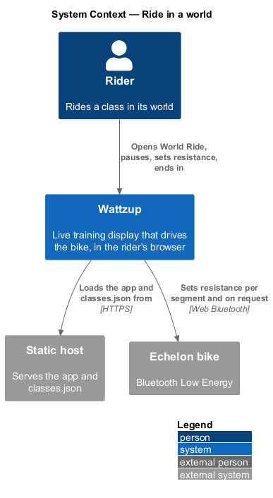
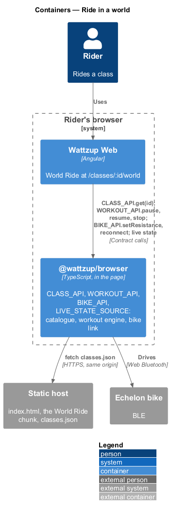
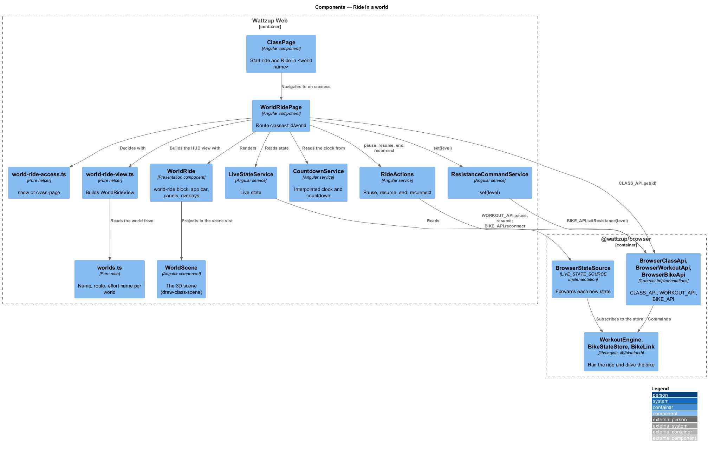
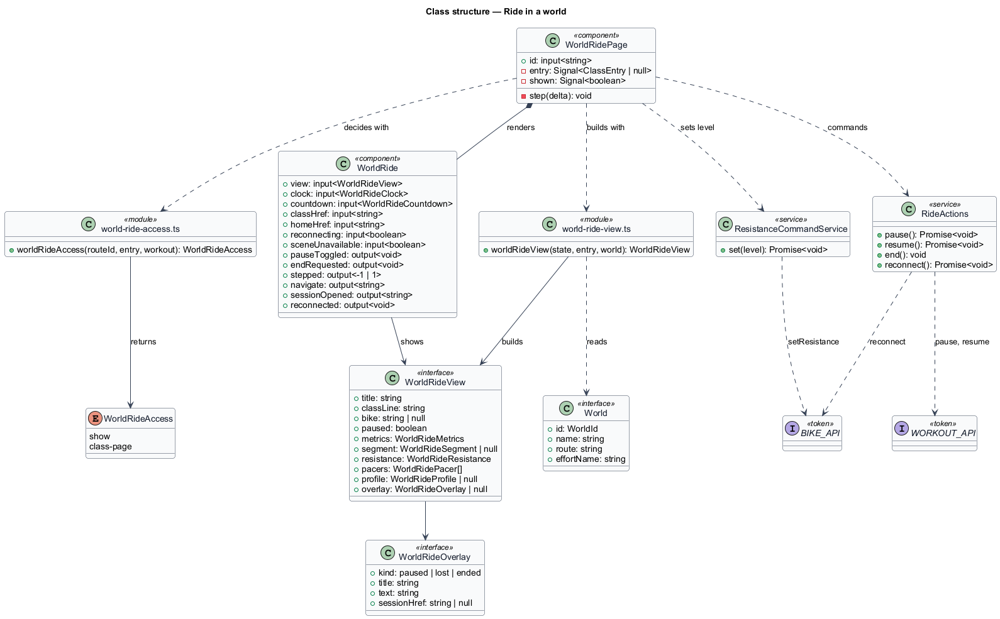
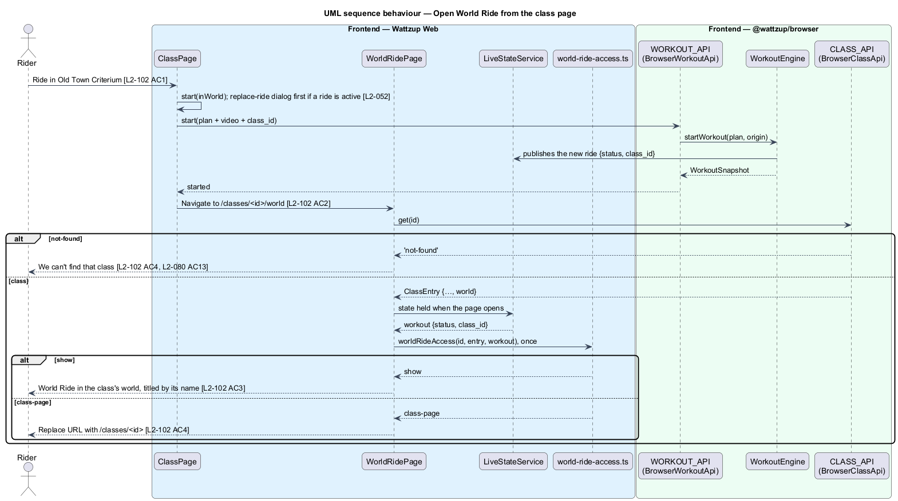
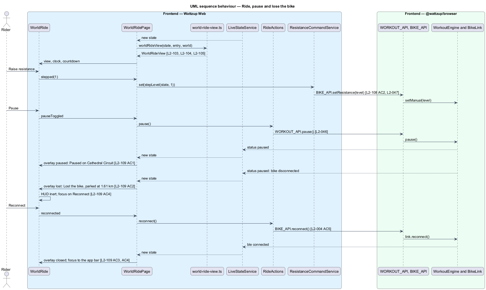

# Ride in a world

## Overview

World Ride (L1-017) shows a class ride inside the class's own scene: a 3D road whose climbs follow the plan, with the ride's numbers and controls laid over it. This feature is the screen at `/classes/:id/world`. It covers how the rider opens the screen from the class page, which ride it shows, and the panels over the scene (L2-102 to L2-105, L2-108, L2-109). The scene itself and the route profile belong to `world-ride/draw-class-scene`. The pacer board belongs to `world-ride/show-simulated-pacers`.

**World Ride** — screen at `/classes/:id/world` that shows the ride in progress of class `:id` in that class's scene

**HUD** — heads-up display: the app bar and panels drawn over the scene (metrics, current segment, route profile, pacers, resistance)

**world** — the scene of the class being ridden, as named by its `world` field (`world-ride/assign-class-scene`), with its name, route and effort name (L2-101)

**effort name** — what a `work` segment is called in a world, e.g. `Cobbled sprint` in Old Town Criterium

**ride in progress** — workout whose `status` is neither `ended`, `ended: bike shut off` nor `stopped`

World Ride adds no contract call. It reads the class through `CLASS_API.get(id)` and the ride from the live state that `LiveStateService` holds. It drives the ride through the calls the Ride Dashboard already makes: `WORKOUT_API.pause()` and `resume()`, `BIKE_API.setResistance(level)`, `BIKE_API.reconnect()`, and the end-ride dialog's `WORKOUT_API.stop()`. Their implementations run in the page, in `@wattzup/browser`. The dashboard at `/` keeps showing the same ride. Leaving World Ride never changes the workout (L2-102 criterion 6).

The class page (`classes/ride-a-class`) gains one action, `Ride in <world name>`. It starts the ride exactly as Start ride does, and opens World Ride instead of the dashboard (L2-102 criteria 1 and 2).

## Description

### Contracts

None new. `CLASS_API.get(id)` answers `world`, and the live state carries `workout.class_id` (`world-ride/assign-class-scene`). `WORKOUT_API.pause()`, `resume()` and `stop()`, `BIKE_API.setResistance(level)` and `BIKE_API.reconnect()` are unchanged (L2-046, L2-047, L2-004, L2-051); their in-browser implementations drive the `WorkoutEngine` and the bike link (`live-state/run-rides`).

### Frontend (`frontend/projects/wattzup/src/app/`, with presentation components in `frontend/projects/components/`)

**Route.** `app.routes.ts` gains `classes/:id/world`, placed before `classes/:id`, titled `World Ride · Wattzup` until the class is read. It loads `WorldRidePage` with `loadComponent`, so the page, the scene renderer and the scene assets stay out of the initial bundle (L2-102 criterion 8). The initial bundle keeps its 300 KB gzipped budget.

**Pure rules (`core/`, new, each with its `.spec.ts`).**
- **`world-ride-access.ts`**: `worldRideAccess(routeId, entry, workout)` returns `'show'` or `'class-page'`. It returns `'show'` only when all three hold (L2-102 criteria 3 and 4):
  - `entry.world` is not `null`;
  - `workout` is a ride in progress (`isActive` in `core/workout-status.ts`);
  - `workout.class_id` equals `routeId`.
- **`world-ride-view.ts`**: `worldRideView(state, entry, world)` returns the `WorldRideView` the HUD renders. It reuses the existing rules:
  - **App bar** (L2-103): the world's `name` as `title`, `<route> · <class title>`, `device_label` as `bike`, and `paused` for the Pause or Resume label.
  - **Metrics** (L2-104): `powerDelta` (`core/power-delta.ts`) for `On target`, `+<n> W` or `-<n> W`, and `Paused` when not running. `formatLive` and `formatSpeed` (`core/metric-format.ts`) give `--` for `null`. Heart is always `--`, because the bike never reports a heart rate (ADR 0003).
  - **Segment** (L2-105): `kindLabel` and `roundCount` (`core/segment-labels.ts`) give `Work · 1 of 8`, `Recover · <r> of <n>`, `Warm-up`, `Cool-down` and `Steady`. The next line names the next segment by `kindLabel`, or by the world's effort name when it is `work`, as in `Next: Cobbled sprint · 0:30 at level 24`. On the last segment the line reads `Last stretch to the finish arch`.
  - **Resistance** (L2-108): `controlsState` (`core/resistance-controls.ts`) gives which buttons are disabled: − at 1, + at 32, and both while `ble` is not `connected`. The caption reads `Manual` in `manual` mode, else `Resistance / 32`.
  - **Pacers and profile**: the board rows from `pacerBoard` (`world-ride/show-simulated-pacers`), and the route profile view from `routeProfileView` (`world-ride/draw-class-scene`) with `<distance_km> km`.
  - **Overlay** (L2-109): `paused` for `paused`, `lost` for `paused: bike disconnected`, `ended` for `ended` or `ended: bike shut off` with a `session_id`, else `null`. The lost text is `<device_label> stopped answering. You're parked at <distance_km> km on <route>. Wake it with a pedal stroke, then reconnect.`, with the distance to two decimals and `Your bike` when there is no `device_label`. The ended overlay takes its title and text from `rideOverlayText` (`core/ride-overlay-text.ts`), as the dashboard's does, and links `See your ride` to `/sessions/<session_id>`.
- **`worlds.ts`** (`world-ride/draw-class-scene`) gives `worldById(id)`: the name, route and effort name.

**Presentation component (`frontend/projects/components/src/lib/world-ride/`, new).**
- **`WorldRide`** (`wz-world-ride`): renders the `world-ride` block of the design system, with its elements as in `docs/mocks/pages/world-ride/*`. Its inputs are `view: WorldRideView` (with its `pacers` and `profile`), `clock: WorldRideClock` (`elapsed`, `total`), `countdown: WorldRideCountdown` (`left`, `ridden`, `duration`, `width`), `classHref`, `homeHref` (default `/`), `reconnecting` and `sceneUnavailable`. Its outputs are `pauseToggled`, `endRequested`, `stepped` (`-1` or `1`), `navigate` (a plain click on a link, with its `href`), `sessionOpened` (a plain click on `See your ride`) and `reconnected`. It injects no service, token or router. The scene is projected into the `[slot=scene]` slot, so the block draws the HUD over it. The parts it renders:
  - **App bar.** The lockup links to `homeHref` with the accessible name `Wattzup dashboard`. `Class` with a back arrow links to `classHref`. Then the `h1` world name over the class line, the bike's name, the clock `<elapsed> / <total>`, the Pause or Resume button and End (L2-103 criterion 1). The links carry real `href`s, and a plain click is emitted as `navigate`, so the component does not use the router.
  - **Metrics panel.** `world-ride__power` with `W est.` (title and description `Estimated from cadence and resistance`), the target line, and the `Cadence`, `Heart` and `Speed` description list (L2-104).
  - **Segment panel.** `world-ride__interval`: the label, the countdown with `role="timer"`, the `progress` named `Segment progress`, and the next line (L2-105).
  - **Resistance panel.** `world-ride__resistance`: `Lower resistance`, the output named `Resistance` with its caption, and `Raise resistance`. Each button is disabled as `controlsState` says (L2-108).
  - **Overlays.** The paused overlay `role="status"`: `Paused on <route>` / `The world holds still until you pedal again.`. The lost-bike overlay `role="alert"`: `Lost the bike`, the lost text, and `Reconnect`. While it shows, the HUD is `inert` and focus moves to `Reconnect`. When it closes, focus returns to the app bar's first control (L2-109).
  - **Ride complete overlay.** When `status` becomes `ended` or `ended: bike shut off` with a `session_id`, the scene holds still, the HUD is `inert`, and the overlay of L2-084 shows over it with `See your ride` (focused) and `Ride another class`. With `session_id` `null` (a ride too short to save, L2-081), the page navigates to `/` (L2-109 criterion 5).
  - Every control is at least 44 × 44 px with a visible focus ring, in the Tab order of L2-103 criterion 1 (L2-103 criterion 4).
  - **Layout.** Under 1024 px the resistance panel and the bike's name are hidden (L2-108 criterion 4). Under 768 px the class line, the total and the Pause label are hidden, along with the board. Under 640 px the route profile is hidden and the panels stack (L2-110 criterion 8).

**Page (`dashboard/world-ride-page/`, new).**
- **`WorldRidePage`** (route `classes/:id/world`; the document title is the world's name):
  - **Entry.** It calls `LiveStateService.ensureStarted()` and `CLASS_API.get(id)`. `not-found` shows `ClassNotFound`, titled `Class not found · Wattzup` (L2-102 criterion 4). Otherwise it decides once, as soon as it has both the class and a live state, from the live state held when the page opens: `worldRideAccess` returns `'show'`, or `'class-page'`, which replaces the URL with `/classes/<id>` (L2-102 criteria 3 and 4). It waits for no later state. `WORKOUT_API.start` resolves only after the in-browser `WorkoutEngine` has published the new ride to `BikeStateStore`, so when the class page navigates here the state already holds the ride and its `class_id`.
  - **Rendering.** It renders `wz-world-ride` with `worldRideView(...)`. The clock and countdown come from `CountdownService`, interpolated as L2-024. The scene is `wz-world-scene` (`world-ride/draw-class-scene`), projected into the scene slot.
  - **Commands.** `pauseToggled` calls `RideActions.pause()` or `resume()`, which call `WORKOUT_API.pause()` or `resume()` and show a toast when they fail (L2-103 criterion 2, L2-046). `stepped` calls `ResistanceCommandService.set(stepLevel(state, delta))`, which calls `BIKE_API.setResistance(level)` (L2-108 criterion 2, L2-047). `endRequested` calls `RideActions.end()`, which opens the end-ride dialog. Ending leads where L2-084 says (L2-102 criterion 7). `reconnected` calls `RideActions.reconnect()`, which calls `BIKE_API.reconnect()` (L2-109 criterion 2). `navigate` routes to the link's `href`, and `sessionOpened` opens the summary as just finished (L2-085 criterion 2).
  - **Leaving.** Following the lockup or `Class` makes no `WORKOUT_API` call (L2-102 criterion 6).

**Class page change (`dashboard/class-page/`).**
- `ClassPage` gains `Ride in <world name>` beside Start ride, as a secondary `btn`, when `entry.world` is set (L2-102 criterion 1). The class page mock gains the button in the same change.
- `start(inWorld)` gains a destination: `/` for Start ride and `/classes/<id>/world` for `Ride in …`. Everything else is shared: the replace-ride dialog, the plan passed to `WORKOUT_API.start` with its `class_id`, `Starting…`, and the error alert (L2-102 criterion 2).

### Screen states

| Mock | State |
|---|---|
| `pages/world-ride/default` | Old Town Criterium at 5:00 of 30:00, `Work · 1 of 8`, 142 W against 418 W (`-276 W`), resistance 24 |
| `pages/world-ride/docklands`, `granite`, `oldtown`, `prairie`, `dolomites`, `coast` | Each of the six classes in its own world, at the times of the Class Worlds canvas |
| `pages/world-ride/paused` | `Resume`, and `Paused on Cathedral Circuit` |
| `pages/world-ride/ended` | `Ride complete` over the held scene, with `See your ride` focused (L2-109 criterion 5) |
| `pages/world-ride/disconnected` | `Lost the bike`, parked at 1.61 km on Cathedral Circuit, with `Reconnect`; the HUD inert |
| `pages/world-ride/renderer-unavailable` | No scene; the HUD works (`world-ride/draw-class-scene`) |
| `pages/class/default` | `Ride in Old Town Criterium` beside Start ride |

The mocks' `loading`, `error` and `scenery-ready` states belong to Google Photorealistic 3D Tiles, which L1-017 leaves out of scope.

### Acceptance tests

The contract paths are covered by `world-ride/assign-class-scene` and the existing workout, resistance and bike tests of `@wattzup/browser`.

Playwright (`frontend/e2e/`, Chromium only). No spec reaches a real bike or Bluetooth adapter:
- **Fixtures.** The shared fixture (`e2e/fixtures/wz-test.ts`) installs the fake `navigator.bluetooth` (`fake-bluetooth.ts`), which records every write, pushes notifications on demand (`notify`) and drops the link on demand (`drop`). The app reads the shipped `classes.json`. Time-driven steps use Playwright's page clock (`page.clock.install()` and `runFor`), so no spec waits out a ride. The `webgl` fixture (`fake-webgl.ts`) hides `navigator.gpu` and makes `getContext('webgl' | 'webgl2')` answer `null`; this spec switches it on for every test outside `World Ride scene`, so the HUD is proven without the scene drawn in software. An error in the page or a request off localhost fails the spec.
- **Page object.** `e2e/pages/world-ride.page.ts` owns every World Ride selector. `startFromClass()` connects the fake bike from the dashboard, follows the app's own links to the class page (a reload would drop the bike) and presses `Ride in <world name>`. `open(id)` loads `/classes/<id>/world` straight away. The class page object gains `rideIn(worldName)`.
- **Spec `e2e/world-ride.spec.ts`:**
  - `shows Ride in Old Town Criterium on a class with a world, and not on one without` (L2-102 AC1)
  - `starts the class ride on the bike and opens World Ride` (L2-102 AC2, AC3): the heading, the document title and the page's accessible name are the world's name, and the warm-up level is written to the bike
  - `asks to replace a ride in progress before opening World Ride` (L2-102 AC2, L2-052)
  - `sends the rider to the class page when no ride of that class is in progress` (L2-102 AC4)
  - `sends the rider to the class page for a class without a world` (L2-102 AC4)
  - `shows the class not-found page for an unknown class` (L2-102 AC4)
  - `leads Class back to the class page and the lockup to the dashboard, the ride running on` (L2-102 AC6)
  - `opens the end-ride dialog from End` (L2-102 AC7)
  - `shows the world, route, class, bike and clock in the app bar` (L2-103 AC1)
  - `pauses and resumes the ride` (L2-103 AC2)
  - `shows -- until the bike reports, then power against target, cadence and speed` (L2-104 AC2 to AC5)
  - `counts down the warm-up and names the first effort by its world name` (L2-105 AC2, AC3)
  - `steps to the first work segment and then recovers` (L2-105 AC1, AC3)
  - `reads Last stretch to the finish arch on the last segment` (L2-105 AC4)
  - `shows the bike level and steps it with - and +, in manual` (L2-108 AC1, AC2)
  - `disables - at 1 and + at 32` (L2-108 AC3)
  - `holds the world still with Paused on <route>` (L2-109 AC1)
  - `shows Lost the bike when the bike drops, with Reconnect, and the HUD inert` (L2-109 AC2, AC4)
  - `shows Ride complete over the held world when the plan ends` (L2-109 AC5)

Unit tests:
- `world-ride-access.spec.ts`: one case per workout status of a ride of this class, and one each for no workout, another class's ride, a ride of no class and a class without a world (L2-102 AC3, AC4).
- `world-ride-view.spec.ts`: the app bar, the metrics with `On target` and with every reading missing, each segment kind and the next line, the last segment, `manual` mode, the disabled buttons at 1, at 32 and without the bike, and each overlay (L2-103 to L2-105, L2-108, L2-109).

No spec yet proves that the lost-bike overlay closes once the bike reconnects and focus returns to the app bar (L2-109 AC3, AC4). The bundle budget (L2-102 criterion 8) is checked by `frontend/scripts/check-bundle-size.mjs` on every production build. The layout criteria (L2-108 criterion 4, L2-110 criterion 8) are covered by the responsive sweep, which runs only when a person asks.

### Open questions

- **One block or several components.** The design system extracts World Ride as one block, `world-ride`. `WorldRide` therefore renders the whole HUD from one view. If the design system later gives the board or the resistance panel its own block, those parts move into components of their own.

## Requirements

| L2 ID | Refines (L1) | Requirement |
|-------|--------------|-------------|
| `L2-102` | `L1-017` | Opening World Ride. World Ride is the screen `/classes/:id/world`. It shows the ride in progress of class `:id` in that class's scene. The class page shall gain the `Ride in <world name>` action. |
| `L2-103` | `L1-017` | World Ride app bar. It shows the lockup, `Class`, the world's name over `<route> · <class title>`, the bike's name, `<elapsed> / <total>`, Pause or Resume, and End. |
| `L2-104` | `L1-017` | World Ride live metrics. The panel shows the readouts of L2-021 in the World Ride layout: estimated power against target, cadence, heart (always `--`) and speed. |
| `L2-105` | `L1-017` | World Ride current segment. The panel shows the countdown of L2-024 and the phase of L2-025, and names the next effort in the scene's words. |
| `L2-108` | `L1-017` | World Ride resistance. − and + call `BIKE_API.setResistance(level)`; the caption reads `Manual` in manual mode; the buttons are disabled at 1, at 32 and without the bike. |
| `L2-109` | `L1-017` | World Ride pause and lost bike. A paused ride holds the scene still under `Paused on <route>`. A lost bike shows `Lost the bike` with `Reconnect`. A ride that ends shows `Ride complete` over the held scene. |
| `L2-080` | `L1-014` | Class page. Start ride's `WORKOUT_API.start` call, replace-ride dialog and error alert are shared with `Ride in <world name>`. |
| `L2-084` | `L1-015` | Ending a ride opens its summary. The `Ride complete` overlay and `See your ride`. |
| `L2-051` | `L1-007` | End-ride dialog. End opens it; ending leads to the session or the class library. |
| `L2-046` | `L1-004` | Pause and resume. Pause and Resume call `WORKOUT_API.pause()` and `resume()` and show a toast when they fail. |
| `L2-093` | `L1-005` | Live state. `LiveStateService` exposes the read-only state signal, fed from the in-browser bike connection and engine. |
| `L2-047` | `L1-003` | Manual resistance override. A level set by the rider puts the workout in `manual` mode until the next segment. |

## Diagrams

### System context

The rider opens World Ride from a class in Wattzup, in their browser. Wattzup drives the bike over Web Bluetooth while the rider watches the class's world.

### Containers

Wattzup Web, in the rider's browser, reads the class from `classes.json` on the static host and runs the ride itself: its contract implementations drive the bike over Web Bluetooth and publish the live state the screen reads.

### Components

`WorldRidePage` decides access with `world-ride-access.ts` and builds the HUD view with `world-ride-view.ts`. It renders `WorldRide` with the scene projected under it, and sends commands through `RideActions` and `ResistanceCommandService`, which call `WORKOUT_API` and `BIKE_API`.

### Class structure

`WorldRideView` is a pure value built from the live state, the class and its world. `WorldRide` renders it and emits the rider's commands. Only `WorldRidePage` turns those commands into contract calls.

### Behaviour — open World Ride from the class page

`Ride in <world name>` starts the class ride as Start ride does. On success it opens World Ride, which decides from the state held when it opens, and shows the ride only when the running workout is this class's (L2-102 criteria 1 to 4).

### Behaviour — ride, pause and lose the bike

Each new state renders the HUD again. Pause holds the world still. A lost bike makes the HUD inert, and `Reconnect` asks the bike link to reconnect (L2-103, L2-108, L2-109).

