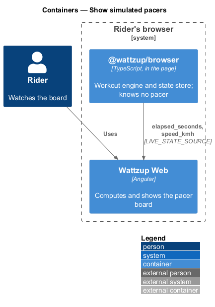
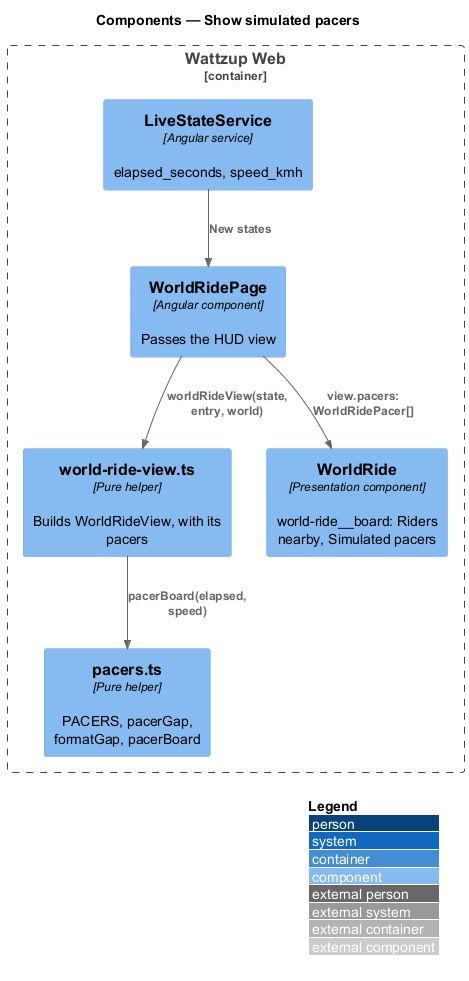
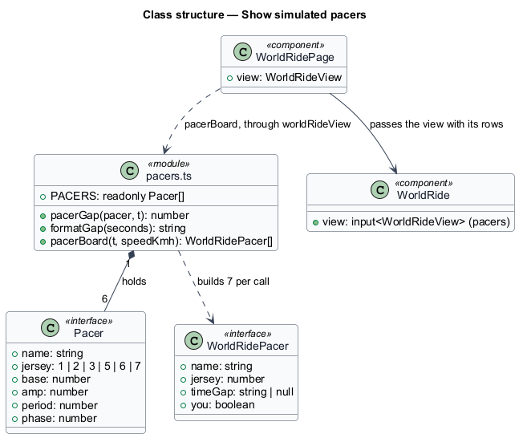
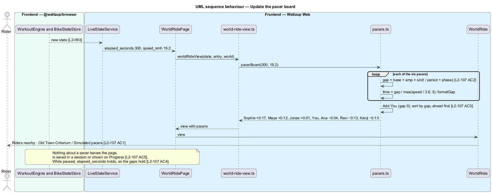

# Show simulated pacers

## Overview

World Ride (L1-017) shows a board of riders around the rider, as a group ride would. Wattzup is single-user and knows no other rider, so the board lists six **simulated pacers**. This feature is that board: who the pacers are, how their gaps move, how the board says they are simulated, and the guarantee that they are never recorded (L2-107).

**simulated pacer** — invented rider on the World Ride board whose gap to the rider follows a fixed wave; it is not a person and not a recording

**gap** — distance, in metres, of a pacer ahead of the rider (negative is behind)

**time gap** — gap divided by the rider's speed, shown as `+m:ss` ahead or `−m:ss` behind

The board exists for company and pace, not for competition. L1-015 shows only real rides, so the pacers are labelled `Simulated pacers` under the board's heading. They live only in the page. They are computed from `elapsed_seconds` and `speed_kmh`, never leave the device, and never appear in a session, the Session Summary or Progress (L2-107 criteria 1 and 5).

The six pacers and their waves come from the Magic Patterns OS file `shared/worlds.ts`. The same six pacers ride in every world.

## Description

### Contracts

None. No contract call, state field or session field carries a pacer (L2-107 criterion 5).

### Frontend (`frontend/projects/wattzup/src/app/`, with presentation in `frontend/projects/components/`)

**Pure rules (`core/pacers.ts`, new, with `pacers.spec.ts`).**
- **`Pacer`**: `{ name, jersey, base, amp, period, phase }`. **`PACERS`** holds the six rows of L2-107 in table order. `jersey` is the number of the pacer's design-system rider colour, `--color-rider-<n>`, applied through the `world-ride__rider--<n>` modifier. The numbers follow the mocks: Sophie Dubois 1, Maya Okafor 2, Jonas Lindqvist 3, Ana Ferreira 5, Ravi Patel 6, Kenji Watanabe 7. Number 4 is `You`. The colour stays with the pacer whatever the board's order. It is never a hex value (Read tokens by role, AGENTS.md).
- **`pacerGap(pacer, t)`** returns `base + amp × sin(t ÷ period + phase)` metres (L2-107 criterion 2).
- **`formatGap(seconds)`** rounds to whole seconds and returns `+m:ss` for 0 and above, else `−m:ss` with U+2212.
- **`pacerBoard(t, speedKmh)`** returns `WorldRidePacer[]`, built as follows (L2-107 criteria 2 and 3):
  - each pacer's time gap is `pacerGap ÷ max(speedKmh ÷ 3.6, 3)` seconds;
  - the `You` row is added with gap 0, `you: true` and no time;
  - the rows are sorted by gap, from furthest ahead to furthest behind.

  A `null` `speed_kmh` counts as 0, so the 3 m/s floor applies.
- **`WorldRidePacer`** (`@wattzup/components`, beside `WorldRide`): `{ name, jersey, timeGap: string | null, you: boolean }`.

**Board.** It is the `world-ride__board` element of `WorldRide` (`world-ride/ride-in-a-world`). It renders:
- the heading `Riders nearby · <world name>`, with `Simulated pacers` directly under it (L2-107 criterion 1);
- an ordered list (`world-ride__riders`) with one `world-ride__rider--<n>` item per row. Each item shows the jersey swatch, the name and the time gap;
- the `You` row with `aria-current="true"`, styled through that attribute.

The name carries each row's meaning. The jersey colour adds to it and never replaces it (L2-107 criterion 3). Under 768 px the board is hidden (L2-107 criterion 6).

**Page.** `worldRideView` (`world-ride/ride-in-a-world`) computes `pacerBoard(elapsed_seconds, speed_kmh)` from the live state on each new state, as the view's `pacers`, and `WorldRidePage` passes the view to `WorldRide`. The board follows the in-browser engine's `elapsed_seconds`, which stops while the ride is not running, so the gaps stop too (L2-107 criterion 4). Nothing else reads the rows.

**Mock.** `docs/mocks/pages/world-ride/*` show the `Simulated pacers` line under the board heading (L2-107).

### Example

At `elapsed_seconds` 300 and 19.2 km/h (5.33 m/s), Maya Okafor's gap is 46 + 28 × sin(300 ÷ 140 + 0.3) = 64.0 m, which is 12.0 s, shown as `+0:12`. This matches `pages/world-ride/default`. The board there reads Sophie Dubois `+0:17`, Maya Okafor `+0:12`, Jonas Lindqvist `+0:01`, You, Ana Ferreira `−0:04`, Ravi Patel `−0:13`, Kenji Watanabe `−0:13`.

### Acceptance tests

This feature has no contract part, so it has no contract test.

Playwright (`frontend/e2e/world-ride.spec.ts`, Chromium only, page object `e2e/pages/world-ride.page.ts`). Each test starts the class ride on the fake `navigator.bluetooth`; time-driven steps fast-forward Playwright's page clock:
- `labels the board and lists six pacers and You, You current` (L2-107 AC1, AC3)
- `keeps the gaps still while paused` (L2-107 AC4)
- `keeps the pacers on the device and out of the saved ride` (L2-107 AC5). It records every request the page makes, rides the class to its end and opens the Session Summary, then checks that no pacer name is on the summary or in any request's URL or body.

Unit tests (`pacers.spec.ts`):
- one `pacerGap` case per pacer row (L2-107 AC2);
- `formatGap` for 0, a positive value, a negative value and rounding;
- the 3 m/s floor at a standstill and with `null` speed;
- the sort order, using the example above (L2-107 AC3).

That the pacers never reach a session or Progress (L2-107 AC5) also follows from the session record having no pacer field: `history/record-session` builds a session only from the workout engine's samples, and `history/keep-sessions` keeps it in IndexedDB on the device. The hidden board under 768 px (L2-107 AC6) is covered by the responsive sweep, which runs only when a person asks.

### Open questions

- **Pacers on a flat world.** The same six waves run in every world and every plan. Whether a world or a plan should change their pace is <TO SUPPLY>.
- **Board when paused.** The gaps hold while the ride is paused. The board stays visible, as in `pages/world-ride/paused`.

## Requirements

| L2 ID | Refines (L1) | Requirement |
|-------|--------------|-------------|
| `L2-107` | `L1-017` | Simulated pacers. The *Riders nearby* board lists six simulated pacers around the rider, computed in the frontend only and labelled `Simulated pacers`. Each gap is `base + amp × sin(t ÷ period + phase)` metres, shown as a time gap. The rows are sorted by gap, with `You` marked current. They stop while the ride is not running. They never leave the device and are never recorded. The board is hidden under 768 px. |

## Diagrams

### System context

The board is computed in Wattzup Web alone, in the rider's browser. The pacers never leave it.

### Containers

Wattzup Web reads `elapsed_seconds` and `speed_kmh` from the live state its in-browser engine publishes, and sends nothing about pacers anywhere.

### Components

`worldRideView` calls `pacerBoard` on each new state, and `WorldRidePage` passes the view, rows included, to the `WorldRide` board.

### Class structure

`PACERS` holds the six fixed waves. `pacerBoard` turns them, the ride time and the speed into sorted `WorldRidePacer` rows.

### Behaviour — update the board

Each new state gives a new time and speed. The board is computed again and drawn, and nothing leaves the page (L2-107).

