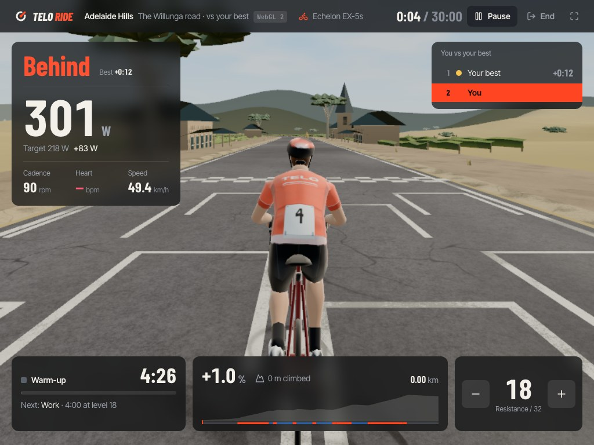
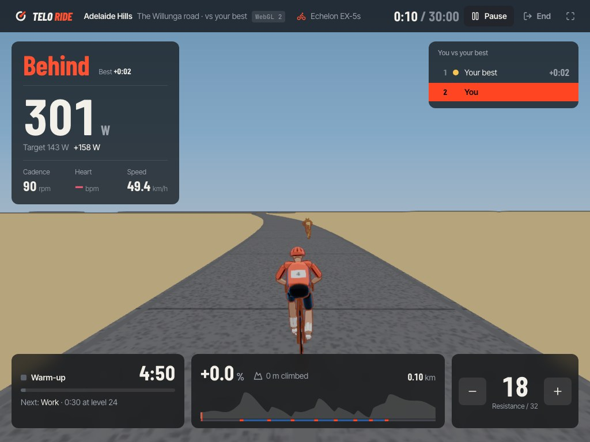
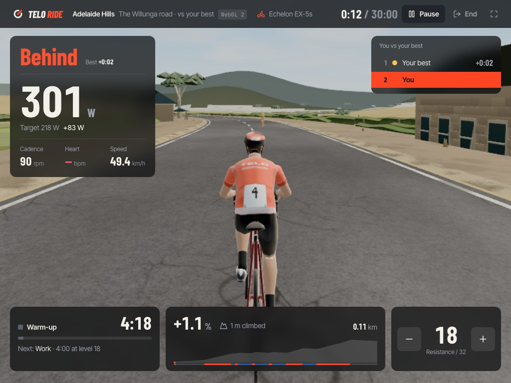
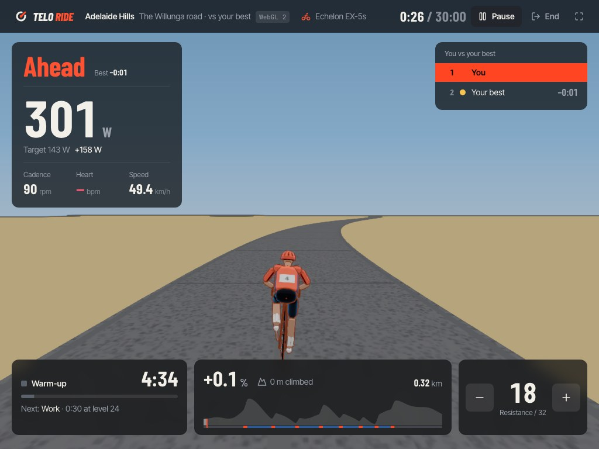
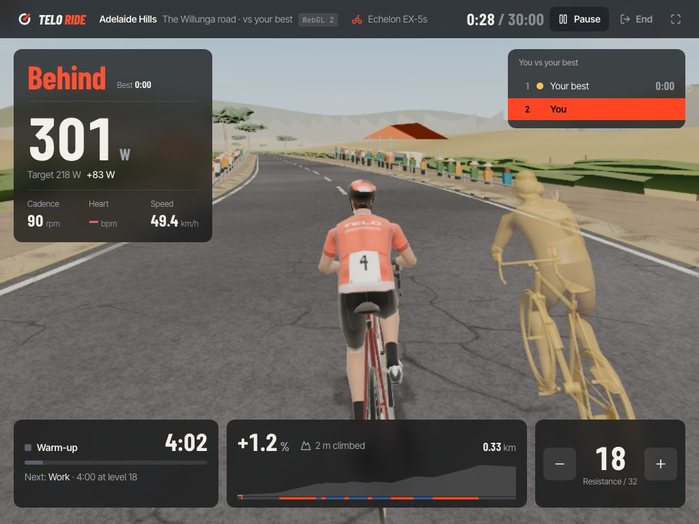

# Adelaide Hills

These captures show the production Race view on low/WebGL 2, with the simulated bike at 90 rpm. Both runs use a 1024 × 768 viewport and include the HUD. The baseline build uses the previous world renderer and the new build uses the Adelaide course. The opening capture is taken when the renderer becomes visible. The other captures use the HUD’s distance, rounded to 0.01 km.

| Rider view | Before | Adelaide course | References |
| --- | --- | --- | --- |
| Village, near the start |  |  | real-01–02, 07–10, 13–15 and game-01, 04 |
| Vineyard bend, 0.10 km |  |  | real-03–06, 14 and game-02, 04–05 |
| Expo approach, 0.32 km |  |  | real-11–12 and game-01–03 |

The route uses the original 15 stages preserved in the repository’s GCN catalogue at commit `a9be36f6a`. The new race rides 12,975 m and climbs 201 m. Scenery is original Blender geometry. The course uses Caribana’s separate near and far silhouettes, locally specific landmarks, baked vertex shade and spatially grouped detail. Low retains the expo, vineyard, gum and village shapes. The game and real photographs remain credited in [the reference folder](../../worlds/adelaide/SOURCES.md).

The frame check runs the production app in headed Chromium with DPR 1, low/WebGL 2, 4× CPU throttle, a 9 s warm-up and 60 s of moving riding. It counts actual render submissions and browser animation frames. The expo is inside the measured segment. Run `npm run perf -- adelaide-tablet --headed` from `frontend/`. The measurement on an Apple M5 Pro MacBook Pro with 24 GB RAM describes the simulated tablet profile.

| Chromium | Sample | Course submissions/s | Display callbacks/s | p95 submission interval | Longest | Peak draw calls |
| --- | --- | ---: | ---: | ---: | ---: | ---: |
| 159.0.8154.6, macOS arm64 | 0.12–0.95 km through the expo | 119.87 | 119.67 | 10.10 ms | 55.70 ms | 41 |

The longest interval exceeded one 60 Hz frame. The measured average met the nominal 60 FPS criterion. These measurements do not establish the frame rate on a physical low-power tablet.
