# World Ride Performance Optimization Guide & Old Town Case Study

This document provides a comprehensive, empirical optimization blueprint for delivering a **60 FPS (`≤ 16.7 ms` frame budget)** World Ride experience in Wattzup while preserving every detail of the drawn and physically based 3D art direction and glassmorphic HUD.

All findings, root-cause diagnoses, trade-off analyses, and before/after measurements below were collected on a real hardware GPU using **Playwright + Chromium DevTools Protocol (CDP)** (`Performance.getMetrics`, V8 `Profiler`, and hardware `timestamp-query` GPU timers) against Wattzup's production build.

---

## 1. Executive Summary

Wattzup opens every World Ride at the `low` tier (ADR 0024: banded toon shading, view-normal/depth ink outlines, three-stop sky gradient, ordered Bayer dithering) and adapts downward if a higher pinned or future tier misses the display's measured frame period (`L2-111`).

Profiling revealed that **Old Town Criterium (`oldtown`)**—the flagship scene for the default class (`30-minute-hiit-cardio`)—ran at **31.7 FPS (`29.9 ms` median)** at `low` on WebGPU, **21.5 FPS (`45.1 ms` median)** on WebGL2, and **13.2–14.8 FPS (`54.2–75.1 ms` median)** at `medium`–`ultra`. Crucially, CDP + GPU timer queries proved that Old Town at `low` and `medium` was **not GPU-bound** (`7.67 ms` GPU time at `low`, `10.22 ms` at `medium`—well inside `16.67 ms`), but **CPU render-submission bound** (`30.83 ms` to `74.53 ms` of JavaScript per frame) due to submitting **1,771–3,308 unculled draw calls** every frame.

By refactoring `OldTownStreet` (`world-oldtown.ts`) and `Corners` (`world-corners.ts`)—consolidating ~1,105 town-house meshes into **9 `BatchedMesh`es**, instancing lamps/swifts/ropes/covers, merging corner furniture by vertex colour, pre-initialising ribbon and road normals at build time, eliminating per-frame `computeVertexNormals()` / `computeBoundingSphere()` / `Matrix4.compose()` churn, and enabling hardware back-face culling (`FrontSide`) on closed volumes—**Old Town now runs at a vsync-locked 60.5 FPS (`16.7 ms` median, `17.8 ms` p95) with zero visual loss and 54 % lower JS heap usage**:

| Metric (`oldtown`, WebGPU, `low` — default ride tier) |  Original (`main`) |        Optimized |                     Change |
| ----------------------------------------------------- | -----------------: | ---------------: | -------------------------: |
| **Average Frame Rate (CDP Ride)**                     |           31.7 FPS |     **60.5 FPS** | **+90.9 % (60 Hz locked)** |
| **20 s Sweep Median Frame Time**                      |            28.0 ms |      **16.7 ms** |                **−40.4 %** |
| **20 s Sweep p95 Frame Time**                         |            38.3 ms |      **17.8 ms** |                **−53.5 %** |
| **CDP CPU Script Time / Frame**                       |           30.83 ms |      **9.93 ms** |  **−67.8 % (3.1× faster)** |
| **GPU Median Time / Frame (`timestamp-query`)**       |            7.67 ms | **4.39–4.72 ms** |                **−40.6 %** |
| **Main-Thread Idle Headroom (V8 Profiler)**           | 0.0 % (CPU-pinned) |  **24.8 % idle** | **+4.1 ms/frame headroom** |
| **Draw Calls / Frame (WebGPU / WebGL2)**              |      1,771 / 1,771 |    **746 / 328** |      **−57.9 % / −81.5 %** |
| **JS Heap Used During Ride**                          |            95.5 MB |      **43.9 MB** |                **−54.1 %** |
| **Missing-Normal TSL Shader Warnings**                |        13 warnings |   **0 warnings** |                 **−100 %** |

---

## 2. Profiling Methodology & Playwright CDP Setup

### Test Hardware & Environment

- **CPU**: 11th Gen Intel Core i7-1185G7 @ 3.00 GHz (4 cores / 8 threads)
- **GPU**: Intel Iris Xe Graphics (`intel` / `gen-12lp` integrated GPU, shared system memory)
- **Browser**: Playwright Chromium, headed (`--enable-gpu --ignore-gpu-blocklist`), `1440 × 900` CSS viewport (`devicePixelRatio = 1`, 60 Hz display)
- **Build**: Production static bundle (`cd frontend && npm run build`, served locally with service workers blocked and zero off-origin network requests)

### Instrumentation Channels

1. **Playwright CDP `Performance` Domain** (`page.context().newCDPSession(page)` → `Performance.enable` / `Performance.getMetrics`):
   Measures exact main-thread `ScriptDuration`, `TaskDuration`, `LayoutCount`, `LayoutDuration`, `RecalcStyleCount`, `JSHeapUsedSize`, and `Nodes` deltas across the recording window—added permanently to `frontend/e2e/sweeps/performance.sweep.ts`.
2. **Playwright CDP V8 `Profiler` Domain** (`Profiler.start` / `Profiler.setSamplingInterval({ interval: 200 })` / `Profiler.stop`):
   Captures 200 µs call-stack samples separately during **scene load/warm-up** and **steady-state riding** (simulated Echelon bike streaming `95 rpm` / level `24` ≈ `35.6 km/h`).
3. **Renderer Probe & Hardware GPU Timers** (`window.__wzWorldRide` in `world-ride-probe.ts`):
   Records per-frame wall intervals, WebGPU `timestamp-query` / WebGL2 `EXT_disjoint_timer_query_webgl2` GPU frame durations, total `drawCalls` across all passes, compiled `programs`, `compiledDuringRide`, and material feature variants.

```bash
# Run the Playwright CDP performance sweep on Old Town (headed, single worker)
cd frontend
WZ_SCENES=oldtown npx playwright test --config playwright.sweeps.config.ts performance -g "frame times per scene and tier" --headed --workers=1

# Compare two sweep JSON reports
node scripts/compare-performance.mjs performance-reports/<before>.json performance-reports/<after>.json
```

---

## 3. Empirical Root-Cause Analysis

### 3.1 The Cross-World Draw-Call Scaling Law

Profiling five scenes of increasing geometric complexity at `low` (WebGPU) established a strict linear relationship between draw calls and CPU frame time:

| Scene (`low`, WebGPU)       | Draw Calls | GPU Median (ms) | CDP CPU Script / Frame (ms) | Median Frame (ms) |  Avg FPS | Scene Load (ms) |
| --------------------------- | ---------: | --------------: | --------------------------: | ----------------: | -------: | --------------: |
| `daytona` (Speedway)        |        484 |            2.82 |                        8.84 |              16.7 | **60.5** |           1,908 |
| `giza` (Plateau)            |        488 |            2.82 |                        8.90 |              16.7 | **60.7** |           1,997 |
| `ibiza` (Coast Sunset)      |        849 |            4.59 |                       18.17 |              19.9 | **52.5** |           2,900 |
| `southbeach` (Ocean Drive)  |      1,415 |            4.85 |                       27.53 |              29.7 | **35.0** |           2,888 |
| `oldtown` _(original)_      |      1,771 |            7.67 |                       30.83 |              29.9 | **31.7** |           4,013 |
| **`oldtown` _(optimized)_** |    **753** |        **4.72** |                    **9.93** |          **16.7** | **60.5** |       **3,767** |

Because ADR 0023 bends the road in the vertex shader (`RoadBend`), scene meshes set `frustumCulled = false` so Three.js never culls geometry whose straight-space bounding box sits outside the camera frustum before bending into view. Consequently, **every `Mesh` in the scene graph is traversed, uniform-updated, and encoded into the WebGPU/WebGL2 command buffer on every pass of every frame**:

- **WebGPU per-RenderObject CPU cost**: `≈ 0.017–0.019 ms` per `Mesh` (`BatchedMesh` amortizes sub-draws inside a single `RenderObject` down to `~0.003 ms`).
- **WebGL2 per-draw CPU cost**: `≈ 0.026 ms` per `Mesh` (reduced by `WEBGL_multi_draw` inside `BatchedMesh` to **1 driver call per batch**).
- **60 FPS Rule of Thumb**: Keeping total active `RenderObject`s under **~450** (and total draw calls under **~800** on WebGPU / **~400** on WebGL2) keeps CPU script time under **`10 ms`**, leaving **`> 6.6 ms`** of margin for browser compositing, bike BLE telemetry, and OS scheduling.

### 3.2 V8 CPU Profiler Hotspots (Before Optimization)

Sampling V8 at 200 µs intervals on unmodified `oldtown` exposed two distinct CPU bottlenecks:

1. **Steady-State Ride (`30.83 ms` script/frame at `low`, `66.43 ms` at `high`)**:
   Over **85 %** of active JavaScript execution lived inside `Three.WebGPURenderer` per-object submission:
   - `GPUQueue.writeBuffer` (native Dawn IPC uniform uploads): **20.3 %** (`6.62 ms/frame`)
   - `Nodes.updateNode` / `RenderObjects.updateByType`: **7.0 %**
   - `Renderer._renderObjectDirect`: **4.1 %**
   - `GPURenderPassEncoder.setVertexBuffer` / `updateBinding`: **5.1 %**
   - `OldTownStreet.lay()` + `placeCrowd()` + `placeBunting()`: recomputing vertex normals and bounding spheres across 12 road ribbons (`computeVertexNormals()` + `computeBoundingSphere()`) and composing `2,800+` `Matrix4` spectator/bunting transforms every frame.
2. **Scene Load & Warm-Up (`4.01 s` at `low`, `10.75 s` at `high`)**:
   - **47.0 %** (`5,677 ms` at `high`; `1,102 ms` / `25.2 %` at `low`) was spent in `Bindings.updateBinding` allocating uniform buffers and WebGPU bind groups for ~1,500 separate meshes across warm-up passes.
   - Procedural 2D canvas generation created **100 `<canvas>` elements (`8.76 MP`)**, including `4,235` individual `CanvasGradient` allocations in `cobbleTextures()` and `1,048,576` `Math.hypot` + closure calls in `normalsFrom()`.

### 3.3 Old Town Draw-Call Census & GPU Overdraw Analysis

At `low`, unmodified Old Town issued **1,771 draw calls** (doubling to **3,305–3,308** at `medium`–`ultra` when the directional shadow map pass re-rendered shadow casters):

```mermaid
flowchart LR
  subgraph Original["Original Old Town (1,771 draws @ low / 3,308 @ high)"]
    H1["90 Houses & Alleys\n~1,105 Meshes\n(DoubleSide!)"]
    C1["7 Cyclists (You + 6 Pacers)\n~350 Meshes"]
    K1["4 Bend Corners\n156 Meshes"]
    L1["15 Street Lamps\n90 Meshes"]
    P1["12 Ribbons + 24 Swifts +\nLandmarks + Props\n70 Meshes"]
  end

  subgraph Optimized["Optimized Old Town (746 draws WebGPU / 328 WebGL2 @ low)"]
    H2["9 Street BatchedMeshes\n(FrontSide + 5 Atlases +\nBack-Camera Culling)"]
    C2["7 Cyclists\n~350 Meshes\n(Next Global Win)"]
    K2["4 Bend Corners\n20 Vertex-Coloured Meshes"]
    L2["7 Lamp InstancedMeshes"]
    P2["6 Multi-Strip Ribbons +\n1 Swift / 1 Cover / 1 Rope\nInstancedMesh + Merged Landmarks"]
  end

  Original -->|"−1,025 WebGPU draws\n−1,443 WebGL2 draws"| Optimized
```



Three hidden GPU & shader defects were also uncovered:

1. **`side: DoubleSide` on Closed House Volumes**: `OldTownStreet.material()` set `side: DoubleSide` on every town-house `BoxGeometry` and roof `prism`, even though all closed volumes wind outward (`FrontSide`) with determinant `+1` on both sides of the street (`rotation.y = Math.PI` preserves winding). The GPU was shading both front and interior back walls of every building in both the MRT scene pass and the `2048 × 2048` 25-tap PCF shadow pass—nearly doubling fragment shader pressure.
2. **Multi-Material Roof Arrays Skipped by `flatten()`**: `house()` and `addCathedral()` passed `[roof, gables]` material arrays on pitched roofs and dormers, which `flatten()` skipped (`if (Array.isArray(o.material)) return;`), leaving ~200 unmerged roof/dormer draw calls.
3. **13 Missing `normal` Attributes During `warmUp()`**: `ThreeWorldRenderer.warmUp()` renders `warmRound()` _before_ `rehearse()` calls `draw()` → `layRoad()`. Neither `OldTownStreet.ribbon()` (11 lit strips) nor `world-renderer.ts`'s `stripGeometry()` (`road` and `ground`) allocated a `'normal'` attribute until the first `lay()` call, emitting 13 `THREE.TSL: Vertex attribute "normal" not found on geometry` warnings and compiling initial warm-up shaders without vertex normals.

### 3.4 Stack-Wide Bundle & HUD Findings (Beyond Old Town)

1. **2.65 MB (`577 KB` gzipped) Monolithic `world-renderer` Chunk**:
   `world-streets.ts` statically imports all **83 street modules**, and `world-renderer.ts` statically imports `OldTownStreet` and `DocklandsStreet`. A rider opening a single class downloads and parses scenery code for all 85 procedural streets before the 3D scene can boot, while the initial app bundle stays lean at `104.9 KB` gzipped (`300 KB` budget).
2. **Per-Frame HUD Layout Thrashing Under `backdrop-filter: blur(0.75rem)`**:
   CDP recorded **`270–336` full DOM layouts and style recalculations per 8-second window (`~34–42 Hz`)** during every ride (`~55 ms` layout + `~36 ms` style recalc). Tracing the DOM mutation showed `WorldRidePage.countdown` updating `[style.--value]="cd.width"` (`pct.toFixed(2)%`) on `wz-progress-bar` at `requestAnimationFrame` cadence underneath six glassmorphic `.world-ride__panel` / `.world-ride__bar` elements styled with `backdrop-filter: blur(0.75rem)`.
3. **Shared `Cyclist` Rig (`world-cyclist.ts`)**:
   Each `Cyclist` builds ~50 separate child `Mesh`es (spokes, rims, tyres, tubes, saddle, bars, shoes, limbs, helmet). With `You` + up to 6 `PACERS` visible, cyclists alone contribute **~350 draw calls (`~700` with shadows)** in _every_ world—now accounting for nearly half of Old Town's remaining draw calls!
4. **Tier-Drop Shader Cache Eviction (`high` → `medium`)**:
   When `applyTier()` transitions from `medium` → `high` during `warmUp()`, mutating `this.roadMaterial.normalMap` and setting `this.roadMaterial.needsUpdate = true` increments `roadMaterial.version`, evicting the `medium` program from Three.js's per-material cache so a subsequent `high` → `medium` drop recompiles pipelines (`10` in `giza`, `64` in `oldtown`), whereas `medium` → `low` and `ultra` → `high` compile `0`.

---

## 4. Optimizations Implemented in Old Town Criterium

All production scene changes were delivered incrementally with ATDD unit and E2E specs while keeping Old Town's deterministic seeded street layout (`seeded(3)`, `seeded(71)`, per-house feature seeds) **pixel-identical**:

1. **9-`BatchedMesh` Street Frontage Consolidation (`world-oldtown.ts`)**:
   - Grouped ~90 town houses and alleys into `20 m` street blocks and packed the entire street into **9 `BatchedMesh`es**:
     - **3 Stacked `wrapS` Façade Atlases**: `upperMat` (14 open/shuttered upper-storey palettes stacked vertically with 8 px edge-extruded gutters), `shopMat` (8 lit ground-floor shopfronts paired with a vertically repeating `shopGlowTexture`), and `homeMat` (8 rusticated town-house ground floors).
     - **3 Vertex-Coloured Shared Materials**: `matte` (all 8 gable wall colours, 8 stone trim colours, chimney brick, terracotta pots/planters, doorway steps, and alley cobbles), `metal` (zinc gutters/downpipes and iron brackets/poles/tables/oculi), and `roofMat` (all 4 clay/slate roof colours tinting one neutral tile map).
     - **2 Packed Detail Atlases + 1 Cut-Out Railing**: `awningMat` (7 striped awning columns in one `512 × 64` `wrapT` atlas), `detailMat` (`1024 × 512` 4 px edge-extruded atlas packing 4 gilt shop fascias, 4 glazed shop doors, 4 trade signs, 4 civic flags, bay leaves, and geranium blooms), and `railing` (`alphaTest: 0.5`, preserving ordered Bayer dithering at `low`).
   - Enabled **hardware back-face culling (`FrontSide`)** on all 6 closed-volume batches (`upperMat`, `shopMat`, `homeMat`, `matte`, `metal`, `roofMat`), keeping `DoubleSide` only on single-sheet geometry (`awningMat`, `detailMat`, `railing`).
   - Applied **vertical road-grade shear (`m[9] = -grade`)** per street block in `place()` so walls and chimneys stay 100 % plumb vertical while footings hug ramps, and culled blocks behind the camera (`start + width ≤ -20 m`, safely behind the sun's 14.4 m forward roof shadow) via `setVisibleAt(id, visible)` guarded by `getVisibleAt(id) !== visible`.
   - Disposed all temporary per-house `BoxGeometry` / `PlaneGeometry` / `prism` instances and marker materials immediately after `BatchedMesh` upload, cutting runtime JS heap by **54–64 %**.
2. **Corner, Lamp, Prop & Landmark Instancing (`world-corners.ts`, `world-oldtown.ts`)**:
   - Merged static corner furniture per material using vertex colours in `Corners` (**156 → 20 meshes** across 4 bend apexes) while keeping the marshal's waving yellow flag animated.
   - Converted 15 street lamps (**90 meshes → 7 `InstancedMesh`es**), 12 wheeling swifts (**24 meshes → 1 `InstancedMesh`**), 3 street-banner ropes (**1 `InstancedMesh`**), and 3 pitched manhole covers (**1 `InstancedMesh`**).
   - Merged solid-colour parts on the cathedral, belfry, and TV moto via vertex colours and disabled shadow casting on the distant cathedral (`500 m`) and belfry (`260 m`), which sit far outside the directional shadow frustum.
3. **Zero-Churn Per-Frame Updates & Pre-Built Normals (`world-oldtown.ts`, `world-renderer.ts`)**:
   - Merged left/right symmetric road ribbons (`kerb`, `pavement`, `damp`, `foot`, `banner`, `rail`: **12 → 6 meshes**), pre-populated analytical cross-section vertex normals at `build()` time (and on `road`/`ground` in `stripGeometry()`), and replaced `.forEach` + `computeVertexNormals()` + `computeBoundingSphere()` with direct typed-array writes in `lay()`.
   - Pre-composed static spectator (`crowd`) and `bunting` rotations/scales once at `build()`, updating only `instanceMatrix` translation slots `[idx * 16 + 13]` (`y`) and `[idx * 16 + 14]` (`z`) per frame.
4. **Procedural 2D Canvas Fast Paths (`world-oldtown.ts`)**:
   - Hoisted per-row linear gradients and stamped a reusable domed sett height tile in `cobbleTextures()` (replacing `8,470` gradient allocations with `78`), replaced `1.05M` `Math.hypot` + closure calls in `normalsFrom()` with direct array indexing + `1 / Math.sqrt(...)`, and batched `Path2D` wall speckles in `bayTexture()` / `homeTexture()`.

---

## 5. Before vs. After Performance Results

### 5.1 Official 20-Second Playwright Sweep (`compare-performance.mjs`)

Recorded with `WZ_SCENES=oldtown npx playwright test --config playwright.sweeps.config.ts performance --headed --workers=1` (`3 s` warm-up skip + `20 s` recording window):

| Scene     | Tier                  | Backend  | Median Frame (ms)         | p95 Frame (ms)            | GPU Median (ms)           |        Draw Calls | Compiled During Ride |
| --------- | --------------------- | -------- | ------------------------- | ------------------------- | ------------------------- | ----------------: | -------------------: |
| `oldtown` | **`low`** _(default)_ | `webgpu` | **28.0 → 16.7 (−40.4 %)** | **38.3 → 17.8 (−53.5 %)** | 7.01 → **4.39 (−37.4 %)** |   1,732 → **746** |            0 → **0** |
| `oldtown` | `medium`              | `webgpu` | **54.2 → 23.2 (−57.2 %)** | **72.2 → 31.8 (−56.0 %)** | 8.91 → **7.27 (−18.4 %)** | 3,227 → **1,239** |            0 → **0** |
| `oldtown` | `high`                | `webgpu` | **57.3 → 31.9 (−44.3 %)** | **96.2 → 47.3 (−50.8 %)** | 14.55 → **17.83**         | 3,230 → **1,242** |            0 → **0** |
| `oldtown` | `ultra`               | `webgpu` | **65.2 → 31.0 (−52.5 %)** | **89.2 → 44.8 (−49.8 %)** | 14.55 → **17.83**         | 3,230 → **1,242** |            0 → **0** |

### 5.2 Playwright CDP Riding Benchmark (WebGPU & WebGL2, 35.6 km/h Active Ride)

| Backend & Tier      | Avg FPS (Before → After)      | Median ms (Before → After) | p95 ms (Before → After) | CDP CPU Script ms/f (Before → After) | GPU Median ms (Before → After) | Draws (Before → After)  | JS Heap MB (Before → After) |
| ------------------- | ----------------------------- | -------------------------- | ----------------------- | ------------------------------------ | ------------------------------ | ----------------------- | --------------------------- |
| **WebGPU `low`**    | 31.7 → **60.5 (+91 %)**       | 29.9 → **16.7**            | 42.8 → **17.9**         | 30.83 → **9.93 (−68 %)**             | 7.67 → **4.72 (−38 %)**        | 1,771 → **753**         | 95.5 → **43.9**             |
| **WebGPU `medium`** | 13.2 → **57.3–60.3 (+334 %)** | 75.1 → **16.7–17.1**       | 112.2 → **17.8–21.9**   | 74.53 → **12.01–13.28 (−82 %)**      | 10.22 → **6.29–6.36 (−38 %)**  | 3,305 → **1,243**       | 78.7 → **51.1**             |
| **WebGPU `high`**   | 14.8 → **38.2 (+158 %)**      | 62.6 → **26.1**            | 92.9 → **32.4**         | 66.43 → **15.58 (−77 %)**            | 18.74 → **15.86 (−15 %)**      | 3,308 → **1,259**       | 134.1 → **56.8**            |
| **WebGPU `ultra`**  | 14.2 → **37.5 (+164 %)**      | 61.7 → **26.0**            | 96.7 → **29.0**         | 69.29 → **13.14 (−81 %)**            | 19.07 → **15.60 (−18 %)**      | 3,308 → **1,259**       | 107.5 → **38.9**            |
| **WebGL2 `low`**    | 21.5 → **53.6 (+149 %)**      | 45.1 → **18.4**            | 56.5 → **25.5**         | 45.75 → **9.93 (−78 %)**             | 10.38 → **9.60 (−8 %)**        | 1,771 → **328 (−81 %)** | 66.9 → **49.5**             |
| **WebGL2 `medium`** | 12.2 → **39.6 (+225 %)**      | 80.8 → **25.2**            | 95.2 → **32.5**         | 81.08 → **11.88 (−85 %)**            | 15.58 → **16.17**              | 3,305 → **560 (−83 %)** | 56.7 → **76.8**             |
| **WebGL2 `high`**   | 10.3 → **30.3 (+194 %)**      | 93.7 → **33.1**            | 127.7 → **41.2**        | 96.40 → **12.70 (−87 %)**            | 24.39 → **22.42 (−8 %)**       | 3,308 → **563 (−83 %)** | 91.4 → **58.1**             |

> [!NOTE]
> Notice how WebGL2 `drawCalls` dropped by **81.5 % (`1,771 → 328`)** because Three.js's WebGL2 backend submits each `BatchedMesh` through a single `WEBGL_multi_draw` (`gl.multiDrawElementsWEBGL`) call, cutting WebGL2 CPU script time by **4.6× to 7.6×**.

---

## 6. Prioritized Roadmap & Trade-Offs for All 191 Worlds

To extend sub-`16.7 ms` startup and 60 FPS rendering across every World Ride scene and tier, execute the following steps in priority order:

### Step 1: Code-Split Street Modules with Dynamic `import()` (`world-streets.ts`, `world-renderer.ts`)

- **Action**: Convert `STREETS: Partial<Record<WorldId, StreetFactory>>` to lazy loaders `Partial<Record<WorldId, () => Promise<StreetFactory>>>` (plus lazy `import('./world-oldtown')` and `import('./world-docklands')` in `ThreeWorldRenderer.start()`).
- **Expected Gain**: Cuts the `world-renderer` chunk from **2.68 MB raw / `577 KB` gzipped** down to **~650 KB raw / ~165 KB gzipped**, loading only the active scene's `15–60 KB` street chunk (`~410 KB` less compressed JS transferred and parsed before `warmUp()` starts).

### Step 2: Batch Rigid Parts in the Shared `Cyclist` Rig (`world-cyclist.ts`)

- **Action**: Merge rigid bike frame tubes/fork/stays (`~14` meshes → `1`), cockpit/saddle/pedals (`~8` → `1`), wheel rim/spokes/hub/tyre (`~12` → `2` rotating wheel meshes), and rigid upper-body jersey/helmet parts per rider.
- **Expected Gain**: Cuts cyclist draw calls in **every single world** from **~350 → ~110** at `low` (**~700 → ~220** with shadows), saving **~`4.2 ms/frame` of CPU** globally and pushing both `oldtown @ medium` (20 s sweep) and `oldtown @ low (webgl2)` cleanly onto the 60 Hz lock (`≤ 16.7 ms`).

### Step 3: Roll Out `BatchedMesh` + `FrontSide` + Stacked `wrapS` Atlases to `world-kit.ts` Streets

- **Action**: Add a shared `StreetBatcher` helper in `world-kit.ts` applying Old Town's pattern (`BatchedMesh` with `perObjectFrustumCulled = false`, `sortObjects = false`, `FrontSide` on closed primitives, vertex-coloured solid materials, and back-camera visibility culling) to draw-heavy scenes (`southbeach` at `1,415` draws, `ibiza` at `849` draws, `docklands`, `timessquare`, `galibier`).
- **Expected Gain**: Brings `southbeach @ low` (`30.1 FPS` → **60 FPS**) and `ibiza @ low` (`50.7 FPS` → **60 FPS**) within the `500`-draw 60 Hz envelope.

### Step 4: Eliminate Per-Frame HUD Layout Churn Under `backdrop-filter` (`world-ride-page`, `progress-bar`)

- **Action**:
  1. Drive `wz-progress-bar` fill with compositor-only `transform: scaleX(var(--ratio))` (`transform-origin: left`) instead of width/layout-affecting properties, or quantize progress updates on `WorldRidePage` to `0.5 %` / `4 Hz` while keeping the `mm:ss` text reactive per second.
  2. Add `contain: layout style paint` on `.world-ride__panel` and `.world-ride__bar` so text updates inside one glassmorphic HUD card never invalidate layout or `backdrop-filter` blur sampling on sibling cards.
- **Expected Gain**: Drops ride-time `LayoutCount` from **`~35 layouts/sec` → `< 2 layouts/sec`**, saving `~0.8–1.5 ms/frame` of main-thread style/layout + compositor blur cost.

### Step 5: Lock 60 FPS at `high` and `ultra` on Integrated GPUs (`world-renderer.ts`)

- **Action**:
  1. Run GTAO (`ao(depth, ...)` in `buildPipeline`) at **half resolution (`0.5×`)** with depth-aware bilateral upsampling (`~4×` fewer SSAO depth taps on integrated GPUs).
  2. Tighten `sun.shadow.camera` bounds to the visible near-road corridor (`[-12, 12] × [-10, 55] m`) and split street batches into near shadow-casting (`< 60 m`) vs. far non-shadow-casting (`≥ 60 m`) instances, or reduce `shadow.radius` tap count on integrated GPUs.
- **Expected Gain**: Cuts `high`/`ultra` `gpuMedianMs` on Intel Iris Xe from **`15.6–17.8 ms` → `~9.5–11.0 ms`**, unlocking **60 FPS at `high` and `ultra`** even on ultrabook integrated graphics.

### Step 6: Preserve Material Program Cache Across `high` → `medium` Tier Drops (`world-renderer.ts`)

- **Action**: Keep two road `MeshStandardMaterial` instances (one plain/layered for `medium`, one with `normalMap: roadRelief` for `high`/`ultra`) instead of mutating `roadMaterial.normalMap` + `needsUpdate = true` inside `applyTier()`.
- **Expected Gain**: Eliminates the remaining `10–64` pipeline compiles on a `high` → `medium` tier drop (`compiledAfterDrop = 0` across all 3 tier-drop transitions).

---

## 7. Optimization Trade-Off Matrix

| Optimization                                                                               | Primary Bottleneck Solved                                    | Measured / Expected Gain                                                    | Visual / UX Trade-Off                                                                                                                                                                               | Memory & Complexity Trade-Off                                                                                                                | Recommendation                                                                            |
| ------------------------------------------------------------------------------------------ | ------------------------------------------------------------ | --------------------------------------------------------------------------- | --------------------------------------------------------------------------------------------------------------------------------------------------------------------------------------------------- | -------------------------------------------------------------------------------------------------------------------------------------------- | ----------------------------------------------------------------------------------------- |
| **`BatchedMesh` + Vertex Colours + Atlases** _(Done in Old Town)_                          | CPU `RenderObject` & uniform buffer submission               | **−58 % WebGPU draws, −81 % WebGL2 draws, 3.1× faster CPU, −54 % JS heap**  | **Zero visual loss** (100 % identical geometry, UVs, and seeded variation).                                                                                                                         | Slightly more build-time packing code (`~150 LOC`); saves ~50 MB JS heap by disposing source geometries.                                     | **Adopt in `world-kit.ts`** for all dense urban/coastal worlds.                           |
| **`FrontSide` Back-Face Culling on Closed Volumes** _(Done in Old Town)_                   | GPU fragment & shadow-map overdraw                           | **−38 % GPU frame time** at `low`/`medium`; **−15–18 %** at `high`/`ultra`  | **Zero visual loss** on closed outward-wound boxes/prisms; flat sheets must keep `DoubleSide`.                                                                                                      | Zero memory cost; requires verifying `det(matrix) > 0` (use Y-rotation instead of negative scale, or pair negative scale with `DoubleSide`). | **Enforce by default** on all closed meshes across all worlds.                            |
| **Pre-Initialised Strip Normals & Direct Typed-Array `lay()`** _(Done in Old Town & Road)_ | Per-frame CPU normal/bounds recompute + warm-up TSL warnings | Eliminates **13 shader warnings** + saves `~1.5 ms/frame` CPU               | Cross-section normals omit `< 0.2 %` longitudinal ramp tilt (`cos(atan(0.06)) = 0.998`), visually indistinguishable.                                                                                | Zero memory overhead; cleaner, allocation-free hot loop.                                                                                     | **Port to `Ribbons` in `world-kit.ts`**.                                                  |
| **Dynamic `import()` per Street Module**                                                   | Network transfer & JS parse time on World Ride open          | **−410 KB gzipped** lazy download (`577 KB → ~165 KB`)                      | **Zero visual trade-off**; faster loading spinner (`aria-busy`) dismissal on cold cache.                                                                                                            | Builds ~85 small `15–60 KB` hashed chunks in `dist/` (total site size unchanged at `170.3 MB`).                                              | **High priority**; zero downside.                                                         |
| **Rigid Sub-Assembly Merging in `Cyclist`**                                                | Global CPU draw-call floor (`~350` draws in all worlds)      | **−240 draws (`−480` with shadows)** in _every_ world (`~4 ms/frame` saved) | **Zero visual loss**: wheels, cranks, legs, and rider lean continue animating identically via hierarchy pivots.                                                                                     | ~1 hour refactor in `world-cyclist.ts`; benefits all 191 worlds at once.                                                                     | **Highest ROI next step** for global 60 FPS.                                              |
| **HUD Compositor `scaleX` + CSS `contain`**                                                | Main-thread DOM layout & `backdrop-filter` invalidation      | Cuts `LayoutCount` by **> 90 %** (`~1 ms/frame` saved)                      | Rounded pill ends on a `scaleX`-transformed bar distort at tiny percentages unless clipped by `overflow: hidden` on the track; quantizing width to `0.25 %` avoids distortion with 90 % of the win. | Trivial CSS/signal change; preserves crisp `backdrop-filter` glass UI.                                                                       | **Use `overflow: hidden` clip or `0.25 %` quantization** + `contain: layout style paint`. |
| **Half-Resolution (`0.5×`) GTAO at `high`/`ultra`**                                        | Integrated GPU fragment bandwidth (`gpuMedianMs` ~16–18 ms)  | **−4 to −6 ms GPU time** at `high`/`ultra`                                  | Very slightly softer contact ambient occlusion in fine cobble crevices; imperceptible in motion behind FXAA/TRAA.                                                                                   | **−75 % AO render-target VRAM**; single parameter in `buildPipeline`.                                                                        | **Strong win** for locking 60 FPS at `high`/`ultra` on laptop GPUs.                       |

---

## 8. 45-Second Old Town Iterative Optimization Log

Every iteration below is measured across a **45-second sustained ride** (`recordMs = 45,000 ms` after `2,000 ms` settle, `95 rpm` / `~450 m` — more than one full `384 m` Old Town Criterium circuit) at `1440 × 900` via Playwright + Chrome DevTools Protocol (`Performance.getMetrics` + WebGPU `timestamp-query`).

### 45-Second Baseline (`main` post-PR #950)

| Tier (`webgpu`) | Avg FPS | Median (ms) | p95 (ms) | p99 (ms) | GPU Median / p95 (ms) | Draw Calls | Programs (`+mid-ride`) | CDP Script (ms/f) | CDP Task (ms/f) | Layouts / Styles | Cold Load (ms) |
| --------------- | ------: | ----------: | -------: | -------: | --------------------: | ---------: | ---------------------: | ----------------: | --------------: | ---------------: | -------------: |
| **`low`**       |    60.5 |        16.7 |     17.8 |     18.8 |           4.92 / 5.70 |        747 |              65 (`+0`) |             9.329 |          10.331 |    1,504 / 1,506 |        3,944.5 |
| **`high`**      |    38.3 |        26.2 |     32.7 |     49.5 |         15.60 / 17.30 |      1,249 |             240 (`+0`) |            17.344 |          18.835 |    1,314 / 1,319 |       10,861.2 |

### Iteration 1: Merge Rigid Bike Sub-Assemblies in `CyclistKit` (`world-cyclist.ts`, `world-renderer.ts`)

- **Change**: Pre-merged each bike's 16 rigid frame and drop-bar tubes into 1 shared `frameShape`, 2 tyres + 1 saddle into 1 `bikeRubberShape`, 2 rims + 1 chainring into 1 `bikeMetalShape`, and front/rear wheel spoke-lace and speed-blur discs into 1 `wheelDiscsShape` inside `CyclistKit`, and registered pacer `wheelBlur` meshes so `opacity = 0` transparent blur discs are hidden at `low`.
- **45-Second Results**:

| Tier (`webgpu`) | Avg FPS (Before → After)  | Median ms | p95 ms          | p99 ms          | GPU Median ms | Draw Calls (Before → After) | CDP Script ms/f (Before → After) |
| --------------- | ------------------------- | --------- | --------------- | --------------- | ------------- | --------------------------- | -------------------------------- |
| **`low`**       | 60.5 → **60.6**           | **16.6**  | 17.8 → **17.8** | 18.8 → **18.1** | 5.37          | 747 → **631 (−116)**        | 9.329 → **8.465 (−9.3 %)**       |
| **`high`**      | 38.3 → **42.4 (+10.7 %)** | **23.7**  | 32.7 → **27.5** | 49.5 → **43.6** | 15.53         | 1,249 → **1,054 (−195)**    | 17.344 → **11.168 (−35.6 %)**    |

### Iteration 2: Merge Rigid Upper-Body Sub-Assemblies & Zero-Allocation `pose()` IK (`world-cyclist.ts`)

- **Change**: Pre-merged each rider's rigid upper-body jersey (`torso` + 2 `upper` arms + 2 shoulder `caps` → 1 `bodyJerseyShape`), skin (`neck` + `head` + 2 `fore`arms → 1 `bodySkinShape`), and left/right chin straps (`2 → 1` `chinStrapsShape`) in `CyclistKit`, reducing `this.body` from 14 meshes to 6 per rider, and replaced all per-frame `Vector3` clones/allocations in `Cyclist.pose()`, `placeMesh()`, and `bendInto()` with pre-allocated scratch vectors (`0` heap allocations per `pose()` call).
- **45-Second Results**:

| Tier (`webgpu`) | Avg FPS (Before → After) | Median ms | p95 ms          | p99 ms          | GPU Median / p95 ms | Draw Calls (Before → After) | CDP Script ms/f (Before → After) |
| --------------- | ------------------------ | --------- | --------------- | --------------- | ------------------- | --------------------------- | -------------------------------- |
| **`low`**       | 60.6 → **60.6**          | **16.7**  | 17.8 → **17.7** | 18.1 → **18.1** | 5.83 / 6.75         | 631 → **591 (−40)**         | 8.465 → **7.751 (−8.4 %)**       |
| **`high`**      | 42.4 → **43.6 (+2.8 %)** | **22.8**  | 27.5 → **27.6** | 43.6 → **47.2** | **15.40 / 16.45**   | 1,054 → **974 (−80)**       | 11.168 → **12.988**              |

### Iteration 3: Dynamic `import()` Code-Splitting for All 85 Street Modules (`world-streets.ts`, `world-renderer.ts`)

- **Change**: Converted all 83 kit-built street entries in `STREETS` (`world-streets.ts`) plus `OldTownStreet` and `DocklandsStreet` (`world-renderer.ts`) into on-demand dynamic `import()` chunks (`StreetLoader = () => Promise<StreetFactory>`), cutting World Ride lazy JS loaded on entering Old Town by **50.0 % raw (`2,742.3 KB → 1,371.0 KB`, `577.7 KB → 275.1 KB` gzipped)** so unused street geometries and textures are never downloaded or parsed.
- **45-Second Results**:

| Tier (`webgpu`) | Avg FPS (Before → After) | Median ms | p95 ms          | p99 ms          | Lazy World JS (KB)            | Cold Load ms (Before → After) |
| --------------- | ------------------------ | --------- | --------------- | --------------- | ----------------------------- | ----------------------------- |
| **`low`**       | 60.6 → **60.6**          | **16.7**  | 17.7 → **17.7** | 18.1 → **18.2** | 2,742.3 → **1,371.0 (−50 %)** | 4,003.4 → **3,987.3**         |
| **`high`**      | 43.6 → **44.1 (+1.1 %)** | **22.8**  | 27.6 → **26.7** | 47.2 → **44.7** | 2,742.3 → **1,371.0 (−50 %)** | 10,274.2 → **10,117.4**       |

### Iteration 4: Half-Resolution (`0.5×`) GTAO Ambient Occlusion (`world-renderer.ts`)

- **Change**: Extracted `createAmbientOcclusion(depth, camera)` and set `aoPass.resolutionScale = 0.5` on `GTAONode` (technique 36), cutting GTAO horizon-raymarching pixel invocations by **4× (`1.30M → 0.32M` pixels/frame)** and AO render-target VRAM by **75 %** before upsampling into bloom and TRAA.
- **45-Second Results**:

| Tier (`webgpu`) | Avg FPS (Before → After)  | Median ms (Before → After) | p99 ms (Before → After)   | GPU Median / p95 ms (Before → After)       | CDP Script ms/f (Before → After) |
| --------------- | ------------------------- | -------------------------- | ------------------------- | ------------------------------------------ | -------------------------------- |
| **`low`**       | 60.6 → **60.6**           | 16.7 → **16.6**            | 18.2 → **18.3**           | 5.83 / 6.75 → **5.90 / 6.82**              | 7.952 → **7.922**                |
| **`high`**      | 44.1 → **56.3 (+27.7 %)** | 22.8 → **16.9 (−25.9 %)**  | 44.7 → **35.1 (−21.5 %)** | 15.40 / 16.52 → **9.96 / 11.73 (−35.3 %)** | 13.244 → **9.441 (−28.7 %)**     |

### Iteration 5: HUD Layout Containment, `0.5 %` Progress Coalescing & Route-Profile Memoization (`world-ride.scss`, `countdown-clock.ts`, `world-ride-page.ts`, `route-profile.ts`)

- **Change**: Quantized segment progress-bar width updates in `WorldRidePage` via `progressWidth()` (`0.5 %` / `~1.3 px` steps) so `Object.is` signal equality skips ~97 % of 60 Hz `OnPush` checks, added `contain: layout style` to `.world-ride__panel` so HUD card updates never reflow sibling `backdrop-filter` panels, and WeakMap-memoized `routeProfile()` plus static `routeProfileView()` SVG `area` polygon and `strip` array references.
- **45-Second Results**:

| Tier (`webgpu`) | Avg FPS (Before → After) | Median ms       | p95 ms (Before → After)   | p99 ms (Before → After) | Layouts / Styles (Before → After)     | CDP Task ms/f       |
| --------------- | ------------------------ | --------------- | ------------------------- | ----------------------- | ------------------------------------- | ------------------- |
| **`low`**       | 60.6 → **60.4**          | 16.6 → **16.7** | 17.8 → **17.2 (−0.6 ms)** | 18.3 → **18.0**         | 1,506 / 1,507 → **94 / 95 (−93.8 %)** | 9.088 → **8.678**   |
| **`high`**      | 56.3 → **58.3 (+3.6 %)** | 16.9 → **16.7** | 28.0 → **21.9 (−6.1 ms)** | 35.1 → **32.6**         | 1,467 / 1,467 → **84 / 84 (−94.3 %)** | 10.651 → **11.424** |

### Iteration 6: Zero-Allocation `roadAhead`/`bendAhead`/`layRoad` Buffers & Analytical `fillStrip` Normals (`scene-road.ts`, `scene-bend.ts`, `world-bend.ts`, `world-renderer.ts`)

- **Change**: Added in-place `out` buffer reuse and O(1) monotonic segment cursor stepping to `roadAhead()`, replaced holey temporary JS arrays and per-frame `Float32Array(512)` allocations in `bendAhead()` with pre-allocated `Float64Array` scratch buffers, eliminated 6 per-frame `heightAt` closure allocations and `[...behind, ...ahead]` spreads in `ThreeWorldRenderer`, and replaced twice-per-frame `computeVertexNormals()` + `computeBoundingSphere()` scans in `fillStrip()` with direct typed-array writes and exact analytical slope normals `(0, 1 / hypot(1, g), g / hypot(1, g))`.
- **45-Second Results**:

| Tier (`webgpu`) | Avg FPS         | Median ms | p95 / p99 ms                  | CDP Script ms/f (Before → After) | CDP Task ms/f (Before → After) | Layouts |
| --------------- | --------------- | --------- | ----------------------------- | -------------------------------- | ------------------------------ | ------: |
| **`low`**       | 60.4 → **60.7** | **16.7**  | 17.2 / 18.0 → **17.1 / 17.7** | 7.917 → **7.057 (−10.9 %)**      | 8.678 → **7.797 (−10.2 %)**    |      91 |
| **`high`**      | **56.3**        | 17.4      | 22.9 / 34.3                   | 10.520 → **10.346 (−1.7 %)**     | 11.424 → **11.303 (−1.1 %)**   |      90 |

### Iteration 7: Coarser `StreetBlock` Packing (`48 m`) & Shadow-Corridor `near`/`far` `BatchedMesh` Split (`world-oldtown.ts`)

- **Change**: Widened `BLOCK_MAX` from `20 m` (`54` street blocks) to `48 m` (`20` street blocks, with `HOUSE_BEHIND = 64 m` so blocks wrap strictly behind the chase camera), and split the 6 shadow-casting `BatchedMesh` materials into `near` (`castShadow = true`, `start < 75 m` inside the directional shadow box) and `far` (`castShadow = false`, `start ≥ 75 m`) pairs sharing the exact same materials (`0` extra shader programs). Because Three.js's WebGPU backend issues one indexed draw per visible `BatchedMesh` instance, this halved main-pass frontage draws and eliminated ~75 % of house shadow-pass draws.
- **45-Second Results**:

| Tier (`webgpu`) | Avg FPS | Median ms | p95 / p99 ms    | Draw Calls (Before → After)   | Programs (`+mid-ride`) | Layouts |
| --------------- | ------: | --------: | --------------- | ----------------------------- | ---------------------: | ------: |
| **`low`**       |    60.6 |      16.7 | **17.1 / 17.8** | 591 → **328 (−263, −44.5 %)** |              65 (`+0`) |      87 |
| **`high`**      |    54.8 |      17.5 | 25.7 / 35.7     | 974 → **469 (−505, −51.8 %)** |             240 (`+0`) |      89 |

### Iteration 8: Distance-Gated Pacer Shadow Casting, Merged `addArch()` & Pre-Warmed `RampSign` Texture (`world-cyclist.ts`, `world-ramps.ts`, `world-renderer.ts`)

- **Change**: Added `Cyclist.setCastShadow(on)` and gated pacer shadow casting in `placePacers()` to pacers inside the directional shadow corridor (`p.metres ∈ (-25, 75)` in Old Town), merged `addArch()`'s 8 steel truss chords and 3 frame boxes into 2 meshes with an in-place `1024 × 96` banner canvas, and bound `RampSign`'s persistent `192 × 256` `CanvasTexture` (`alphaTest: 0.5`, opaque pass) at construction time so ramp grade updates repaint in place with zero shader recompiles and full `ToonLook` twin sharing.
- **45-Second Results**:

| Tier (`webgpu`) | Avg FPS (Before → After) | Median ms       | p95 ms (Before → After)   | GPU Median / p95 ms               | Programs (`+mid-ride`) | CDP Script ms/f     |
| --------------- | ------------------------ | --------------- | ------------------------- | --------------------------------- | ---------------------: | ------------------- |
| **`low`**       | 60.6 → **60.6**          | **16.7**        | **17.1**                  | 5.96 / 7.01                       |     65 → **64 (`+0`)** | 7.891 → **7.626**   |
| **`high`**      | 54.8 → **56.5 (+3.1 %)** | 17.5 → **17.3** | 25.7 → **22.3 (−3.4 ms)** | 10.42 / 12.91 → **10.35 / 11.53** |   240 → **239 (`+0`)** | 10.633 → **10.430** |

### Iteration 9: Compact Spectator Accessory `InstancedMesh`es & Zero-Allocation `placeCrowd()` (`world-oldtown.ts`)

- **Change**: Compacted `OldTownStreet` spectator `hats`, `waved` hand flags, and `hair` `InstancedMesh`es to allocate only active non-zero-scale instances (`1,905 → ~740` total accessory instances across the 635 spectators, eliminating **~1,165 degenerate `scale = 0` instances**, **−74.6 KB/frame** of `instanceMatrix` GPU uploads, and ~120,000 wasted vertex-shader transforms per frame while preserving the exact `seeded(47)` PRNG sequence), and rewrote `placeCrowd()` with flat typed-array index tables and zero per-frame array allocations.
- **45-Second Results**:

| Tier (`webgpu`) | Avg FPS | Median ms | p95 / p99 ms    | GPU Median ms | CDP Script ms/f (Before → After) | CDP Task ms/f (Before → After) |
| --------------- | ------: | --------: | --------------- | ------------: | -------------------------------- | ------------------------------ |
| **`low`**       |    60.5 |      16.7 | **17.1 / 17.9** |          5.90 | 7.626 → **7.547 (−1.0 %)**       | 8.410 → **8.311 (−1.2 %)**     |
| **`high`**      |    56.0 |      17.4 | 23.3 / 34.8     |         10.42 | 10.430 → **9.251 (−11.3 %)**     | 11.380 → **10.149 (−10.8 %)**  |
